# Control Plane Admin UI User Manual

This manual covers the Control Plane Admin UI served by `evander-admin-web`.
It is written for operators who need to monitor the control plane, manage execution targets,
review privileged work, adjust directory-scoped policy, and inspect workflow runtime behavior.

The Admin UI is a host-side operator surface. It uses the same runtime state, configuration files,
audit logs, workflow packs, and worker status that the CLI and systemd services use. An empty
result means no matching records were returned; an unavailable state means the read failed.
Check the selected scope, filters, and error before drawing conclusions about live activity.

## Open The Admin UI

The default local URL is:

```text
http://127.0.0.1:8100/
```

The service entry point is:

```bash
evander-admin-web --runtime-dir runtime --host 127.0.0.1 --port 8100
```

For persistent deployments, start the systemd unit after `config/admin-web.env` is configured:

```bash
sudo systemctl start evander-admin-web.service
```

If the Admin UI is exposed beyond localhost, put it behind TLS and configure authentication in
`config/admin-web.env`. The UI supports:

- `none`: no sign-in gate, intended for trusted local-only operation.
- `local_password`: local username/password sign-in backed by the signed local session cookie.
- `azure_sso`: Microsoft Entra OIDC sign-in backed by the same local session cookie.

### Branding

The default Admin UI branding uses the bundled Evander and Quinth Software Solutions assets.
Set Admin UI branding overrides in `config/admin-web.env` and restart
`evander-admin-web.service`. The supported environment variables include:

- `EVANDER_ADMIN_WEB_PAGE_TITLE` for the browser title.
- `EVANDER_ADMIN_WEB_HEADER_TITLE` for the shell header title.
- `EVANDER_ADMIN_WEB_HEADER_TITLE_VISIBLE=false` to keep the shell header title available to
  assistive technology without rendering it beside the logo.
- `EVANDER_ADMIN_WEB_HEADER_LOGO_SIZE=wordmark` for wider header logo lockups. The default is
  `wordmark`.
- `EVANDER_ADMIN_WEB_PRODUCT_LOGO_LIGHT_URL` and
  `EVANDER_ADMIN_WEB_PRODUCT_LOGO_DARK_URL` for the product logo used in the header and
  sign-in brand bar.
- `EVANDER_ADMIN_WEB_COMPANY_LOGO_LIGHT_URL` and
  `EVANDER_ADMIN_WEB_COMPANY_LOGO_DARK_URL` for the companion company logo in the sign-in
  brand bar.
- `EVANDER_ADMIN_WEB_HEADER_LOGO_LIGHT_URL` and
  `EVANDER_ADMIN_WEB_HEADER_LOGO_DARK_URL` when the header logo should differ from the
  product logo.
- Matching `*_ALT` variables for accessible logo text.

Logo values can be absolute `https://...` URLs, in-app paths such as `/assets/logo.png`,
`data:image/...` URLs, or paths relative to `EVANDER_ADMIN_WEB_BRANDING_ASSET_DIR`.
Relative asset paths are served by the Admin Web API under `/api/admin/branding/assets/...`, which
also works when Caddy proxies the HTML entrypoints and serves hashed frontend assets directly.
When no asset directory is configured, Admin Web serves the bundled defaults from
`frontend/admin-web/branding`.

## Shared Shell

### Appearance and record navigation

Admin Web uses a consistent compact layout. The browser remembers the light/dark theme,
and embedded add-ons receive the same theme. Touch devices retain larger control targets.
Long names and descriptions wrap in record details, and loading indicators distinguish a
pending read from an empty inventory.

Most pages start with a searchable list. Select an item to open its
inspector, then choose **View agent**, **View session**, or the corresponding
page-specific action for forms, controls, logs, and history.
Close the inspector or press Escape to return focus to the selected record. On narrow
screens the inspector opens as a dialog. The inventory and full record retain their
filters and local editing state while switching between them.

Click an inventory column header to sort ascending; click again for descending.
The arrow indicates direction. Names use natural ordering (Agent 2 before Agent 10),
numbers and dates use their actual values, and unavailable values stay last. Sorting
keeps the current filters and inspected record, including when returning from the full record.

Release news remains visible on the Dashboard. **Read article** opens a larger reader;
**Older** and **Newer** browse the archive. Version, build, and changelog details are
available below the story. Team views keep their existing destinations; narrow screens
use a view selector, and task-board filters can be expanded when needed.

### Navigation and context


Every Admin UI section uses the same shell:

- The header shows the active section, selected directory, current user, privilege lock state,
  theme toggle, directory chooser, and sign-out button when authentication is enabled.
- The left navigation keeps every page one click away in permanently expanded **Overview**,
  **Operations**, **Automation**, **Extensions**, **Infrastructure**, and **Governance** groups.
  Compact icon rows show each page description on hover or keyboard focus.
- Use **Find page** or press `Ctrl+K` / `Command+K` to search visible built-in and add-on pages by
  page name, description, or group. Use Up/Down and Enter to open the selected result, or Escape to
  close the finder.
- The section toggle collapses the desktop navigation to icons and short labels. On smaller screens,
  every page remains available in the horizontal navigation strip and **Find** opens the same page
  finder.
- The selected directory is shared by directory-scoped views. It defaults to `root`.
- Privileged operations are locked by default in the UI. Unlock before creating, deleting,
  starting, stopping, approving, denying, saving policy, or editing workflow state.
- Deep links use hash routes, for example `/#workflow`, `/#sessions`, `/#git-repositories`, `/#tool-calls`,
  `/#connectors`, `/#configuration`, and the host-global `/#addons` page.
- A deployment banner appears when the host reports an active or stale deployment/update status.
- The assistant launcher appears in the lower corner when the assistant integration is configured.

### Choose Directory Scope

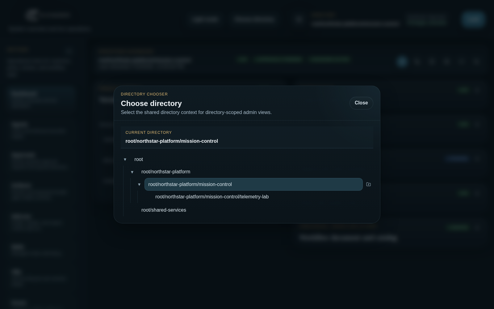

Use **Choose directory** in the header when you need to work in a specific tenant, product, team,
or environment scope.

1. Click **Choose directory**.
2. Expand the tree to find the desired path.
3. Select the directory.
4. If directory-scoped configuration is enabled and privileges are unlocked, use the plus button
   to create a child directory.
5. Empty non-root directories can be deleted with the delete button when privileges are unlocked.

Changing directory affects pages that filter or edit directory-owned state, including Agents,
Approvals, VMs, Issues, Sessions, Git Repositories, MCP Tools, Tool Calls, Connectors, Host
Directories, Privacy, Configuration, Users, Workflow, and dashboard panels.

### Unlock Privileged Operations

Use **Unlock** in the header before performing mutations. Locked mode is a safety
guard for read-only inspection, and sensitive API routes also check whether the current
authenticated Admin Web session is unlocked. Unlocking does not add permissions or replace
revision checks. Locking, signing out, cookie expiry, or restarting Admin Web clears the
temporary unlock state.

Privileged actions include:

- creating, stopping, destroying, or resuming agents and VMs
- approving or denying requests
- editing sessions and approval policy
- saving configuration and worker settings
- creating, editing, or deleting issues, users, directories, skills, and workflow graphs

Use **Lock** again when you are finished.

## Assistant

The Assistant launcher appears in the lower corner when the Admin assistant integration is
configured. Depending on backend configuration and startup state, the launcher can be hidden,
disabled, loading, minimized, expanded, or show an error.

Common tasks:

1. Click **Assistant** to expand the chat panel.
2. Check the mode badge before asking it to act. **Read only** can inspect; **Full access** can
   perform configured operations.
3. Type a message and click **Send**, or press Enter without Shift.
4. Use Shift+Enter for multiline messages.
5. Use **New chat** to start a fresh assistant thread.
6. Minimize the panel when you want it out of the way.
7. If the launcher is disabled or shows an error, check assistant configuration and
   `/api/chat/session` server logs before relying on it for operator work.

Admin assistant profiles include the read-only `list_documentation`, `search_documentation`, and
`read_documentation` MCP tools. They query the current host checkout instead of a copied guest
snapshot, so the assistant can consult current authoritative and focused references plus canonical
technical-manual chapters. Documentation answers describe supported behavior; questions about the
current runtime should still be checked against live status, configuration, workflows, or logs.

## Dashboard

The Dashboard is the default landing view after sign-in.


Use it to answer "what needs attention right now?" It combines live reads from the detail sections:

- deployment and admin state
- worker service status
- agent inventory
- workflow runs and graph activity
- approval queue health
- session counts
- tool-call audit status
- version, changelog, and news context
- workflow document and catalog availability

Common tasks:

1. Click **Refresh** for a fresh read. Dashboard refreshes bypass the short-lived dashboard cache.
2. Expand panels to see the live details behind each summary.
3. Download the changelog from the Version and changelog panel when you need the full release log.
4. Use **Newer** and **Older** in the News card to page through previous blog entries.
5. Use quick links such as **Open workflow**, **Open approvals**, **Open sessions**,
   **Open tool calls**, and **Open config** to move into the detail tabs.
6. If a panel is marked missing or unavailable, open the corresponding detail tab to inspect the
   exact backend error or empty state.

## Agents

The Agents tab manages active and historical execution targets across the selected directory.

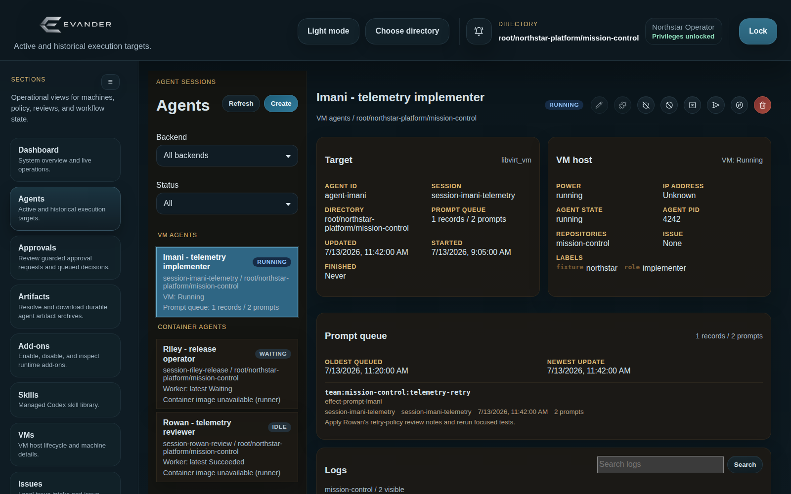

Use this page to inspect sessions, target names, policies, logs, and lifecycle controls for agent
execution targets.

Common tasks:

1. Select a directory in the shell.
2. Open **Agents**.
3. Use **Refresh** to reload current target state.
4. Scroll the left list independently from the detail workspace. Its compact rows show only the
   agent identifier and execution status; hover or focus a row for its session, directory, target,
   runtime-image, and prompt-queue summary.
5. Select an agent to inspect full details, logs, active steering dispatch, labels, policy,
   metadata, and attached session or VM context.
6. Unlock privileges before starting any mutation.
7. Use **Create** to create an agent session. Fill in directory, session ID, model, TTL, target
   details, allowed tools/scripts, communication targets, mailbox-account access, bootstrap
   options, optional HTTP targets, Host Directory grants, and optional Codex skills. Each HTTP target gives the session a
   named HTTP(S) base URL through the host relay; it does not enable general internet access or
   supply target credentials. Container-worker Codex agents can also choose **Metered API** or
   **ChatGPT subscription** as their usage source. A new subscription agent must also select one
   enabled worker profile.
8. Use the policy edit action to adjust an existing agent's host-side policy. HTTP targets and Host
   Directory capabilities can be added, changed, or removed here. You can also switch Codex usage
   between metered API and enabled subscription profiles without replacing the agent session.
9. Use the skill install action to copy managed Codex skills into an existing session.
10. Use the prompt action to queue a direct prompt for the selected agent. The dialog accepts a
   multiline prompt and an optional resume thread ID, prefilled from the session's latest known
   agent thread when available.
11. Use **Operator steering** to interrupt and steer a container worker session's active dispatch,
    or to queue a legacy relay-delivered note for non-container sessions.
12. For subscription work that is waiting, inspect its profile, queue reason, and retry time. An
    authorized root owner can cancel the indefinitely queued prompt from the agent detail.
13. Use lifecycle actions only after confirming the target and directory are correct.

The same independent sidebar scrolling applies to other list/detail pages, including
Subscriptions, Sessions, VMs, Issues, Approvals, Workers, Skills, Add-ons, Connectors, Host Directories, users and groups, MCP Tools,
Tool Visibility, and report navigation.

Notes:

- The provider field can be left blank to use the directory/default backend.
- ChatGPT subscription use applies only to container-worker Codex turns whose effective model
  provider is public OpenAI. Local OpenAI and Azure OpenAI turns keep their configured private
  API-key route while retaining the saved preference, and Claude agents do not inherit a Codex
  usage-source default. Unavailable public-OpenAI subscription work queues on its selected profile
  rather than falling back to metered API.
- Skill choices come from the managed Skills tab.
- The page's automatic list refresh uses a short-lived cached summary so it does not reconcile
  every container execution or probe VM agent state on each poll. Use **Refresh** when you need a
  live reconciled read before taking action.
- Container-worker logs default to **Executions**, which shows raw worker job logs by execution.
  Use **Threads** when you need the Codex conversation grouped by thread ID. The thread view is
  available only for container-worker sessions; VM-backed agents continue to show their normal
  agent output.
- The latest **Executions** window fills from preceding executions when a newer auxiliary run,
  such as an artifact import, is too short to fill the view. **Load older** continues backward
  across that combined execution history. Refresh and paging use bounded worker log-page reads;
  they do not eagerly transfer every historical execution log.
- Some actions are unavailable until privileged operations are unlocked.

## Subscriptions

The Subscriptions tab manages ChatGPT subscription profiles on the container worker selected by
the current directory's infrastructure configuration. Profiles are worker-owned: selecting a
different directory may point at another worker, but directories do not grant or hide profiles on
the same worker.

Common tasks:

1. Open **Subscriptions** and verify the displayed worker URL.
2. Unlock privileges as a user with `admin.owner` at `root`.
3. Create a profile using an immutable lowercase slug and an editable display name.
4. Start **Login**, open the device-login URL, enter the displayed code, and wait for completion.
   The first successful login pins the OpenAI account ID. Create another profile rather than
   logging the profile in as a different account.
5. Inspect sign-in state, account identity, plan, safe rate-limit buckets/reset timestamps, usage
   summary, active jobs, and queued prompts. No access or refresh token is shown.
6. Rename, enable, disable, log out, or refresh a profile as needed. Re-enable, successful login,
   and refresh wake durable queue reconciliation.
7. Use **Delete** and confirm to remove an unused profile and its saved worker login. Finish active
   jobs, drain or cancel queued prompts, and reassign or remove unexpired sessions first. The
   server checks session bindings across all directories on that worker. Recorded usage history
   remains available. Deleting a profile does not cancel the provider's paid subscription.

Signed-out, disabled, unavailable, and rate-limited subscription work remains queued without an
automatic expiry or metered API fallback. FIFO order is enforced within one profile while other
profiles can run concurrently. An existing `default` profile represents legacy profile-less
sessions and keeps the worker's existing login compatible. New workers do not create an empty
Default profile, and deleting it survives worker restarts. An existing singleton login is migrated
only when the profile registry is first created.

V1 accepts ChatGPT device login only. Business and Enterprise access tokens are not a profile
login option in this release.

## Approvals

The Approvals tab reviews queued human-approval requests.


Use it when a session or workflow attempts a tool/action that requires human approval.

Common tasks:

1. Open **Approvals** and confirm the directory scope.
2. Filter by status, session, VM, tool, minimum age, or direct-directory-only scope.
3. Select a request from the queue.
4. Review queue health, request summary, intended effect, digest, redacted payload, approval
   payload diagnostic, decision history, and matching audit context.
5. Unlock privileges.
6. Enter the approver identity and a reason.
7. Click **Approve** or **Deny**.
8. Re-open Tool Calls if you need to compare the request to the original audited tool invocation.

Approval requests are intentionally shown with redacted payloads. Do not assume redacted JSON is
the full original request body. When a later tool call reuses an approval but is blocked because the
approval is missing, denied, expired, stale, or payload-mismatched, the approval payload diagnostic
shows a redacted field-level changed/missing/extra summary. That summary is for diagnosis only; it
does not loosen exact-payload approval enforcement.

## Artifacts

The Artifacts tab resolves and downloads published agent artifact archives.

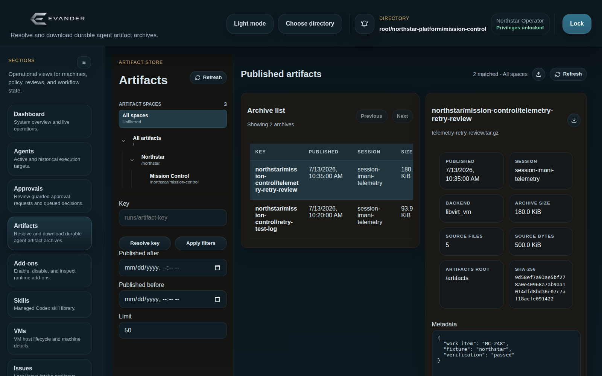

Use it when a workflow or agent has published `/artifacts` as an immutable archive, or when an
operator needs to upload a single local file into the same artifact store for a later workflow.

Common tasks:

1. Open **Artifacts**.
2. Filter by artifact key, published time range, or result limit.
3. Click **Apply filters** to list matching archives.
4. If you already know the key, enter it and click **Resolve key**.
5. Select an archive row to inspect session ID, backend, byte counts, source file counts,
   source artifacts root, SHA-256, and metadata.
6. Use the download button to download the selected archive.
7. To upload a local file, click the upload button, enter a new artifact key, select the file,
   and click **Upload**. The published archive uses the selected file's name.

Click the current selection under **Artifact spaces** to open the space tree in a larger dialog.
Choosing a space immediately filters the archive list to that space and its child spaces, then
closes the dialog. Choose **All spaces** to clear the space filter. The sidebar shows the selected
space; closing the dialog or pressing **Escape** leaves the filter unchanged.

Artifact keys are durable identifiers. Prefer resolving by key when a workflow, tool call, or run
detail links to an artifact directly.

The published archive list is not filtered by the directory selected in the shared header. Use
the archive's session, metadata, key, and publish time to establish provenance. Artifact-space
visibility is controlled by the artifact subject and its grants, which is a separate boundary from
the selected directory.

## Add-ons

The Add-ons page at `/#addons` is the host-global control surface for optional packages. Directory
selection does not create separate enablement state for an add-on.

Common tasks:

1. Open **Add-ons** and inspect discovered, enabled, loaded, pending-restart, and load-error state.
2. Select an add-on to review its manifest, registered Admin routes, workflow providers, MCP tools,
   runtime workflow pack, configuration mismatch, and required service restarts.
3. Unlock privileges and enable or disable the selected add-on. The save path updates the host and
   worker add-on settings together.
4. When an add-on registers a runtime workflow pack, let the save path materialize it through the
   revision-checked workflow service. Use **Refresh runtime pack** when the registered definition
   changes; do not edit the live pack file directly.
5. Restart every service listed by the page. Add-ons with MCP tools require
   `evander-gateway.service`; the normal complete set is Admin Web, trigger orchestrator, effect
   orchestrator, and gateway.
6. Refresh the page and confirm the add-on is loaded and no configuration mismatch remains.

Disabling an add-on prevents it from loading after restart but does not delete its private state.
Treat state removal as a separate, explicit host operation.

Bundled examples:

- **Team Add-on** registers the Teams UI, Team workflow providers, MCP tools, and a runtime workflow
  pack. Team agent cards and org-chart actions can open the linked core Sessions record directly;
  the link does not grant broader session access.
- **MSSQL Seeds** registers an Admin page for approved seed aliases and sidecar configuration. Its
  restore sidecar must also be enabled and reachable near the worker SQL Server; see
  `docs/addons.md` and `docs/operations.md`.
- **Bokio** and **Skatteverket** register their own operator pages and domain tools. Their static
  tool catalogs are merged into Sessions, MCP Tools, and workflow selectors, where the normal
  session and directory policies decide whether each call is autonomous, approval-gated, or denied.
- **Bokio** provides a prepared-action review queue with payload and history inspection,
  **Approve & execute**, rejection, definite-failure retry, and reconciliation-gated retry for
  uncertain outcomes. Mutations require an Admin owner and unlocked privileged operations.
- **Azure DevOps Activity** is headless. It appears on Add-ons with MCP/workflow capabilities but
  deliberately has no navigation tab; it complements rather than replaces `evander-ado-worker`.

## Skills

The Skills tab manages the host-side Codex skill library exposed to agent creation and install
flows.

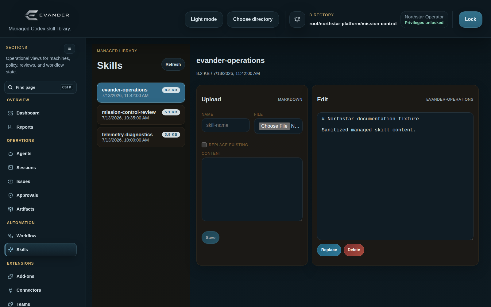

Common tasks:

1. Open **Skills**.
2. Select a skill from the left list to preview and edit its Markdown content.
3. Upload a new `.md` skill by entering a name, selecting a file, or pasting Markdown content.
4. Check **Replace existing** when intentionally overwriting an existing skill.
5. Click **Save** to upload.
6. Use **Replace** to update the selected skill content.
7. Use **Delete** to remove a selected skill.
8. Install managed skills into sessions from the Agents tab.

Skill names should be stable and descriptive because they are selected during agent creation and
skill installation.

Replacing a skill automatically reinstalls the saved content into every active VM and container
session that already declares that skill. The replacement remains saved if an agent cannot be
reached; Admin Web reports the failed sessions, and using **Replace** again safely retries their
reconciliation. An agent turn that is already running keeps its existing context until its next
turn.

## VMs

The VMs tab is visible when the selected execution backend is `libvirt_vm`.

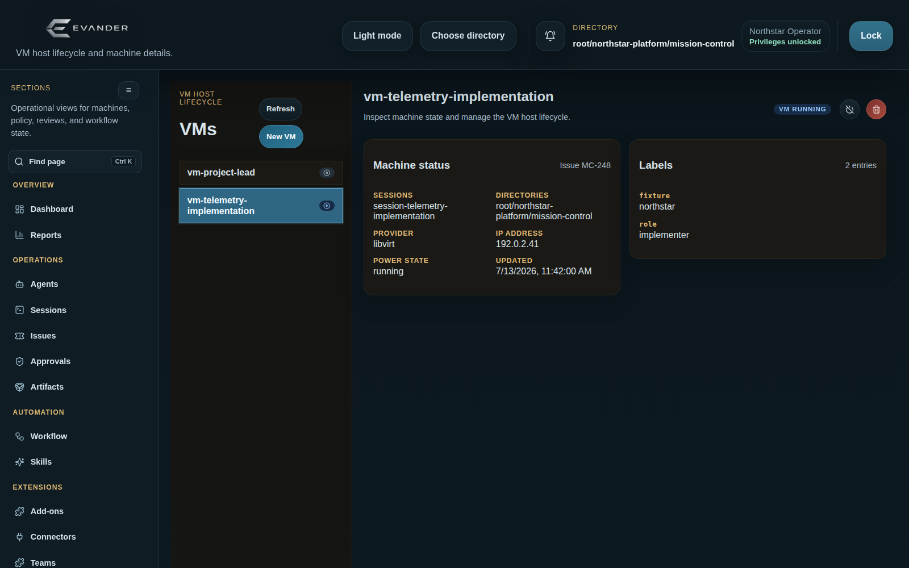

Use it to inspect and operate host-managed libvirt VMs.

Common tasks:

1. Open **VMs**.
2. Select a VM from the left list.
3. Inspect machine status: sessions, directories, provider, IP address, power state, timestamps,
   labels, and recent actions.
4. Unlock privileges before changing VM state.
5. Use start, shutdown, and destroy actions from the toolbar.
6. Use **New VM** to create a standalone VM. Provide a VM name, optional session ID, model, and
   bootstrap options such as .NET, NuGet, Playwright, and MSSQL.

Destroying a VM removes associated host-side state. Confirm the VM name and directory before using
the destructive action.

## Issues

The Issues tab manages local issue records and issue-VM startup.

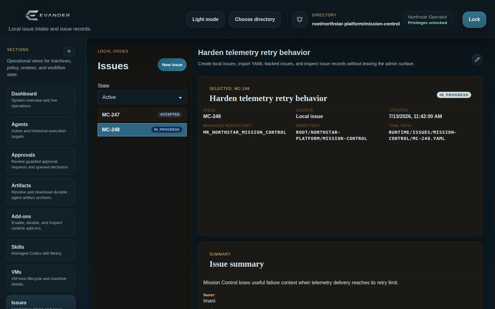

Common tasks:

1. Open **Issues**.
2. Filter by state: **Active**, **All**, or a specific issue state.
3. Select an issue to inspect title, source, updated time, repo source, directory, YAML path, body,
   and metadata.
4. Unlock privileges to create, edit, delete, or launch work from issues.
5. Click **New issue** to create a local issue from the form or import an existing YAML file.
6. Fill in title, repo source, body, and optional immediate VM startup settings.
7. Save the issue.
8. For an existing issue, use the VM action to create a VM with the requested bootstrap options.
9. Use edit and delete only for issue records that the UI marks as editable/deletable.

Issue VM creation uses the selected issue and the current directory context unless the form
provides a more specific value.

## Git Repositories

The **Git Repositories** page manages the registry of host-owned managed repositories independently
of agent-session existence.

Common tasks:

1. Open **Git Repositories** or use the `/#git-repositories` deep link.
2. Choose the directory that should own or reveal the repository. Search by display name, managed
   repository ID, canonical URL, provider, branch, or directory; optionally include descendants.
3. Unlock privileges, enter the canonical source URL or SSH source, optionally set a default branch,
   and select **Register repository**. Leave upstream refresh enabled unless the source is
   intentionally unavailable during registration.
4. Select a repository to inspect its stable ID, directory scope, canonical upstream, default
   branch, host identity, timestamps, and active bindings.
5. Use **Refresh upstream** to fetch current refs and **Run maintenance** for repository cleanup.
6. Use **Save identity** only to change future host-created commit metadata; it does not rewrite
   history or change agent checkout identities.
7. Delete only an unbound repository. The backend refuses deletion while active bindings remain.

The page never asks for or exposes upstream credentials: those remain control-plane-owned.

## Sessions

The Sessions tab manages agent session records, tool access, approval policy, and scheduled wakes.


Common tasks:

1. Open **Sessions**.
2. Search by session, VM, issue, or model.
3. Switch between active and expired session lists.
4. Select a session to inspect VM, issue, directory, model, creation time, expiry time, tools, and
   wake schedules.
5. Unlock privileges before editing.
6. Use the extend action to renew expiry.
7. Use revoke to deny further guest access before expiry.
8. Use delete only when you intend to remove saved local session state. Deletion also revokes the
   session's managed-Git bindings and removes its legacy PR-routing entries plus the matching
   feedback cursors/items, so a later session cannot inherit historical PR state by reusing the
   same ID.
9. Edit the model field when a session needs a different model for future resume/prompt work.
10. Toggle allowed tools and **Require approval** for tools that should queue human decisions.
    Tools are grouped by domain; Team Add-on tools are distinct from Microsoft Teams application
    tools even though both names contain “Team”.
11. Use the settings button next to **Require approval** to set approval TTL, use count, and payload
    matching for that session.
12. Edit **Communication targets** (`communication_target_ids`) for Teams/Discord destinations and
    outbound email recipients. This control does not grant access to an email mailbox account.
13. Edit **Email mailbox access** (`email_mailbox_grants`) separately, choosing a configured mailbox,
    folders, and `read`, `draft`, or `send` capability. Sending requires both a send-capable mailbox grant and a
    write-capable email target bound to that mailbox; drafting needs the mailbox grant but no send
    target.
14. For a legacy session whose canonical grants are still null, review its inherited/raw
    allowlists and use **Convert to managed grants** deliberately. Missing or null canonical fields
    preserve legacy behavior; an explicit empty list means no access.
15. Configure **HTTP targets** as alias/base-URL pairs when the agent needs REST or browser access
    to an external application. The UI shows the relay URL template, preserves workflow-owned
    target metadata, and converts legacy App environment targets when edited. Removing every row
    stores an explicit empty target set.
16. Configure communication-file receive/send permissions, max bytes, MIME types, extensions, and
    metadata.
17. Edit connector grants as a connector-to-operation map. A grant exposes only the named
    operations; it does not expose connector endpoints or authentication material.
18. Edit **Host Directory access** with the structured resource/capability selector. Select only
    `list`, `import`, or `delete` where needed. Selecting a capability enables its dedicated MCP
    tool, while the absolute host root remains hidden from the session.
19. For a persistent `container_worker_vm` agent that needs a different per-job CPU, memory, or
    process/thread allowance, add `container_worker_resource_limits` under **Metadata** and enter
    a nested JSON object such as `{"cpus": 8, "pids_limit": 8192}`. Supported keys are `memory`,
    `cpus`, and `pids_limit`. Include `pids_limit` when setting another limit for a Playwright
    session, because a non-empty ordinary-session override replaces its automatic
    `pids_limit: 1024` allowance. This setting applies to newly dispatched jobs and does not resize
    a running container. Team release-verifier limits use the separate project
    `release_policy.resource_limits` editor.
20. Save settings.
21. Create, update, enable/disable, or delete wake schedules for recurring cron or one-time resume
    prompts.
22. Review recent scheduled wake ledger entries for the selected session, filter by delivery
    status, and retry failed or missed/late wakes without reading host logs.

Changing allowed tools can also remove approval requirements for tools that are no longer allowed.
Review both tool access and approval policy before saving.

## MCP Tools

The MCP Tools tab manages directory-scoped tool rules and approval defaults.

Common tasks:

1. Open **MCP Tools** and choose the directory.
2. Unlock privileges before editing.
3. Select a tool.
4. Set a local rule to disallow the tool, always require approval, define default TTL/use/payload
   settings, or set hard TTL/use/payload limits.
5. Save policy.

Inherited disallow rules remain effective in child directories. A child directory or session cannot
re-enable a tool that an ancestor directory has denied.

The Documentation group contains `list_documentation`, `search_documentation`, and
`read_documentation`. They are ordinary session-grantable tools: Admin assistant profiles receive
them by default, while other agents need an explicit session grant or eligible workflow lease.
Their catalog is read-only and excludes historical design records, generated publication
duplicates, managed upstream content, dependencies, and arbitrary repository files.

## Connectors

The Connectors tab manages named host-side REST and filesystem integrations for the selected
directory. Agents see only connector names, descriptions, granted operations, and operation input
schemas; endpoints and authentication details remain on the host.

Common tasks:

1. Open **Connectors** and choose the directory.
2. Select a connector to inspect its effective operations, driver, availability, and authentication
   readiness without revealing secret values.
3. Unlock privileges and use **Test health** to invoke a configured unapproved read operation.
4. Edit the local `connectors.json` overlay in the JSON editor. Root should contain a complete
   definition; child directories may override only the fields that differ from their parent.
5. Save with the displayed revision. If another operator changed the overlay, reload and reapply
   the intended edit instead of overwriting it.
6. Grant operations to agents from the agent create form or the selected session's connector-grant
   map. Also allow `list_connectors` and `call_connector` for sessions that need connector access.
7. Review connector calls in **Tool Calls**, where the connector and operation are indexed beside
   the generic MCP tool name.

Connector health checks and agent invocations use the same validation, host authentication,
response limits, and audit path. Health checks cannot select arbitrary methods, paths, headers, or
credentials.

## Host Directories

The Host Directories page manages dedicated, directory-scoped filesystem resources. This is the
supported surface when agents need relative tree navigation, bounded file/folder import, or
recoverable deletion inside one approved host directory. It does not create a mailbox, connector,
guest mount, or arbitrary host file browser.

Common tasks:

1. Choose the owning Evander directory and open **Host Directories**.
2. Select an inherited resource or enter a lowercase resource ID and add a new one.
3. Unlock privileged operations, then set its display name, description, absolute host root,
   agent capabilities, import/watch limits, delete-approval behavior, and enabled state.
4. Save the revision-checked local overlay. If the revision is stale, refresh and reapply the
   intended fields.
5. Run **Check health**. Missing roots, symlink roots, unsafe filesystem boundaries, and an
   unwritable delete quarantine fail closed; health details remain operator-only. A delete-enabled
   check creates and immediately removes a private quarantine probe.
6. Grant the resource's capabilities from Agent creation, Agent policy, or Sessions policy.
   Granting capabilities to an existing libvirt session also enables the matching dedicated Host
   Directory tools while preserving its other allowed tools.
7. Review **Quarantine recovery** after agent deletes. Restore only when the original relative
   destination is absent.
8. Use **Purge permanently** only after confirming the recovery ID and path. V1 never purges
   quarantine on a timer.

An incomplete recovery record is shown explicitly. Missing-payload or corrupt-metadata records
cannot be restored, but the owning directory operator can purge their retained control record.

Agents receive resource IDs, relative paths, metadata, and opaque revisions. They never receive the
absolute root. `delete` requires an exact listed revision and, by default, a one-use exact-payload
approval; deleting a non-empty directory also requires the explicit recursive flag.

Workflow authors can select `trigger:host-directory:file-added`. It baselines existing files,
waits for new regular files to settle, supports relative subpaths and include/exclude globs, and
runs in the existing trigger orchestrator. Directories and file updates do not fire it.

## Tool Calls

The Tool Calls tab is the audit view for MCP/tool invocations.

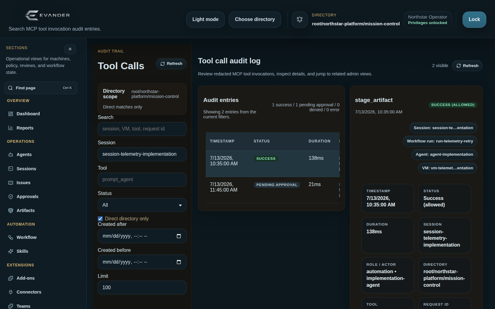

Use it to investigate what happened, who or what triggered it, and how it relates to sessions,
approvals, workflows, agents, and VMs.

Common tasks:

1. Open **Tool Calls**.
2. Filter by free-text search, session, tool, status, direct-directory-only scope, created-after,
   created-before, and limit.
3. Select a row from the audit table.
4. Inspect timestamp, status, duration, session, actor, directory, tool, request ID, correlation ID,
   approval request ID, workflow run, agent/VM fields, redacted arguments, redacted result, and
   normalized metadata.
5. Use relation buttons to jump to related Sessions, Approvals, Workflow runs, Agents, VMs,
   Reports, Configuration, Users, or Workers sections when the audit record carries those links.

The audit view is read-only. Use it as the evidence trail for operator decisions and incident
review.

The unfiltered recent view refreshes automatically. Free-text input is debounced, and filtered
full-history results remain stable until a filter changes or you select **Refresh**, avoiding
repeated expensive reads while an operator is still typing. Free-text searches of three or more
characters use the audit database's trigram index when ready; shorter searches and indexes still
being migrated retain the compatible scan fallback.

The canonical evidence is the configured JSONL audit log; the SQLite database is a query
index. Index failures are logged and ordinary Tool Calls reads fall back to the source log.
If that log cannot be read, the API returns HTTP 503 with **Tool-call audit log is unavailable**.
Treat this as missing access to evidence, not an empty history. Check Admin Web logs, the
configured audit path, file permissions, and storage availability before retrying. Preserve
the source log when repairing or rebuilding its index.

## Privacy

The Privacy tab is the scoped operator surface for privacy policy, coverage, retention previews,
holds, data-subject cases and jobs, review exports, incidents, and external follow-ups. It reports
unsupported sources and incomplete coverage explicitly; it is not a compliance certification or
proof that every provider and backup has been erased.

Choose the affected directory before opening the page. Privacy access always requires an
authenticated operator and the corresponding `privacy.*` permission; root administration is
reserved for the installation owner. Unlock privileged operations before any mutation. Review the
current revision and exact record list before approving retention work or releasing an export,
because stale revisions and changed source records fail closed. See `docs/privacy-operations.md`
for the operational boundaries, review sequence, and recovery guidance.

Use **Inspect evidence** on a case, incident, external follow-up or hold to reopen its saved
references and selected records. **Inspect stored evidence** also accepts a known record ID.
Case, incident and follow-up detail requires `privacy.cases`; hold detail requires `privacy.approve`
in the selected scope. Reading remains available while privileged mutations are locked.

## Configuration

The Configuration tab edits directory-scoped policy and runtime-global admin settings.

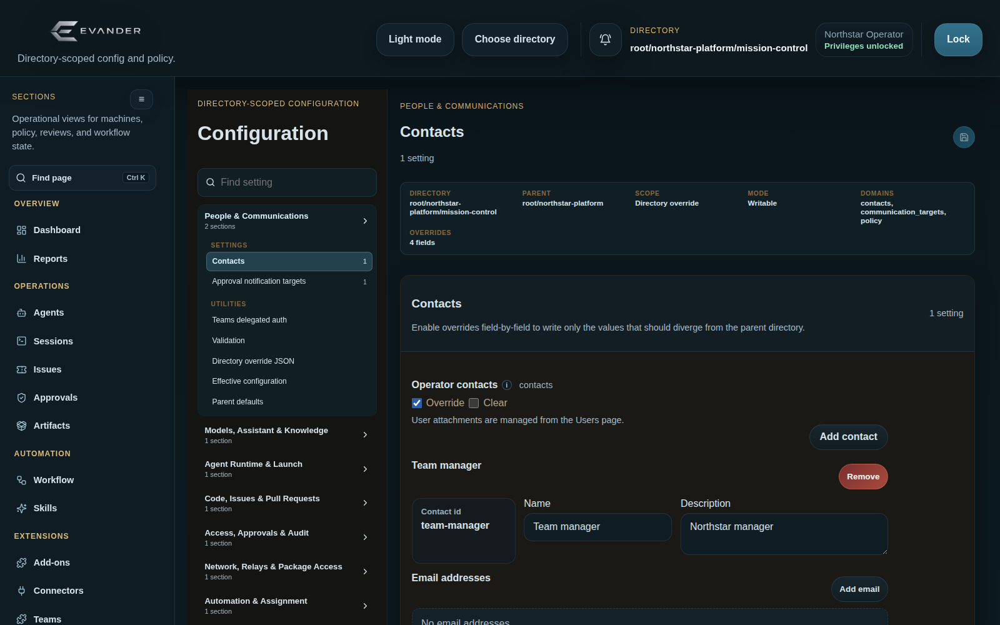

Common tasks:

1. Choose the directory in the shell.
2. Open **Configuration**.
3. Select a compact configuration area, then choose one of its visible **Settings** or
   **Utilities** destinations. Only the selected destination is shown in the workspace.
4. Use **Find setting** to search friendly labels, descriptions, section names, config domains, or
   exact field keys. Selecting a field result opens, focuses, and briefly highlights that setting.
5. Review the directory, scope, and write mode in the context summary. Expand **Directory details**
   to inspect the parent, underlying domains, and override count.
6. Unlock privileges before saving.
7. Edit fields in the selected section. Moving between sections or areas preserves drafts and marks
   every affected area as unsaved.
8. Use field tooltips to confirm each setting's meaning and source domain.
9. Click the save icon in the toolbar to save the selected area's complete draft.
10. Open **Validation**, **Directory override JSON**, **Effective configuration**, or **Parent
    defaults** from Utilities when you need resolution and diagnostic detail.
11. If the save fails because the config changed on the server, reload and reapply the intended
   changes.

**Communication targets**, **Contacts**, and **Email mailboxes** use compact lists. Search matches
names, addresses, and relevant record details; targets and mailboxes also offer a provider filter.
Choose name order, provider order (where available), or configured order with **Sort**. These controls
only change the view and never reorder the saved configuration. Expand a row to inspect or edit it;
collapsing it preserves its draft. A successful save reloads the list and closes editors; a failed
save keeps the open editor and draft. Adding a record clears filters and opens the new editor. Inherited
targets have their own searchable list with **Override** and **Disable** actions. The optional Teams
channel lookup is collapsed until needed. Searching and inspecting remain available in read-only mode.

Configuration destinations are linkable through the page URL. Links may identify an area,
section, and field so another operator can open the same setting directly; invalid or outdated
destinations fall back to the first available section.

Configuration links use these hash-query parameters:

| Parameter | Value |
|---|---|
| `config_tab` | Configuration area key from `tabs[].key` in `/api/configuration/state`. |
| `config_section` | Section key from `tabs[].sections[].key`, or the selected utility key. |
| `config_field` | Optional exact `field_name` within the selected section. |

For example,
`#configuration?config_tab=agent_runtime_launch&config_section=container-worker-settings&config_field=container_worker_job_timeout_seconds`
opens the Container worker settings section and focuses the job-timeout field. Preserve these
parameters when sharing a destination; the directory remains controlled by the Admin Web shell's
directory selector and access rules.

Specialized configuration areas:

- **People & Communications**: maintain contacts, communication targets, approval notification
  targets, Discord, Teams, email, phone-call, and communication-file settings together. The email
  mailbox editor uses structured rows for provider, mailbox identity, host-only secret environment
  references, folder mapping, and default folders. Microsoft Graph supports either a legacy static
  access-token reference or tenant/client/client-secret references for automatic host-side token
  acquisition; secret values never belong in the form.
- **Models, Assistant & Knowledge**: edit model routing, Assistant behavior, model pricing,
  semantic-store, and embedding settings.
- **Agent Runtime & Launch**: control execution backend, container worker, prompt delivery,
  and launch defaults.
- **Code, Issues & Pull Requests**: configure Azure DevOps, GitHub, ADO worker filters, Git
  transport, PR feedback approval, and PR templates.
- **Access, Approvals & Audit**: keep approval-required tools, core approval timing, MCP tool
  policies, tool argument guardrails, audit redaction, and managed credentials together. The
  Credentials utility manages opaque Teams and connector credential references without returning
  secret values to the browser. Email policy controls use configured mailbox selectors and folder
  rows rather than raw JSON; outbound email targets select their sending mailbox independently from
  session mailbox-account access.
- **Network, Relays & Package Access**: configure VM provider defaults, libvirt templates, VM
  network, gateway, relay endpoints, NuGet, and npm audit facade settings.
- **Workflow Events**: manage event schemas, manual forms, and workflow validation contracts.
- **Advanced & Raw**: inspect advanced provider state and support diagnostics.
- **Directory override JSON**: copy the unified explicit overrides for review, diffing, or support.
- **Effective config** and **Parent defaults**: compare the live inherited result to the parent
  baseline before saving a local override.

Avoid editing live pack or config files from stale local copies while other operators may be using
Admin Web. The UI save path uses revision checks to prevent silent stale overwrites.

## Reports

The Reports tab contains workflow activity, workflow failure clusters, and conformance snapshots.

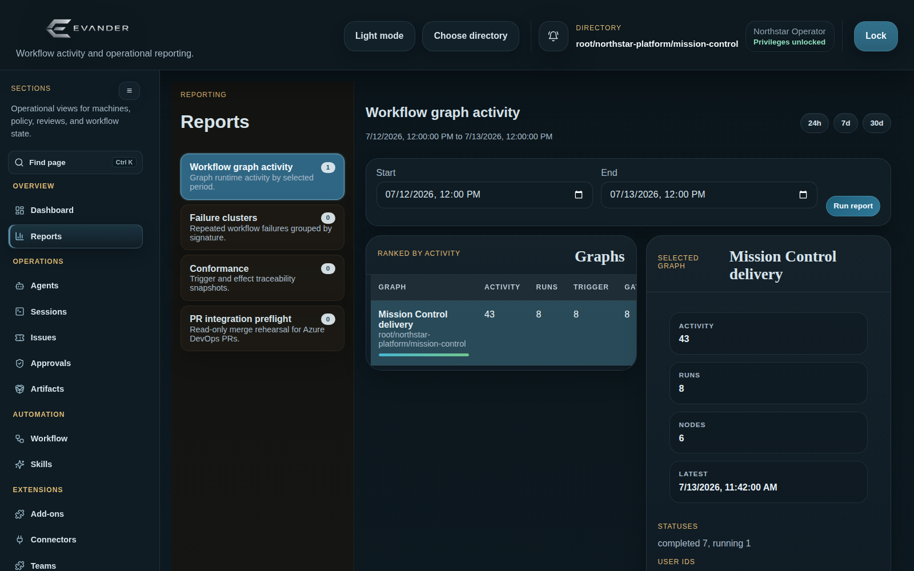

Workflow graph activity:

1. Open **Reports**.
2. Select **Workflow graph activity**.
3. Use 24h, 7d, or 30d presets, or enter a custom start/end range.
4. Click **Run report**.
5. Select a graph to inspect activity count, run count, node count, latest activity, status counts,
   user IDs, and active node breakdown.

PR integration preflight:

1. Open **Reports**.
2. Select **PR integration preflight**.
3. Enter the Azure DevOps repo, mode, PR ids, and directory path. Pairwise mode checks every
   unordered PR pair in the submitted set.
4. Select or enter the directory-visible `managed_repo_id` to use for the temporary simulation.
5. Click **Run report**.
6. Review `status`, `summary_text`, participants, checks, warnings, and errors.

Status meanings:

- `clean`: the merge simulation was clean.
- `conflict`: one or more checks found content conflicts.
- `missing_ref`: a PR source or target commit/ref could not be resolved locally.
- `stale_target_branch`: the branch moved after Azure DevOps recorded the target commit.
- `repo_error`: the selected managed repository could not be refreshed or queried.
- `provider_error`: Azure DevOps metadata lookup failed.

The preflight is read-only and does not resolve conflicts or change PR completion policy.

Workflow failure clusters:

1. Select **Workflow failure clusters**.
2. Use 24h, 7d, or 30d presets, or enter a custom start/end range.
3. Click **Run report**.
4. Review grouped failures by graph, node, and normalized error signature. The signature removes
   volatile IDs and timestamps, and the active/recent/resolved label is a heuristic signal rather
   than proof of root cause.
5. Open a representative workflow run detail before deciding on remediation.

Conformance:

1. Select **Conformance**.
2. Choose the trigger or effect report.
3. Review state, generated time, status, requirement counts, missing coverage, traceability task
   count, failing requirements, remediation snippets, and guidance.
4. Click **Run report** to regenerate the selected conformance snapshot from the UI.

The conformance report artifacts are also documented in `conformance-reports.md`.

Reports does not currently expose a standalone usage or cost report. Model usage queries and
add-on-specific cost surfaces, such as the Team cost guard, use the local model-pricing catalog;
those estimates are operational context rather than invoice data.

## Users & Groups

The Users & Groups tab manages Admin Web user records, local-password credentials, reusable
permission groups, directory-scoped group assignments, and direct workflow grants. The page has separate
**Users** and **Groups** modes. Open `/#users` for Users mode or `/#users/groups` to link directly
to Groups mode.

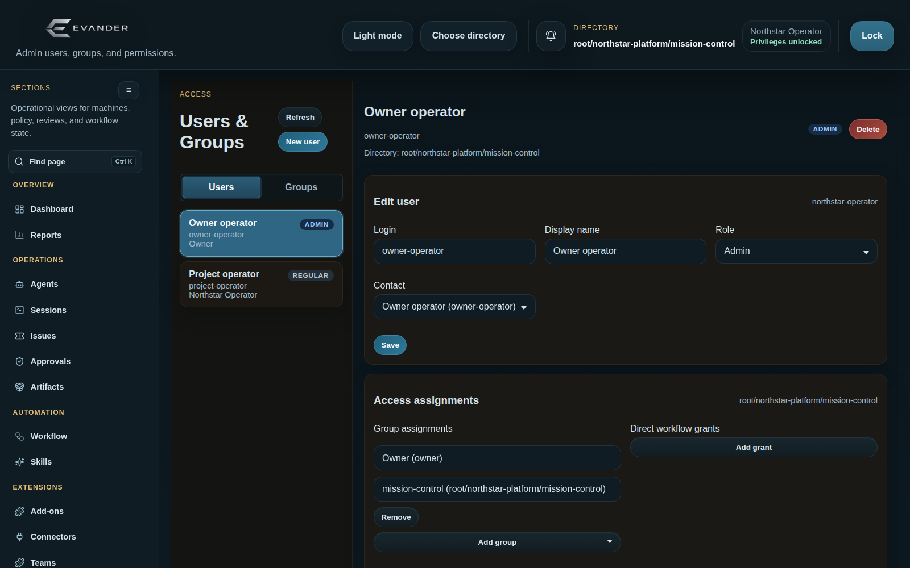

Common user tasks:

1. Sign in as a user with `users.manage`.
2. Open **Users & Groups**.
3. Select **Users**.
4. Click **New user**.
5. Enter the user's login/email-style identifier.
6. Optionally set a display name.
7. Set a password when local password authentication is enabled.
8. Choose the legacy compatibility role.
9. Optionally attach a directory-scoped contact.
10. Add directory-scoped group assignments or direct workflow read/write grants.
11. Click **Save**.
12. Select an existing user to edit display name, role, password, contact, assignments, or grants.
13. Use **Delete** to remove the global user record and invalidate local Admin Web access on the
    next authenticated request. Deletion is not limited to the selected directory.

Common group tasks:

1. Sign in as a user with `groups.manage`.
2. Open **Users & Groups**.
3. Select **Groups**, or open `/#users/groups` directly.
4. Click **New group**.
5. Enter the group ID, name, and optional description.
6. Select the permissions the group should grant.
7. Click **Save group**.
8. Select an existing custom group to edit or delete it.

Users with `groups.manage` can edit reusable permission groups. Users with `users.manage` can edit
user records, group assignments, and direct workflow grants. Other users can sign in and use
surfaces allowed by their effective permissions. Group directory scopes inherit downward, and direct
workflow write grants imply read. The `team_chats.read_all` permission allows read-only inspection
of other operators' Team Add-on Chat histories; normal Team Chat use remains scoped to the signed-in
operator.

## Workers

The Workers tab manages host background worker services and worker-global settings.

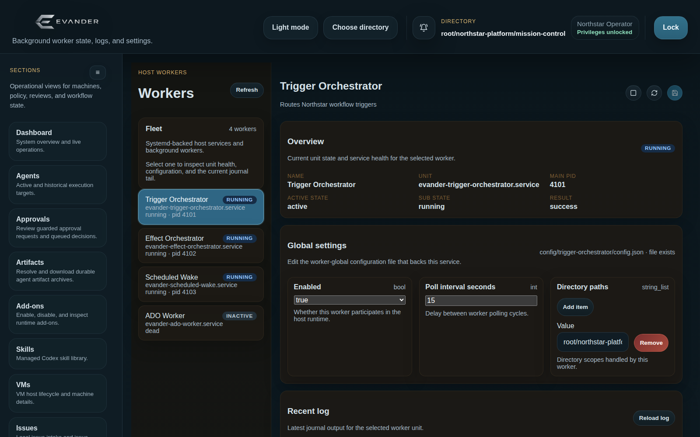

Common tasks:

1. Open **Workers**.
2. Use **Find worker** to search names, IDs, units, states, descriptions, or diagnostic detail, and
   use **Status** to isolate running, stopped, or failed services.
3. Browse the compact, independently scrollable worker list. Each row shows only the worker name
   and service status; hover or focus it for unit, state, result, unit-file, PID, and detail.
4. Select a worker service from the left list.
5. Inspect active state, sub-state, result, unit name, unit-file state, main PID, diagnostic detail,
   global settings, and recent
   journal tail.
6. Unlock privileges before starting, stopping, or saving worker settings.
7. Use the start/stop toolbar action to change service state.
8. Edit fields in **Global settings** when the worker exposes an editable schema.
9. Click the save icon to write worker-global settings back to the host config file.
10. Use **Reload log** to refresh the current journal tail.

If a worker configuration save reports a revision conflict, reload the worker settings first. The
draft remains visible so you can reapply intentional changes after reviewing the newer server copy.

## Workflow

For guided setup, open **Workflow starters** or **Start a workflow** on the dashboard.
Choose a scheduled agent task or, with its add-on enabled, a Teams direct-message assistant.
Check prerequisites, preview the generated workflow, activate it, and verify its first run.
The resulting pack is editable here. See [Workflow starters](workflow-starters.md) for
setup, permissions, and the distinction between queued work and verified completion.

The Workflow tab is the graph editor and runtime inspector.


Use it to maintain workflow packs, inspect current and historical runs, and diagnose node-level
runtime behavior.

Common editing tasks:

1. Choose the directory in the shell.
2. Open **Workflow**.
3. Unlock privileges before editing.
4. Use the **Graphs** panel to select a graph and edit graph name, description, directory paths, and
   user IDs.
5. Use the **Create** panel to add trigger, gate, query, or effect nodes. Click a node type or drag
   it onto the canvas.
6. Connect nodes on the canvas. Named output ports are offered where a source node has multiple
   routes.
7. Select a node to open the Inspector.
8. Review the selected node's **Outputs** section to see declared or derived binding paths, schema
   types, and copyable binding expressions for downstream fields.
9. Edit node ID, display name, and type-specific fields. Trigger nodes also expose an enabled
   toggle; disabled triggers are ghosted on the graph and do not poll for new events. Fields can
   support literal values, bindings, templates, directory selectors, structured lists/maps, JSON,
   and catalog-backed options. Agent/VM creation tool argument policies use a structured
   rule-and-constraint editor for common policies, with raw JSON still available for advanced
   policy maps.
   Literal session and VM target fields offer compact suggestions from the selected directory,
   including expired sessions labeled `(expired)`. Suggestions do not replace free-form IDs,
   templates, or upstream-output bindings, and the available half of the catalog remains usable if
   the session or VM inventory cannot be loaded.
10. Review diagnostics on dirty or invalid nodes.
11. Use **Reset changes** for a selected dirty node when you want to return it to the saved
    version.
12. Use **Save workflow** to persist the workflow document after all diagnostics are acceptable.

For a **Teams direct message** trigger, choose **Chat setup → Direct chats by UPN**
and enter one Microsoft Entra UPN or mail address per line in **Direct chat users**.
Saving resolves the users and ensures their one-to-one chats through the directory's
Teams connection, then stores the canonical chat and sender IDs. Validation previews
do not create chats. Use **Existing chat IDs** for explicit `chat:<chat-id>` targets
and allowed sender references; existing triggers without a setup mode retain this form.
The save still requires current workflow revision and lock checks. An unresolved user
or unavailable Teams connection must be corrected before the workflow can be saved.

For pack-backed workflows, the Workflow tab shows a **History** section for the selected pack. Each
entry records the operation, actor, timestamp, before/after revisions, changed files, and changed
JSON paths. The history is generated for Admin Web/API pack edits and saves; direct filesystem edits
cannot be attributed to an operator.

The experimental **Generate workflow** control opens a separate blank draft canvas. If the current
editor has unsaved changes, opening the generator asks for confirmation and discards those edits.
Enter a natural-language description, then choose **Generate draft** to request a preview from the
host-side OpenAI Responses API integration; the draft is not saved and cannot run. **Cancel**
returns to the regular saved workflow view. **Accept draft** imports the generated graph into the
normal editor as unsaved changes, where graph directory metadata and node fields can be reviewed
before **Save workflow**.

Common runtime inspection tasks:

1. Use **Tutorials** to open the walkthrough chooser. **First steps** teaches the workflow canvas
   basics in an isolated local tutorial graph; **Skip** marks the tutorial complete for the chooser
   attention state without launching it, and **Restart** can run it again later.
2. Use **Current runs** to inspect active workflow events and node activity.
3. Enter an event ID, trace ID, session ID, or artifact ID when you need an exact run.
4. Use **Inspect** to enter inspect mode for the selected run.
5. In inspect mode, select nodes on the run graph to see node status, duration, started/finished
   times, errors, binding errors, links, resolved inputs, outputs, input payload, inputs by source,
   binding trace, and raw records.
6. Use **Latest runs** search to find recent runs by graph or node scope, including runs without
   session links and completed runs when those toggles are enabled.
7. Select a workflow node and expand **Execution history** in its inspector to query individual
   executions. The default window is the previous seven days. Filters use exact, case-sensitive
   RFC 6901 JSON Pointer paths over input or output objects; combine up to eight equality,
   presence, or numeric comparisons. The end timestamp is exclusive. Results identify whether
   the full record is still available or only the compact record remains, and show compact
   retention and existing-record backfill status. Use **Inspect run** to open the surrounding run.
   Arrays remain visible in execution detail but cannot be filtered by element in this version.
8. Use resume, clear/delete, or failure-dismiss controls only when you understand the runtime
   effect and have privileges unlocked.
9. Exit inspect mode to return to graph editing.

Workflow edits are staged in the browser until **Save workflow** succeeds. Leaving the workflow
view or changing directory while there are unsaved workflow changes prompts for confirmation.

## End-To-End Common Tasks

### Investigate a Failed Automation

1. Open **Dashboard** and expand **Automation activity** and **Tool-call audit trail**.
2. Click **Open workflow** if the dashboard points to a run or graph problem.
3. Inspect the current or latest run in **Workflow**.
4. Select failing nodes and review errors, binding trace, input payload, and outputs.
5. Open **Tool Calls** and filter by session, tool, request ID, correlation ID, or workflow run ID.
6. Follow relation buttons into Approvals, Sessions, Agents, or VMs as needed.
7. Use **Reports** to check whether the issue is isolated to one graph or visible across the
   selected period.

### Create Work From A Local Issue

1. Choose the target directory.
2. Unlock privileges.
3. Open **Issues**.
4. Click **New issue**.
5. Create the issue manually or import YAML.
6. Fill in repo source and issue body.
7. Enable immediate VM startup if desired and select bootstrap options.
8. Save the issue.
9. If you did not start a VM during creation, select the issue and use the VM action later.
10. Watch **VMs**, **Agents**, **Sessions**, and **Tool Calls** for follow-up state.

### Require Approval For A Tool

1. Choose the directory.
2. Unlock privileges.
3. Open **Sessions**.
4. Select the session.
5. In **Model and access**, enable the target tool if it is not already allowed.
6. Check **Require approval** for the same tool.
7. Use the settings button if the approval should allow more than one use, a shorter TTL, or payload
   variance.
8. Save settings.
9. When the session uses that tool, review the queued request in **Approvals**.

### Review And Decide An Approval

1. Open **Approvals**.
2. Filter to pending requests and the relevant session/tool.
3. Select the request.
4. Compare summary, intended effect, payload digest, redacted payload, approval payload diagnostic,
   and audit context.
5. Unlock privileges.
6. Enter approver and reason.
7. Approve or deny.
8. Confirm the final decision is visible in Decision history and in **Tool Calls**.

### Update Directory Configuration Safely

1. Choose the directory.
2. Open **Configuration**.
3. Select the domain.
4. Review effective config, parent defaults, and existing override JSON.
5. Unlock privileges.
6. Change only the fields needed.
7. Save the tab.
8. If the UI reports that configuration changed before save, reload and compare the newer state
   before retrying.

### Start Or Stop A Worker

1. Unlock privileges.
2. Open **Workers**.
3. Select the worker.
4. Review overview and recent log.
5. Use start or stop.
6. Refresh and verify active state, sub-state, result, and journal output.

### Add A Managed Skill And Use It In A Session

1. Open **Skills**.
2. Upload or paste the Markdown skill and save it.
3. Open **Agents**.
4. Select an existing agent session or create a new one.
5. Choose the skill in the create form or install-skills modal.
6. Confirm the action log and session state.

### Download Published Artifacts

1. Open **Artifacts**.
2. Resolve the known artifact key or filter the archive list by time range.
3. Select the archive.
4. Confirm session, backend, file count, byte count, and SHA-256.
5. Download the archive.

## Troubleshooting

- If Admin Web does not load, request `http://127.0.0.1:8100/healthz`. If it is unavailable, inspect
  `evander-admin-web.service`, its journal, and `config/admin-web.env` before changing UI state.
- If a page appears empty, confirm the selected directory. Many lists are scoped.
- If an add-on is missing, open `/#addons`, check enabled/loaded/error/restart state, and restart
  every service listed there. Do not look for a tab when the add-on is intentionally headless.
- If mutation buttons are disabled, unlock privileged operations.
- If VMs are absent from navigation, the current execution backend is not `libvirt_vm`.
- If a save reports stale configuration, reload before retrying.
- If workflow edits are not visible to another operator, confirm **Save workflow** succeeded and
  that both operators are viewing the same directory.
- If the dashboard feels stale, use **Refresh**. Detail tabs always use their normal live reads.
- If screenshots or labels differ from this manual, prefer the running UI and current codebase as
  authoritative; this manual should be updated with the UI change.

## Tool Visibility

Use **Tool Visibility** to inspect the effective per-directory visibility of built-in, MCP, and
add-on tools. Confirm this view before changing allow/deny or approval policy so you can separate
a hidden tool from a visible tool whose invocation is denied.
