# Evander Technical Manual

## Core Platform and Team Add-on

<div class="manual-edition">

**Edition 1.0** · Evander 0.3.1 · verified against `418936fa752c` · 2026-07-29

Current implementation is normative. Chapters explicitly labelled as design history are non-normative and describe how the present system evolved.

</div>

This manual explains the complete core Evander control plane and the Team Add-on from first principles through architecture, operation, failure recovery, and engineering extension. Readers can follow it front to back or use the glossary and subject index as a technical reference.

## Contents

- [Part I: Orientation](#part-i-orientation)
  - [1. How to Read This Manual](#1-how-to-read-this-manual)
  - [2. One Work Item, End to End](#2-one-work-item-end-to-end)
  - [3. Trust Model and Security Boundaries](#3-trust-model-and-security-boundaries)
- [Part II: Core Evander Architecture](#part-ii-core-evander-architecture)
  - [4. System Topology, Services, and Ports](#4-system-topology-services-and-ports)
  - [5. Runtime Assembly, Configuration, and Directories](#5-runtime-assembly-configuration-and-directories)
  - [6. Identity, Sessions, RBAC, and Policy](#6-identity-sessions-rbac-and-policy)
  - [7. MCP, Approvals, and Audit](#7-mcp-approvals-and-audit)
  - [8. Workflow Runtime and Orchestration](#8-workflow-runtime-and-orchestration)
  - [9. Execution Backends](#9-execution-backends)
  - [10. Networking, Relays, Packages, and Secrets](#10-networking-relays-packages-and-secrets)
  - [11. Managed Git, Artifacts, and Code Consultations](#11-managed-git-artifacts-and-code-consultations)
  - [12. Issues and Provider Integrations](#12-issues-and-provider-integrations)
  - [13. Communications, Meetings, Calls, and Wakes](#13-communications-meetings-calls-and-wakes)
  - [14. Semantic Memory, Model Usage, Skills, and Add-ons](#14-semantic-memory-model-usage-skills-and-add-ons)
  - [15. Admin Operations, Observability, Backup, and Recovery](#15-admin-operations-observability-backup-and-recovery)
- [Part III: Team Add-on](#part-iii-team-add-on)
  - [16. Team Add-on Boundary and Domain Model](#16-team-add-on-boundary-and-domain-model)
  - [17. Enabling and Operating the Team Add-on](#17-enabling-and-operating-the-team-add-on)
  - [18. Organization, Projects, Tasks, and Cases](#18-organization-projects-tasks-and-cases)
  - [19. Commands, Identity, Revisions, and the Durable Outbox](#19-commands-identity-revisions-and-the-durable-outbox)
  - [20. Wakes, Leases, Context Rotation, and Stand-down](#20-wakes-leases-context-rotation-and-stand-down)
  - [21. Chat, Agent Mail, Voice, and Escalation](#21-chat-agent-mail-voice-and-escalation)
  - [22. Deliverables, Reviews, and Decision Cascades](#22-deliverables-reviews-and-decision-cascades)
  - [23. Ephemeral Delegation](#23-ephemeral-delegation)
  - [24. Team Git Promotion and Release Gates](#24-team-git-promotion-and-release-gates)
  - [25. Governance, Memory, Cost, and Internals](#25-governance-memory-cost-and-internals)
- [Part IV: Engineering and Evolution](#part-iv-engineering-and-evolution)
  - [26. Engineering and Extension Guide](#26-engineering-and-extension-guide)
  - [27. Design History and Compatibility Boundaries](#27-design-history-and-compatibility-boundaries)
- [Part V: Reference](#part-v-reference)
  - [28. System Reference](#28-system-reference)
  - [29. Troubleshooting Decision Tables](#29-troubleshooting-decision-tables)
  - [30. Glossary](#30-glossary)
  - [31. Subject Index](#31-subject-index)

<div class="page-break"></div>

# Part I: Orientation

Build a trustworthy mental model before introducing implementation detail.

# 1. How to Read This Manual

> **At a glance.** You do not have to read this manual at one speed or from cover to cover. If Evander is new to you, begin with the story and the security ideas; if you are solving a particular problem, jump directly to the relevant explanation or runbook. One fictional organization appears throughout so that unfamiliar machinery can be learned through people and work rather than as a list of disconnected features.

## The two useful speeds

Evander is easier to understand when it is read at two speeds.

At overview speed, keep four ideas in mind:

1. The host is the control plane. It owns policy, credentials, workflow state, managed Git, and durable evidence.
2. An agent works in an isolated execution environment. It receives a bounded session, not the host's ambient authority.
3. Narrow relays and the MCP gateway mediate useful access. Network reachability alone never grants a capability.
4. Workflows connect durable events to gates, queries, and effects. The Team Add-on builds organization and governance behavior on those same core primitives.

At reference speed, use the mechanics, invariants, failure tables, commands, and source trails in each chapter. A claim such as “a directory policy is inherited” is only the overview. The reference account also says which values merge, which replace, which restrictions cannot be relaxed by a child, where the files live, and what happens when validation fails.

The opening **At a glance** passage and the first section of every chapter are written for overview speed. They introduce the problem and the mental model in ordinary language; they are not compressed substitutes for the technical chapter. The remainder is designed to survive close technical use.

Indented boxes labelled **Deeper detail**, **Technical sidebar**, **For administrators**, or **Administrator runbook** let a chapter explain an important mechanism without interrupting its main story. Skip them on a first read. Return when you need the implementation detail, exact record, or host-level procedure.

## Choose a reading path

The chapters are ordered so that later mechanisms have a foundation, but not every reader needs the same first pass.

| If you are… | Read first | Then use |
|---|---|---|
| New to Evander | Chapters 2–5 | The execution, Git, relay, and operations chapters |
| Operating a host | Chapters 4–8 | The Admin Web, observability, backup, and troubleshooting chapters |
| Designing workflows | Chapters 2, 5, and 8 | The workflow authoring, provider, and run-inspection chapters |
| Reviewing security | Chapters 3, 6, and 7 | Execution-backend, managed-Git, relay, secret, and audit details |
| Building with the Team Add-on | Chapters 2 and 8 | The Team concepts, task, wake, review, governance, and release chapters |
| Debugging a live incident | The symptom's chapter runbook | Its failure table and source trail, then the observability chapter |

For a broad understanding, read the story in Chapter 2 before studying individual services. It gives names to the records that will recur later: directory, session, workflow run, event, approval, execution, Git commit, and audit entry.

## The continuous Northstar example

The manual follows a synthetic team named `northstar-platform` and its `mission-control` project. A work item asks the team to add telemetry retry behavior. In Chapters 1–15, agents are described by what they do: the implementation agent makes the change, the review agent examines it, and the release agent handles publication. The Team Add-on chapters introduce a small named cast only when persistent identities and organizational relationships become useful. Human actions are attributed generically to **an operator** or, for interactive chat and voice, **a signed-in user**.

Core chapters use this example without assuming the Team Add-on is installed. For example, “the implementation session” means an ordinary core session associated with the work. Team chapters then explain how the add-on records named identities and roles, assigns tasks, schedules wakeups, governs review, and coordinates release work.

Unless a passage explicitly says otherwise, Northstar names and payloads are illustrative. They are not default accounts, reserved identifiers, a shipped workflow, or a promise that every installation has Azure DevOps, Teams, or a container worker configured. The example's directory path is:

```text
root/northstar-platform/mission-control
```

The path matters because configuration, RBAC scope, provider selection, sessions, workflows, and Team records all use directory context to prevent one project from silently inheriting another project's authority.

## How to read the illustrations

Architecture and sequence figures deliberately omit incidental implementation detail so the ownership or transition remains legible; the surrounding text states the full contract. UI screenshots come from the checked-in production front end running against a fixed, sanitized Northstar fixture—not from a live operator runtime. They use dark mode, frozen timestamps, fictional identities, and non-secret data. Treat visible counts, IDs, build labels, and states as explanatory examples, then inspect the equivalent live API/store when operating a deployment.

## How statements are qualified

The manual uses a small set of deliberate terms:

- **Must** describes an enforced invariant or a required operator step. The text should name the enforcement point.
- **Should** describes the supported and safest operating practice, even when the code cannot enforce every part of it.
- **May** describes an optional capability, often dependent on directory configuration or an installed add-on.
- **Default** means the value in the current source or example configuration. It is not proof that a live deployment still uses that value.
- **Representative flow** means a technically supported composition, not a workflow installed automatically.

Paths are relative to the repository unless they begin with `/`. Commands assume the repository root and an installed `evander` package; development commands may use `./.venv/bin/evander-cli` where that distinction matters. Runtime examples use `runtime`, while packaged defaults may resolve to `/var/lib/evander`. Always follow the `--runtime-dir` selected by the running service.

Checked-in files ending in `.example`, `.example.json`, or `.env.example` are templates. They are not live secrets or proof of live settings. In particular, checked-in workflow packs can be examples or built-ins, while an operator's active pack can be ignored by Git and managed through Admin Web.

## Reading a mechanism from intent to evidence

Most technical sections follow the same chain:

| Question | Where the answer appears |
|---|---|
| What problem does this solve? | Mental model or opening explanation |
| What record carries the decision? | Mechanics and data-flow sections |
| What cannot be bypassed? | Invariants |
| What happens after a crash or bad input? | Failure behavior |
| How do I inspect or recover it? | Practical runbook |
| Where is the behavior enforced? | Source trail |

That chain prevents a common documentation error: describing the happy-path user interface while omitting the durable state and rejection behavior underneath it. If Admin Web says an approval is pending, for example, the reference question is not merely which button to press. It is also which session and exact payload the request binds, when it expires, how use is consumed, and what the audit record contains.

## Correctness and the live source of truth

This manual describes the repository revision that contains it. For a live host, use the deployed checkout, runtime database or JSON store, effective directory configuration, service environment, logs, and process state as the final source of truth. A local example file cannot overrule a live revision; a stale browser screen cannot overrule a durable execution record.

When a broad statement and a detailed statement appear to conflict, prefer the narrower one with an enforcement point. When the manual and current behavior appear to conflict:

1. Confirm that the command, service, and browser are pointed at the same runtime directory.
2. Inspect effective configuration, not only the root or child overlay.
3. Check the deployed code revision and active service unit.
4. Reproduce with the focused test named in the source trail.
5. Treat the mismatch as either a software defect or a documentation defect; do not invent an undocumented exception.

## Failure behavior of the documentation model

| Misreading | Consequence | Correction |
|---|---|---|
| Treating an example as active configuration | An operator diagnoses the wrong provider, port, or workflow. | Read effective live configuration and service environment. |
| Treating a visible tool as permission to use any payload | A call is denied by argument policy or approval binding. | Follow the complete policy order in Chapters 6 and 7. |
| Treating a queued event as a completed effect | Work appears “lost” although it is waiting, running, or completion-pending. | Trace the event and execution records in Chapter 8. |
| Treating an add-on concept as a core primitive | Team task state is confused with a core workflow event or session. | Follow the ownership boundary stated in the Team chapters. |
| Editing a live workflow pack as a plain file | Concurrent edits are overwritten or a stale revision is installed. | Use Admin Web's revision and lock behavior. |
| Looking only at a branch name | The reviewed or released commit is misidentified. | Follow the pinned-SHA and lease rules in the Git and release chapters. |

## Practical runbook

When arriving at an unfamiliar Evander host, establish context before making changes:

```bash
evander-cli status --runtime-dir runtime --json
evander-cli directories list --runtime-dir runtime
evander-cli list-sessions --runtime-dir runtime --all
git rev-parse --show-toplevel
git rev-parse HEAD
git status --short
```

Then choose the record closest to the symptom:

- An agent cannot see or call a tool: start with the session, effective policy, MCP binding, and audit trail.
- A workflow did not advance: start with its trigger event, graph revision, queue record, and node execution.
- A VM or worker job did not start: start with the session's selected backend and backend execution record.
- A Git result is missing: start with the managed repository ID, session authorization, pushed SHA, and promotion lease.
- A Team task did not wake: start with Team state and its outbox/wake evidence, then cross into the core workflow run.

Non-mutating observation is the safest first move, but commands that assemble the runtime—including `evander-cli status` and some directory commands—can bootstrap or migrate missing runtime configuration. Run them as the intended operator against the intended runtime, and back up an unfamiliar runtime first. JSON and SQLite files are durable implementation surfaces, not general edit APIs. Use the CLI or Admin Web mutation path so validation, locking, revision checks, audit, and related state transitions remain intact.

## Source trail

- `README.md` and `AGENTS.md` — repository purpose, current surfaces, supported operating flows, and maintenance conventions.
- `docs/architecture.md`, `docs/operations.md`, and `docs/configuration-reference.md` — core architecture, operator procedures, and configuration fields.
- `src/evander/admin/composition.py` and `src/evander/runtime.py` — current runtime assembly and shared services.
- `src/evander/models.py` — canonical session, approval, event, and other durable record models.
- `tests/test_documentation_integrity.py` and `tests/test_evander_user_manual.py` — documentation link and publication checks.


# 2. One Work Item, End to End

> **At a glance.** Imagine a piece of work passing through a well-run workshop. Evander notices the work, decides which prepared process applies, gives an agent a temporary workspace and only the permissions needed for that job, pauses when a person must approve something sensitive, and records exactly what was reviewed and released.
>
> This chapter follows one work item through that journey. You do not need to understand every service or record on the first read. The important idea is that each handoff is saved, limited, and traceable, so a stopped process can be resumed and a finished one can be explained.

## A representative mission

Northstar's `mission-control` project receives a work item: **add retry behavior to telemetry delivery**. An operator has prepared the route that this kind of work should follow. An implementation agent will make the change, a review agent will examine it, and a release agent will handle publication. The Team Add-on can coordinate those roles, but the journey in this chapter uses Evander's core safety and execution machinery.

That prepared route is called a **workflow**. A **provider** is the connector that lets Evander observe or act in another system, such as Azure DevOps. A workflow **pack** is a saved collection of workflow definitions, and the visual arrangement of steps and connections is often called a **graph**. These terms become precise later; for now, think *connector, reusable process, and process map*.

Evander does not ship one universal process for every organization. An operator chooses the connectors and workflow that match the local tools, review rules, and release practices. The Northstar story is therefore a realistic example, not a hidden default.

The simplest mental model is a relay race. Each stage hands the next stage a durable identifier—a saved reference to what happened—instead of a vague assertion that work happened:

```text
work item -> saved event -> workflow run -> agent session
          -> temporary workspace -> work and approvals
          -> exact code version -> review -> release -> cleanup
```

Those identifiers are what make the run recoverable and explainable.


Put simply, Evander is the guarded coordinator; the agent is a temporary worker with limited access. The arrows show approved routes through the coordinator, not general access from the worker to the host or internet.

<p class="figure-caption">Figure 2.1 — The end-to-end path crosses explicit host boundaries; no arrow represents general guest access.</p>

## Before the work arrives: agree on the boundary

Before the first run, an administrator connects the source repository and any external work system, chooses the project settings, prepares the workflow, and decides which tools may require human approval. An ordinary operator does not need to memorize that wiring to follow a run; they need to know which project is selected and which prepared process is expected to handle the item.

The setup answers three plain questions before any temporary workspace is created:

1. **Whose work is this?** The selected directory identifies the organization and project.
2. **Which rules apply?** The directory determines the effective provider, workflow, security, and execution settings.
3. **What may the agent do?** The future session receives only the tools, code access, contacts, and limits chosen for this job.

> <span class="sidebar-kicker">For administrators</span> **What was prepared in advance**
>
> The repository was registered with Evander and assigned a `managed_repo_id`. Provider, policy, execution-backend, and automation settings were configured at `root` or along `root/northstar-platform/mission-control`. A workflow graph was selected for that directory. External credentials stayed in host secret storage, and the session's tools, argument constraints, communication targets, and approval behavior were chosen before dispatch.

## Stage 1: a new item becomes a saved event

Suppose the Azure DevOps connector notices the telemetry-retry work item. Evander first turns that observation into an **event**: a saved statement that something happened and may need a response. Saving the event separates the work from the connector that noticed it. If that connector restarts a moment later, the work does not disappear with it.

Evander saves the event before telling Azure DevOps that it has been received. If a crash happens at an awkward moment, the connector may offer the same item again. Stable identifiers make that redelivery **idempotent**[^idempotency]: Evander continues from the existing record instead of quietly losing the item or beginning unrelated duplicate work.

Once the event is safely stored, Evander wakes the part of the system that advances workflows.

> <span class="sidebar-kicker">Deeper detail</span> **Durable publication and redelivery**
>
> The trigger orchestrator polls enabled trigger definitions, resolves directory-scoped provider settings, and asks each provider for candidate events. A provider supplies a stable event identity, source identity and type, and payload; it may also supply an idempotency key. The queue deduplicates the event ID and, when present, the idempotency key. Only after durable publication does the worker call the provider's acknowledgement hook and advance its cursor.
>
> The event and execution store is SQLite at `runtime/orchestration.db`. This storage choice matters to administrators and recovery tooling, but it does not change the operator-level promise: acknowledgement follows durable publication.

## Stage 2: the workflow decides what should happen

The workflow is the prepared checklist and route for this kind of event. In Northstar's case it might ask:

1. Is this item for the `mission-control` project and in a state we handle?
2. Have we already started this exact request?
3. Is there a suitable active agent session?
4. If not, should Evander create one?

Evander calls these kinds of steps **gates**, **queries**, and **effects**. A gate makes a decision about the route, like a checkpoint. A query looks something up without changing it. An effect changes the world, such as creating a session or posting a message. The everyday example above is the concept; the technical names are useful when reading or editing the visual workflow.

Evander checks a workflow before making it active. If a later edit is invalid, the running services keep the last known good version and report the failed update. A bad edit therefore does not silently replace a working process.

> <span class="sidebar-kicker">Deeper detail</span> **What “compiled workflow” means**
>
> A workflow graph is compiled into validated nodes and edges. A realistic path may use `gate:filter`, `gate:dedupe`, `query:session:list`, and `effect:agent:create`. Queries return data to later nodes; gates can branch, delay, iterate, merge, serialize, or reject flow; effects perform state changes. References such as `${{node.output}}` are checked against upstream outputs rather than executed as arbitrary host code.
>
> Compilation rejects missing endpoints, duplicate node IDs, invalid provider settings, unsafe cycles, and broken bindings. A failed hot reload leaves the previous compiled graph in service.

## Stage 3: give the agent a temporary, limited job

When the workflow decides that implementation should begin, Evander creates a **session**. The session is both a job identity and a temporary permission card. It says which project the job belongs to, when the permission expires, which tools and resources the agent may use, and how later records should be connected back to this work item.

The session does not contain the host's general credentials. Those stay with Evander. Knowing an old session ID is also not enough to keep working after it expires.

Evander then starts a **sandbox**[^sandbox]: a temporary, isolated work environment. Depending on the installation, this may be a disposable virtual machine or a disposable container running on a dedicated worker machine. To an operator, both mean the same thing at this point in the story: the implementation agent gets a bounded place to work, while the host keeps control of policy and secrets. Chapter 9 explains the infrastructure differences.

> <span class="sidebar-kicker">Technical sidebar</span> **What the session manifest records**
>
> The manifest contains a unique session ID and expiry; the directory `root/northstar-platform/mission-control`; the selected model and VM or worker binding where applicable; visible and approval-required MCP tools; allowlists for contacts, scripts, channels, mailboxes, files, and search; argument and quota rules; and metadata linking the session to the workflow run, source item, agent role, and intended Git operation.
>
> With `libvirt_vm`, the environment is normally a disposable VM overlay. With `container_worker_vm`, the control plane asks an authenticated worker daemon to prepare session directories and run disposable Docker jobs.

## Stage 4: give the agent controlled access to the code

Evander gives the implementation agent access through a registered repository rather than exposing an arbitrary folder on the host. The agent clones the code into its own workspace and, if explicitly allowed, pushes changes only through a restricted Git route and an agent-specific branch area.

The key safety idea is simple: Evander records exactly which version was produced, reviewed, and released. Git calls that unique version identifier a **commit SHA** (usually shortened here to **SHA**). A branch name is a movable label; a SHA identifies one exact snapshot of the code.

This distinction prevents a subtle but serious mistake: approving one version and later publishing a different version merely because the same branch name moved.

> <span class="sidebar-kicker">Deeper detail</span> **The managed-Git handoff**
>
> The workflow passes a `managed_repo_id`, not a trusted host checkout path, to the clone effect. The managed-Git service resolves the host-owned bare repository and provisions scoped SSH access. The supported sequence separates the agent's work branch, the exact SHA produced by that session, the workflow decision that pins and promotes that SHA, and the later push or pull-request effect protected by an explicit lease. Source code moves with Git, not inside MCP messages.

## Stage 5: let the agent use only the services it needs

Inside the sandbox, the implementation agent sees familiar development tools. What is different is the route outward. Evander provides a few controlled doors for model requests, approved tools, packages, code, and explicitly allowed test systems. General internet access is not the default, and the host's model or provider credentials are not copied into the workspace.

Every tool request is checked against this job's permissions. A reachable service does not automatically give the agent permission to use every tool, contact, repository, or destination behind it.

> <span class="sidebar-kicker">Technical sidebar</span> **The controlled doors**
>
> Model requests use the OpenAI-compatible host relay. MCP tool calls use the gateway at `/mcp`. Package traffic may use the NuGet relay, npm-audit facade, PyPI/npm cache, or apt cache. Restricted Git uses SSH. An allowlisted external environment uses the session-scoped HTTP target relay.
>
> The HTTP relay constrains the destination but does not inject a host credential; it forwards authentication supplied by the guest. For MCP, a proof token binds the transport to the session, `tools/list` is filtered, and each invocation is checked against directory policy, session grants, argument rules, approval state, and any workflow lease.

## Stage 6: pause safely for human approval

Suppose the implementation agent requests a sensitive tool action. Evander does not perform it immediately. It creates a pending approval that tells an authorized operator which job is asking, which tool it wants to use, what the action is expected to do, when the request expires, and a safe-to-display summary of the requested input.

If the operator approves, the agent retries that same action using the approval request ID. Approval applies to the bounded request; it is not a general promotion to greater power. The session must still be active, the tool must still be allowed, and the input must still satisfy policy.

> <span class="sidebar-kicker">Deeper detail</span> **Why the agent retries the exact request**
>
> The durable request stores a digest of the original payload, a redacted review payload, a human summary, session and directory identity, tool and intended effect, expiry, and grant settings. Under the default exact-payload mode, changing the payload, session, or tool invalidates the approval. Expired, denied, or exhausted grants are rejected, and use consumption is atomic.
>
> Approval requirements are configurable, but the built-in destructive tools `delete_ado_backlog_item` and `semantic_delete_points` always require one-use, exact-payload approval. Chapter 7 is the full protocol reference.

## Stage 7: complete, review, and publish the exact result

When the implementation agent finishes, Evander records the result and advances the prepared process. It can collect artifacts, update the work item, wait for the Git push, open a pull request, and route feedback back to the same job.

The review agent examines the exact commit identified by the workflow—not merely whatever happens to be at the tip of a branch later. If changes are requested, Evander can start a bounded follow-up while keeping the earlier attempt visible. Once review and release checks pass, the release path receives that approved SHA and the limited authority needed to publish it.

The Team Add-on adds the organizational story around these core controls: a team manager, a project lead, a task owner, an assigned reviewer, a release authority, Agent Mail, wake scheduling, and governance. It coordinates *who should do what*; core Evander still owns the session, workflow, policy, execution, approval, and controlled Git paths.

> <span class="sidebar-kicker">Technical sidebar</span> **How completion re-enters the workflow**
>
> A completed prompt publishes structured output as another event. Later nodes can inspect session context, copy artifacts, update issue state, wait for Git evidence, enqueue a follow-up prompt, pin and promote the pushed SHA, create a pull request, or route review feedback. These transitions remain journalled under the same trace and workflow revision.

## Stage 8: keep the evidence and remove the sandbox

After the work finishes, Evander can remove the sandbox without erasing the job's **provenance**[^provenance]. The host retains the session, workflow decisions, approvals, tool-call history, exact code version, review result, release evidence, and cleanup outcome according to its retention policy.

Removing compute and removing evidence are different actions. If cleanup fails, the failure remains visible until an operator or automated recovery process cleans up the leaked resource through a follow-up action.

> <span class="sidebar-kicker">Technical sidebar</span> **The retained records**
>
> Workflow node executions retain event, trace, node, type, status, configuration hash and revision, inputs, outputs, errors, and binding trace. MCP calls produce append-only JSONL audit events with a queryable SQLite index. Approval decisions and uses remain linked by request ID. Session and backend records retain the selected execution target and cleanup result.

## What should always be true

The full system is easier to trust when its promises are stated plainly:

- Evander decides which project and rules apply before it creates the job.
- It saves observed work before telling the external system that the work was received.
- A session ID, a network connection, a visible tool, and an approval are separate checks; none grants all the others.
- The agent receives controlled routes to useful services, not the host's general network access or credentials.
- Repeated delivery or a restarted worker should converge on the existing saved work rather than quietly lose it.
- The exact code version—not a movable branch label—is the evidence used for review and release.
- The sandbox may disappear; enough host-side evidence remains to explain what happened.

## Troubleshooting

Start with what an operator can observe, then ask an administrator for the deeper store or service evidence only when needed.

| What you see | First place to look | What it usually means |
|---|---|---|
| The work item never appears | Provider status and trigger history | The external connection, filter, project settings, or polling may be wrong. |
| The item appears but does not advance | Workflow run and event history | No route matched, a checkpoint rejected it, or a workflow step failed. |
| The agent never starts | Session and execution details | Capacity, the selected environment, or its configuration failed. |
| The code cannot be cloned | Repository and session authorization details | The repository, session scope, key, or allowed branch is wrong. |
| An expected tool is missing | Session permission explanation | The tool was not granted, was denied by project policy, or lacks required context. |
| A tool reports that approval is required | Approvals and tool-call audit | This is a controlled pause, not a gateway outage. |
| The agent finished but nothing follows | Workflow run after the completion step | Completion may still be publishing, or the process has no next route. |
| Review appears to target the wrong code | Reviewed SHA and promotion/release record | A movable branch label may have been used instead of the pinned version. |
| The sandbox remains | Session cleanup status | Cleanup is incomplete; preserve the evidence and follow the supported recovery path. |

> <span class="sidebar-kicker">For administrators</span> **Authoritative evidence behind the table**
>
> The corresponding implementation records are the provider cursor and trigger logs; orchestration queue and node-execution journal; backend effect execution; managed-repository registry and Git authorization log; session manifest and visibility explanation; approval store and append-only tool audit; completion event; pinned-SHA promotion record; and backend cleanup record.

## A practical operator handoff

In Admin Web, select the affected directory first. Capture the source work-item ID, workflow run or trace ID, session ID, any approval request ID, and the exact commit SHA if code was produced. Those few identifiers usually let an administrator or support engineer trace the same run across the detailed records.

Do not delete queue, journal, approval, or session files to “unstick” a run. First establish whether it is waiting, running, waiting for completion, failed, skipped, exhausted, expired, or already completed. Use the supported Admin Web or CLI action after that diagnosis.

> <span class="sidebar-kicker">Administrator runbook</span> **Host-level checks**
>
> Start with broad status and then follow identifiers rather than timestamps alone:
>
> ```bash
> evander-cli status --runtime-dir runtime --json
> evander-cli list-sessions --runtime-dir runtime --all
> evander-cli list-approvals --runtime-dir runtime
> systemctl status evander-trigger-orchestrator.service
> systemctl status evander-effect-orchestrator.service
> ```
>
> For a deep support handoff, add the directory path, configuration revision, backend execution or VM ID, managed repository ID, cleanup result, and any relevant node-execution IDs. Run bootstrap-aware commands against the intended runtime and back up an unfamiliar runtime first.

[^idempotency]: Idempotency means that repeating the same operation has the same intended effect as performing it once. Here, redelivery returns to the saved event and run instead of starting unrelated work.

[^sandbox]: In this manual, a sandbox is the bounded execution environment used for one session—a disposable VM or a container on a worker VM—not an unrestricted host workspace.

[^provenance]: Provenance is evidence of a result's origin and history: the event, session, code version, decisions, and actions that produced it.

## Source trail

- `src/evander/daemons/trigger_orchestrator.py` — trigger polling, durable publication, acknowledgement, cursors, and worker wakeup.
- `src/evander/daemons/effect_orchestrator.py` — graph routing, idempotent execution, completion events, journals, and recovery behavior.
- `src/evander/models.py`, `src/evander/policy.py`, and `src/evander/gateway/` — session capability, policy evaluation, MCP binding, approval, and audit mechanics.
- `src/evander/effects/providers/agent_create.py`, `agent_clone_repo.py`, `agent_prompt.py`, and `git_promote_agent_branch.py` — representative agent and Git lifecycle effects.
- `src/evander/admin/services/managed_git_service.py` and `docs/git-remotes.md` — managed repository, restricted SSH, pinning, promotion, and publication contracts.
- `config/workflow-packs/agent-container-worker.v1-example.json` — a non-default example composition containing the node families used in this story.
- `tests/test_trigger_orchestrator.py`, `tests/test_effect_orchestrator.py`, `tests/test_gateway.py`, and `tests/test_managed_git_workflow_contract.py` — focused end-to-end invariants.


# 3. Trust Model and Security Boundaries

> **At a glance.** An agent may need to write code, call tools, and reach outside services, but it should not inherit all the power of the computer running Evander. Three promises define the boundary: host credentials stay on the host, the agent receives controlled routes rather than open internet access, and every action remains limited by the current job's permissions. Evander checks those promises at several points so that one mistaken or compromised component does not automatically unlock everything else.

## Three promises to keep in mind

The full security design becomes easier to follow when it is reduced to three promises.

1. **The agent cannot freely use host credentials.** When the agent harness[^agent-harness] sends a prompt to the configured AI model, the request goes through Evander. The real provider key stays on the host; the temporary workspace does not receive a copy.
2. **The agent cannot freely reach the internet.** If it needs a package or an approved test system, Evander provides a specific route. That route does not become permission to browse or contact arbitrary destinations.
3. **The agent cannot exceed this job's permissions.** A telemetry-retry job may inspect one work item, use selected tools, and work in one registered repository. It does not thereby gain access to every project, recipient, script, or administrative control.

Everything else in this chapter explains how Evander keeps one or more of those promises. On a first read, the promises and examples are enough. The sidebars give the exact enforcement details needed for security review, administration, and incident response.

## What Evander protects—and from whom

Evander separates people, control, temporary work, and outside systems. Each area is trusted for a different purpose:

| Area | What belongs there | What crossing the boundary requires |
|---|---|---|
| Operator access | A person's sign-in, role, approvals, and privileged Admin Web state | A human permission must never be silently reused as an agent permission. |
| Evander host | Real provider credentials, policy, sessions, workflow state, managed Git, and audit evidence | Input from an agent, model, webhook, or provider must be checked before it changes trusted state. |
| Temporary workspace | The job's source checkout, tools, and limited session configuration | Access to host files, outside services, or another project must be explicitly provided. |
| Worker machine | The container runtime and session workspaces for jobs assigned to that worker | A worker may run accepted jobs; it does not choose unrelated control-plane authority. |
| Outside services | Models, Git hosts, work trackers, communication systems, package sources, and approved HTTP targets | Requests pass through the relevant credentialed provider or restricted relay. Merely claiming to be an agent is not enough. |


<p class="figure-caption">Figure 3.1 — Authority stays in its zone and crosses only through authenticated, scoped surfaces.</p>

The figure's practical message is simple: the temporary worker reaches useful capabilities through Evander; it does not inherit the host or operator's general authority.

> <span class="sidebar-kicker">Technical sidebar</span> **Execution boundaries are not interchangeable**
>
> The default execution boundary is a disposable `libvirt_vm`. The additive `container_worker_vm` backend runs disposable Docker containers inside a dedicated worker VM; that VM remains the stronger outer boundary. Containers and VMs do not have identical isolation properties, so Chapter 9 defines their lifecycle and sandbox contracts separately. Human access is independently controlled by authentication, role-based access control (RBAC), directory scope, and the transient privileged-operation lock.

## Permission is a series of checks

A request is allowed only when every applicable check succeeds. No single switch grants general access:

```text
right project rules
  AND active job
  AND verified connection
  AND allowed tool and input
  AND allowed destination
  AND approval when required
= request may run
```

Read the chain from top to bottom: every line must be true, and passing one line does not replace any of the others.

For example:

- A session may reach the tool gateway, but it still cannot use an email tool that was not granted.
- The email tool may be visible, but a recipient outside the job's approved list is still rejected.
- An operator may approve one sensitive request, but changing that request's input makes it a different request.
- An operator's permission to edit a workflow does not become the agent's permission to edit users, unlock Admin Web, or call another tool.

Together, these independent checks provide **defense in depth**[^defense-in-depth]. If a check cannot decide safely, it **fails closed**[^fail-closed].

> <span class="sidebar-kicker">Deeper detail</span> **The exact authority intersection**
>
> The implementation evaluates directory policy, an active session grant, authenticated and session-bound transport, argument constraints, provider/target/repository scope, and any required approval or workflow-scoped lease. Removing any term denies or prevents the action. Network reachability is only a routing prerequisite; a session ID is only a correlator; tool visibility is only one policy result; and approval is valid only for its bounded request.

## Promise 1: host credentials stay on the host

Suppose a failing test needs analysis. The agent harness sends the relevant prompt and context to the configured AI model through Evander's model relay. The relay adds the real provider credential on the trusted host. The model's response returns to the agent, but the provider key does not.

The same ownership principle applies to work trackers, communication providers, and other host integrations. The agent asks for an allowed action; a host-side component uses the credential needed to perform it. A workflow or project setting normally names the host environment variable that contains a secret—it does not contain the secret value itself.

This arrangement limits routine exposure, but it cannot make careless handling harmless. A credential pasted into source code, a prompt, a tool argument, or a log has crossed the boundary. Redaction can reduce what later screens display; it cannot make an exposed credential trustworthy again.

> <span class="sidebar-kicker">Technical sidebar</span> **Two relays with different promises**
>
> The OpenAI relay demonstrates host-owned authentication. The guest receives a host relay URL and a placeholder API key for client compatibility. The relay authenticates upstream with the real credential and keeps the upstream client alive for the complete streaming response.
>
> The HTTP target relay has a different contract. It confines a session to an allowlisted base URL but forwards authentication headers and cookies supplied by the guest request. It does not inject a host credential. Treating target confinement as secret substitution would overstate the boundary.

> <span class="sidebar-kicker">For administrators</span> **Where secrets belong**
>
> Live values belong in host environment files, a secret manager that feeds those environments, or another host-owned provider configuration. Directory JSON and workflow packs should refer to environment-variable names. Secret-bearing session authentication metadata must not be exposed through ordinary operator payloads. If exposure is plausible, preserve evidence and rotate the credential at its authority source; deleting or redacting a record is not revocation.

## Promise 2: the agent gets controlled routes, not open internet

Evander uses **default-deny egress**[^default-deny-egress]. Suppose the telemetry-retry job needs a package and access to a provisioned test API. Evander can provide a package cache and one approved HTTP target. The agent can use those routes for the job, but it does not gain a general path to unrelated websites or services.

The same distinction applies to every reachable host port. Reaching the gateway does not grant every tool. Reaching SSH does not grant every repository or branch. Reaching a package service does not turn it into a general web proxy. The service at the end of the route performs its own scope and identity checks.

This changes how environments are prepared. Optional toolchains can be seeded from the host, package traffic can use controlled relays or caches, and larger worker toolchains can be placed in runner images or read-only cache mounts. A prompt should not need arbitrary internet access simply to recreate a known development environment.

> <span class="sidebar-kicker">Technical sidebar</span> **Network enforcement**
>
> Guests do not receive general internet access by default. The host firewall admits explicit guest-to-host routes: SSH on port `22`, MCP on `8000`, the model relay on `11434`, the NuGet relay on `11666`, the HTTP target relay on `11777`, and the npm-audit facade on `11881`. Optional package caches commonly use Nexus on `8081` and apt-cacher-ng on `3142`. An open route remains subject to session and service policy.
>
> Separately, the host uses controlled SSH into libvirt VMs for bootstrap, status, log, and maintenance operations. That host-to-guest administrative path is not a guest session capability and should not be confused with the guest-to-host restricted-Git route.
>
> The container worker defaults jobs to Docker network mode `none`. A deployment may choose a different mode only with explicit worker egress configuration and an allowlist. The worker backend is not a general network escape hatch.

## Promise 3: permission belongs to this job

A **session** is the job's temporary identity and permission card. It applies **least privilege**[^least-privilege] and connects the work to a project, an expiry time, and an execution environment. When it expires, its earlier ID does not preserve permission to continue.

For the telemetry-retry job, the session might allow the agent to inspect work item `MC-248`, run two named test scripts, use one managed repository, and publish a report only after approval. A review job in the same project may receive a different tool set. Neither session automatically inherits what the other can do.

Every tool request is then checked in the context of that session. The agent cannot widen its own permission by writing a different session ID into a tool argument, choosing a new recipient, or changing an approved payload.

> <span class="sidebar-kicker">Technical sidebar</span> **What the session manifest controls**
>
> The manifest binds a session to its directory, expiry, selected execution identity, allowed and approval-required tools, resource allowlists, argument policies, quotas, and correlation metadata. Tool policy has independent dimensions: directory denial, session or workflow-lease grant, catalog visibility, argument constraints, provider-specific resource allowlists, and per-invocation approval. An ancestor directory deny cannot be undone by a child.
>
> Argument rules can require fields, fix values, match patterns or enumerations, and apply allowlists or denylists. Resource rules can narrow contacts, scripts, channels, users, mailboxes, folders, files, search, and HTTP targets. Inherited rules and session rules both apply.

> <span class="sidebar-kicker">Deeper detail</span> **How MCP proves which session is calling**
>
> 1. Evander generates a session-specific proof token while preparing the session. MCP-auth metadata retains the issued token for guest provisioning together with its SHA-256 verifier, making that metadata secret-bearing.
> 2. The client declares the session in the connection query or `x-evander-session-id` header and presents the proof through a supported header or query field.
> 3. After MCP assigns its `mcp-session-id`, Evander persists the transport-to-session binding in `runtime/mcp-transport-bindings.json`.
> 4. Reusing that transport for a conflicting Evander session is rejected.
> 5. `tools/list` and each invocation are filtered or denied when session context is missing, invalid, conflicting, or expired.
>
> A session ID supplied as a tool argument remains only as a compatibility shape. The authenticated connection supplies the authoritative identity and rejects a conflict. Session identifiers are correlators, not bearer secrets.

## Code follows a separate controlled route

Evander transports source code through Git rather than embedding files in tool messages. The agent receives access to a registered repository, works in its own checkout, and can write only through the Git route and branch area granted to the session.

The important operator-level result is that review and release refer to one exact code version. A branch name can move; a commit SHA identifies the snapshot that was actually produced. The release path therefore uses the reviewed SHA, not whichever version happens to occupy a familiar branch name later.

> <span class="sidebar-kicker">Deeper detail</span> **Managed-Git enforcement**
>
> The host registers or refreshes an upstream into an Evander-owned bare repository. The session receives a `managed_repo_id`; the control plane resolves the internal path and provisions a scoped SSH key. The restricted SSH wrapper constrains operations and refs. Agent writes belong below `refs/heads/agents/<session-id>/<topic>`.
>
> Workflows consume the exact SHA from the triggering push, pin it, and promote or publish it with explicit lease checks. This prevents a **TOCTOU race**[^toctou] in which a mutable branch advances after review. Managed repositories and ephemeral worktrees stay below the runtime root; exposing a trusted host checkout would bypass ownership, cleanup, and provenance controls.

## Outside systems and worker machines remain separate

Evander may trust a host credential to contact a work tracker without trusting everything the tracker returns. A title, comment, webhook, or model response is still input. Workflows check its shape and route before an effect is allowed to change trusted state.

A worker machine is similarly trusted to run accepted jobs, not to invent new ones. If a worker is compromised, the incident is serious: it can see its assigned session workspaces and attack its own VM. The protocol is designed so that this does not automatically reveal unrelated control-plane secrets or repositories.

> <span class="sidebar-kicker">Technical sidebar</span> **Provider and worker enforcement**
>
> Provider adapters run on the host, resolve settings for the selected directory, and use host credentials for Azure DevOps, communications, and other integrations. Provider output remains untrusted workflow input; schemas, gates, and bindings validate it before effects consume it.
>
> The container worker API uses a bearer token retained by the control plane. Jobs receive a sanitized execution specification and explicit mounts and configuration. The protocol intentionally omits general secret transport and arbitrary host-path transport.

## Approval is a boundary, not absolution

Some actions remain sensitive even when the tool, target, and input are otherwise allowed. Evander pauses those actions and asks an authorized operator to decide. The approval shows which session and tool are involved, the intended effect, when the request expires, and a safe-to-display view of the input.

Approval does not prove that the action is wise. The operator still needs to inspect the directory, job, tool, destination, intended effect, and surrounding workflow. If redaction hides so much that the decision cannot be understood, the safer design is to pass a reference to protected content rather than ask for a blind approval.

An approval also does not promote the session. It authorizes the bounded request while all other checks remain in place.

> <span class="sidebar-kicker">Deeper detail</span> **Exact binding and workflow leases**
>
> An approval record binds a digest of the real payload to its session, tool, expiry, payload mode, and maximum use count while presenting a redacted copy for review. Operator decisions require identity and reason and enter the audit trail. In exact-payload mode, changing an argument invalidates the retry.
>
> A workflow-scoped MCP lease can add a tool for one session and workflow run with expiry and usage limits. It cannot override a directory deny or remove a tool's per-invocation approval requirement.

## When a boundary is challenged

The expected response is usually denial, a controlled pause, or a retained failure record—not silent expansion of authority:

| Failure or attack | Expected boundary response |
|---|---|
| Agent calls the public model endpoint directly | Default networking blocks it; the supported client points at the host relay. |
| Someone has a session ID but not its proof token | MCP authentication fails; the ID alone is insufficient. |
| One MCP connection declares a second session | The persisted binding detects the conflict and rejects it. |
| A child directory tries to re-enable an ancestor-denied tool | Effective policy reapplies the inherited deny. |
| An approved invocation changes an argument | Exact payload binding rejects it unless policy deliberately selected a broader mode. |
| The agent pushes outside its branch area | Restricted SSH and ref enforcement reject the write. |
| A workflow pack contains a secret value | Remove it, rotate the credential, and replace the value with a host environment reference. |
| Audit indexing fails | Append-only JSONL remains the canonical tool-call audit; the SQLite index can be rebuilt. |
| Worker cleanup fails | The host records `cleanup_failed`; evidence remains available while an administrator retries cleanup. |
| A host relay is compromised | Its upstream credential may be exposed. Isolate the host and rotate the credential; workload isolation does not contain a host compromise. |

## If you are concerned about access or a secret

Start with the observable job, not host firewall commands.

1. In Admin Web, select the directory where the work ran and open the relevant session.
2. Record what looked wrong: the tool or service, target, approximate time, and expected behavior.
3. Capture the session ID, workflow run or trace ID, approval request ID, tool-call record, and execution or VM ID when available.
4. If your role permits it, use the supported control to stop or contain the affected session. Otherwise contact an Evander administrator. Do not delete session, approval, audit, or workflow records.
5. If a credential may have appeared in source, a prompt, a payload, a response, or a log, treat the exposure as plausible until checked. Preserve evidence and ask the credential owner to rotate it at the source.

Deleting a redacted UI record, destroying a temporary workspace, or removing a session from a list does not revoke an external credential. Rotation at the system that issued the credential is the decisive step.

> <span class="sidebar-kicker">Administrator runbook</span> **Host-level security checks**
>
> Work from the reported directory and session outward:
>
> 1. Confirm the runtime directory, session status, expiry, directory binding, and execution target.
> 2. Inspect effective directory policy and provenance rather than only the child overlay.
> 3. Compare allowed tools, argument rules, resource allowlists, and any workflow-scoped lease.
> 4. Inspect MCP transport binding, approval state, and the matching append-only tool-call audit event.
> 5. Verify that the relay, restricted Git wrapper, provider, or worker enforced its own target scope.
> 6. For possible secret exposure, contain the smallest affected service or session, preserve logs and audit evidence, rotate the credential at its authority source, update host secret storage, and then restart or reissue only the affected scope.
>
> Useful first checks include:
>
> ```bash
> evander-cli status --runtime-dir runtime --json
> evander-cli list-sessions --runtime-dir runtime --all
> evander-cli directories config-show root/northstar-platform/mission-control \
>   --domain policy --runtime-dir runtime
> sudo nft list ruleset
> sudo ss -ltnp
> ```

[^agent-harness]: The agent harness is the program that coordinates the agent's work: it sends prompts and context to the configured model, presents tools, and applies the model's responses in the working session.

[^defense-in-depth]: Defense in depth uses several independent controls so that bypassing or misconfiguring one does not remove the others.

[^fail-closed]: A check fails closed when an error or uncertainty causes denial rather than permission.

[^default-deny-egress]: Egress is outbound network traffic. Default-deny means it is blocked unless a specific route has been allowed.

[^least-privilege]: Least privilege gives each job only the access needed for its current purpose and duration.

[^toctou]: TOCTOU means “time of check to time of use”: the state validated during review changes before the later action uses it.

## Source trail

- `docs/architecture.md`, `docs/execution-backends.md`, `docs/container-worker-backend.md`, and `docs/git-remotes.md` — supported trust and transport boundaries.
- `config/firewall.env.example`, `scripts/apply_firewall.sh`, and `scripts/git_ssh_command_wrapper.sh` — network defaults and restricted Git enforcement.
- `src/evander/models.py`, `src/evander/policy.py`, and `src/evander/policy_config.py` — session capabilities, tool decisions, argument rules, approvals, and inherited denies.
- `src/evander/gateway/app.py`, `src/evander/gateway/session_context.py`, `src/evander/session_auth.py`, and `src/evander/repositories/mcp_transport_bindings.py` — MCP proof and persistent connection binding.
- `src/evander/relays/openai.py` and `src/evander/relays/http_target.py` — contrasting model-secret and target-confinement relay semantics.
- `src/evander/admin/services/managed_git_service.py` and `src/evander/worker/` — managed Git and worker trust boundaries.
- `tests/test_policy.py`, `tests/test_gateway.py`, `tests/test_firewall_defaults.py`, and `tests/test_managed_git_workflow_contract.py` — boundary enforcement tests.


<div class="page-break"></div>

# Part II: Core Evander Architecture

Trace configuration, policy, orchestration, execution, Git, integration, and operator surfaces through the host control plane.

# 4. System Topology, Services, and Ports

> **At a glance.** Evander has a visible operator interface and several background parts. Admin Web is where people inspect work and make decisions, while workflow services notice events, start jobs, and move them forward. Temporary workspaces do the agent's work, and controlled connections provide only the tools and outside access that job needs. The first half of this chapter helps an operator recognize those parts and common failure patterns. The second half gives administrators the exact service, port, firewall, and storage map.

## Four parts to recognize

You do not need to memorize process names to understand where work is happening. Start with four parts:

1. **Admin Web is the operator surface.** It shows runs, sessions, approvals, configuration, workers, and audit records. It lets a person observe or decide; it is not the process that continuously executes workflows.
2. **Workflow services coordinate the work.** They notice eligible events, record them, decide which workflow path applies, and advance that path. They continue to matter even when nobody has Admin Web open.
3. **A temporary workspace performs the agent's job.** Depending on the configured backend, this is a disposable virtual machine or a disposable container inside a worker machine.
4. **Controlled connections provide capabilities.** The workspace reaches Evander tools, a model, managed Git, packages, or approved outside systems through narrow routes. A working route does not by itself grant permission to use everything behind it.

The relationship is easier to see without the service names:

```text
external event ---------> workflow services ---------> temporary workspace
                                |                              |
                                v                              v
operator <----> Admin Web <----> shared job records     controlled connections
```

An integration can deliver work directly to the workflow services; it does not have to pass through Admin Web. Admin Web and the background services meet through shared Evander state, which is why the interface can show work that arrived while no operator was signed in.

## What an operator may notice

Because these parts are separate, one can be healthy while another is waiting, denied, misconfigured, or unavailable. That is useful evidence rather than a contradiction.

| What you see | What it usually tells you | Useful information to capture |
|---|---|---|
| Admin Web opens, but a run does not advance | The operator interface is available; a workflow service, queue, approval, or execution backend may need attention | Directory, run ID, session ID, last status, and time of the last change |
| A request reaches Evander but is denied | The connection may be working; a job permission, target rule, argument rule, or approval check stopped the action | Tool or action, visible denial, target, session ID, and approximate time |
| An integration is configured, but no new work arrives | Its dedicated worker, credential, provider connection, or source-side filter may be unavailable | Directory, integration name, expected item or message, and last successful activity |
| A session is created, but no workspace starts | Coordination reached the execution step; virtual-machine or worker provisioning may have failed | Session ID, execution or VM ID, worker name if shown, and the visible failure |
| The agent works locally but cannot reach a model, package, repository, or approved target | The temporary workspace is alive; the relevant controlled connection needs inspection | Destination or capability, exact error, session ID, and whether the failure is repeatable |

The important distinction is **reachable versus permitted**. A refused connection means the request did not reach a service. A denial from that service means the route worked and a later check made a decision.

## The process topology in one view

The plain map above is enough for ordinary orientation. The exact process path is useful when reading logs, status output, or deployment configuration.

> <span class="sidebar-kicker">Deeper detail</span> **Standard and worker-backed paths**
>
> In a standard deployment using local disposable virtual machines, the major paths are:
>
> ```text
> operator browser/CLI
>         |
>         v
> Admin Web + shared admin runtime ---- runtime stores/databases
>         |                                      ^
>         v                                      |
> trigger/effect workers <---- provider workers/events
>         |
>         v
> libvirt VM ---- controlled relays ---- external systems
>         `------ restricted Git ------ managed repos
> ```
>
> Here, “controlled relays” covers MCP, model, package, and approved HTTP access.
>
> With the `container_worker_vm` backend, agent effects call `evander-worker-daemon` on a dedicated worker VM. The daemon creates a disposable Docker job, which calls back to the control-plane gateway and relays through explicitly configured guest URLs.

Processes share domain services and stores, but they do not all need to be running for every installation. A host used only for local sessions may not configure Teams, Discord, DIDWW, Azure DevOps, or a container worker. “Installed by the service installer” and “required for this workflow” are different statements.

## Services an operator may hear about

The names below often appear in status messages or an administrator's explanation. Their plain roles matter more than their command lines.

### Core services

“Core” here means part of the ordinary control-plane or agent path. A particular action may use only some of them—for example, opening Admin Web does not require a workflow run to be active.

| Role | Name you may see | Plain responsibility |
|---|---|---|
| Operator interface | `evander-admin-web` | Shows and changes supported Evander state for authenticated users. |
| Event intake | `evander-trigger-orchestrator.service` | Notices eligible trigger events and records them durably. |
| Workflow execution | `evander-effect-orchestrator.service` | Advances recorded events through workflow decisions and effects. |
| Tool access | `evander-gateway` | Presents the job's allowed Evander tools and checks the session on each request. |
| Model access | `evander-openai-relay` | Lets the agent harness call the configured model while the real provider credential stays on the host. |
| Execution backend | Local libvirt support or `evander-worker-daemon` | Creates and removes the temporary workspace selected for the job. |

### Optional integration services

| Capability | Services or components you may see | When they matter |
|---|---|---|
| Azure DevOps feedback and proxy issue state | `evander-ado-worker.service`, `evander-proxy-issue-sync.service` | When Azure DevOps supplies review feedback or locally mirrored issue state. |
| Discord intake and wakes | `evander-discord-ingest.service`, `evander-discord-wake.service` | When Discord messages are ingested or allowed to wake an agent. |
| Scheduled resumes | `evander-scheduled-wake.service` | When a session should resume at a recorded future time. |
| Teams intake | `evander-teams-ingest.service`, `evander-teams-meeting-ingest.service` | When Teams messages, meetings, or media enter configured flows. |
| Packages and approved HTTP targets | NuGet relay, npm-audit facade, optional package caches, HTTP target relay | When a workspace needs one of those controlled outside routes. |
| Telephony | `evander-didww-sip-bridge.service` | When the DIDWW integration is configured. |
| Remote container execution | `evander-worker-daemon` on a worker VM | Only when the selected backend uses disposable worker containers. |

Optional does not mean unimportant. It means the service is needed only when the deployment uses that capability.

## A Northstar request across the system

Return to the telemetry-retry work item from Chapter 2. Without process names, the trip looks like this:

1. A configured integration notices the source event.
2. Workflow services record the event before treating it as accepted work.
3. The workflow decides what should happen and asks the selected execution backend for a temporary workspace.
4. The agent works there, using only the controlled tool, model, package, HTTP, and Git routes provided for the job.
5. An operator follows progress and handles any approval through Admin Web.
6. Review feedback or another source event returns through its integration and enters the same durable workflow path.

Admin Web can display and influence this work, but the request does not travel through the browser on its way to the gateway. Closing the browser does not stop the background workflow services.

> <span class="sidebar-kicker">Technical sidebar</span> **The same request with process and port names**
>
> 1. A provider worker or workflow trigger sees Northstar's source event using credentials resolved for `root/northstar-platform/mission-control`.
> 2. The trigger orchestrator writes a queue record to `orchestration.db` and signals the effect worker's local wake mechanism.
> 3. The effect worker creates the implementation session and calls the selected backend.
> 4. A local implementation VM reaches ports `8000`, `11434`, and configured package surfaces through the host firewall; it uses port `22` for restricted managed Git.
> 5. Operators inspect state through Admin Web on `8100`, normally from the host or through its reverse proxy.
> 6. Review feedback returns through a provider worker or trigger and re-enters the same durable event path.

## Reading common failures

An operator can use the first column to describe the symptom. The remaining columns help an administrator choose the first layer to inspect.

| Symptom | Layer to inspect first | Important distinction |
|---|---|---|
| Connection refused | Listener process and bind address | The service is not reachable; policy has not run yet. |
| Timeout from a workspace | Firewall, routing, service bind, or worker network | A port may listen on the wrong interface. |
| HTTP `401` from MCP | Session proof | The network path works; authentication failed. |
| HTTP `406` from plain GET `/mcp` | MCP content negotiation | This can be expected liveness evidence, not a dead gateway. |
| Tool absent or denied | Session and effective policy | Gateway reachability does not grant the tool. |
| Admin Web healthy, runs stalled | Trigger/effect services and queue | The UI is not the executor. |
| Trigger healthy, effects absent | Effect worker, graph, queue, completion state | Trigger publication and effect execution are distinct stages. |
| Optional cache port open, restore fails | Actual cache service and client URL | Firewall allowance does not start Nexus or apt-cacher-ng. |
| Worker daemon unreachable | Control-plane-to-worker routing, token, or service | Guest firewall settings are not the same path. |
| All stores appear empty after restart | Runtime-root mismatch | The process may use `/var/lib/evander` while someone inspects repository `runtime`. |

## Troubleshooting: what to hand to an administrator

Start with what Admin Web can show. Capture what is available; a missing identifier should not prevent a useful handoff.

1. Confirm the selected directory and record its path.
2. Open the relevant run or session and record the run or trace ID, session ID, source item or event ID, last status, and time of the last change.
3. Copy the exact visible error or denial. If an approval, tool call, execution, VM, or worker is involved, record its ID too.
4. Note what still works: for example, “Admin Web opens and the session exists, but no workspace was created.” This helps locate the boundary that failed.
5. Give those details to an Evander administrator. Do not delete runtime files, open firewall ports, or start unrelated services to make the symptom disappear.

If Admin Web itself is unavailable, record the address used, the time, and the exact browser or proxy error. An operator normally does not need socket commands or host access to make the initial report.

The remainder of this chapter is administrator reference material.

## Administrator reference: listeners and ports

A **listener** is a service waiting for network requests. Its bind address determines which host interfaces accept those requests. Loopback (`127.0.0.1`) means the same host only; `0.0.0.0` means all configured interfaces, still subject to routing and firewall rules. Live environment files can override the defaults below.

### Core and commonly used listeners

| Surface | Entry point | Default bind/port | Intended caller | Notes |
|---|---|---:|---|---|
| Admin Web | `evander-admin-web` | `127.0.0.1:8100` | Operator browser or reverse proxy | Dashboard, sessions, approvals, workflows, config, users, chat, and audit. `/healthz` is the health endpoint. |
| MCP gateway | `evander-gateway` | `0.0.0.0:8000` | Workspace MCP client | Streamable MCP at `/mcp`; a plain GET may return `406` and still prove the endpoint is listening. |
| OpenAI relay | `evander-openai-relay` | `0.0.0.0:11434` | Workspace model client | Keeps host model credentials and forwards streamed responses as they arrive. |

Admin Web deliberately defaults to loopback. Exposing it through a reverse proxy requires authentication, cookie, TLS, and network controls; changing its bind address alone is not a complete exposure design.

### Optional listeners

| Surface | Entry point or service | Default bind/port | Intended caller | Notes |
|---|---|---:|---|---|
| Codex subscription egress proxy | `evander-codex-egress-proxy` | `127.0.0.1:11889`; private control-plane IP under Ansible | Configured container workers | Restricts worker source CIDRs and OpenAI/ChatGPT destinations; it is not a guest firewall surface. |
| NuGet relay | `evander-nuget-relay` | `0.0.0.0:11666` | Workspace package client | Narrow NuGet package surface; `/healthz` is available. |
| HTTP target relay | `evander-http-target-relay` | `0.0.0.0:11777` | Session with a configured target alias | Constrains external HTTP targets; forwards guest-managed authentication rather than injecting a host secret. |
| npm audit facade | `evander-npm-audit-facade` | `0.0.0.0:11881` | Workspace npm tooling | Narrow audit compatibility surface. |
| DIDWW SIP bridge | `evander-didww-sip-bridge` | Configurable; example is loopback `11888` | Host telephony integration | Host-local integration; do not confuse its example port with the worker daemon on a separate host. |
| Worker daemon | `evander-worker-daemon` | CLI default `127.0.0.1:11888`; Ansible worker default `0.0.0.0:11888` | Authenticated control plane on the constrained worker network | Deployed by `ansible/worker.yml`, not the control-plane service installer. |

## Administrator reference: firewall defaults

`config/firewall.env.example` permits guest-to-host TCP only on an explicit list:

| Port | Expected use |
|---:|---|
| `22` | SSH and restricted managed Git |
| `8000` | MCP gateway |
| `11434` | OpenAI-compatible model relay |
| `11666` | NuGet relay |
| `11777` | HTTP target relay |
| `11881` | npm audit facade |
| `8081` | Optional Nexus PyPI/npm cache |
| `3142` | Optional apt-cacher-ng provisioning cache |

The last two are firewall allowances for optional services, not services started by Evander. Conversely, loopback Admin Web and host-local support databases are not guest firewall entries. Qdrant, where used for semantic storage, defaults to a host-local `127.0.0.1:6333` provider endpoint rather than a general workspace-facing database.

Opening a port establishes a route. The service still applies its own session proof, target, repository, or upstream-authentication rules. Port reachability is not a capability grant.

## Administrator reference: background workers

### Core workflow workers

| Worker | Responsibility |
|---|---|
| `evander-trigger-orchestrator.service` | Poll enabled workflow triggers, publish durable events, advance cursors, and wake the effect worker. Its command is `evander-cli trigger-orchestrator`, not a separate `evander-trigger-orchestrator` console script. |
| `evander-effect-orchestrator.service` | Route queued events through graphs and execute gates, queries, and effects. |

### Optional integration and wake workers

| Worker | Responsibility |
|---|---|
| `evander-ado-worker.service` | Poll Azure DevOps PR feedback and completion; work-item intake remains workflow-owned. |
| `evander-proxy-issue-sync.service` | Refresh local proxy issue state from Azure DevOps. |
| `evander-discord-ingest.service` | Ingest Discord data. |
| `evander-discord-wake.service` | Turn eligible Discord messages into agent wake activity. |
| `evander-scheduled-wake.service` | Resume sessions whose scheduled wake is due. |
| `evander-managed-git-refresh.service` | Refresh an authorized managed repository before clone, fetch, pull, or archive reads. |
| `evander-teams-ingest.service` | Run `evander-cli teams-ingest` through `scripts/run_teams_ingest.sh`. |
| `evander-teams-meeting-ingest.service` | Ingest configured Teams meeting media and events. |

Most background services poll a provider or consume a queue rather than accept public network connections.

There is no current `evander-host-heartbeat.service`. Older references to it are stale. Azure DevOps feedback polling belongs to the ADO worker; Discord and scheduled wakeups belong to their dedicated workers. Optional guest-local heartbeat timer assets are a different mechanism and are disabled by default by provider bootstraps.

## Administrator reference: installation and shared state

On a systemd-based host, `scripts/install_systemd_units.sh` renders and enables the firewall, gateway, Admin Web, OpenAI relay, Codex subscription egress proxy, DIDWW bridge, NuGet relay, npm audit facade, HTTP target relay, ADO and proxy workers, Discord ingest and wake, scheduled wake, Teams ingest and meeting ingest, and both orchestrators.

> <span class="sidebar-kicker">Administrator note</span> **Enabled does not mean configured or healthy**
>
> Before installation or startup, populate the required local files for the services in use, including `config/firewall.env`, `config/admin-web.env`, provider-worker JSON, trigger-orchestrator JSON, optional relay environment files, and optional repository-root `secrets.env`. The unit templates generally start processes after network readiness and load their configured environment, but they cannot supply missing credentials or integration settings.

The separate units are deliberate failure boundaries. The gateway can be healthy while a Teams credential is invalid. Admin Web can render while the effect worker is stopped. A package relay can be absent without changing workflow queue durability.

All control-plane processes must also agree on the **runtime root**: the directory containing Evander's live configuration, records, databases, managed repositories, and add-on state. Important shared surfaces include:

- `host-config.json` and `directory-config/` for bootstrap and effective configuration;
- session, approval, directory, wake, prompt, and provider state stores;
- `orchestration.db` for the default trigger queue and workflow execution state;
- `audit.jsonl` plus `audit.db` for canonical audit and its query index;
- `managed-git-repositories.json`, `managed-git/`, and `git-worktrees/` for managed source;
- add-on state below `runtime/addons/` when an add-on is installed.

If two services point at different runtime roots, each may look internally consistent while the system appears split. Always inspect a unit's effective command and environment before editing the repository's example configuration.

## Administrator runbook

Begin with the application view and then descend to the Linux service manager and network listeners:

```bash
evander-cli status --runtime-dir runtime --json
sudo systemctl --failed
sudo systemctl status evander-gateway.service
sudo systemctl status evander-admin-web.service
sudo systemctl status evander-trigger-orchestrator.service
sudo systemctl status evander-effect-orchestrator.service
sudo ss -ltnp
```

Check the narrow health paths:

```bash
curl -i http://127.0.0.1:8100/healthz
curl -i http://127.0.0.1:11666/healthz
curl -i http://127.0.0.1:8000/mcp
```

For the gateway probe, record the status and headers; do not require `200` from a GET that omits MCP content negotiation. For service failures, inspect the effective unit and recent logs:

```bash
sudo systemctl cat evander-gateway.service
sudo journalctl -u evander-gateway.service -n 200 --no-pager
```

Before reinstalling units, run the supported preflight:

```bash
./scripts/install_systemd_units.sh --preflight
```

Do not start every optional worker merely to make `systemctl --failed` empty. Configure and run only the integrations the deployment intends to use, while keeping the core surfaces required by its workflows healthy.

## Source trail

- `pyproject.toml`, `systemd/*.service.template`, and `scripts/install_systemd_units.sh` — installed entry points and current control-plane units.
- `config/firewall.env.example` and `scripts/apply_firewall.sh` — workspace-to-host port defaults and firewall realization.
- `src/evander/host_config.py`, `src/evander/admin/web/app.py`, `src/evander/worker/cli.py`, and `src/evander/didww_sip_bridge.py` — listener defaults.
- `src/evander/daemons/trigger_orchestrator.py` and `src/evander/daemons/effect_orchestrator.py` — orchestration worker topology.
- `docs/operations.md`, `docs/architecture.md`, and `docs/container-worker-backend.md` — supported deployment and worker layout.
- `tests/test_install_systemd_units_script.py` and `tests/test_firewall_defaults.py` — executable service and port checks.


# 5. Runtime Assembly, Configuration, and Directories

> **At a glance.** Evander can serve several organizations, teams, and projects without making
> each one repeat the same settings. Broad rules can live near the top of a directory tree, while
> a project records only what is different. When a job starts, Evander combines those layers and
> can show where the final values came from.
>
> For an operator, the practical lesson is simple: first select the directory that owns the work,
> then inspect the setting as it applies there. The technical sections later in this chapter explain
> the files, merge rules, stores, and startup path that make this possible.

## Start with the directory that owns the work

A directory is Evander's logical place for an organization, team, or project. It is not a folder
containing source code. Selecting a directory tells Evander which inherited configuration,
permissions, providers, repositories, workflows, and communication targets belong to the work.

Every installation begins with an immutable top-level directory called `root`. Child directories
form a tree. A project might therefore appear as:

```text
root
└── northstar-platform
    └── mission-control
```

If an operator selects `mission-control`, Evander starts with its built-in defaults, applies the
settings at `root`, then the settings at `northstar-platform`, and finally the project's own
overrides. The project does not have to copy every organization-wide setting merely to change its
VM template or provider project.


Read the figure from the broadest scope at the top to the selected project at the bottom. The
result is one validated set of settings for the job; the project layer does not become a separate
control plane.

<p class="figure-caption">Figure 5.1 — Evander combines defaults and ordered directory layers, while preserving broader tool denials.</p>

## What an operator may notice

The same screen can show a local value, an inherited value, or a value selected for one running
session. Those are different views of the same configuration story.

| What you see | What it usually means | Safe next step |
|---|---|---|
| A field is present although the project has no local value | The value came from a parent directory or a built-in default | Inspect the effective value and its source before adding an override |
| Changing a list removes inherited entries | Lists replace rather than extend the parent list | Enter the complete list intended for this project, or remove the override |
| A project cannot re-enable a denied tool | A broader security rule deliberately remains in force | Find the denying ancestor and ask for a security review there |
| A save is rejected | Validation, the selected directory, or workflow revision/lock protection prevented the change | Read the validation message; reload the current revision if necessary |
| A valid screen does not match a running session | The session may retain an explicit selection made when it was created | Inspect the session as well as the current directory configuration |
| Admin Web and a background service appear to see different state | The processes may be using different runtime roots or code revisions | Record the directory, service, and visible values for an administrator |

Do not copy an inherited value into the project merely to make it visible in the raw view. That
creates a new local override and can prevent later parent changes from reaching the project.

## Raw, effective, and selected values

Evander presents three useful views:

- **Raw** is exactly what one directory overrides.
- **Effective** is the validated result after defaults and the full path from `root` to the
  selected directory have been combined.
- **Selected runtime value** may additionally be pinned or overridden by session metadata, such as
  a model-provider mode or exact worker image reference selected when that session was created.

The Admin Web configuration surface and `directories config-show` expose raw and effective
information. Provenance—the recorded source of a value—answers “why is this here?” A field can be
effective even when no file exists at the leaf, because it came from a default or an ancestor.

Sessions carry a canonical directory path. Policy and provider resolution begin there, with
supported session-level selections added where defined. Administrative ownership checks and
validation therefore guard moves or deletions while sessions or workflows still refer to a
directory.

## A project example

Suppose `root` selects `libvirt_vm`, disables email sending, and denies a destructive MCP tool.
`root/northstar-platform` selects a provider project and an approval notification target.
`mission-control` selects a VM template and narrows the allowed contacts.

The project's implementation session receives the combined result. It does not duplicate the
root relay settings, and it cannot undo the destructive-tool denial. Its contacts list replaces
the inherited list rather than extending it. Provenance can show that the provider organization
came from `root` while the project name came from `northstar-platform`.

This pattern lets operators own project-specific automation while administrators maintain broader
policy without one enormous global configuration file.

## Troubleshooting configuration

Start in Admin Web with the directory that owns the work. Record the raw value, effective value,
and displayed source for the field in question. If a run or session is involved, also capture its
run ID or session ID and the value shown there.

| Symptom | Likely cause | Safe response |
|---|---|---|
| Service shows empty runtime | Different `--runtime-dir` or unit environment | Inspect the running unit and `host-config.json`; do not copy state blindly. |
| Child list lost inherited entries | Lists replace, not concatenate | Write the full intended child list or remove the override. |
| Child cannot re-enable a tool | An ancestor deny is monotonic | Change the denying ancestor after a security review; do not patch runtime output. |
| Configuration save is rejected | Domain schema, directory path, revision, or lock conflict | Correct the validation error or reload the current revision. |
| Hot-running process retains older workflow | Invalid reload kept last-known-good | Inspect worker log and Admin Web validation; fix and publish a new valid revision. |
| Legacy YAML edit has no effect | Current runtime has migrated to host/root configuration | Inspect `host-config.json` and root domains. |
| Admin and gateway disagree | Independently launched processes used different roots or code revisions | Compare command lines, environments, checkout revision, and resolved config. |
| SQLite/JSON becomes corrupt after manual edit | Domain transaction/locking was bypassed | Stop writers, preserve evidence, restore from backup or supported reconstruction; do not keep editing. |

Do not edit a runtime database, JSON state file, or live workflow pack to force the display into the
desired state. If the safe path is unclear, hand the administrator the selected directory, domain,
raw and effective values, provenance, validation message, relevant run/session ID, and approximate
time.

The remainder of this chapter is administrator and extension-author reference material.

## Administrator reference: five kinds of configuration-shaped data

Several Evander files contain JSON or environment variables, but they have different ownership and
update rules:

| Kind | Typical location | Purpose | Safe mutation path |
|---|---|---|---|
| Host bootstrap | `runtime/host-config.json` | Runtime root, listener addresses, core store paths, add-on loader | Setup/CLI and supported host configuration flow |
| Directory config | `runtime/directory-config/root/...` | Inheritable policy, providers, contacts, email, wake, VM, and automation behavior | Admin Web or `evander-cli directories config-set` |
| Workflow config | `config/trigger-orchestrator/config.json` and referenced packs | Graphs, nodes, edges, provider bindings, orchestration store settings | Admin Web revision/lock API; files are loading surfaces, not a concurrency bypass |
| Secrets/service env | `config/*.env`, provider JSON env references, optional `secrets.env` | Credentials and process-specific listener/auth settings | Host operator and secret-management process |
| Runtime state | JSON/SQLite beneath the runtime root | Sessions, approvals, queue/journal, Git registry, audit, add-ons | Domain CLI/Admin/API only; do not hand-edit |

The distinction prevents two recurring mistakes. A listener port belongs to host bootstrap or a
service environment, not a child project's provider overlay. Likewise, `orchestration.db` may
contain JSON columns, but it is durable state, not configuration to edit into a desired state.

### Bootstrapping a runtime

The repository-oriented first-run sequence is:

```bash
uv pip install -e '.[dev]'
evander-cli init-state --runtime-dir runtime
```

Initialization establishes `host-config.json`, the directory registry, the immutable root
directory, root directory-config files, and other required stores. The packaged `HostConfig`
default runtime is `/var/lib/evander`; commands and repository services commonly pass `runtime`
explicitly. Relative runtime paths are resolved, and default store paths follow the selected
runtime root.

Startup reads only the host bootstrap and root directory configuration. Diagnose those canonical
surfaces directly; gateway YAML is no longer accepted as bootstrap or migration input.

At startup, `load_runtime_gateway_config` combines the host bootstrap with root directory domains
into a validated `GatewayConfig`. Broader assembly then adds the repositories and services that a
process needs.

### The supported composition root

`src/evander/admin/composition.py::build_admin_runtime` (the `build_admin_runtime` composition
function) is the supported assembly surface for the
CLI, gateway integrations, Admin Web, workflow providers, and add-ons that need administration
services. It:

1. resolves the runtime directory;
2. loads or creates host bootstrap configuration;
3. opens the directory store and ensures `root` exists;
4. opens the directory-config store and ensures root domains exist;
5. resolves the current runtime gateway configuration;
6. builds the shared `RuntimeContext`;
7. opens the audit index and starts best-effort import from canonical JSONL;
8. composes narrow domain services for directories, sessions, approvals, issues, Git, workflows,
   workers, reports, skills, and other operator functions.

`RuntimeContext` is the lower-level shared bundle. It contains repositories and runtime services
such as sessions, approvals, tool approval leases, directories, MCP transport bindings, drafts,
email and communication stores, wake state, prompt queues, scripts, policy/provider resolvers,
`PolicyEngine`, and `AuditLogger`.

This assembly boundary matters to extensions. Reconstructing stores ad hoc can choose a different
runtime root, omit a migration, bypass a repository adapter, or create policy and provider
resolvers with different context. Add behavior through narrow services and the add-on/provider
registration surfaces rather than creating a second hidden control plane.


<p class="figure-caption">Figure 5.2 — One supported composition path keeps CLI, gateway, Admin Web, workflows, and add-ons on the same runtime truth.</p>

### Directory invariants and authorization scope

The directory store rejects a missing parent, duplicate sibling name, invalid canonical path, and
cycles. Root cannot be moved into or replaced by a child. The same canonical path can scope:

- effective policy and provider settings;
- Admin Web RBAC assignments;
- session and workflow ownership;
- managed repositories and provider operations;
- communication targets and Team Add-on records.

A directory is a logical ownership and inheritance node whose configuration happens to be stored
under a matching runtime path; it is not a filesystem checkout.

### Configuration domains

The current directory-config store recognizes these canonical domains:

| Domain | File | Examples of responsibility |
|---|---|---|
| `policy` | `policy.json` | Session TTL, tool denies/approvals, arguments, communication/file rules, redaction |
| `providers` | `providers.json` | Azure DevOps, Discord, Teams, execution backend, worker, model/relay and Git provider settings |
| `contacts` | `contacts.json` | Named communication destinations without exposing raw addresses to sessions |
| `email` | `email.json` | Mailbox/provider settings |
| `wake` | `wake.json` | Wake and resume provider behavior |
| `ado_worker` | `ado-worker.json` | Directory-owned ADO worker behavior |
| `vm` | `vm.json` | Libvirt templates and VM defaults |
| `issue_setup` | `issue-setup.json` | Issue-session bootstrap choices |
| `pr_template` | `pr-template.json` | Pull-request template content/settings |
| `automation` | `automation.json` | Directory automation configuration |

Hyphenated CLI aliases such as `ado-worker` and `issue-setup` are normalized to canonical domain
names. Legacy domain files and metadata overlays are migration compatibility surfaces; new work
should use the canonical files.

### Resolution mechanics: root to leaf

To resolve the example project's `policy`, Evander starts with model defaults, applies any raw
`root/policy.json`, then `root/northstar-platform/policy.json`, then the leaf
`root/northstar-platform/mission-control/policy.json`. Each applied layer records directory ID,
path, domain, and overlay. Provenance maps effective leaf fields back to their source.

Merge semantics are deliberately simple:

- when both current and overlay values are objects, keys merge recursively;
- every other overlay value replaces the current value;
- therefore lists replace rather than concatenate;
- an explicit `null` replaces an inherited value with `null` if the domain schema permits it;
- the final effective payload is validated as a domain model.

A child can replace an inherited list of approval notification targets without inheriting every
root target. It cannot append one item merely by supplying a one-item list.

Policy adds one monotonic security rule: every MCP tool denied by any applied ancestor remains
denied in the effective result, even if a child overlay writes `denied: false`. This exception
prevents delegation from weakening an upstream prohibition while retaining ordinary replacement
semantics for other values.

### Runtime directories and durable stores

The precise set grows with enabled features, but these paths are foundational:

| Path below the selected runtime | Role |
|---|---|
| `host-config.json` | Host bootstrap configuration |
| `directories.json` | Directory tree records |
| `directory-config/` | Canonical raw directory overlays |
| `sessions.json` | Session manifests through the repository adapter |
| `approvals.json` | Per-invocation approval requests |
| `session-tool-approval-leases.json` | Workflow-scoped temporary MCP grants |
| `mcp-transport-bindings.json` | Persistent MCP transport-to-session binding |
| `orchestration.db` | Default trigger queue, workflow execution and snapshot state |
| `audit.jsonl` / `audit.db` | Canonical audit stream and query index |
| `managed-git-repositories.json` | Managed-repository registry |
| `managed-git/` / `git-worktrees/` | Evander-owned bare repositories and ephemeral host worktrees |
| `admin-web.db` | Admin users, groups, assignments, and grants |
| `addons/` | Add-on-owned runtime state, including Team state when enabled |

The service and repository types define transaction and locking behavior. JSON stores use their
supported atomic mutation paths; SQLite stores use schema, busy timeout, WAL, and domain
transactions. A text editor provides none of those guarantees.

## Administrator runbook

Inspect rather than infer:

```bash
evander-cli status --runtime-dir runtime --json
evander-cli directories show root/northstar-platform/mission-control \
  --runtime-dir runtime
evander-cli directories config-show root/northstar-platform/mission-control \
  --domain policy --runtime-dir runtime
evander-cli directories config-show root/northstar-platform/mission-control \
  --domain providers --runtime-dir runtime
```

Before a mutation:

1. Record the selected runtime and current directory path.
2. Read the raw overlay, effective value, provenance, and validation errors.
3. Determine whether the field belongs to host, directory, workflow, secret, or state
   configuration.
4. Use Admin Web's current revision/lock path or `directories config-set`; never write a live
   workflow pack from a stale local copy.
5. Read back the raw and effective result.
6. Check the relevant worker/service log for reload acceptance.

For first-run or recovery initialization, `evander-cli init-state --runtime-dir runtime` is
idempotent setup, not a command to erase current state.

## Source trail

- `src/evander/host_config.py` and `src/evander/bootstrap.py` — host bootstrap,
  runtime-relative paths, legacy import, and root initialization.
- `src/evander/admin/composition.py` and `src/evander/runtime.py` — supported composition root and
  shared runtime services.
- `src/evander/directories.py` and `src/evander/directory_config.py` — tree invariants, domain
  files, ancestry merge, provenance, and validation.
- `src/evander/policy_config.py` and `src/evander/provider_config.py` — effective policy/provider
  resolution and monotonic tool denies.
- `src/evander/workflow/runtime_config.py` and
  `src/evander/admin/services/workflow_config_service.py` — workflow loading, validation, hot
  reload, revision, lock, and history behavior.
- `docs/configuration-reference.md` and `docs/operations.md` — field-level and operator guidance.
- `tests/test_directory_config.py`, `tests/test_directory_admin.py`, `tests/test_cli.py`, and
  `tests/test_admin_extracted_services.py` — inheritance, initialization, mutation, and assembly
  contracts.


# 6. Identity, Sessions, RBAC, and Policy

> **At a glance.** Evander treats a signed-in person and a working agent as different kinds of
> identity. A person signs in to Admin Web and receives responsibility for particular operator
> functions and directories. An agent receives a temporary session describing what one job may
> use.
>
> This separation is why an audit record can say which person approved an action, which bounded
> agent session performed it, and which workflow asked for it. It also means that changing a
> person's access and revoking an agent's session are separate actions.

## Two identities, two kinds of responsibility

An operator's login answers: **which parts of Evander may this person view or change?** A session
answers: **what may this agent use for this particular job, and for how long?** Neither identity
automatically inherits the other's authority.

Three practical boundaries follow:

1. Signing in to Admin Web does not create an agent session.
2. An agent session does not let the agent act as the signed-in operator.
3. A workflow, approval, or visible tool can add context to a session, but none turns it into
   unrestricted host access.

The directory connects these worlds without merging them. A person may be responsible for one
directory and its descendants; an agent session also names the directory whose policy applies to
that job.

## What an operator may notice

| What you see | What it usually means | Useful next step |
|---|---|---|
| You can sign in, but a page or edit is unavailable | Authentication succeeded, but your effective group assignments do not grant that action in the selected directory | Confirm the directory and ask an owner to review your assignment |
| You can work in one project but not its sibling | Directory assignments flow downward to descendants, not sideways to siblings | Check that the correct project is selected |
| A sensitive edit says privileged operations are locked | Your current browser session is authorized but its temporary safety lock is still engaged | Review the action, then use the supported unlock control if appropriate |
| An agent has no visible tools | The session may be expired, unproved, incorrectly bound, or intentionally granted no tools | Record the session ID, directory, expiry, and visible status |
| A tool is visible but its call is denied | Seeing the tool did not pre-approve every recipient, target, argument, lease, or sensitive action | Capture the tool name, request, denial, session ID, and run ID |
| A workflow lease works in one run but not another | The lease is deliberately tied to one session and workflow run | Compare the session, run, lease, and expiry rather than broadening policy |

These distinctions are useful evidence. “The page loaded but the edit was denied” points to a
different boundary than “I could not sign in,” just as “the agent saw the tool but one call was
rejected” differs from “the tool was absent.”

## A session is the job's permission card

When Evander creates a session, it records the job's identity, directory, expiry, selected
execution context, and allowed capabilities. Most empty or absent permissions do not become broad
access. Two newer communication fields deliberately preserve a narrower compatibility distinction:
missing or `null` means that an older session still uses its legacy allowlists, while an explicit
empty list means no managed communication destinations or mailbox accounts. Unknown and expired
sessions are denied, and an old workload cannot prolong its own authority merely by continuing to
send traffic.

Two sessions in the same project can therefore differ. An implementation session may receive only
the tools needed to inspect a work item, operate the managed-repository workflow, and report its
result, while a review session receives a different set. Renewal or reissue is an explicit
operator or domain action.

An older session can show a **legacy communication policy** callout on the Sessions page. Converting
it prepares managed destination and mailbox selections for review; it does not save them
immediately. Review the proposed rows—especially outbound email recipients—then save the session
policy. Selecting no rows and saving is an explicit denial, not a return to legacy behavior.

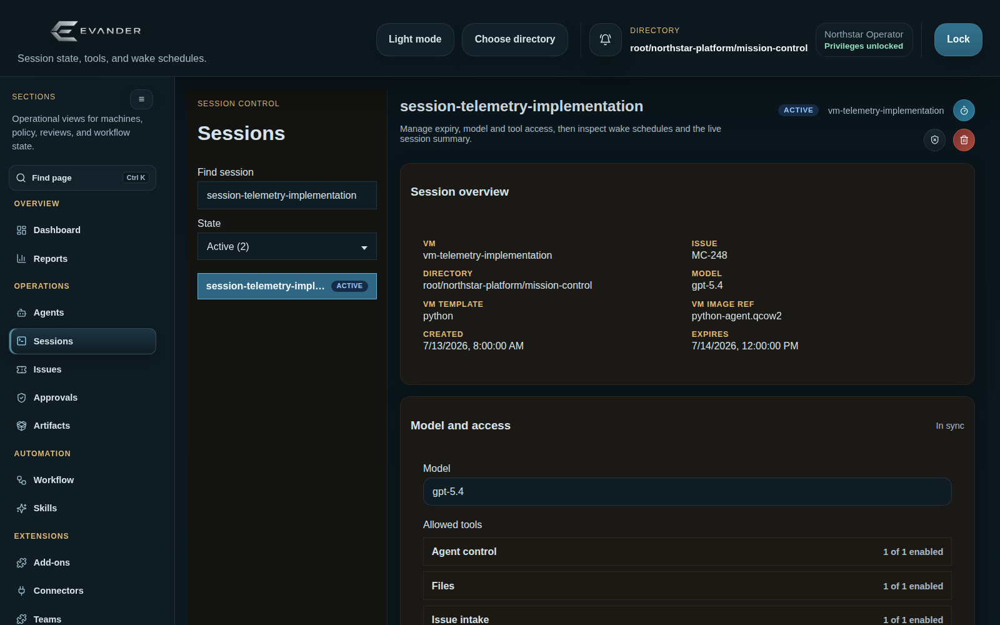

The operator view brings together the session's state, directory, execution backend, expiry, and
tool grants. It is the right starting point when an agent can work but cannot perform one expected
action.

<p class="figure-caption">Figure 6.1 — Session state, scope, backend, and tool grants meet in one operator view. Sanitized Northstar fixture.</p>

## The privileged-operations lock is a safety catch

Some sensitive Admin Web changes require both the necessary effective permission and an unlocked browser session.
Login begins locked. Unlocking marks only the current authenticated Admin Web session; locking,
logging out, cookie expiry, or an Admin Web restart removes that mark.

This is protection against an accidental click or an unattended open console. It is not a second
password, multi-factor authentication, or a human approval for an agent's tool call. Workflow and
MCP approvals are separate durable decisions bound to the requested action.

## How Evander decides whether an agent may use a tool

For an operator, the decision can be read as a short sequence of questions:

1. Is this a real, unexpired session?
2. Which directory owns it, and what rules apply there?
3. Is the tool forbidden, allowed for the session, or temporarily exposed by this workflow?
4. Does this type of tool have everything it needs—for example, an execution to resume?
5. Are the requested target and arguments within the job's limits?
6. Does this particular action require human approval?
7. If approval or a temporary workflow grant is presented, is it still valid for this session and
   run?

A tool can appear in the agent's catalog and still reject one disallowed recipient, script,
target, or argument. Visibility says the tool may be relevant to the job; it does not predict every
future request.

## Troubleshooting access

For a human-access problem, record the authentication mode if known, login name, selected
directory, page or action requested, exact message, and whether the privileged-operations lock is
shown as locked. An owner or administrator can then inspect the matching group assignments and
direct grants without exposing password-verifier data.

For an agent-access problem, start with the session page and the relevant tool-call or workflow
record. Capture:

- session ID, directory, expiry, and backend or VM binding if shown;
- tool name and whether it was absent or merely denied on invocation;
- exact visible reason and the safe-to-share request summary;
- workflow run and lease IDs, and approval request ID if present;
- time of the attempt and remaining-use information if displayed.

Do not edit `sessions.json`, broaden the root policy, or change a human's group merely to make one
agent call succeed. Those actions affect different boundaries. Ask an administrator to revoke the
smallest affected session or lease when authority is no longer appropriate.

The remainder of this chapter is administrator and security-reference material.

## Administrator reference: the identity stack

“Who did this?” can refer to several valid identities:

| Identity | Examples | What it governs |
|---|---|---|
| Human operator | An operator's Admin Web login | Reading or mutating operator surfaces through RBAC |
| Directory scope | `root/northstar-platform/mission-control` | Which inherited configuration and RBAC assignments apply |
| Agent/session | An implementation session's `session_id` and optional VM/provider binding | MCP visibility, allowlists, quotas, expiry, execution correlation |
| Workflow | Run ID, graph ID/revision, trace ID, node execution ID | Why the action was scheduled and which configuration produced it |
| MCP transport | Protocol `mcp-session-id` bound to an Evander session | Which session the connection is allowed to represent |
| Provider identity | ADO project, Git account, Teams app, relay credential | Which external service principal the host uses |
| Team identity | Team manager, project lead, task owner, reviewer, and release agent IDs | Add-on task, wake, review, governance, and release responsibility |

The audit trail combines several of these so it can distinguish “an operator approved a request
for the implementation session during workflow run X” from the less useful “a tool ran.”

### Admin Web authentication

Admin Web supports three current modes:

| Mode | Purpose |
|---|---|
| `none` | An explicitly unauthenticated/local mode. Appropriate only inside a trusted, otherwise protected operator boundary. |
| `local_password` | Local users and PBKDF2 password credentials, with an environment-supplied bootstrap/break-glass account. |
| `azure_sso` | Azure SSO identity mapped to the local user/RBAC store. |

If no mode is supplied, a configured admin password selects `local_password`; otherwise the
process falls back to `none`. Production administrators should set the mode deliberately rather
than relying on that convenience behavior.

The durable user, group, assignment, and direct-grant store is SQLite at `runtime/admin-web.db`.
Retired JSON user files are not read by the runtime. Local passwords use PBKDF2-HMAC-SHA-256 with 200,000
iterations and a 32-byte random salt. The database stores a verifier, not the plaintext password.

Successful authentication creates an HMAC-signed `evander_admin_session` cookie. The default
session TTL is 43,200 seconds (12 hours), with a minimum of 60 seconds. Set a stable
`EVANDER_ADMIN_WEB_SESSION_SECRET`; if absent, the process generates one, so a restart invalidates
existing cookies. Secure-cookie and reverse-proxy/TLS behavior belong to the complete exposure
design.

The first-owner bootstrap is guarded. The configured local bootstrap account or Azure bootstrap
allowlist can establish the first usable owner, but later authorization comes from durable users
and assignments. User-management logic protects the effective owner boundary so an operator
cannot casually remove or disable the last owner.

### Directory-scoped role-based access control

Role-based access control (RBAC) uses this permission catalog:

| Permission | Meaning |
|---|---|
| `admin.owner` | Full permission catalog |
| `users.manage` | Manage users and relevant assignments |
| `groups.manage` | Manage groups and permissions |
| `workflows.read` | Read workflow definitions |
| `workflows.write` | Modify workflow definitions; implies read for direct grants |
| `workflow_packs.manage` | Manage workflow packs |
| `workflow_runs.read` | Inspect workflow runs |
| `workflow_runs.control` | Operate workflow runs |
| `team_chats.read_all` | Read Team chats beyond ordinary participant scope |

Built-in groups are `owner`, `operator`, `workflow-maintainer`, `workflow-viewer`, `auditor`, and
`viewer`. Owner and operator are required group definitions. `admin.owner` expands to the full
catalog. Operator receives workflow read/write, pack management, run read/control, and Team chat
read-all; it does not implicitly receive user/group management unless configured through another
group or ownership.

A group assignment at a directory applies to that directory and descendants. Thus an assignment
at `root/northstar-platform` applies to `mission-control` but not to an unrelated root child.
Direct workflow grants are limited to workflow read or write, and write expands to read. Effective
permission is the union of matching group assignments and matching direct workflow grants. Scope
inheritance is downward only: an assignment on `mission-control` does not authorize its parent or
sibling.

Some resources are worker-global rather than directory-owned. In particular, named ChatGPT
subscription profiles on a container worker can be created, enabled or disabled, signed in,
cancelled during login, or signed out only by an authenticated operator with privileged operations
unlocked and effective `admin.owner` permission at `root`. Ownership of only a child directory is
insufficient because directories select infrastructure, not profile access. Each session's profile
selection may be changed between turns. The first successful login still pins each profile's OpenAI
account ID, so changing a session's selection never changes the account represented by a profile.

### Privileged-operation lock implementation

Authentication and RBAC answer whether an operator *may* perform an action. Sensitive mutation
routes also require the current authenticated Admin Web session to be marked as
privileged-unlocked.

Calling the unlock endpoint marks the current cookie session in process memory; it is not a second
password or SSO challenge. Routes call `request_has_privileged_operations`, optionally with a
required permission and directory scope, so both authorization and transient state must pass.

### Session manifest fields

A `SessionManifest` includes:

- `session_id`, creation and expiry timestamps;
- VM, execution-provider, and model bindings where selected;
- canonical `directory_path`;
- allowed MCP tools, approval-required tools, and per-tool grant settings;
- allowed contact and script IDs;
- nullable `communication_target_ids` for Teams and Discord destinations plus outbound email
  recipients;
- nullable structured `email_mailbox_grants` for mailbox `read`, `draft`, or `send` access and
  per-mailbox folders, alongside legacy Discord, Teams, mailbox, folder, recipient, and domain
  allowlists retained for older sessions;
- an optional `codex_auth_mode` override for container-worker Codex sessions;
- tool argument policies;
- communication file limits and enablement;
- web-search enablement and quotas;
- metadata for workflow, issue, Team, Git, HTTP-target, and execution correlation.

### Canonical communication grants and legacy conversion

The canonical fields divide two kinds of authority that legacy allowlists combined:

| Session field | Grants | Does not grant |
|---|---|---|
| `communication_target_ids` | Named Teams and Discord destinations, and named outbound email recipients | Access to read or draft within an email mailbox |
| `email_mailbox_grants` | One mailbox account, an access level (`read`, `draft`, or `send`), and explicit folders | Permission to deliver mail to arbitrary recipients |

Both fields are nullable for compatibility. Missing or `null` keeps the corresponding legacy
resolution path; `[]` is canonical and denies all access in that category even if old allowlist
fields still contain values. A canonical target that has since been disabled or removed fails
closed instead of falling back to its raw provider address.

The Sessions-page conversion is explicit and reviewable. It proposes destination IDs from legacy
Discord channels and Teams channel, chat, and one-on-one user allowlists, plus mailbox grants from
the old mailbox/folder fields. Mailbox access is inferred conservatively from the session's current
email tools and send flag: read-only remains `read`, draft-capable becomes `draft`, and an actually
send-capable session becomes `send`; draft and send proposals include the required `drafts` folder.
Legacy recipient strings are not silently turned into managed email targets. Select the intended
configured email recipient targets before saving if the converted session must send mail.

### Policy evaluation details

The policy engine's effective tool-request sequence is:

1. require an existing, unexpired session;
2. resolve effective policy for its directory;
3. apply directory denial and any special capability profile;
4. require the tool in `allowed_tools` or in a valid workflow-scoped approval lease for this
   session and run;
5. require structural prerequisites such as a bound execution for resume behavior or a feedback
   stream for feedback tools;
6. apply inherited and session argument/resource rules to the payload;
7. require and validate per-invocation approval where configured.

Tool visibility and execution use the same underlying policy decisions, but visibility cannot
pre-validate a future payload.

Directory policy supplies safe defaults: approval TTL 3,600 seconds, session TTL 28,800 seconds,
email sending disabled, and communication file send/receive disabled. Live directory overlays may
alter supported values. These defaults are not a substitute for explicitly reviewing a production
root policy.

Argument-policy operators include required fields, fixed values, patterns, enums, allowlists, and
denylists. The resolved directory rule list and the session rule list both apply; a permissive
session rule does not erase a directory constraint. Within directory inheritance, ordinary list
replacement follows the merge rules in Chapter 5.

### Workflow-scoped tool leases

A `SessionToolApprovalLease` temporarily grants named MCP tools to exactly one session and workflow
run. It contains a lease ID, effect execution correlation, per-tool approval settings, optional
notification targets, expiry, revocation time, and used counts.

The workflow context must present matching run and lease IDs. Use is consumed under the
repository's atomic update path. A lease cannot:

- revive an expired session;
- cross to another session or workflow run;
- override an inherited directory deny;
- bypass argument/resource policy;
- remove mandatory or configured per-invocation approval.

A project's graph may reserve one tool for the implementation agent during a bounded step without
putting that tool in every long-lived session. The lease says the workflow may expose the tool; a
separate exact approval may still be required for a sensitive call.

## Failure reference

| Symptom | Decision that failed | Typical cause |
|---|---|---|
| Admin Web redirects or returns unauthenticated | Human authentication | Missing/expired/bad cookie, restart with generated secret, SSO or password failure |
| Authenticated user sees read-only UI | RBAC | No matching directory assignment or direct grant |
| Mutation says privileged operations are locked | Transient guard | Current cookie session has not been unlocked or process restarted |
| User can edit Northstar but not a sibling | Directory scope | Expected descendant-only assignment behavior |
| Agent's `tools/list` is empty | Session/MCP identity | Unknown, expired, unproved, or incorrectly bound session |
| Tool is missing | Visibility policy | Not granted, directory-denied, profile-denied, or structurally unavailable |
| Visible tool rejects call | Payload policy | Argument, target, quota, lease, or approval failed |
| Legacy communication conversion cannot be saved | Canonical resource validation | A proposed raw/old destination no longer resolves to an enabled managed target, or a mailbox/folder is unavailable under effective policy |
| Lease works in one run but not another | Workflow scope | Run/session mismatch is intentional |
| Last owner mutation is rejected | Recovery invariant | Store prevents loss of the effective owner boundary |

## Administrator runbook

For a human-access issue, collect the auth mode, login, current directory, requested permission,
matching group assignments, direct grants, and privileged-lock state. Do not inspect or copy
password-verifier fields unless incident response requires it.

For an agent-access issue:

```bash
evander-cli list-sessions --runtime-dir runtime --all
evander-cli directories config-show root/northstar-platform/mission-control \
  --domain policy --runtime-dir runtime
evander-cli list-approvals --runtime-dir runtime
```

Then use Admin Web's session tool-visibility view or the gateway audit entry to identify the exact
reason. Compare the normalized tool name, session expiry, directory, session grant, inherited deny,
structural prerequisite, argument payload, workflow run/lease, approval request, and remaining
uses before changing policy.

Use lifecycle commands rather than editing `sessions.json`:

```bash
evander-cli renew-session <session-id> --runtime-dir runtime
evander-cli revoke-session <session-id> --runtime-dir runtime
```

Check each command's `--help` for the required renewal/expiry arguments in the installed revision.
Revoke the smallest affected session or lease when authority is no longer appropriate; changing a
human's group does not automatically revoke an already issued agent session.

## Source trail

- `src/evander/admin/web/shared.py`, `src/evander/admin/web/user_store.py`, and
  `src/evander/admin/web/rbac.py` — authentication, cookies, password storage, groups, permission
  scope, and privileged lock.
- `src/evander/admin/web/users.py` and `tests/test_admin_web_user_store.py` — user/group
  administration, bootstrap, migration, and owner protection.
- `src/evander/admin/web/codex_auth.py` — privileged root-owner authorization for worker-owned
  ChatGPT subscription profiles.
- `src/evander/admin/services/session_helpers.py` and
  `frontend/admin-web/src/features/sessions/SessionsScreen.tsx` — canonical session-policy
  updates and explicit legacy communication conversion.
- `src/evander/models.py` — `SessionManifest`, `SessionToolApprovalLease`, and approval models.
- `src/evander/policy.py` and `src/evander/policy_config.py` — visibility, grants, denial,
  structural checks, arguments, approvals, and defaults.
- `src/evander/repositories/session_manifests.py` and
  `src/evander/repositories/session_tool_approval_leases.py` — durable session and lease mutation
  semantics.
- `tests/test_admin_web_rbac.py`, `tests/test_policy.py`, `tests/test_gateway.py`, and
  `tests/test_session_tool_approval_leases.py` — authorization-plane invariants.


# 7. MCP, Approvals, and Audit

> **At a glance.** An agent does not call arbitrary host functions. It asks Evander to use a named
> tool for the current job. Evander identifies the session, checks the job's rules and the specific
> request, pauses for a person when approval is required, and records the outcome.
>
> For an operator, the most important distinction is between **seeing a tool**, **being allowed to
> request an action**, and **having that exact sensitive action approved**. These are separate
> checks. The technical reference later in this chapter explains the MCP connection, proof tokens,
> payload binding, leases, and audit stores behind them.

## One tool request in plain language

MCP is the protocol the agent harness uses to discover and call Evander tools. A typical request
passes through six understandable stages:

1. Evander identifies the temporary session making the request.
2. It confirms that the session is active and that the tool belongs to this job.
3. It checks the requested recipient, target, file, or other arguments against policy.
4. If the action is sensitive, Evander creates a pending request instead of performing it.
5. After a decision, the agent retries the same request; Evander runs it only if every check still
   passes.
6. Evander records the decision and result for later inspection.

This is why a working connection does not imply that every tool or action is available. It is also
why an approval does not become permanent extra power.

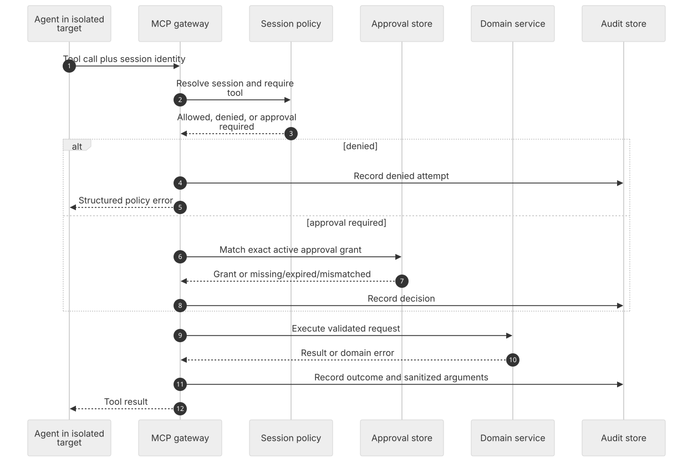

Put simply, the figure shows one request moving through identity, policy, approval, execution, and
recordkeeping. A stop at any earlier stage prevents the host operation.

<p class="figure-caption">Figure 7.1 — Catalog visibility, invocation authorization, approval, execution, and audit are separate checks in one request envelope.</p>

## What an operator sees when approval is required

The agent's first call does not run the sensitive action. Evander creates a durable pending request
and tells the agent to wait for a decision. In Admin Web, the operator can see which session and
directory asked, the tool and intended effect, when the request expires, and a redacted summary of
the input.

Before deciding, verify four things:

1. **The job:** Is this the expected session, directory, and workflow context?
2. **The action:** Does the tool and intended effect match the work being performed?
3. **The boundary:** Is the displayed target or redacted input as narrow as expected?
4. **The timing:** Is the request still current, and is there a clear reason to perform it now?

Approve or deny with a useful reason. Approval does not execute the action; the agent must retry
the bound request. If the retry changes the payload, session, or tool under the ordinary exact
binding, Evander rejects it rather than treating the old approval as permission for something new.

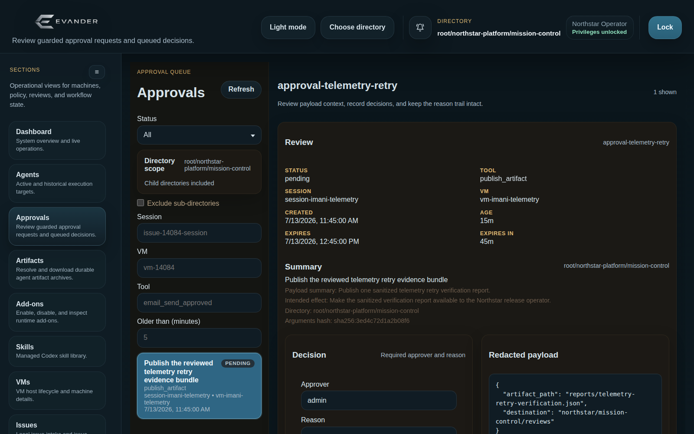

The operator receives a review surface, not the agent's authority or the host's provider
credentials. A delayed chat notification should lead back to this canonical request before a
decision is made.

<p class="figure-caption">Figure 7.2 — The operator sees the request identity, bound action, status, and decision surface without receiving ambient guest authority. Sanitized Northstar fixture.</p>

## Approval is bounded, not blanket elevation

The ordinary approval is tied to the exact request, has one use, and expires according to policy
(3,600 seconds by default). Directory policy can impose tighter limits. Once the use or time limit
is reached, the request no longer authorizes a retry.

A workflow can also make a tool temporarily available for one session and run. That temporary
grant answers “may this workflow step expose the tool?” An invocation approval answers “may this
exact sensitive call execute now?” Where both apply, both must pass.

Neither control can revive an expired session, override a broader directory denial, cross to a
different job, or bypass the request's argument rules.

## What the audit trail is for

Evander records allowed, blocked, denied, failed, and completed tool activity with the identities
that explain it. Operators can relate a tool call to a session, workflow, approval, and person
without relying on a vague message that “the tool ran.” Sensitive values are redacted recursively
before they are presented in ordinary audit views.

The audit view and the workflow run answer complementary questions:

- the audit trail explains the tool request, policy decision, approval, and result;
- workflow evidence explains why the request was scheduled and how the graph continued.

Redaction reduces accidental disclosure. It is not permission to place secrets in ordinary tool
arguments, messages, or workflow payloads.

## What an operator may notice

| What you see | What it means | Useful evidence to capture |
|---|---|---|
| A plain browser request to `/mcp` returns `406` | The endpoint may be listening, but the request did not speak MCP | HTTP status and headers; do not diagnose a dead gateway from this alone |
| The client receives HTTP `401` | Session proof is missing or invalid | Session ID, expiry, client header/query behavior, and time |
| The client receives `409` or a session-conflict error | The connection is already tied to a different session | Declared session and protocol connection ID |
| A tool is absent | Visibility policy or a structural prerequisite excluded it | Session, directory, expected tool, and visibility explanation |
| The first call returns an approval request | Evander paused as designed | Request ID, status, expiry, job, and intended effect |
| An approved retry reports payload mismatch | The retried arguments do not match the approved request | Original review summary and current redacted payload |
| An approved retry is exhausted or expired | Its use or time boundary has ended | Request settings, status, and decision/use history |
| An approval notification failed | Delivery failed; the durable request was not approved or denied | Request ID, delivery error, and whether it remains pending |
| Admin Web misses recent calls | The query index may be stale although the canonical log is intact | Runtime root, approximate time, and whether other audit entries appear |
| The canonical audit log lacks the event | The wrong runtime/process may be under inspection, or append did not occur | Running service configuration and gateway error/time |

## Troubleshooting an approval or tool call

Start with the request, session, and audit views in Admin Web. Record the request ID, session ID,
directory, workflow run or trace ID, tool, intended effect, status, expiry, remaining uses, decision
reason, and exact visible error. If the tool is absent rather than denied, say so explicitly.

Do not approve merely to clear a pending queue, and do not ask the agent to vary the request until
one retry happens to pass. If the request is unclear or broader than expected, deny it with a reason
that helps the workflow or operator correct the request. If recent audit entries are missing, an
administrator should check the canonical log before assuming the action was unrecorded.

The remainder of this chapter is administrator and protocol reference material.

## Administrator reference: MCP as a policy gateway

`evander-gateway` hosts a FastMCP server named “Evander Gateway” at the streamable `/mcp` path. It
is not a transparent proxy to arbitrary host functions. Registered tools adapt explicit host
services, and both discovery and invocation are session-aware.

The broad request path is:

```text
MCP HTTP request
  -> resolve declared/bound Evander session
  -> verify session proof token
  -> check active session and effective directory policy
  -> filter catalog or validate invocation arguments
  -> validate workflow lease and per-invocation approval
  -> dispatch one registered tool
  -> append audit event and best-effort index it
```

### Connection binding and proof

An MCP client initially declares its Evander session with the `session_id` query parameter or
`x-evander-session-id` header. It supplies the session proof token with one of the supported MCP
session-token query parameters or headers, normally `x-evander-mcp-session-token`.

The MCP protocol assigns an `mcp-session-id`. When that transport ID and a declared Evander session
first appear together, Evander persists their relationship in
`runtime/mcp-transport-bindings.json`. Future requests on the transport inherit the binding. A
request declaring a conflicting Evander session is rejected rather than silently rebound.

Session setup issues a random proof token and records MCP-auth metadata on the session, including a
SHA-256 verifier. Comparison is constant-time. Query-string tokens are redacted when the gateway
logs request URLs. Headers are preferred because URLs are more likely to appear in infrastructure
logs.

The `session_id` field remains optional on tool schemas for legacy clients. The wrapper supplies
the bound connection session and rejects a conflicting explicit field. An unbound caller cannot
choose another session merely by changing a tool argument.

### Catalog filtering

MCP `tools/list` is evaluated for the authenticated session. It includes only tools that are
registered, compatible with the session's capability profile, not directory-denied, granted by the
session or an eligible workflow lease, and structurally usable.

Structural examples include resume operations that need a bound execution and feedback operations
that need a configured feedback stream. A bad or missing proof can produce HTTP authentication
rejection before catalog evaluation; a valid session with no visible tools can legitimately
receive an empty catalog. Catalog visibility is not pre-approval, and argument/resource policy can
still reject a particular payload.

### Live project documentation

Three read-only built-in tools expose the current host documentation without copying the repository
into an execution target:

- `list_documentation` lists the permitted document paths, titles, and classifications;
- `search_documentation` performs bounded case-insensitive literal search, optionally within one
  document;
- `read_documentation` returns a bounded line range with pagination metadata.

They are normal session-grantable tools and use the same catalog filtering, invocation policy, and
audit envelope as other built-ins. Admin assistant capability profiles receive them by default;
other agents need an explicit session grant or an eligible workflow lease. The host service reads
files at invocation time from the authoritative/focused map and canonical technical-manual chapter
sources. It rejects unlisted paths, traversal and symlink escapes, historical records, generated
publication duplicates, the manual reading-path and design-history chapters, managed upstream
content, and arbitrary repository files.

### Invocation checks

The registered-tool wrapper applies these controls around the tool implementation:

1. bind the authoritative session from the request context;
2. require valid session proof and an active manifest;
3. enforce add-on registration/capability policy where the tool came from an add-on;
4. enforce effective directory and session argument/resource policy;
5. determine per-invocation approval settings;
6. validate and, when appropriate, consume approval or workflow-lease use;
7. dispatch the host operation;
8. audit allowed, blocked, denied, error, and result context with redaction.

The exact helper ordering can differ for specialized tool families, but none may treat a free-form
`session_id` as sufficient authority. Add-on tools enter the same gateway and remain subject to the
same connection, session, and audit envelope.

### The approval handshake and durable record

On the first invocation of an approval-required tool, the agent omits `approval_request_id`.
Evander does not run the effect. It creates or reuses a request whose ID is deterministic for the
session and invocation payload, then returns an error/instruction identifying the pending request
and asking the agent to retry after a decision.

The stored `ApprovalRequest` contains:

- request, session, directory, VM, tool/action, and intended-effect identity;
- a digest of the unredacted invocation payload;
- a recursively redacted payload for review plus a human summary;
- status, creation and expiry timestamps;
- effective grant settings and current use count;
- notification targets, deliveries, errors, and attempt state;
- approver, decision time, reason, and decision history.

The digest and review payload serve different purposes. Redaction limits disclosure to the
operator surface; hashing the original payload preserves exact binding even when a sensitive field
is hidden.

An operator supplies a non-empty reason when approving or denying. On retry, the policy engine
atomically validates status and optionally consumes use while checking expiry, payload mode,
session, tool, and maximum uses. The `approval_submit` and `approval_check` protocol tools do not
require their own approval, which would otherwise create an infinite loop.

### Grant settings and mandatory approval

The ordinary default is:

- exact payload binding;
- one use;
- an expiry derived from effective policy, 3,600 seconds by default.

Session per-tool settings can request a TTL, use count, and payload mode. Directory policy remains
the upper security boundary: it can cap TTL and use count and require exact payload. A broader
`ANY` payload mode is therefore an explicit policy choice, not an accidental consequence of a
redacted value.

Two built-in destructive operations are always stricter: `delete_ado_backlog_item` and
`semantic_delete_points` require exact-payload, one-use approval. This mandatory set is
intentionally small and explicit. Other tools become approval-required through effective directory
policy, session settings, communication-file rules, or specialized policy behavior.

A reusable request ID does not mean unlimited use. Once the configured use count is reached,
status becomes exhausted and the next attempt is rejected. A pending or approved request that
passes its deadline becomes expired. Denial, expiry, exhaustion, payload mismatch, wrong session,
wrong tool, and unknown request are distinct rejection states for audit and diagnosis.

### Workflow-scoped leases versus invocation approvals

A workflow may issue a `SessionToolApprovalLease` to expose a tool temporarily for one session and
workflow run. The MCP context presents the lease and workflow-run IDs, and consumption tracks
per-tool use.

| Control | Question |
|---|---|
| Workflow tool lease | May this workflow step temporarily add this tool to this session's catalog? |
| Invocation approval | May this exact sensitive call execute now? |

A lease cannot cross a session/run boundary, revive an expired session, override a directory deny,
or bypass invocation approval.

### Approval notifications

Effective policy or the session can select configured communication target IDs for pending
approvals. Request creation records queued/disabled status and delivery attempts. Notification
failure does not silently approve or deny the request; the durable approval remains pending until
decision or expiry.

Notifications carry a review prompt, not provider credentials. Operators should use the canonical
request in Admin Web or CLI for the final decision, especially if a chat notification is truncated
or delayed. A project can route an implementation session's request to an authorized operator
without revealing a raw address or phone number to the agent. The session sees the target ID and
approval outcome, while the host resolves contact and provider details.

### Canonical audit stream and query index

`AuditLogger` appends one JSON object per line to the configured audit path, normally
`runtime/audit.jsonl`. For tool calls, records can include:

- timestamp, directory, session, VM, agent role, and actor user ID;
- tool name, status, decision, and error summary;
- request, correlation, workflow run, trace, approval, and lease IDs;
- duration and redacted arguments/results.

The effective policy's redacted keys are applied recursively, with additional sensitive markers
guarded by the index. Proof-token query values are also redacted in transport logs.

`runtime/audit.db` is a SQLite search index built from the JSONL stream. It stores normalized
columns plus payload/search text and uses WAL. Appends try to index immediately; Admin runtime
startup can import historical tail data. If indexing fails, the JSONL append remains canonical.
Rebuilding the index must not rewrite the source log.

Approval decisions create their own audit context, linked by request and session. Workflow
execution journals remain complementary to this audit evidence.

## Administrator failure reference

| Symptom | Meaning | First evidence |
|---|---|---|
| `/mcp` plain GET returns `406` | Endpoint is listening but request did not negotiate MCP | HTTP status/headers; use an MCP client for protocol health |
| HTTP `401` | Missing or invalid session proof | Session metadata, client header/query, expiry |
| HTTP/session conflict `409` or tool conflict error | Transport is already bound differently | `mcp-transport-bindings.json` and declared header/query |
| Tool absent from list | Visibility denial or missing structural prerequisite | Tool visibility explanation and effective policy |
| First call returns approval request | Expected controlled pause | `show-approval` and pending audit record |
| Approved retry says payload mismatch | Retried arguments differ from the approved digest | Original intended effect and current redacted payload |
| Approved retry says exhausted/expired | Use or time bound has ended | Request status/settings/history |
| Notification failed | Review delivery failed, not the durable request | Notification deliveries/error and pending queue health |
| Admin audit view misses recent calls | SQLite index stale or unavailable | Canonical `audit.jsonl`; rebuild index |
| JSONL lacks expected event | Wrong runtime, process, or code path; append itself did not occur | Running unit config and gateway log |

## Administrator runbook

For a pending request:

```bash
evander-cli list-approvals --runtime-dir runtime \
  --status pending \
  --directory-path root/northstar-platform/mission-control \
  --show-payload
evander-cli show-approval <request-id> --runtime-dir runtime
```

After confirming the session, tool, intended effect, expiry, exact redacted payload, and surrounding
workflow context:

```bash
evander-cli approve <request-id> <operator-id> \
  --approve \
  --reason "Telemetry retry test needs this bounded operation" \
  --runtime-dir runtime
```

To deny, use `--deny` and an equally useful reason. Never approve merely to clear queue health.

If the query index is stale but JSONL is intact:

```bash
evander-cli rebuild-audit-index --runtime-dir runtime --reset --json
```

For an MCP identity problem, compare the declared Evander session, protocol `mcp-session-id`,
proof-token header, manifest expiry, and persistent binding. Reissuing a session is safer than
hand-editing a binding when a guest was cloned or its session material was copied unexpectedly.

## Source trail

- `src/evander/gateway/server.py`, `src/evander/gateway/app.py`, and
  `src/evander/gateway/session_context.py` — MCP registration, middleware, catalog filtering,
  binding, and invocation context.
- `src/evander/gateway/documentation_tools.py` and
  `src/evander/admin/services/documentation_service.py` — policy-gated live documentation tools
  and the fail-closed current-document catalog.
- `src/evander/session_auth.py` and `src/evander/repositories/mcp_transport_bindings.py` —
  proof-token issuance/verification and persistent transport binding.
- `src/evander/policy.py`, `src/evander/policy_config.py`, and `src/evander/models.py` — tool
  visibility, approval creation/validation/consumption, settings, and durable records.
- `src/evander/approval_notifications.py` and
  `src/evander/admin/services/approval_audit_service.py` — notifications, operator decisions,
  queue health, and audit context.
- `src/evander/audit.py` and `src/evander/repositories/audit_index.py` — canonical JSONL append and
  queryable SQLite index.
- `tests/test_gateway.py`, `tests/test_policy.py`, `tests/test_approval_notifications.py`, and
  `tests/test_session_tool_approval_leases.py` — gateway, exact binding, notification, and lease
  behavior.


# 8. Workflow Runtime and Orchestration

> **At a glance.** A workflow is Evander's prepared answer to “when this happens, what should we
> check and do next?” It can notice an event, make a decision, look something up, perform an action,
> and continue when that action finishes.
>
> Evander saves the event and each completed step as the work advances. A stopped worker can
> therefore continue from evidence rather than guessing what happened. An operator can follow the
> run as a sequence of named steps; the later administrator reference explains packs, compiled
> graphs, queue records, bindings, revisions, and recovery windows.

## Read a workflow as a prepared route

Most workflow steps have one of four everyday jobs:

| Job in the route | What it does | Technical name |
|---|---|---|
| Notice something | Observes time, another system, a webhook, or an internal event | Trigger |
| Choose the path | Filters, deduplicates, branches, loops deliberately, or joins work | Gate |
| Find information | Reads state without performing the external business change | Query |
| Do something | Creates a session, sends a prompt, updates a system, or publishes code | Effect |

Connections between steps show which result leads to which next step. A query or effect does not
directly call the next box; its completion becomes a saved event. That extra handoff is what lets
the route survive a process restart.

A representative project route might read:

```text
ticket created
  -> keep items for mission-control
  -> ignore a start already handled
  -> look for an active session
  -> continue only when none is active
  -> create an implementation session
  -> clone the managed repository
  -> prompt the implementation work
  -> wait for and pin the Git result
  -> obtain a review decision
  -> pass the release gates
```

This is an example, not a built-in universal process. Operators choose the integrations, checks,
and release rules that fit their organization. The Team Add-on chapters explain the additional
task, review, and governance route around core workflow execution.


The figure's main message is that each handoff has a saved record. The trigger worker and effect
worker do not have to remain in one uninterrupted in-memory conversation.

<p class="figure-caption">Figure 8.1 — Workers coordinate through durable event and execution records instead of an in-memory call chain.</p>

## Following a run in Admin Web

The workflow editor shows the prepared route. A workflow run shows what happened when one event
traveled through a particular revision of that route. The current editor can change after a run
begins, so keep the run's recorded revision in view when comparing expected and actual behavior.

For one run, an operator usually needs only a small set of landmarks:

- the source item or event and its time;
- the run or trace ID;
- the last step that completed and its output path;
- the first step that is waiting, denied, or failed;
- the session ID, approval ID, or code version linked from that step.

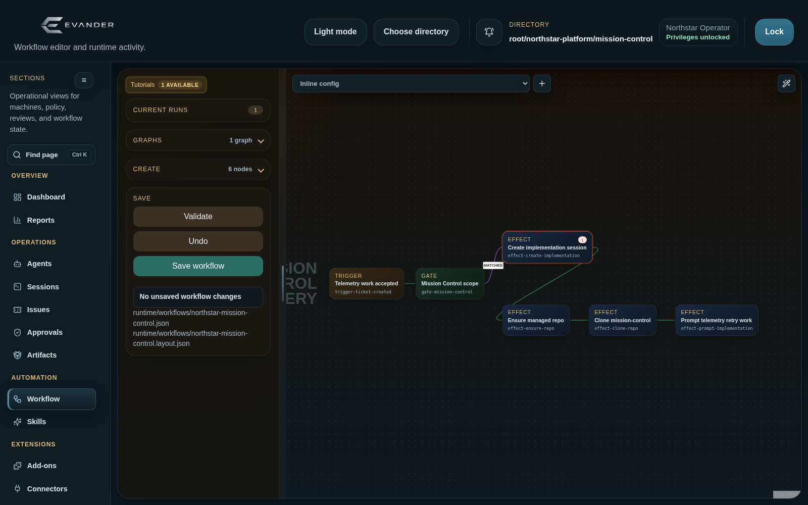

The editor is the authoring view. Runtime events and executions remain separate durable records
underneath it, which is why opening or closing the browser does not start or stop the workflow.

For a cross-run question, select the relevant node and expand **Execution history** in its
inspector. Choose a local-time date window (the default is the previous seven days), optionally
limit statuses, and add exact JSON Pointer filters over input or output fields. Up to eight filters
are combined with AND. Equality is type-aware and case-sensitive; numeric comparisons and
presence/absence checks are also available. Array contents are visible in detail but array-element
predicates are not supported. Results show whether the full record is still retained or the
sanitized compact record is being used, along with the retention boundary and backfill status.
The compact tier defaults to 365 days while full execution payloads default to 30 days.

<p class="figure-caption">Figure 8.2 — The editor is the authoring projection over a revisioned graph; runtime events and executions remain durable records underneath. Sanitized Northstar fixture.</p>

## What an operator may notice

| What you see | What it usually means | Safe next step |
|---|---|---|
| The same source item appears again | Publication or acknowledgement may have been retried; stable identities should converge on the existing event | Compare the event/source IDs before treating it as duplicate work |
| Other sources advance but one does not | One trigger or provider can fail without stopping the others | Capture the integration, directory, expected item, and last successful activity |
| An event exists but no step runs | The effect worker, route from the source, or active graph revision needs attention | Record event, run/trace, source step and output, and shown revision |
| A gate appears to have “lost” an item | It may have deliberately filtered, deduplicated, serialized, or sent the item down another output | Inspect the gate result and selected output path |
| A step remains `running` after a restart | Recovery may resubmit it; the external action may already have happened | Do not manually run the action again until an administrator checks its evidence |
| A step succeeded but no later step appears | Completion publication may be pending, or no connection matches its output | Record the execution status, output, and any `completion_pending` state |
| A workflow edit has no effect | Validation may have kept the last-known-good revision active | Compare the run revision with the editor and read validation messages |
| A review loop stops | Its declared cycle, depth limit, event budget, or business condition ended the route | Capture the last gate/output and iteration state |
| A value cannot be passed to the next step | The binding may name missing or unavailable upstream output | Capture the source output and binding error |
| A Team task is open but no agent wakes | The Team-to-core handoff or governance decision may still be pending | Check both the Team task/outbox state and the linked core run |

## Why a completed action may still be waiting

An important recovery state is `completion_pending`. It means a step's provider succeeded, but the
saved completion event that should move the route onward was not published successfully. Evander
retries that publication instead of immediately performing the successful external action again.

This is safer than treating every stalled route as permission to repeat work. There is still an
unavoidable uncertainty if a process dies after an outside system changes but before Evander saves
the local success record. That is why release, Git, communication, and provider operations use
stable identities, leases, or reconciliation where available.

## Troubleshooting a workflow run

Start with Admin Web. Record the selected directory; source item and event ID; run or trace ID;
graph ID and revision; last completed step and output; first waiting or failed step; execution
status; and any linked session, approval, completion event, or Team task ID. Include the exact
visible error and approximate time.

Do not delete a `running` record until someone has established whether its external effect
occurred. Do not force a second effect merely because completion publication is pending. If a new
edit is not active, do not overwrite the workflow file: resolve validation errors or reload and
merge through the editor when another revision or lock is current.

An administrator can use the detailed IDs and status records below to locate the exact durable
handoff. The remainder of this chapter is administrator and workflow-author reference material.

## Administrator reference: node families and identifiers

A workflow graph contains globally unique node IDs from four families:

| Family | Responsibility | Example |
|---|---|---|
| Trigger | Observe time, a provider, webhook, or internal event and publish a source event | `trigger:ticket:created`, `trigger:cron`, `trigger:event` |
| Gate | Decide or reshape flow without being the external business effect | `gate:filter`, `gate:dedupe`, `gate:map`, `gate:for`, `gate:merge` |
| Query | Read data and publish structured outputs | `query:session:list`, `query:ado:work-items` |
| Effect | Change host or external state and publish completion outputs | `effect:agent:create`, `effect:agent:prompt`, `effect:git:promote-agent-branch` |

Edges connect source nodes and output ports to target nodes. A completion is itself an event, so a
query or effect does not call the next node directly.

### Packs, graphs, and intermediate representation

A workflow pack has a `pack_id`, `pack_version`, optional description, graph metadata, and a
versioned intermediate representation (IR). Each graph has one canonical directory path, optional
user IDs, and a list of node IDs. Each IR node wraps a typed node envelope plus bindings and
optional retry/idempotency policy; edges are part of the IR.

`config/trigger-orchestrator/config.json` selects workflow packs and can also contain inline graphs
or IR. During load, Evander:

1. reads global orchestration settings;
2. migrates supported older node/port shapes;
3. composes configured packs and inline IR;
4. appends the hidden built-in system pack;
5. resolves configured workflow transforms;
6. materializes typed provider schemas;
7. validates graph, binding, directory, and communication-target constraints;
8. computes the compiled runtime configuration.

The hidden system pack is runtime-managed and not an editable operator graph. Node IDs and webhook
slugs must be globally unique across active configuration. A graph cannot claim multiple directory
paths.

Checked-in example packs illustrate supported combinations but are not automatically active. Live
operator packs may be ignored by Git and edited through Admin Web. Use its revision and lock
behavior; writing a stale file directly can defeat concurrency protection even if the JSON itself
is valid.

### Compilation and bindings

Compilation turns authoring IR into concrete trigger, gate, query, effect, and edge definitions.
Provider schemas validate node configuration before execution. Graph validation rejects missing
endpoints, illegal trigger inbound edges, accidental cycles, invalid ports, duplicate IDs, and
inconsistent graph membership.

Bindings carry upstream output into downstream configuration. A value such as:

```text
${{node.output}}
```

is resolved from declared upstream output context. Validation uses provider output schemas and
graph ancestry to catch references that are unavailable, misspelled, or not dominant on the path.
Execution stores a binding trace and a hash of the resolved configuration so an operator can see
what value the node actually received.

Bindings are data selection, not arbitrary Python or shell evaluation. An effect that
intentionally executes a command has its own typed provider and policy boundary; a generic binding
cannot become host code.

### Providers and extensions

Node type names resolve through the orchestration provider loader. A profile determines the
built-in provider set, and configuration can add explicit Python modules or enabled entry points.
Add-ons contribute providers through their registration surfaces. Provider factories receive
shared administration/runtime services so they operate on the same sessions, Git registry,
policy, and stores as the CLI and Admin Web.

The graph's directory path is passed into provider construction and effective configuration
resolution. One active graph set can therefore contain projects using different ADO projects,
backends, contacts, or Team state without duplicating a daemon per directory.

Provider initialization failures are isolated and logged where possible; one bad optional
provider should not erase a valid current graph. A node whose provider cannot be constructed
cannot execute successfully, and its failure remains visible in execution evidence.

### The trigger orchestrator

The trigger worker runs as:

```bash
evander-cli trigger-orchestrator --runtime-dir runtime
```

or with `--once` for one diagnostic cycle. A single-instance polling kernel owns its lock and local
wake mechanism. Each cycle:

1. checks workflow and provider configuration for a valid reload;
2. publishes due scheduled internal events;
3. selects enabled, non-system triggers;
4. constructs each provider using the graph's effective directory context;
5. polls for candidate events;
6. validates provider output and publishes each stable event ID, using an additional idempotency
   key when the publisher supplies one;
7. acknowledges the provider item only after durable publication;
8. records cursor state and wakes the effect orchestrator.

Provider initialization and polling failures are logged per trigger so the cycle can continue with
other definitions. A publish failure prevents acknowledgement of that item. Redelivery is expected;
stable idempotency is part of a correct trigger provider.

The default polling interval is five seconds with up to five seconds of configured jitter. A
successful publish lets the loop return promptly rather than sleeping through available work.
New durable scheduled events also notify the trigger worker, and each cycle caps its next sleep at
the earliest pending due time. This keeps deadline delivery precise without busy polling; the
provider sweep rechecks deadlines before sleeping and immediately polls only internal-event
listeners when new events became due. Those events enter the trigger queue in the same cycle
without polling unrelated external providers twice. The normal polling cadence remains the
recovery fallback.

### The durable orchestration store

`OrchestrationCoreConfig` defaults to:

- SQLite backend at `runtime/orchestration.db`;
- 30-day orchestration retention;
- WAL checkpoint mode `truncate`;
- a checkpoint threshold of 64 MiB, interval of 300 seconds, and checkpoint busy timeout of
  1,000 ms;
- maximum graph depth 16;
- maximum 200 events per effect-worker cycle.

The database unifies the trigger-event queue, workflow events, gate and effect/query executions,
and workflow configuration snapshots behind repository interfaces. Provider and worker cursors
remain in repository-backed JSON paths, for example `trigger-cursors-*.json` and
`trigger-orchestrator-cursors.json`. SQLite WAL supports independent trigger, effect, and Admin
readers/writers while the repository applies a busy timeout and transactions.

SQLite at `runtime/orchestration.db` is the only supported orchestration state backend. It stores
the queue, workflow journal, execution records, and workflow configuration snapshots.

### The effect orchestrator

The effect worker runs as:

```bash
evander-effect-orchestrator --runtime-dir runtime
```

It resets stale queue `inflight` markers at startup, reloads the current graph, retries
completion-pending publication, claims queued events, and routes them along matching source
node/port edges. Gates execute through registered gate providers; queries and effects run through a
bounded executor so short independent operations can overlap.

For every dispatched node, the worker records an idempotency key of:

```text
<event-id>::<node-id>
```

The execution record includes execution and idempotency IDs, source event/trace/node/type, status
and timestamps, resolved configuration and hash, input, outputs, published-completion state, error,
binding trace, and configuration revision.

If a non-running execution already exists for that key, the node is not run again. If the record
is still `running` after a process restart but no in-process future exists, the worker resubmits the
provider using the stored resolved configuration. Evander therefore does **not** promise
exactly-once external side effects. Providers that call external systems need a stable idempotency
key or reconciliation behavior of their own.

### Completion events and recovery

When a query, effect, or gate finishes, the worker builds a deterministic completion event and
publishes it back to the queue. Downstream edges select its output port. The original execution is
not considered fully propagated until completion publication is recorded.

If the provider succeeds but queue publication fails, the record becomes `completion_pending` with
the intended outcome. Later cycles retry publication rather than rerunning the successful provider.

There is still an unavoidable crash window around external systems without idempotency: the
process can die after the remote side effect but before the local success record is durable.
Provider design and reconciliation must account for it. ADO work-item updates, Git promotion,
communication sends, and release operations should use provider-specific stable identities and
leases.

### Cycles, depth, and event budgets

Graphs are acyclic by default. A feedback or iteration edge must set `allow_cycle: true`;
accidental cycles and self edges are rejected. Deliberate cycles remain bounded by
`max_graph_depth`, and each worker cycle claims only `max_events_per_cycle` records.

A review-change request may use a declared cycle to return to implementation. The edge declares
intent; dedupe, iteration state, task state, and depth limits prevent an unbounded hot loop. An
explicit cycle is permission to route again, not proof that the business condition will eventually
terminate.

### Configuration revisions and hot reload

Both workers fingerprint the global configuration, referenced pack files, and
communication-target SQLite files, including WAL/SHM state. When the fingerprint changes, the
reloader parses, composes, validates, and compiles a candidate.

If successful, the new current configuration and provider revision take effect. Workflow snapshots
and node records retain revision context so existing evidence remains intelligible. If invalid,
the worker logs the exception and keeps the last-known-good configuration. A bad edit does not
replace a working graph with an empty one.

Effect-worker store-binding changes are treated conservatively: switching the live queue/execution
store is deferred until old queued/inflight work drains. Provider-loader changes rebuild provider
factories. Administrators should still schedule major graph or store migrations deliberately rather
than relying on opportunistic hot reload.

### Team Add-on on the same runtime

The Team Add-on ships a workflow pack with core trigger/gate/effect/query shapes such as Team
outbox publication, due-agent wake, governance-manager wake, ephemeral agent lifecycle, Git
promotion/consolidation, release recording, and session-routing queries.

Team state remains add-on-owned, but execution remains core-owned:

- Team decides that an implementation agent is due to work and emits or publishes a durable
  intent.
- Core workflow creates or resumes the session and executes the prompt.
- Core completion becomes a Team-visible result or outbox event.
- Team governance decides whether review or release work should happen next.

This seam matters during diagnosis. A Team task can exist without a core wake having been
published; a core workflow run can be healthy while Team governance intentionally withholds the
next dispatch.

## Administrator failure reference

| Symptom | Durable state to inspect | Interpretation |
|---|---|---|
| Trigger provider repeatedly returns same item | Queue idempotency and provider cursor/ack | Publication or acknowledgement may be failing; duplicates should converge. |
| Other triggers work, one does not | Per-trigger logs and effective provider config | Provider construction/poll failure is isolated. |
| Event is queued but no node runs | Effect service, source node/port, graph revision | Worker stopped, no matching edge, or graph/source changed. |
| Gate “lost” an item | Gate execution and output port | It may have deliberately filtered, deduped, serialized, or routed it. |
| Node is `running` after restart | Execution record and current inflight map | Recovery may resubmit; check provider idempotency before manual action. |
| Node succeeded but downstream is absent | `completion_pending` or missing matching edge | Retry completion publication; do not rerun the external effect first. |
| New workflow edit has no effect | Worker reload log and current revision | Candidate may be invalid; last-known-good remains active. |
| Cycle stops | Depth/event budget and `allow_cycle` | Safety bound or undeclared cycle prevented further routing. |
| Bind expression fails | Binding trace/error and provider schema | Upstream output is missing, wrong port/path, or not valid on every route. |
| Team task is open but no agent wakes | Team outbox/wake/governance plus core queue | Cross the add-on/core seam and find which durable handoff is missing. |

## Administrator runbook

Validate each worker independently with one-cycle commands:

```bash
evander-cli trigger-orchestrator --runtime-dir runtime --once
evander-effect-orchestrator --runtime-dir runtime --once
```

Then inspect service logs without leaving duplicate workers running:

```bash
sudo systemctl status evander-trigger-orchestrator.service
sudo systemctl status evander-effect-orchestrator.service
sudo journalctl -u evander-trigger-orchestrator.service -n 200 --no-pager
sudo journalctl -u evander-effect-orchestrator.service -n 200 --no-pager
```

For one run, collect source event ID, trace ID, graph ID, configuration revision, source node/port,
target node, node idempotency key, execution status, completion event ID, and workflow run/session
IDs. In Admin Web, compare the graph revision shown for the run with the current editor revision.

Do not delete a `running` record until you know whether its external effect occurred. Do not force
a second effect merely because completion publication is pending. Prefer provider reconciliation,
supported retry/force-complete controls for the specific node type, or recovery of queue
publication.

Before publishing a workflow edit, run validation and resolve every error. If another operator
holds the workflow lock or the revision changed, reload and merge through Admin Web instead of
overwriting the pack.

## Source trail

- `src/evander/config.py` — orchestration defaults, paths, validation, limits, and provider-loader
  configuration.
- `src/evander/workflow/packs.py`, `compiler.py`, `validation.py`, `binding.py`, and
  `runtime_config.py` — pack composition, compilation, graph/binding checks, and last-known-good
  reload.
- `src/evander/daemons/trigger_orchestrator.py` and `src/evander/orchestration/kernels.py` —
  trigger polling, single-instance loop, publication, acknowledgement, and wakeup.
- `src/evander/daemons/effect_orchestrator.py` — graph routing, node execution, idempotency,
  completion-pending recovery, cycles, and revision evidence.
- `src/evander/triggers/queue.py` and `src/evander/repositories/orchestration_db.py` — JSON/SQLite
  queue and shared orchestration persistence.
- `src/evander/orchestration/adapters/provider_factories.py` and
  `src/evander/workflow/plugins.py` — provider construction and extension loading.
- `tests/test_workflow_packs.py`, `tests/test_workflow_compiler.py`,
  `tests/test_workflow_validation.py`, `tests/test_trigger_orchestrator.py`,
  `tests/test_effect_orchestrator.py`, and `tests/test_workflow_orchestrator_live_reload.py` —
  workflow contract and recovery tests.


# 9. Execution Backends

> **At a glance.** Once Evander decides that an agent may work, it still needs a safe place for that work to happen. The usual choice is a temporary virtual machine; another supported choice runs temporary containers on a dedicated worker machine. This chapter compares those environments while keeping the more important promise in view: changing where the agent runs does not change who grants permission or where durable evidence belongs.

## Where the agent's work happens

Evander separates two responsibilities. The control plane decides what the job is allowed to do and keeps the durable record. The **execution backend** provides the temporary workspace in which the permitted work runs.

An installation currently has two choices:

| Workspace choice | What the agent receives | What remains outside it |
|---|---|---|
| Temporary virtual machine (`libvirt_vm`) | A disposable VM with its own disk and selected toolchains | Session policy, real credentials, workflow state, managed Git, and audit evidence remain host-owned. |
| Worker container (`container_worker_vm`) | A disposable Docker job on one configured worker VM, with selected session state kept between jobs | The control plane still owns permission, credentials, workflow state, Git identity, and durable evidence. |

To an operator, the shared promises matter more than the infrastructure names:

- the session and directory rules are chosen before the workspace starts;
- the agent uses the same controlled model, tool, package, HTTP, and Git routes in either kind of workspace;
- the exact code version and the work's evidence remain traceable after temporary compute is removed;
- selecting a different backend does not grant broader authority.

The two backends share session, workflow, policy, relay, Git, and observability contracts, but they do not have identical isolation or lifecycle semantics. The later reference sections explain those differences.


The diagram's main point is that Evander can change the kind of temporary workspace without moving its policy, credentials, Git authority, or durable records into that workspace.

<p class="figure-caption">Figure 9.1 — Backend selection changes the execution mechanism, not the host-owned session, policy, relay, Git, or evidence contracts.</p>

## What an operator may notice

The workspace is only one stage in a run. These observations help distinguish an execution problem from an earlier workflow or later publication problem.

| What you see | What it usually tells you | Useful information to capture |
|---|---|---|
| A session exists, but no VM or worker job appears | Evander reached session creation, but backend preparation or startup may have failed. | Session ID, selected backend, execution or VM ID if shown, last status, and visible error |
| The workspace starts with the wrong image or missing tools | The recorded template/image selection or an optional bootstrap/cache may not match the job. | Session ID, backend, image or template shown, and the missing command or tool |
| A prompt never starts | The workspace may exist even though queue persistence or dispatch failed before the agent harness began. | Session ID, execution ID, prompt status, and time of the last change |
| The agent works, but model, tool, package, HTTP, or Git access fails | Compute is running; the relevant controlled connection or job permission needs inspection. | Exact error, requested capability, session ID, and whether the failure repeats |
| Cleanup reports `cleanup_failed` | Evander could not prove that every worker-owned resource was removed. The record is evidence, not clutter. | Session ID, execution ID, worker job ID if shown, and the cleanup error |

## A Northstar Platform run from assignment to cleanup

Suppose the project lead for Northstar Platform's `mission-control` project assigns an implementation agent the work item “add telemetry retry behavior.” The operator-visible journey is the same with either backend:

1. Evander selects the project directory, creates or reuses a session, and chooses the configured workspace type.
2. It prepares a VM or a worker session and records which backend and image or template were selected.
3. It gives the session controlled access to `mission-control` through the repository's managed identity, not through an arbitrary host path.
4. Setup and agent work run inside the temporary workspace. Model calls, Evander tools, packages, and Git continue through their controlled routes.
5. Evander records the result and logs. A container job may disappear at this point while its session evidence remains.
6. The workflow can promote only the exact Git commit received from the managed Git event. The workspace type does not change that publication rule.
7. Cleanup removes the disposable compute while host records remain available to explain the run and its cleanup outcome.

> <span class="sidebar-kicker">Deeper detail</span> **The same journey in backend terms**
>
> Effective provider configuration selects `libvirt_vm` unless the session or directory explicitly selects `container_worker_vm`. `effect:agent:create` emits `metric_agent_create_backend_path`; the VM path launches or associates a VM, while the container path prepares the worker session and records the selected image. `effect:agent:clone-repo` receives only `mission-control`'s `managed_repo_id`; the control plane resolves an internal, restricted SSH source and grants the implementation session read-only or session-scoped write access.
>
> Bootstrap and prompt effects then use the host model relay, MCP gateway, and package relays or mounted caches. For a container job, `runtime/container-worker-executions.db` maps Evander's execution/session identity to the worker job ID. Destruction removes disposable compute but retains host session and cleanup records long enough to explain what happened.
>
> This is the central invariant: *backend portability does not weaken provenance*. A worker job may be short lived, but the session, Git SHA, workflow run, dispatch, policy decision, and model-usage correlation remain host-owned.

## Reading backend failures

An operator can use the first column to describe the symptom. The remaining columns guide an administrator toward the relevant backend layer.

| Symptom | What it means | First checks |
|---|---|---|
| `unknown` for a VM | No matching VM summary or session-to-VM mapping was found. | Inspect the session manifest, `vm_id`, and `virsh list --all`. |
| Container backend construction fails | `container_worker_base_url` is missing or invalid. | Inspect effective directory provider configuration, not only root defaults. |
| Worker returns unauthorized/unreachable | Bearer token, URL, routing, service, or firewall is wrong. | Check the daemon unit, `/healthz`, token env name/value, and control-plane-to-worker reachability. |
| Prompt never starts | Queue persistence or worker dispatch failed before the agent harness started. | Find `metric_prompt_enqueue_failed`, then inspect the prompt store and worker session state. |
| Wrong image or toolchain | The session recorded a different image alias/ref, or the worker cache is incomplete. | Inspect session metadata and the worker image catalog; do not change the catalog and assume an existing session changed. |
| `cleanup_failed` | Worker deletion did not complete. | Preserve the record, inspect its cleanup error, retry after fixing reachability or worker state. |
| Model unavailable | The provider rejected the configured model before useful work. | Inspect sanitized wake/job failure metadata and the directory/session model override. |
| ChatGPT subscription work is queued | The session's named worker profile is signed out, disabled, unavailable, or rate-limited. | Ask a root owner to inspect **Subscriptions**; preserve the queued prompt and do not switch silently to metered API. |
| VM starts but guest tools are stale | Optional bootstrap state no longer matches the host. | Re-run the relevant idempotent bootstrap script. |

## Troubleshooting: what to hand to an administrator

Start in Admin Web and capture what is available:

1. Record the directory, run or trace ID, session ID, and last status.
2. Record the selected backend and any VM, execution, worker, or worker-job identity shown.
3. Copy the exact error and note the last successful stage—for example, “the session exists, but no workspace was created” or “the workspace runs, but model access fails.”
4. If cleanup is involved, preserve the `cleanup_failed` record and its error. Do not delete it to tidy the dashboard.
5. Give those details to an Evander administrator. Do not repeatedly create replacement sessions unless the workflow's recovery procedure calls for it.

The remainder of this chapter is implementation and administrator reference material.

## Administrator reference: control plane and execution plane

The host control plane decides *what* may happen. It owns the session manifest, effective directory configuration, tool policy, credentials, managed Git identity, workflow state, and audit trail. An execution backend decides *where and how* a permitted operation runs. This distinction is one of Evander's most useful design seams: a workflow can use portable `effect:agent:*` nodes without embedding `virsh`, Docker, host paths, or worker credentials in its graph.

The shared backend protocol has six operations:

| Operation | Meaning |
|---|---|
| `prepare` | Validate and normalize an `ExecutionSpec` into a backend-specific prepared target. |
| `start` | Start a prepared target and return a durable handle where applicable. |
| `inspect` | Return normalized status and backend metadata. |
| `stop` | Stop active execution without necessarily deleting its durable state. |
| `destroy` | Remove the backend resource or mark an explicit cleanup outcome. |
| `get_log_snapshot` | Read a bounded, operator-facing view of the agent log. |

Normalized status values are `unknown`, `preparing`, `starting`, `running`, `stopped`, `failed`, and `destroyed`. The Admin surfaces may expose more specific retained container-session states such as `abandoned`, `cleanup_failed`, and `cleaned_up`; those are lifecycle evidence, not additional values in the generic execution protocol.

`ExecutionSpec` carries execution-defining fields explicitly: backend, session and target identity, directory, command, image, resolved clone source and branch, working directory, resource limits, persistence mode, and workspace mode. The free-form `metadata` field is sanitized context. It is not an escape hatch for commands, credentials, host repository paths, or other execution inputs.

## Administrator reference: the two current backends

### `libvirt_vm`: the default

The libvirt adapter deliberately wraps the established VM administration services. `prepare` resolves a target VM name directly or through the session's `vm_id`; lifecycle and log calls then delegate to the focused VM service. Power states are normalized into the shared execution status model.

A VM session normally has:

- a qcow2 overlay under `/var/lib/libvirt/images/evander`;
- cloud-init state derived from `config/cloud-init-user-data.yaml`;
- an unprivileged `agent` user for normal work and a privileged `agent-admin` setup user;
- session routing and relay variables in `/etc/evander/session.env`;
- a guest artifact root at `/artifacts`, linked from `/home/agent/artifacts`;
- optional toolchains installed after launch by explicit bootstrap scripts.

The base image is intentionally small. Python, .NET, NuGet, Playwright, frontend dependencies, and SQL Server are opt-in bootstraps rather than assumptions baked into every VM.

Directory-scoped `vm.json` may define `libvirt_vm_templates` and `libvirt_vm_default_template`. `effect:agent:create.vm_image` selects an approved alias; Evander records the resolved selection with the session. The catalog validates the alias and map shape, not the actual image. The operator remains responsible for verifying that a referenced file exists, is readable by `libvirt-qemu`, is qcow2, and accepts cloud-init. Supplying a Docker image in this field is a category error.

### `container_worker_vm`: disposable jobs on a durable worker

The container backend calls the authenticated HTTP API of `evander-worker-daemon` on one configured worker VM. It is currently a single-worker execution path, not a scheduler. The worker creates durable per-session directories and starts disposable Docker jobs against them.

The portable agent effects map as follows:

| Portable effect | Container-worker behavior |
|---|---|
| `effect:agent:create` | Create the host session manifest and prepare worker-side session directories and agent home. |
| `effect:agent:clone-repo` | Resolve a `managed_repo_id` on the control plane and clone into `/home/agent/repos/<repo-name>`. |
| `effect:agent:copy-files` | Write validated paths below the durable `/home/agent`. |
| `effect:agent:exec` | Run a deterministic setup command in a transient job. |
| `effect:agent:prompt` | Start the configured agent harness in a disposable job, retain outcome/log evidence, then remove the job. |
| `effect:agent:destroy` | Delete worker jobs and session files while retaining host cleanup evidence. |

The selected container image comes from the directory-scoped `container_worker_images` alias map. `container_worker_default_image` is the fallback for older or unspecified sessions. Once an alias is resolved, the exact image reference is stored with the session and reused; a later catalog change does not silently change an existing agent's runtime. Claude sessions normally select an appropriate Claude runner image and `model_provider_mode: "anthropic"`.

Container sessions are configured by mounting their durable agent home, not by rebuilding an image. Codex or Claude configuration, shell profile, MCP routing, relay URLs, and managed skills are written into that home. Large toolchains and immutable caches belong on worker-level read-only mounts; mutable caches remain session-scoped.

The default security posture is no general container network. A non-`none` Docker network mode is valid only when the worker deployment explicitly enables its egress policy and supplies an allowlist. The current backend does not provide worker scheduling, autoscaling, Kubernetes, general secret transport, or a general internet path. The worker bearer token stays on the control plane. Provider keys stay behind host relays.

Optional named ChatGPT subscription profiles follow the same host-ownership principle but use
worker-local brokers and a restricted HTTPS proxy instead of putting accounts or provider keys in
containers. They do not turn the container network into a general public route.

SQL Server is also intentionally separate. `effect:agent:create` rejects the VM-style `mssql=true` and `mssql_init_root` options for container sessions. Container agents use the worker-host SQL Server through the scoped MCP provisioning operations `mssql_provision_database`, `mssql_list_databases`, and `mssql_drop_database`.

### Adjusting one session's CPU, memory, or process limit

Admin Web can set per-job limits for one persistent container-worker agent. Unlock privileged
operations, open **Sessions**, select the session, and add or update
`container_worker_resource_limits` under **Metadata**. Enter the nested value as a JSON object
snippet:

```json
{
  "cpus": 8,
  "pids_limit": 8192
}
```

The object accepts `memory` as a non-empty Docker-compatible memory string, `cpus` as a positive
number, and `pids_limit` as a positive integer. Saving it changes newly dispatched jobs; it cannot
resize a job that is already running.

Without this object, a Playwright-enabled session receives a process/thread limit of `1024`, while
other sessions inherit the strict worker default of `512`. For an ordinary session, a non-empty
object is the complete per-job override. Include `pids_limit` when changing CPU or memory for a
Playwright agent, or the worker's `512` default will apply instead of the Playwright allowance.

Team release-verification jobs use a separate project-wide control:
`release_policy.resource_limits` in the Team project editor. They have no built-in CPU or memory
quota and use a `2048` process/thread default; configured fields override the worker or verifier
defaults individually. Changing that release policy does not change the ordinary prompt or test
jobs of a persistent Team agent.

### Codex metered API and ChatGPT subscription usage

Container-worker Codex sessions can choose between `metered_api` and `chatgpt_subscription`.
`container_worker_codex_auth_mode` supplies a directory-resolved compatibility default, while a
session's nullable `codex_auth_mode` is an explicit override. Directory configuration chooses the
effective worker but never chooses, grants, or restricts its profiles. New UI-created subscription
agents select an enabled named profile. Operators can later select another enabled profile or
return the same session to metered API usage. A running turn keeps its launch-time route; later
turns and deferred prompts use the updated selection. Existing profile-less subscription sessions
use reserved profile `default`.

The subscription selection is effective only for a turn whose model provider mode is
`openai_public`. A local OpenAI-compatible or Azure OpenAI turn keeps using its configured private
endpoint and API-key route even when the stored session preference says `chatgpt_subscription`.
Evander does not rewrite that preference, so a later public-OpenAI turn can use it. Chapter 10
describes the network-routing distinction.

Each named profile has an independent auth home, broker, file lock, and managed App Server process.
Profile refreshes can run concurrently, but operations within one profile remain serialized. The
first successful device login pins the OpenAI account ID. Every disposable job authenticates its
own App Server from an in-memory external-token snapshot; it receives no account-file mount, token
environment variable, command-line token, or persisted token metadata. All profiles share the
control plane's allowlisted CONNECT proxy. Cloud policy accepts its private port only from worker
addresses, and the worker's container egress policy admits only that endpoint while ordinary
container egress remains default-deny.

This path queues and fails closed. Preflight or mid-turn capacity exhaustion persists the original
prompt indefinitely with profile, reason, and reset-aware retry time; per-profile FIFO does not
block other profiles and does not consume the ordinary retry ledger. It never falls back to
metered API. Profile management is audited and requires an authenticated operator, unlocked
privileged operations, and effective `admin.owner` at `root`; child-directory ownership is not
enough. V1 supports ChatGPT device login, not Business or Enterprise access-token profiles.

## Administrator reference: persistence and cleanup

Stopping and destroying are intentionally different. Stopping a VM leaves its disk. Stopping a worker job leaves the durable session home. Destroying a VM removes the linked VM through the VM service. Destroying a container session asks the worker to remove jobs, files, Git keys, and session-owned databases, then retains the host session manifest and execution mapping as a cleanup tombstone.

Do not erase a `cleanup_failed` record to make a dashboard look tidy. It is the evidence needed to retry worker cleanup and to discover leaked files, jobs, keys, or databases. The container repository accepts the old JSON filename as configuration and one-time import input, but current live mappings are SQLite-backed.

Chat Assistant mappings are also backend-aware. Libvirt uses one global assistant VM/session with distinct per-user agent thread IDs. Container execution uses a distinct assistant session per user. The durable mapping in `runtime/chat-assistant-session-mappings.json` makes concurrent “open chat” and “first message” initialization converge instead of creating duplicates.

Admin Web offers **Executions** and **Threads** log views for container-worker sessions.
Executions are raw worker job logs; Threads group the Codex conversation by thread ID. The latest
Executions window reads backward across preceding runs when a short auxiliary execution, such as an
artifact import, would otherwise hide the agent transcript. **Load older** continues through that
combined history. Live refresh and paging request bounded log pages from the worker rather than
transferring every historical execution log.

## Administrator runbook

Start with the broad control-plane view:

```bash
evander-cli status --runtime-dir runtime --json
evander-cli list-vms --all
evander-cli list-sessions --all
```

For a VM-backed session:

```bash
evander-cli start-vm <vm-name>
evander-cli logs <vm-name>
evander-cli shutdown-vm <vm-name>
```

For the configured worker, exercise the backend before trusting a workflow:

```bash
evander-cli execution smoke-container-worker --json
evander-cli execution list-container-worker-executions
evander-cli execution status <execution-or-session-id>
evander-cli execution logs <execution-or-session-id>
```

`execution start-container-job` and `smoke-container-worker` explicitly construct the container backend. The generic `status`, `logs`, `stop`, and `destroy` commands infer it only when the target is present in the container execution mapping, unless `--backend container_worker_vm` is supplied. These commands never change the configured default backend.

For subscription-mode Codex, a root owner should also open **Subscriptions**, verify the selected
profile status and pinned account, and complete device login when required. Verify that cloud and
worker egress policies allow only the configured control-plane subscription proxy and that the proxy's
OpenAI/ChatGPT hostname allowlist is current. Do not copy the broker's account file into a job for
diagnosis; a missing login is meant to fail closed.

When cleanup fails:

1. Record the session ID, execution ID, worker job ID, last observed status, and cleanup error.
2. Restore worker connectivity or fix the worker-side resource problem.
3. Retry the explicit destroy operation.
4. Confirm the Admin Sessions view reports `cleaned_up` and that no worker job, session directory, Git authorization, or session database remains.
5. Only then apply the configured retention policy to host tombstones.

For deployment details and a deeper worker security checklist, continue with `docs/container-worker-backend.md`. For libvirt template preparation, use `docs/libvirt-vm-template-operations.md`.

## Source trail

- `src/evander/execution/backend.py` and `src/evander/execution/models.py` — shared backend protocol, execution specification, handles, and status model.
- `src/evander/execution/libvirt_backend.py` — libvirt adapter and power-state normalization.
- `src/evander/execution/container_worker_backend.py` and `src/evander/execution/container_worker_repository.py` — worker requests, durable mappings, logs, and cleanup outcomes.
- `src/evander/codex_auth.py`, `src/evander/worker/codex_auth_broker.py`,
  `src/evander/worker/codex_subscription.py`, and `src/evander/worker/codex_egress_proxy.py` —
  effective auth selection, single-writer account ownership, external job authentication, and
  restricted subscription traffic.
- `src/evander/admin/web/codex_auth.py` — root-owner account-management boundary and audit events.
- `src/evander/effects/providers/agent_create.py`, `agent_clone_repo.py`, `agent_prompt.py`, and `agent_destroy.py` — portable agent lifecycle dispatch.
- `src/evander/worker/` and `ansible/worker.yml` — worker API, Docker runtime, durable store, sandbox policy, and deployment.
- `docs/execution-backends.md`, `docs/container-worker-backend.md`, and `docs/libvirt-vm-template-operations.md` — supported operator contracts.
- `tests/test_libvirt_execution_backend.py`, `tests/test_container_worker_execution_backend.py`,
  `tests/test_worker_daemon.py`, `tests/test_codex_auth_modes.py`,
  `tests/test_codex_auth_broker.py`, and `tests/test_vm_to_container_migration.py` — backend,
  subscription-auth, and migration behavior.


# 10. Networking, Relays, Packages, and Secrets

> **At a glance.** An agent is useful only if it can reach the models, code, packages, tools, and test systems needed for its job. Evander provides controlled doors to those services instead of opening the whole network or copying host secrets into the agent's workspace. This chapter explains what each door is for and why network reachability is never treated as permission by itself.

## Controlled doors, not an open corridor

An isolated workspace does not normally browse the internet or receive the host's provider credentials. Instead, it reaches a small set of Evander-owned services. Each service has one job and checks the request appropriate to that job.

| What the agent needs | Controlled route | Plain-language boundary |
|---|---|---|
| Evander tools | MCP gateway | Show and run only the tools allowed for this active session. |
| A model | Model relay, or the worker's brokered subscription route | Keep provider keys and named ChatGPT profiles outside the agent workspace and constrain the upstream destination. |
| Packages | Package relay, facade, or prepared cache | Reach configured package sources without opening a general download route. |
| A named test or application environment | HTTP target relay | Reach only a target alias recorded for this session; use the application's own guest-held login. |
| Source code | Restricted managed Git over SSH | Read or write only the repository scope and refs granted to this session. |

Three ideas keep this model understandable:

1. **A working connection is not permission.** The route can work while a later session, target, tool, or policy check denies the action.
2. **Different doors handle credentials differently.** The model and private NuGet relays add the host-owned upstream credential they are designed to protect. The HTTP target relay deliberately does not; it forwards authentication already held by the guest.
3. **A narrow failure is useful evidence.** A package-cache miss, an expired session, and an application login failure occur at different boundaries and should not be “fixed” by opening general network access.

The host resolves the session and directory rules, supplies an upstream credential only where a relay owns that responsibility, removes Evander transport secrets before forwarding, and records the consequential activity. Default-deny forwarding supports those checks; it does not replace them.

## A request through a controlled door

Suppose the implementation agent for Northstar Platform needs to test telemetry retry behavior.

- A model request normally goes to Evander's model relay. Evander checks the session, selects the configured provider, removes guest transport credentials, adds the host's provider credential, and records available usage information. An explicitly selected public-OpenAI subscription turn on a container worker instead receives in-memory authentication from the worker broker and uses the control plane's restricted public proxy.
- A package restore goes through the appropriate relay or cache. The route may serve a public feed, add a host-held private-feed credential, or use already prepared package content.
- A request to the provisioned `mission-control` environment uses a session alias such as `mission-control-api`. The agent supplies its legitimate application credential; the relay confines the destination and does not turn that URL into general internet permission.

The agent may experience all three as ordinary development traffic. Their security contracts are deliberately different behind the scenes.

## What an operator may notice

| What you see | What it usually tells you | Useful information to capture |
|---|---|---|
| The agent cannot reach any controlled service | Session routing, workspace networking, or bootstrap state may be wrong. | Session ID, backend, exact connection error, and whether the shell was opened before the latest bootstrap |
| Tools work, but model calls fail | The MCP route is healthy; model policy, provider configuration, credential, or upstream service needs attention. | Session ID, model, provider mode if shown, status/error, and approximate time |
| Public packages work, but a private feed fails | The package route is present; the private-feed credential or feed configuration may be missing. | Feed name, package, restore error, session ID, and whether public packages still work |
| An HTTP target returns `401` | The request may have reached the target application, which rejected the guest-managed login. | Target alias, application status, session ID, and a redacted description of the authentication used |
| An HTTP target alias returns `404` | That alias is not present in the session contract. | Session ID, requested alias, directory, and expected workflow |
| A restore reports content unavailable | Direct internet is intentionally absent; the relay or cache may not contain or reach the requested package. | Ecosystem, package/version, configured source, and exact restore error |

Do not include secret values, session tokens, private keys, or full authorization headers in a support handoff. Names of configured environment variables and redacted errors are usually enough to locate the boundary.

## Reading common failures

An operator can use the first column to describe the failure. The remaining columns tell an administrator what safe outcome to expect and which boundary to repair.

| Failure | Expected behavior | Interpretation |
|---|---|---|
| Missing model provider key | Relay returns a service error before upstream use. | Fix the service environment named by effective provider config. |
| Expired or bad session token | Session relay request is rejected (`401`/`403` or WebSocket policy close). | Repair session/bootstrap state; do not bypass session routing. |
| Hosted web search requested but disabled | Relay returns a policy error and logs the denial. | Enable only on the session that genuinely needs it. |
| Unsupported provider path | Relay returns `501`, validation error, or WebSocket policy close. | Use a supported API; the relay is not a generic reverse proxy. |
| Subscription profile has no capacity | The original Codex prompt remains durably queued without a metered fallback. | Have a root owner inspect **Subscriptions**; do not copy profile credentials into the job. |
| Azure NuGet PAT missing | Public NuGet may work; Azure feed returns `503`. | Set the configured PAT environment variable for the NuGet unit. |
| HTTP target alias missing | Relay returns `404`. | Add the alias through the session/workflow metadata contract. |
| HTTP target redirect changes origin | Relay returns `502` rather than following it. | Correct the target base URL or application redirect behavior. |
| Package restore misses cache | Restore may fail because direct internet is unavailable. | Prewarm the cache or make the appropriate relay/cache reachable. |
| SSE transport closes after final bytes | Relay logs `relay_stream_transport_terminated`; the client may still have a complete response. | Correlate chunks/bytes and provider events before treating it as data loss. |

## Troubleshooting: what to hand to an administrator

Start with the session and one failing request:

1. Record the directory, run or trace ID, session ID, execution backend, and time of the request.
2. Name the door that failed: tool, model, package/feed, Git, or HTTP target alias.
3. Copy the exact status and error, but redact credentials and authorization material.
4. Note which nearby route still works—for example, “MCP tools work, but model calls fail” or “public NuGet works, but the Azure feed returns `503`.”
5. Give those details to an Evander administrator. Do not add firewall ports, copy a host key into the workspace, or bypass the relay as a diagnostic shortcut.

If a secret may have been exposed, preserve the audit evidence and contact the administrator responsible for that credential so it can be rotated. Deleting a visible record does not revoke a credential.

The remainder of this chapter is network, protocol, and administrator reference material.

## Administrator reference: doors and network boundaries

The exact service doors and default ports are:

- MCP on port `8000` is the tool-capability door;
- the model relay on `11434` is the inference door;
- the NuGet relay on `11666`, npm audit facade on `11881`, and optional Nexus cache on `8081` are package doors;
- the HTTP target relay on `11777` is a session-specific door to a named external origin;
- host SSH on `22` is the managed Git transport door;
- apt-cacher-ng on `3142`, when enabled, is a worker-provisioning door rather than an agent application dependency.

The checked-in firewall example allows those host TCP ports and drops other forwarded traffic from the libvirt bridge. A deployment may deliberately change the list, but adding a port is a security decision: it creates network reachability that the application may not further mediate. Container-worker networking has its own worker-side egress policy and must be configured explicitly; the libvirt firewall is not a container policy.

MCP is therefore a central capability boundary, but not the only reachable host service. Every direct relay must enforce its own narrow contract.

## Administrator reference: session routing and the guest environment

Cloud-init writes `/etc/evander/session.env`, and the shell profile loads it for the `agent` user. The file contains routing data such as session identity, MCP URL/token, model relay URL, HTTP-target relay prefix, and package locations. It also sets a placeholder `OPENAI_API_KEY` so tools that insist on an API-key variable can start. That placeholder is not the upstream provider secret.

A shell that was already open before a bootstrap repair may need to reload the canonical environment:

```bash
source ~/.profile
```

Session-bearing relay requests are authenticated with the session's MCP token. The token may be carried in a supported header, query parameter, or generated auth path, depending on the client. Relays remove it from the upstream query and headers. The session manifest must exist and be active; the model relay also rejects expired sessions.

## Administrator reference: model inference relay

`evander-openai-relay` exposes a session-scoped model surface while resolving the actual provider from effective directory and session configuration. Public OpenAI is the default when no mode override is supplied. The current modes are:

| Mode | Upstream shape | Current boundary |
|---|---|---|
| `openai_public` | OpenAI-compatible HTTP, SSE, and supported Responses WebSocket | Host injects the OpenAI key. |
| `azure_openai` | Azure OpenAI deployments selected through the model-to-deployment map | Host injects the Azure key; managed identity is not part of this implementation. |
| `local_openai` | OpenAI-compatible HTTP/SSE endpoint such as Ollama | WebSocket/realtime is rejected; a configured placeholder bearer may be used upstream. |
| `anthropic` | `GET /v1/models`, `POST /v1/messages`, and `POST /v1/messages/count_tokens` | Host injects `x-api-key`; WebSocket/realtime is rejected. |

The general OpenAI-compatible HTTP allowlist is `GET /v1/models` and `POST` to `/v1/responses`, `/v1/responses/compact`, `/v1/chat/completions`, `/v1/completions`, or `/v1/embeddings`. Only `/v1/responses` is accepted on the OpenAI-compatible WebSocket surface. Unsupported paths fail before they become arbitrary proxy access.

The relay removes guest `Authorization`, `x-api-key`, hop-by-hop headers, content length/encoding, host, and the Evander session token before building the upstream request. It then supplies the provider credential selected by host configuration. For streaming responses, the upstream client remains alive until the response iterator finishes, so raw SSE bytes can be forwarded without truncating the stream.

Hosted OpenAI web search is denied unless the session manifest explicitly sets `web_search_enabled: true`. The relay examines both HTTP request bodies and WebSocket messages, rather than trusting a client-side Codex flag alone. Model use is recorded in `runtime/model-usage.db` when the provider supplies token usage; completed responses without a usage block are recorded as `usage_unavailable`.

### Subscription routing remains provider-specific

ChatGPT subscription authentication is an optional container-worker Codex route, not a new
credential accepted by every provider. A `chatgpt_subscription` preference becomes effective only
when the turn's model provider mode is `openai_public`. The disposable job gets an in-memory token
snapshot from the selected worker profile broker and reaches only allowlisted OpenAI/ChatGPT HTTPS hosts through
the control plane's source-restricted CONNECT proxy; it receives neither the broker's `auth.json`
nor direct public egress. Cloud ingress and the worker's `DOCKER-USER` rules allow only the private
worker-to-proxy path.

For `local_openai` and `azure_openai`, Evander deliberately computes the turn as `metered_api` and
keeps the configured private endpoint and API-key/relay behavior. It leaves the stored session
preference unchanged. This distinction matters when diagnosing a session that moves between
provider modes: seeing `chatgpt_subscription` in session policy does not mean a local Ollama or
Azure request was sent with the worker profile.

Subscription authentication also fails closed. An absent login, disabled profile, refresh failure,
rate limit, broker ownership failure, or restricted-proxy failure does not cause a quiet retry
against the host's metered OpenAI credential. Capacity deferrals retain the original prompt in a
per-profile FIFO queue. Chapter 9 covers profile ownership and lifecycle.

### Local-model routing is still a relay boundary

A host-local model is not a reason to connect the guest directly to Ollama. Keep the agent pointed at Evander's session-scoped relay and configure `local_openai_api_base_url` on the host. If the relay listens on wildcard port `11434`, it rejects the ambiguous default of calling a loopback service on that same port. Bind the relay to the guest-facing address or move the local model to another private port, such as `127.0.0.1:11435`.

## Administrator reference: package paths

### NuGet

`evander-nuget-relay` exposes two feed roots:

```text
/nuget/nuget-org/...
/nuget/azure/...
```

The public feed needs no host credential. The Azure Artifacts feed reads the PAT from the configured host environment variable and adds Basic authorization upstream. Service-index JSON is rewritten so clients continue through the relay; package bytes are streamed. Origin-rooted Azure packaging paths are accepted only for feed IDs learned from the configured service index, preventing the relay from becoming an arbitrary Azure DevOps proxy.

`bootstrap_nuget_vm.sh` creates a guest NuGet configuration with writable caches in `/home/agent/.nuget`, the relay feeds, and an optional read-only fallback package directory at `/opt/evander/nuget-cache-ro`. Container workers use their own worker-level read-only cache and session-local writable cache.

### PyPI, npm, apt, and npm audit

The optional Nexus service on `8081` is the worker/application cache for PyPI and npm. It is separate from apt-cacher-ng on `3142`, which Ansible uses while provisioning a worker VM.

The npm audit protocol is a special case. `evander-npm-audit-facade` sends ordinary package metadata and tarball requests to the configured package registry, normally Nexus, but sends only the two npm audit POST endpoints to the audit registry:

```text
/-/npm/v1/security/advisories/bulk
/-/npm/v1/security/audits/quick
```

This lets `npm audit` work without turning the worker's npm registry setting into a direct public package route. The facade does not inject an npm credential.

## Administrator reference: session-scoped HTTP targets

The HTTP target relay differs deliberately from the model and NuGet relays: **it forwards guest-managed authorization and cookies**. It does not inject a host secret for the target.

Each session manifest contains named HTTP-target metadata, normally under `metadata.http_targets`. A request uses the session and alias:

```text
$HTTP_TARGET_RELAY_BASE_URL/session/<session-id>/target/<alias>/path
```

Operators can manage the same contract without editing raw metadata: use **HTTP targets** in the
Agents create/edit forms or in **Sessions → Model and access**. Each row accepts an alias and
HTTP(S) base URL. Existing per-target workflow metadata is preserved, and clearing all rows writes
an explicit empty target set so legacy App environment metadata cannot restore access implicitly.

The relay:

1. authenticates the Evander session token;
2. resolves the alias only from that session manifest;
3. combines the configured base path with validated, traversal-safe path segments;
4. removes the Evander token and hop-by-hop headers but preserves application headers, including guest `Authorization`;
5. makes one request without automatically following redirects;
6. rewrites a same-origin redirect back through the relay and rejects a redirect outside the configured origin.

This is useful while the implementation agent verifies telemetry retry behavior in Northstar Platform's provisioned `mission-control` environment. A workflow can add `mission-control-api` and `mission-control-ui` aliases to the session, while the agent authenticates to those applications using credentials it legitimately holds. The public environment URL does not become a general network permission.

## Administrator reference: where secrets belong

Provider configuration stores *environment-variable names*, URLs, IDs, and non-secret routing metadata. The environment of the relevant host service stores the values. Typical examples are `OPENAI_API_KEY`, `ANTHROPIC_API_KEY`, `AZURE_DEVOPS_PAT`, `AZURE_ARTIFACTS_PAT`, `DISCORD_BOT_TOKEN`, `EVANDER_WORKER_TOKEN`, and bridge/provider tokens.

Keep secrets out of:

- session manifests and workflow payloads;
- Git remote URLs, config, ref names, and registry records;
- guest images and cloud-init templates;
- command arguments and logs;
- add-on state and communication-target addresses.

The repo-root `secrets.env` can be loaded by supported systemd templates, but it is still an operator-managed secret file. Check its ownership and mode. A health endpoint may report whether a key was loaded; it must not return the key.

There are narrow exceptions where a guest receives a short-lived or scoped credential: the MCP session token, a session-scoped restricted Git key, a one-time response/consultation token, or an ephemeral OpenAI Realtime client secret. These are capabilities with a bounded audience and purpose, not copies of the long-lived host credential.

### Microsoft Graph mailbox credentials

A Graph mailbox can use a static access-token environment reference for compatibility, but the
preferred application path names three host environment variables: tenant ID, client ID, and
client secret. Evander validates that the client-credentials set is complete, lazily exchanges the
values at the tenant's OAuth 2.0 token endpoint using the Graph `.default` scope, and sends only the
acquired bearer token to Microsoft Graph. Neither the application secret nor the acquired token is
written to a guest, session manifest, communication target, or prompt.

Acquired tokens live in a process-local cache keyed by the complete credential identity, including
authority, tenant, client, secret, and scope. The cache is shared across provider object rebuilds,
serializes concurrent acquisition for the same identity, and refreshes shortly before expiry.
Changing a credential value selects a new cache entry, so host-side secret rotation does not keep
using the old token. Acquisition errors are redacted; operators should record the mailbox ID and
environment-variable names, never their values.

## Administrator runbook

First verify the listeners locally on the control plane:

```bash
curl -fsS http://127.0.0.1:11434/healthz
curl -fsS http://127.0.0.1:11666/healthz
curl -fsS http://127.0.0.1:11777/healthz
curl -fsS http://127.0.0.1:11881/healthz
```

Then verify service and firewall state:

```bash
sudo systemctl status evander-openai-relay.service
sudo systemctl status evander-nuget-relay.service
sudo systemctl status evander-http-target-relay.service
sudo systemctl status evander-npm-audit-facade.service
sudo nft list table inet evander
```

Inspect relay logs without printing service environments:

```bash
sudo journalctl -u evander-openai-relay.service -n 200 --no-pager
sudo journalctl -u evander-nuget-relay.service -n 200 --no-pager
```

Finally test *from the execution environment*, because host-local success does not prove guest or worker routing. For Codex in a VM:

```bash
source ~/.profile
codex exec --skip-git-repo-check -C /tmp "Reply with exactly: relay works"
```

For NuGet, inspect the generated sources and perform a restore that is expected to be satisfiable by the relay/cache:

```bash
dotnet nuget list source
dotnet restore <solution-or-project>
```

When diagnosing, preserve the separation of concerns: a DNS or firewall failure is not an MCP policy failure; a `401` from the HTTP target application is not an Evander token failure if the relay accepted the request; a provider `429` is not worker unreachability. Follow one request from session identity, to relay decision, to upstream response.

## Source trail

- `config/firewall.env.example` and `scripts/apply_firewall.sh` — guest-facing host-port defaults and nftables forwarding policy.
- `config/cloud-init-user-data.yaml` and `scripts/bootstrap_codex_vm.sh` — guest session environment and relay-aware Codex configuration.
- `src/evander/relays/openai.py` — session authentication, provider routing, endpoint allowlists, web-search policy, streaming, and usage capture.
- `src/evander/effects/providers/agent_session.py`, `src/evander/codex_auth.py`, and
  `src/evander/worker/codex_egress_proxy.py` — public-only subscription selection, preserved
  private-provider routing, and restricted worker egress.
- `src/evander/email/graph_provider.py` — host-side Graph client-credentials exchange, shared
  credential-keyed token cache, and renewal.
- `src/evander/relays/nuget.py` and `scripts/bootstrap_nuget_vm.sh` — public/private feed proxying, URL rewriting, and guest NuGet layout.
- `src/evander/relays/http_target.py` — session aliases, guest-managed auth, path validation, and redirect confinement.
- `src/evander/relays/npm_audit_facade.py` — split npm package/audit routing.
- `tests/test_openai_relay.py`, `tests/test_codex_auth_modes.py`,
  `tests/test_email_providers.py`, `tests/test_nuget_relay.py`, `tests/test_app_relay.py`,
  `tests/test_npm_audit_facade.py`, and `tests/test_firewall_defaults.py` — relay, private-route,
  Graph credential, and network-boundary regression coverage.


# 11. Managed Git, Artifacts, and Code Consultations

> **At a glance.** Source code, produced files, approved inbound host files, and a quick question about a repository are different kinds of things, so Evander moves them in different ways. Git carries exact versions of code; artifact storage carries durable result files; a Host Directory imports from one approved root; a consultation gives a temporary reader one bounded question. Choosing the right route keeps the result traceable without exposing arbitrary folders on the host.

## Three kinds of movement

It helps to begin with the thing being moved:

- **Source code** belongs in managed Git. Git gives Evander an exact commit to review and publish.
- **Reports, bundles, and other produced files** belong in artifact storage. Publishing makes one immutable archive; an artifact space can organize versions without rewriting old archives.
- **Approved inbound files on the host** belong in a Host Directory. An agent receives named
  list/import/delete capabilities and relative paths, never the absolute root.
- **A bounded question about code** belongs in a code consultation. Evander pins one repository snapshot, gives a temporary worker read-only access, accepts one structured answer, and cleans the worker up.

The matching identities are:

| Need | Correct surface | Durable identity |
|---|---|---|
| Clone, review, merge, or publish source code | Managed Git | `managed_repo_id` + ref + exact commit SHA |
| Preserve generated files or a deliverable | Published artifact | immutable artifact key + archive SHA-256 |
| Inspect or import from one approved host folder | Host Directory | resource ID + relative path + revision |
| Organize versions of published outputs | Artifact space | space path + logical artifact ID + version |
| Ask a bounded question about a code snapshot | Code consultation | consultation ID + managed repo + pinned commit |

A host checkout path is not a public repository identity. `/artifacts` is not a Git remote. An artifact key is not a mutable “latest” file. A consultation is not a persistent Team member. Keeping those distinctions sharp prevents a large class of provenance and cleanup errors.

These are separate data planes, and host paths remain private implementation details in every flow.


Read the diagram from left to right: the agent can propose a commit in its own area, but the host separately pins the exact version, reviews it, and publishes it under a fresh check of the destination.

<p class="figure-caption">Figure 11.1 — Ref ownership and exact-SHA pinning keep guest work, host review, and canonical publication as separate authority transitions.</p>

## One change, three routes

For the Northstar Platform telemetry-retry change:

1. The implementation session clones `mission-control` through its `managed_repo_id` and pushes only to the branch area assigned to that session.
2. The workflow records and pins the exact commit produced by that push. Review and release use that commit, not merely the latest version under a movable branch name.
3. The session may stage a test report under `/artifacts`. Publishing it under a key such as the following creates one immutable archive:

   ```text
   northstar-platform/mission-control/telemetry-retry/dispatch-8/test-report
   ```

4. If another agent needs one answer about that exact source snapshot, a code consultation can read the pinned commit without becoming a permanent Team role or receiving write access.

A newer report gets a new artifact key. A later code change gets a new commit. Keeping those identities distinct makes it possible to say precisely what was reviewed, what file bundle was retained, and which snapshot supported an answer.

## What an operator may notice

| What you see | What it usually tells you | Useful information to capture |
|---|---|---|
| A branch has moved, but review still shows an earlier commit | Evander pinned the exact submitted SHA instead of silently following the branch. | Managed repository, session, agent ref, and expected/reviewed SHA |
| Publication stops after the destination changes | The destination lease prevented stale automation from overwriting newer upstream work. | Managed repository, destination ref, approved SHA, and visible lease error |
| Publishing the same artifact key fails | Published keys are immutable; the original archive remains unchanged. | Artifact key, source session, intended new key, and error |
| An artifact space edit reports a conflict | Another writer changed the space revision first. | Space path, logical artifact ID, expected/current revision, and intended change |
| A consultation remains queued | The directory/profile may be at capacity, or the request may be waiting within its deadline. | Consultation ID, directory/profile, status, deadline, and source session |
| A consultation ends but cleanup is incomplete | Evander retains the terminal record and does not release capacity prematurely. | Consultation ID, worker session/job, cleanup status, and cleanup error |

## Reading common failures

The safe outcome is often a refusal rather than an automatic recovery. That refusal preserves the exact source, archive, or snapshot the workflow intended to use.

| Failure | Safe outcome |
|---|---|
| Managed source ref moves before promotion | Promotion returns `source_ref_moved`; no newer SHA is substituted. |
| Upstream destination changes before publication | The explicit lease fails; no blind overwrite occurs. |
| Merge conflict in an operation worktree | The operation fails and cleans up; Evander does not auto-resolve agent code. |
| Guest pushes outside its namespace | The forced SSH command rejects the update. |
| Duplicate published artifact key | Publication fails; the existing artifact remains unchanged. |
| Unsafe artifact path, symlink, or archive member | Read/stage/import rejects it instead of escaping the artifact root. |
| Artifact-space revision is stale | Mutation returns a revision conflict; reload and reapply intentionally. |
| Consultation exceeds capacity | It remains queued until capacity is released or its deadline expires. |
| Consultation result cites invalid lines/path | Result submission fails validation; the snapshot remains authoritative. |
| Consultation worker cleanup fails | The terminal record is retained and capacity is not released prematurely. |
| Host Directory entry changes after listing | Import/delete rejects the stale revision; list again before deciding. |
| Host Directory root or child is a symlink/mount crossing | The operation fails closed rather than following it. |

## Troubleshooting: what to hand to an administrator

Begin with the kind of object involved and its durable identity:

1. For source code, record the directory, `managed_repo_id`, session ID, relevant ref, and exact commit SHA.
2. For a published file bundle, record the artifact key, source session, publication status, and archive SHA-256 if shown. For an artifact-space conflict, also record the space path and revision.
3. For a Host Directory, record its resource ID, relative path, revision or recovery ID, and
   operation; never paste the operator-only absolute root into agent-visible notes.
4. For a code consultation, record the consultation ID, source session, pinned commit, status, deadline, and cleanup state.
5. Copy the exact refusal or error and note the last successful stage.
6. Give those details to an Evander administrator. Do not move branch labels to “match,” overwrite an artifact, delete a retained cleanup record, hand-edit Host Directory quarantine, or manually release a consultation snapshot or capacity slot.

The remainder of this chapter is managed-Git, Host Directory, artifact, consultation, and administrator reference material.

## Administrator reference: managed repository identity and trust scope

Evander keeps one host-owned bare repository for each canonical upstream *within an owning directory trust boundary*. The registry is `runtime/managed-git-repositories.json`; bare repositories live below `runtime/managed-git/`. Consumers address a repository by a deterministic ID shaped as `mr_` plus 20 hexadecimal characters.

Registration normalizes equivalent GitHub and Azure DevOps SSH/HTTPS URLs. It strips credentials, query strings, fragments, and a trailing `.git` from generic identities. A local checkout uses its canonical `origin` when available, otherwise its resolved path establishes identity. Registration never rewrites the operator's checkout.

Directory inheritance matters:

- an owning directory makes its managed repository visible to descendants;
- a descendant registration of the same upstream reuses the ancestor-owned repository;
- siblings are separate trust boundaries and receive separate managed IDs even for the same upstream;
- an operation must be authorized against the repository owner, not merely against a caller-supplied child path.

The registry contains canonical identity, provider, display name, default branch, refresh source, host commit identity, internal repository location, timestamps, and active bindings. It must not contain provider credentials or temporary worktree paths.

## Administrator reference: ref ownership

The bare repository is a controlled exchange, not a shared free-for-all.

| Namespace | Owner |
|---|---|
| ordinary `refs/heads/*` and tags | canonical refresh |
| `refs/heads/agents/<session-id>/**` and that session's notes | the authorized guest session |
| `refs/heads/review/**`, `refs/heads/team/**`, and `refs/evander/**` | host workflows |

Registration rejects an upstream that already uses reserved top-level branch prefixes such as `agents/`, `review/`, or `team/`.

Canonical refresh first fetches into an operation-scoped namespace under `refs/evander/refresh/`, then updates the ordinary refs in one `git update-ref --stdin` transaction. It does not prune agent, review, Team, note, or operation refs.

A writable guest receives a dedicated SSH key with a forced command. It can read only its authorized repository scope and write only its exact agent-branch namespace and notes ref. It cannot write ordinary branches, another session's branch, review/Team refs, tags, hooks, or configuration. A fetch-only session uses `git_access_mode: read-only` and receives no write path.

Guest clones include three helpers:

- `git sync-base` refreshes the expected base safely;
- `git push-agent` validates ancestry and pushes the current commit into the session namespace;
- `git agent-pr-note` attaches the structured PR note to the configured notes ref.

The bare repository's post-receive hook only enqueues a structured trigger event. It never receives an upstream token and never publishes to the canonical remote.

### Refresh credentials and broker failures

Normal guest clone, fetch, pull, <code>ls-remote</code>, and archive reads ask
the host-owned refresh broker to update the exact managed repository before
serving refs. Azure DevOps credential names resolve from the repository's
effective directory configuration:

- <code>azure_devops_pr_pat_env</code> defaults to
  <code>AZURE_DEVOPS_PR_PAT</code>;
- <code>azure_devops_pat_env</code> defaults to
  <code>AZURE_DEVOPS_PAT</code>; and
- Managed Git uses the first populated PR PAT variable, then the populated
  general PAT variable.

If a PAT is selected while the registered Azure DevOps refresh source uses SSH,
Evander gives only that Git child process an in-memory
<code>url.&lt;canonical-https-url&gt;.insteadOf=&lt;ssh-source&gt;</code>
override. It does not change the registry, canonical repository identity,
stored refresh source, persistent Git configuration, or operator checkout.

A failed broker request never returns raw Git output. It returns a sanitized
message, exception category, and one stable code:
<code>broker_busy</code>,
<code>upstream_host_key_verification_failed</code>,
<code>upstream_host_resolution_failed</code>,
<code>upstream_authentication_failed</code>,
<code>upstream_connection_failed</code>,
<code>upstream_tls_verification_failed</code>,
<code>local_ref_update_failed</code>,
<code>upstream_ref_policy_rejected</code>, or the fallback
<code>upstream_refresh_failed</code>. The restricted read fails rather than
serving stale refs.

## Administrator reference: pinned promotion and publication

A `trigger:git:push` event names the managed repository, changed ref, old and new SHA, session, notes ref, default branch, and derived review branch. Downstream logic must carry the event's exact new SHA.

Promotion checks that the source agent ref still equals `expected_commit_sha`, then pins that object under a host-only operation ref in the same transaction. If the agent has pushed again, the event becomes `source_ref_moved`; Evander does not silently review the newer commit. Review and Team target updates use compare-and-swap.

Publication is equally strict. When Northstar Platform's release agent publishes the reviewed change:

1. Fetch the upstream destination into an operation-local ref.
2. Verify that destination is an ancestor of the approved SHA.
3. Push the exact approved SHA with an explicit destination lease.
4. Serialize operations for the same destination while allowing unrelated destinations to proceed.

This makes a race visible instead of letting stale automation overwrite a newer upstream branch. PR creation may reuse an existing PR for the same source/destination, but it does not weaken the exact-SHA push contract. Azure DevOps can briefly leave <code>lastMergeSourceCommit</code> on the preceding push; Evander confirms the expected SHA against the highest-ID PR iteration within a bounded window before accepting the reused PR. A source branch that genuinely moved still produces a conflict.

### Ephemeral host worktrees

Most managed Git operations manipulate bare refs. Operations that genuinely require files create a unique detached worktree at:

```text
runtime/git-worktrees/<managed_repo_id>/<operation-id>/checkout
```

It starts from a pinned host-only ref. Hooks, LFS smudge, submodule initialization, inherited commit signing, credential prompts, and interactive prompts are disabled. A secret-free manifest and operation lock sit beside the checkout.

The worktree is scratch space, not an agent sandbox. Never execute agent-authored builds or tests there. Success, failure, cancellation, and normal termination remove the worktree, prune its registration, and compare-and-swap delete its operation ref. Startup and periodic maintenance reconcile abandoned worktrees only when their lock is free and they are older than the configured stale threshold, one hour by default.

### Persistent Team task-worktree cleanup

Persistent Team coding tasks use a different lifecycle from ephemeral host
operation worktrees. Resolution or reassignment creates a durable
<code>WorktreeCleanupCandidate</code>, and
<code>effect:team:wake-due-agents</code> reconciles it under the same
session/repository coordination used by preparation.

The node's <code>worktree_cleanup_dry_run</code> setting is tri-state:

| Value | Behavior |
|---|---|
| <code>true</code> | Run safety audits only; never attempt physical removal. |
| <code>false</code> | Permit the first eligible reconciliation pass to attempt physical removal immediately. |
| omitted | Run a dry safety pass first, mark the candidate <code>dry_run_safe</code>, then attempt physical removal on a later eligible pass after <code>worktree_cleanup_retry_seconds</code>. |

Every physical attempt revalidates Team references, retained commit evidence,
repository, path, branch, <code>HEAD</code>, and dirty-file state before and
under the execution backend's repository lock. A refusal remains visible as a
deferred or <code>recovery_required</code> candidate; managed-repository
maintenance and recursive deletion are not substitutes for this lifecycle.
The durable ignored-file evidence contains byte totals, the exact file count,
a SHA-256 of the complete sorted inventory, and a deterministic sample of at
most 200 paths rather than an unbounded path list.

## Administrator reference: artifact lifecycle

### Host Directory intake and recovery

Host Directories are defined in the directory-scoped `host-directories.json` domain. Each named
resource fixes an absolute non-root host directory, available capabilities, size/entry bounds,
delete approval, and enabled state. Session `host_directory_grants` select exact
`list`/`import`/`delete` capabilities. The dedicated MCP tools resolve every component relative to
an already-open directory descriptor; parent traversal, symlinks, special files, and
mount-boundary crossings are rejected. Agent responses never contain the configured root.
When an existing libvirt session is reconciled with new Host Directory grants, Evander adds the
dedicated tools implied by those capabilities while preserving its unrelated allowed tools.
The Admin health operation opens the root and, when `delete` is enabled, creates and removes a
private quarantine probe so an unwritable recovery area fails before agents receive access.

Listing returns relative metadata plus a revision. File import copies bounded bytes into a
session-owned communication artifact; directory import creates a deterministic `tar.gz`. That
handle still needs the normal, separately granted artifact-copy path before bytes enter the
workspace. Delete requires the listed revision and an explicit recursive flag for a non-empty
directory. By default it also requires one-use exact-payload approval. The host moves the entry
under `.evander-trash` and returns a recovery ID; Admin Web can restore it to an absent original
destination or permanently purge it. V1 has no automatic purge. Scope markers and directory
fsyncs make interrupted operations diagnosable: missing-payload or corrupt-metadata records remain
visible to the owning directory, cannot be restored, and can be explicitly purged.

`trigger:host-directory:file-added` uses the existing trigger worker. The first scan baselines
existing regular files; later files must keep the same identity, size, and modification time for
two polls and the configured settle interval. Directories, symlinks, and updates to a known file do
not emit. Replacing a known path is still an update unless a scan first observes it absent; a
delete observed before re-add creates a new event. Events carry the resource ID, relative path,
size, timestamps, and revision, never the root.

### Session artifacts

An agent stages output under `/artifacts` (or the configured `EVANDER_ARTIFACTS_DIR`). Paths must be relative, normalized, and free of empty, dot, or parent segments. Host-side readers open path components without following symlinks and require a regular file. These checks defend against a workspace symlink redirecting a supposedly safe artifact read outside its root.

Session artifacts are working output. They are not durable publication until a workflow or operator publishes them.

### Published artifacts

`effect:artifact:publish-artifacts` collects selected regular files, creates a `tar.gz`, and writes it to the host `PublishedArtifactStore` below `runtime/published-artifacts/`. A published key is immutable: trying to publish the same key again fails rather than replacing history.

Metadata includes the key, storage ID, archive filename and format, byte count, SHA-256, publication time, source session, execution backend, source file count/bytes, and caller metadata. The storage ID is derived from the key, while the recorded SHA-256 verifies the actual archive bytes. Import copies the stored archive into a target session and extracts only safe archive members below its artifact root.

For the telemetry retry work, Northstar Platform might publish:

```text
northstar-platform/mission-control/telemetry-retry/dispatch-8/test-report
```

That key always identifies that exact archive. A newer report receives a new key.

### Artifact spaces

An artifact space is a mutable, permissioned index over immutable published artifacts. Paths are normalized absolute logical paths such as `/northstar-platform/mission-control/releases`. Each logical `artifact_id` receives monotonically increasing versions that point to published artifact keys.

Space state in `runtime/artifact-spaces.json` carries a revision. Mutations can supply `expected_revision`; stale writers receive a conflict instead of overwriting another operator's change. Grants distinguish read, write, and manage subjects. Empty grants preserve the open/default behavior; once grants are populated, the caller must have the corresponding subject capability.

The split is intentional: the artifact blob remains immutable, while the space can answer “what is the latest accepted `mission-control` release report?” without changing any old archive.

## Administrator reference: request-scoped codebase consultations

Use `consult_codebase` when an agent needs a bounded answer about a repository snapshot but does not need to assign work to a persistent Team agent. The caller supplies a `managed_repo_id`, a question, and either a source ref, exact SHA, or a repository with a default branch. Evander resolves and records one exact commit before queueing the work.

The lifecycle is:

1. Authenticate the source session and validate the named consultation profile.
2. Resolve the managed repository inside the caller's directory scope and pin the exact commit under a consultation snapshot ref.
3. Insert a record in `runtime/agent-consultations.db`; an idempotency key is unique per source session and may not be reused for a different request.
4. Publish the durable `agent.consultation.requested` internal event. The initial MCP call may wait briefly, but the gateway transaction does not remain open for the entire model run.
5. The hidden system workflow claims capacity for the directory/profile, creates a `container_worker_vm` session, and grants it only `submit_codebase_consultation_result`.
6. Clone the managed repository read-only, detach at the pinned commit, write a one-time result token, and prompt the configured model with web search disabled.
7. Accept one structured result: answer, zero or more path/line evidence entries, confidence from 0 to 1, and explicit limitations. Evidence is validated against the pinned snapshot.
8. Finalize, cancel, fail, or time out; destroy the worker, revoke its Git access, release the snapshot pin, and only then release profile capacity.

Queue time counts against the consultation deadline. `max_concurrency` is per directory/profile. Fully cleaned terminal records older than `agent_consultation_retention_days` are compacted on new requests; records with incomplete cleanup remain for diagnosis.

The result token is bound to the worker session, stored only as a hash in the database, and consumed once. The signing secret comes from the host environment named by `agent_consultation_token_secret_env`. Never place the secret value in provider configuration.

## Administrator runbook

Register and inspect the Northstar Platform `mission-control` repository:

```bash
evander-cli git-repos register \
  --directory-path root/northstar-platform/mission-control \
  --repo-source /srv/repos/mission-control

evander-cli git-repos list --directory-path root/northstar-platform/mission-control
evander-cli git-repos show <managed-repo-id> --directory-path root/northstar-platform/mission-control
```

Set the identity for subsequent host-created consolidation commits on only that managed
repository:

```bash
evander-cli git-repos set-host-identity <managed-repo-id> \
  --directory-path root/northstar-platform/mission-control \
  --name "Release Automation" \
  --email "release-automation@example.com"
```

This repository-locked operation does not change directory defaults, other managed repositories,
agent checkout identities, or existing commits.

Normal agent reads refresh automatically. The restricted SSH wrapper validates the exact
repository, then asks `evander-managed-git-refresh.service` to fetch upstream before serving clone,
fetch, pull, `ls-remote`, or archive data. If the broker or upstream is unavailable, the read fails
instead of silently returning stale refs; the agent never receives upstream credentials.

Clone it into an existing VM session without exposing the host path:

```bash
evander-cli clone-repo-into-vm <vm-name> \
  --managed-repo-id <managed-repo-id> \
  --directory-path root/northstar-platform/mission-control \
  --session-id <session-id>
```

Run routine reconciliation and Git maintenance:

```bash
evander-cli git-repos maintenance
evander-cli git-repos maintenance --managed-repo-id <managed-repo-id>
```

Delete only after `git-repos show` confirms there are no issue, project, session, SSH, or worktree bindings. There is no force-delete path.

For a consultation, verify that the gateway, trigger orchestrator, effect orchestrator, model relay, and container worker are healthy; confirm the caller has `consult_codebase` and `get_codebase_consultation` (plus `cancel_codebase_consultation` if needed); then request and poll by consultation ID. If it stalls, inspect in this order:

1. the row in `runtime/agent-consultations.db`;
2. the internal event and orchestration run;
3. container session/job status and logs;
4. the consultation snapshot ref in the managed repository;
5. cleanup status and error before attempting to release or delete anything manually.

## Source trail

- `src/evander/admin/services/managed_git_service.py`, `managed_git_runtime_service.py`, and `managed_git_worktree_service.py` — registry identity, ref transactions, restricted SSH integration, runtime grants, worktrees, publication, and maintenance.
- `scripts/git_ssh_command_wrapper.sh`, `scripts/guest/push_agent.sh`, and `scripts/guest/sync_base.sh` — guest capability and helper enforcement.
- `src/evander/session_artifacts.py`, `src/evander/effects/providers/artifacts.py`, and `src/evander/published_artifacts.py` — safe artifact paths, publication, and immutable storage.
- `src/evander/artifact_spaces.py` and `src/evander/admin/services/artifact_service.py` — logical spaces, grants, versions, and revision checking.
- `src/evander/consultations.py`, `src/evander/code_consultation_service.py`, `src/evander/gateway/consultation_tools.py`, and `src/evander/effects/providers/code_consultation.py` — persisted consultations, one-time result submission, worker lifecycle, and cleanup behind the shared domain service.
- `docs/git-remotes.md` and `docs/operations.md` — supported managed-Git and consultation runbooks.
- `tests/test_managed_git_service.py`, `tests/test_managed_git_runtime_service.py`, `tests/test_managed_git_worktree_service.py`, `tests/test_managed_git_workflow_contract.py`, `tests/test_published_artifacts.py`, `tests/test_artifact_spaces.py`, and `tests/test_consultations.py` — current contract coverage.


# 12. Issues and Provider Integrations

> **At a glance.** Work may begin inside Evander or in an external tracker such as Azure DevOps or GitHub. Evander keeps a local record that its sessions and workflows can rely on, while a controlled connector reads or updates the external item using host-owned credentials. This chapter explains how those two views stay related without pretending they are the same record.

## One work item, three views

An operator may see what looks like the same work item in Evander and in an external tracker. They
are related, but they are not interchangeable copies. Evander keeps a dependable local anchor for
the job, a refreshed view of selected remote details, and a link to the provider's authoritative
record.

For example, Northstar Platform's `mission-control` project can track “add telemetry retry
behavior” as a local proxy for Azure DevOps work item 14084. The implementation session refers to
the local record, the proxy view shows the remote title and state, and a workflow action posts a
progress comment to Azure DevOps. If the provider is briefly unavailable, Evander can still explain
which local job and session were involved without claiming that its cached title or status is fresh.

The three views serve different purposes:

| Record | Authority | Purpose |
|---|---|---|
| Local issue | Evander runtime | Stable identity, directory scope, priority, state, VM/session association |
| Proxy cache | Evander runtime, refreshed from provider | Fast display of selected remote fields and synchronization diagnostics |
| Remote issue or pull request | Azure DevOps or GitHub | Provider-native discussion, status, reviewers, commits, and links |

The local record never carries a provider token into the temporary workspace. An agent asks Evander
to perform an allowed issue action; Evander checks the session and directory, applies policy, and
uses the host-owned provider connection. Provider-normalized responses then cross the boundary.

## What an operator may notice

The separation between local and remote records explains several otherwise surprising situations:

| What you see | What it tells you | Useful evidence to capture |
|---|---|---|
| The issue exists in Evander but its remote title or state looks old | The local anchor is available, but its refreshed provider view may be stale | Directory, internal issue ID, provider link, cache time, and sync diagnostic |
| A local issue changes state but the provider item does not | The local lifecycle and the provider mutation are separate operations | Local state, intended remote operation, workflow run, and visible error |
| A provider pull request has new feedback but no agent responds | Provider feedback pickup, workflow publication, or session wake may be waiting | PR identity, latest comment or completion time, run ID, and session ID |
| A merge check was clean earlier but now reports a stale target | The branch changed after the earlier check | PR identity, target SHA from the provider, and exact managed-repository SHA |

These differences are useful diagnostic evidence. Do not edit the cached record to make the two
views appear consistent; refresh or retry the operation that owns the missing handoff.

> <span class="sidebar-kicker">Deeper detail</span> **Local issue identity and lifecycle**
>
> A `LocalIssueRecord` has an internal `issue_id`, a human-facing `issue_number`, directory path,
> title, description, state, source type, timestamps, and metadata. Identity is scoped. The same
> visible number can exist in different directories or provider projects, so callers should use the
> internal ID whenever a number could be ambiguous.
>
> The supported local states are:
>
> ```text
> New -> Approved -> Committed -> In Progress -> Completed -> Closed
> ```
>
> These are allowed values, not a promise that every transition must visit every intermediate state.
> State-changing services enforce the operation-specific invariant. `claim_next_issue`, for example,
> selects an eligible local manual issue by priority and age and moves it to `In Progress`.
> `complete_issue` refuses an issue that is not already `In Progress`.
>
> Priority values are `P0` through `P3`; omitted priority behaves as `P3` for queue ordering.
> `claim_next_issue` considers `Committed` records in the calling session's directory scope, orders
> them by priority and age, and moves the winner to `In Progress`. Only `local_manual` issues
> participate in the local claim/complete queue. A `remote_proxy` remains governed by its remote
> system and is changed through provider-aware operations.
>
> Issue VM creation and repository bootstrap are separate actions. Creating the VM first makes
> failures and cleanup visible; cloning a managed repository later gives the session only the
> repository identity and access mode it needs. Deleting a local issue is blocked while a VM or
> session still depends on it.

> <span class="sidebar-kicker">Technical sidebar</span> **Remote proxies, freshness, and provider contracts**
>
> A proxy stores its binding in `metadata.remote`, including the normalized provider and remote
> issue ID. `metadata.proxy_cache` contains the most recently materialized provider payload and
> refresh time. Provider errors belong in synchronization metadata; they must not be disguised as
> fresh remote state.
>
> Current proxy mutation support is Azure DevOps-specific. Provider-neutral workflow queries can
> read remote issues from Azure DevOps and GitHub, but this does not imply that every mutation exists
> for every provider. Unsupported combinations fail explicitly.
>
> The `evander-proxy-issue-sync` worker periodically batches Azure DevOps summaries for known
> proxies. It refreshes changed cache entries and records diagnostics. A missing remote item does not
> automatically delete its local proxy: disappearance can mean permissions, a transient provider
> failure, or deletion, and requires an operator decision.
>
> Remote intake is workflow-owned. A remote-issue trigger or query discovers matching work and an
> explicit proxy-upsert step creates or refreshes the local anchor. The proxy sync worker maintains
> already-known records; it is not a second intake engine.
>
> Provider adapters translate external shapes into stable workflow contracts:
>
> - remote issue queries accept provider-specific filters and return canonical issue items;
> - Azure DevOps effects create, update, delete, and comment on work items where configured;
> - pull-request list/get queries normalize identifiers, branches, SHAs, status, reviewers, commits,
>   and raw provider context;
> - pull-request effects update supported metadata or tags;
> - reply and publish services expose provider-specific discussion and PR publication behind
>   normalized calls.
>
> Normalization is intentionally lossy at the portable layer. A workflow that needs a provider-only
> field should declare that dependency rather than assuming every provider has it. Raw response data
> is available only where the node contract explicitly exposes it.
>
> Inline provider media is also a trust boundary. Media URLs must use the expected HTTPS provider
> host and pass size and content checks before Evander makes them available. Arbitrary HTML or image
> URLs in an issue body are not fetched merely because a provider returned them.

## Reviews and merge checks

During review, the important promise is that Evander checks the provider's current pull-request
record against the exact code available in the authorized managed repository. The check reports
what it found; it does not merge or publish anything.

If review of the retry-telemetry change reports a stale target, the target SHA reported by the pull
request no longer matches the current target ref. The review agent should refresh the pull-request
snapshot and rerun the check—not treat an earlier clean report as permission to publish.

> <span class="sidebar-kicker">Deeper detail</span> **Feedback streams and merge preflight**
>
> Pull requests have two operating modes:
>
> 1. **Explicit streams.** Current workflow configuration names provider, repository, and matching
>    rules. The ADO worker lists and polls those Azure DevOps PRs, records feedback cursors, and
>    publishes new-feedback or completion events idempotently.
> 2. **Legacy PR-map bindings.** Older sessions may be associated with entries in
>    `runtime/pr-map.json`. This compatibility path remains readable, but new workflow design should
>    prefer explicit PR triggers and managed repository identity. While the session still exists,
>    its manifest's current directory is authoritative over an older directory persisted in the
>    binding. Supported session deletion prunes that session's PR-map entries and matching feedback
>    cursors/items so a reused session ID cannot inherit the historical stream.
>
> The ADO worker owns Azure DevOps review feedback and completion pickup. It does not own general
> work-item intake. GitHub PR reads, replies, and publication use their provider services; do not
> infer a GitHub polling worker from the ADO service name.
>
> Merge preflight is read-only analysis. It resolves the provider PR snapshot, verifies that expected
> refs and commits exist in the authorized managed repository, and uses Git's merge-tree machinery
> for single, pairwise, or ordered checks. Results distinguish a clean merge from conflicts, missing
> refs, a stale target branch, repository errors, and provider errors. Preflight never merges,
> pushes, or updates the PR.

## Troubleshooting

Begin with the record you can see. In Admin Web, select the directory and capture the internal issue
ID, visible number, `source_type`, current state, provider link, and last visible error or sync time.
For a pull request, capture its provider identity and the exact SHA involved. Those details let an
administrator follow the boundary that failed without guessing from a title alone.

| Symptom | Likely invariant or boundary | Safe response |
|---|---|---|
| Issue number resolves to several records | Number is not globally unique | Supply directory/provider context or internal `issue_id` |
| Claim returns no work | No eligible `local_manual` issue, or state/priority filter excludes it | Inspect source type, directory, state, and priority |
| Proxy fields look old | Sync has not succeeded or provider is unavailable | Inspect `proxy_cache` time and `proxy_sync` diagnostics; refresh explicitly |
| Provider mutation is rejected | Provider/operation pair is unsupported, policy denies it, or credentials are missing | Confirm the node's provider contract and host credential configuration |
| PR feedback repeats or disappears | Cursor/stream identity changed or legacy and explicit modes were mixed | Inspect the trigger stream, worker state, and published event IDs |
| Preflight reports `missing_ref` | Required SHA was not fetched into the managed repository | Refresh the managed repository and rerun; do not substitute branch tips |
| Preflight reports `stale_target_branch` | Provider target SHA and current target ref differ | Refresh provider and Git state before deciding |

Provider failures should leave enough context to retry without fabricating success. Workflow effects record attempts and outcomes; polling workers preserve cursors only at their defined success boundary; proxy refresh keeps the last known cache with an explicit diagnostic.

Give the captured IDs and timestamps to an Evander administrator when the safe response requires
host configuration, service logs, or a managed-repository refresh. Do not change cache JSON or
substitute a branch tip for the recorded SHA.

## Administrator runbook

1. **Identify the record.** In Admin Web, select the directory and record the internal issue ID, visible number, `source_type`, and current state.
2. **Separate local from remote truth.** For a proxy, inspect `metadata.remote`, cache timestamp, and sync diagnostics. Open the provider URL when remote authority matters.
3. **Check host configuration.** Verify the selected directory inherits the intended provider organization/project/repository and that its token environment variable exists on the host.
4. **Check the responsible component.** Intake failures belong to the trigger workflow; known-proxy freshness belongs to `evander-proxy-issue-sync`; Azure DevOps PR feedback/completion belongs to `evander-ado-worker`.
5. **Inspect journals and workflow records.** Use `journalctl -u evander-proxy-issue-sync.service` or `journalctl -u evander-ado-worker.service`, then correlate the issue/PR identity with trigger and effect records in Admin Web.
6. **Refresh before mutating.** Re-read the remote object and, for code changes, refresh the managed repository. Preserve the exact provider ID and commit SHA.
7. **Retry the narrow operation.** Refresh a proxy, replay the failed workflow effect under its normal idempotency rules, or rerun merge preflight. Never edit provider/cache JSON to simulate success.

## Source trail

- `src/evander/models.py`
- `src/evander/admin/services/issue_helpers.py`
- `src/evander/admin/services/issue_git_service.py`
- `src/evander/issues/service.py`
- `src/evander/daemons/ado_issue_worker.py`
- `src/evander/daemons/proxy_issue_sync.py`
- `src/evander/pull_request_automation.py`
- `src/evander/pr_tracking.py`
- `src/evander/pr_merge_preflight.py`
- `src/evander/queries/providers/remote_issues.py`
- `src/evander/queries/providers/pull_request_get.py`
- `src/evander/effects/providers/pull_request_update.py`
- `tests/test_issue_git_admin_service.py`
- `tests/test_proxy_issue_sync.py`
- `tests/test_ado_issue_worker_state.py`
- `tests/test_pr_query_service.py`
- `tests/test_pr_merge_preflight.py`


# 13. Communications, Meetings, Calls, and Wakes

> **At a glance.** A message can inform an agent, ask for a reply, or become new work, but receiving it should not wake every agent indiscriminately. Evander first records communication through an allowed channel, then applies project rules to decide what it means and whether an agent should resume. This chapter follows that path across chat systems, email, meetings, calls, and scheduled reminders.

## From a message to a wake

A message does not travel straight from a chat system into an agent's active conversation. Evander
first decides whether the project may use that communication destination, records the message, lets
the workflow decide whether it matters, and only then asks an eligible session to resume.

For the Northstar Platform team, an operator might configure a readable and replyable Teams chat for
`mission-control`. The project workflow can select messages about the telemetry-retry work item and
dispatch a wake only to the implementation session. A review session can reply in the same thread
without gaining access to unrelated chats.

Four identities keep those handoffs clear:

| Concept | Example | Meaning |
|---|---|---|
| Communication target | `northstar-ops` | Stable, secret-free policy name for a Discord channel, Teams chat/channel/user, or similar endpoint |
| Stored message | provider + target + message/cursor ID | Locally materialized content and thread context |
| Workflow event | `trigger:communication:new-message` | A durable fact eligible to start workflow logic |
| Wake dispatch | session + source event + mode | A request to resume or create an agent turn |

Receiving a message does not automatically wake every session. A send permission does not imply read
permission. A successful provider API call does not prove that a workflow consumed the resulting
event.

## What an operator may notice

Because each handoff is separate, partial progress is visible and useful:

| What you see | What it usually means | Useful information to capture |
|---|---|---|
| The provider shows a message, but Evander does not | The message has not crossed the ingest boundary | Directory, target, sender, provider message time and ID |
| Evander shows the message, but no workflow starts | The message was recorded but did not match the configured trigger or sender rules | Stored message ID, target, trigger, and last workflow activity |
| A workflow runs, but the agent does not resume | The wake was denied, deferred, or failed after workflow selection | Run ID, wake record, session ID, and visible status |
| Reading works, but replying does not | The target or thread may allow `read` without `reply` | Target ID, message or thread ID, requested operation, and denial |
| A call or meeting is visible, but no summary arrives | Transport, event ingest, workflow, and wake are at different stages | Call or meeting ID, latest provider state, event time, and session ID |

An operator does not need to inspect every service to make a useful report. The durable IDs reveal
how far the communication travelled.

## Who may be contacted

Operators and workflow authors select communication targets by a stable, readable ID rather than by
pasting an arbitrary provider address into each job. Each target says whether the project may read,
write, or reply. Direct messages can additionally restrict which senders are accepted.

A communication target is a destination, not an account login. For email, a named recipient target
answers “where may this session deliver a message?” while a mailbox grant answers “which mailbox
may it read, draft in, or send from?” Granting one never silently grants the other. This same split
keeps a readable finance inbox from becoming permission to mail arbitrary people.

> <span class="sidebar-kicker">Deeper detail</span> **Target resolution and policy**
>
> A target definition has a stable ID, provider and target kind, provider-native address, display
> metadata, and capabilities. Capabilities are explicit—typically `read`, `write`, and `reply`—and
> are checked per operation. Canonical sessions refer to destinations through
> `communication_target_ids`; the resolver applies directory inheritance and overlays before
> returning the effective target. Missing or `null` retains legacy destination resolution for an
> older session, while `[]` means no destinations. Once canonical, a disabled or deleted target
> fails closed instead of being treated as a raw provider address.
>
> Target definitions contain addresses, not access tokens. Discord bot tokens, Microsoft Graph
> credentials, email credentials, and telephony secrets remain in host environment/configuration.
> Directory-scoped policy can narrow the root catalog. A child directory cannot turn an unknown or
> forbidden endpoint into an allowed target merely by supplying its raw provider ID.
>
> Direct-message routes deserve a second check: the target may be allowed while the sender is not.
> Inbound routing and workflow triggers apply sender/user allowlists where configured.

## Why a stored message may not wake an agent

Recording a message and deciding to act on it are intentionally different steps. A project can keep
an auditable inbox without treating every notification as new work. If a message does matter, the
workflow chooses the session and the wake behavior.

> <span class="sidebar-kicker">Technical sidebar</span> **Ingest, query, trigger, and wake**
>
> **Ingest.** `evander-discord-ingest` and the Teams ingest command poll provider APIs using host
> credentials, normalize messages, and upsert them into provider-specific inbox stores. Cursor state
> makes repeated polling safe. Teams meeting ingest consumes the media bridge's structured event
> stream rather than pretending a meeting transcript is an ordinary Graph chat message.
>
> **Query and trigger.** `query:communication:messages` reads stored messages through the normalized
> target boundary. `trigger:communication:new-message` evaluates new stored messages for explicit
> targets and sender rules. Provider-specific compatibility triggers still exist, but the normalized
> trigger is the preferred design for portable workflow packs.
>
> **Wake.** Wake dispatch is a later decision. `evander-discord-wake` considers unread Discord
> messages for eligible active sessions. `evander-scheduled-wake` handles persisted schedules. Azure
> DevOps PR feedback is handled by `evander-ado-worker`, not either communication wake worker. There
> is no current `evander-host-heartbeat` service.
>
> This separation prevents a provider polling hiccup from becoming a session lifecycle decision and
> prevents one stored message from being delivered repeatedly without a durable cursor or dispatch
> record.

## Reading, replying, and exchanging files

Permission follows the action. Being allowed to read a project channel does not automatically permit
a new post, and permission to post does not imply access to every thread. Replies remain tied to the
message or thread an operator can recognize.

Attachments are not trusted merely because a provider displayed them. Evander checks an inbound
file before storing it as a communication artifact, and it sends only a safe file from the current
session's artifact area.

> <span class="sidebar-kicker">Technical sidebar</span> **Tool and attachment checks**
>
> Gateway tools first resolve the calling session, then the effective target, capability, directory
> policy, and approval requirement. Reads are limited to allowed targets. Replies additionally bind
> to an existing message/thread. New outbound messages require `write`; threaded responses require
> `reply`.
>
> Inbound attachments are metadata until explicitly fetched. Attachment helpers re-resolve the
> source message and target, enforce allowlists, bound file size, reject unsafe filenames and media
> types, and store accepted bytes as communication artifacts. An artifact link records the
> provider/message relationship without making provider URLs a permanent trust token.
>
> Outbound files follow the inverse path: Evander reads a safe regular file from the session artifact
> root, verifies the selected target and capability, then uploads through the host provider. A guest
> cannot supply an arbitrary host path.
>
> All sensitive tool calls pass through policy and audit. If an approval is required, the provider
> action does not happen until the approval is granted and still valid.

## Email: drafting and sending are separate

An agent can prepare a draft without automatically gaining permission to send it. Recipient and
domain rules still apply, and the final send can pause for explicit approval.

Three checks stay visibly separate:

| Selection | What it permits | What else is needed |
|---|---|---|
| Mailbox grant with `read` | Read only the named mailbox and granted folders | The relevant read tool must also be granted |
| Mailbox grant with `draft` | Read plus create a host-recorded draft in that mailbox | The `drafts` folder, the draft tool, and any recipient/domain rule |
| Mailbox grant with `send` | Read and draft, and make that mailbox eligible to send | Global/session send enablement, the send tool, a matching recipient target, and any required approval |

`draft` and `send` grants must include the `drafts` folder. A draft may name recipients allowed by
the draft recipient/domain policy without receiving an outbound `communication_target_ids` grant;
that lets an agent prepare text for review. Delivery is stricter: every recipient must resolve to a
write-capable email communication target selected for the session and bound to the same sending
mailbox profile.

> <span class="sidebar-kicker">Deeper detail</span> **Mailbox providers and state**
>
> Email providers support Gmail and Microsoft Graph behind a normalized interface. Mailbox access
> comes from `email_mailbox_grants`; each row names the mailbox, access level, and folders. Missing
> or `null` retains the old mailbox/folder allowlists, while `[]` denies all mailbox access even if
> old allowlist fields remain in the manifest. Sync cursors are stored locally so incremental unread
> polling can continue without scanning the entire mailbox.
>
> Draft creation records a host-side snapshot owned by the calling session and mailbox. Sending must
> reference that snapshot and match its recipients, subject, and attachment IDs; a different session
> cannot send it. The send then applies the mailbox's `send` grant, global/session send enablement,
> matching canonical recipient targets, and approval policy before calling the provider.
>
> Microsoft Graph can acquire application tokens from host-held tenant, client, and client-secret
> environment references and cache them until shortly before expiry. The guest sees message and
> draft abstractions, not application credentials or access tokens. Static Graph tokens remain a
> compatibility mode; Chapter 10 describes the host-side credential boundary. JSON-backed email is
> available for controlled/local use but should not be mistaken for a live provider.

Older sessions remain on their legacy communication behavior until an operator explicitly chooses
**Convert to managed grants** on the Sessions page and saves the reviewed result. The conversion
proposes mailbox access from current tools and flags and brings forward legacy Discord channels and
Teams channel, chat, and one-on-one user allowlists; it does not invent managed email recipient
targets from free-form recipient strings. Chapter 6 gives the conversion details. An explicit empty
managed selection is a denial, so do not use conversion as a casual formatting operation.

When a send result is uncertain—for example, the network fails after the provider accepted the
request—inspect the provider's sent/draft state and Evander's audit entry before retrying. Blind
retry can duplicate a message.

### Finding older email safely

`email_list_unread` remains the incremental unread workflow. The broader
`email_list_messages` tool is separate and must appear explicitly in the session's allowed tools;
giving a session ordinary email read tools does not add it automatically. It also requires a
read-capable grant for the named mailbox and folder.

The listing tool returns message summaries plus an opaque `next_cursor`. It accepts a page size
from 1 to 100 and portable filters for received-after/before time, read state, sender, recipient,
subject, full text, and attachment presence. Date bounds must include a timezone, and the lower
bound must be earlier than the upper bound. Gmail and Graph translate those filters into
provider-supported queries, while the controlled local provider evaluates them in memory. The
agent does not receive provider-specific query syntax.

A cursor is bound to the session, mailbox, folder, and exact filter set that issued it, and expires
after 15 minutes. Continue a page with the returned cursor and the same arguments; trying to reuse
it for another search—or after expiry—is a validation error. This prevents an opaque provider
continuation URL or token from becoming a way to change mailbox scope.

## Scheduled wakes

A scheduled wake asks Evander to resume a session at a particular time or on a repeating schedule.
The schedule is saved, so restarting the worker does not erase the reminder. Before dispatch, Evander
still checks that the target session can be resumed.

Two resume modes matter:

- `same_context` continues the existing agent context, so the reminder arrives in the current work;
- `new_context` creates an intentionally fresh turn where an allowed Admin surface permits it.

> <span class="sidebar-kicker">Technical sidebar</span> **Stored schedule and dispatch rules**
>
> A wake request contains a target session, prompt/context, source, directory, resume mode, and either
> a one-time `resume_at` or a cron expression. The SQLite-backed wake store also records status,
> lease/attempt state, next run, and dispatch history. Older JSON state may be imported once; SQLite
> is the live authority.
>
> MCP scheduling supports only `same_context`, because the calling session cannot grant itself
> authority to create an unrelated context. Admin operations can select the supported mode
> explicitly.
>
> The worker claims due records, validates that the session is still dispatchable, and records the
> outcome. A recurring schedule advances only across its handled-dispatch boundary. A failed one-time
> dispatch remains retryable with bounded backoff/deadline state rather than being marked successful.
> Disabled or completed one-time schedules have no next run.

> <span class="sidebar-kicker">For administrators</span> **Inspecting wake schedules**
>
> Useful commands include:
>
> ```bash
> evander-cli wake-schedules list
> evander-cli wake-schedules list --session-id <session-id>
> ```
>
> Use `evander-cli wake-schedules --help` for the current create/edit/delete syntax; timestamps are
> interpreted as explicit instants and should include a timezone.

## Voice calls and Teams meetings

Calls and meetings add a live media connection, but they follow the same saved-handoff principle as
messages. A provider may accept a call or a bridge may join a meeting before any transcript, result,
workflow event, or agent wake is available. Operators can therefore see where the handoff stopped.

Public session records use a contact ID or masked display information. The host keeps the telephony
credential, just as it keeps chat and email credentials.

> <span class="sidebar-kicker">Technical sidebar</span> **Call and meeting transport**
>
> Phone calls use host-owned contact and provider configuration. Public session records contain a
> contact ID or masked display information, not a raw secret credential. Retell-backed calls and
> OpenAI Realtime over the DIDWW SIP bridge have different media transports but share a projected
> voice-session lifecycle that operators can inspect.
>
> Call creation, status reconciliation, and the wake that reports a terminal call result are
> separate steps. If the provider accepted a call but the agent has not resumed, inspect the
> provider/call record and the voice-session reconciliation/wake path independently.
>
> Teams meetings use a dedicated media bridge because real-time meeting media is not exposed as an
> ordinary Linux Graph polling API. The Windows bridge joins or leaves, captures media/transcript
> events, and sends authenticated structured events to the host ingest surface. Evander persists
> meeting/session records and turns eligible transcript events into workflow input. Starting or
> stopping a bridge session is operational control, not proof that a workflow saw a transcript.

> <span class="sidebar-kicker">For administrators</span> **Meeting bridge commands**
>
> ```bash
> evander-cli teams-meeting start --help
> evander-cli teams-meeting stop --help
> ```

## Troubleshooting

Start in Admin Web with the communication, run, wake, call, or meeting record that is visible. Record
the selected directory, target, provider message or event ID, workflow run, wake dispatch, session
ID, last status, and approximate time. Also state the last boundary that definitely worked—for
example, “the message appears in Evander, but no workflow run was created.”

| Symptom | Check first | Meaning |
|---|---|---|
| Provider shows a message; Evander does not | Ingest service journal and cursor | Polling/auth/target resolution failed before local storage |
| Message is stored; workflow did not run | Trigger target, sender filter, and trigger cursor | Ingest succeeded; workflow eligibility did not |
| Workflow ran; agent did not wake | Wake dispatch record and session state | Dispatch was denied, deferred, or failed |
| Read works but reply fails | Target capabilities and thread identity | `read` does not imply `reply` |
| Mailbox is visible but an email read is denied | Mailbox grant, folder, and exact tool | A destination target does not grant mailbox-account access; `email_list_messages` also needs its own tool grant |
| Draft succeeds but send is denied | Recorded draft, send-capable mailbox, recipient target, send enablement, and approval | Draft authority deliberately does not imply delivery authority |
| Email page cursor is rejected | Session/mailbox/folder/filter binding or the 15-minute expiry | Reuse an unexpired cursor only with the exact search that issued it; start a new search otherwise |
| Attachment fetch is rejected | Source target, filename/type/size, and stored message link | File did not pass the attachment trust boundary |
| Cron fires repeatedly at once | Schedule/cursor migration or clock assumptions | Inspect persisted `next_run_at`; do not edit the database live |
| Call/meeting exists but no summary arrives | Provider/bridge record, ingest event, then wake record | Transport, event ingestion, and agent delivery are distinct |

Workers keep last-known-good configuration on a failed hot reload where supported and log the rejected reload. They should not replace a working policy with a partially parsed file.

If the next check requires provider credentials, worker journals, cursors, or bridge health, give the
captured evidence to an Evander administrator. Do not resend a message while provider acceptance is
uncertain, and do not edit a wake cursor or schedule database to make it advance.

## Administrator runbook

1. **Name the stage.** Decide whether the failure is provider receipt, ingest, local query, trigger, effect/send, or wake.
2. **Resolve the target and mailbox independently.** In Admin Web, inspect the effective directory target, provider kind, native address, capabilities, and sender restrictions. For email, also inspect the mailbox grant, access level, folders, and sending-mailbox binding.
3. **Check the owner service.** Use `journalctl` for `evander-discord-ingest`, `evander-discord-wake`, `evander-teams-ingest`, `evander-teams-meeting-ingest`, or `evander-scheduled-wake` as appropriate.
4. **Correlate durable IDs.** Follow provider message ID/cursor → stored record → trigger event ID → workflow run → wake dispatch/session. Do not correlate only by message text.
5. **Inspect policy and approval.** Confirm the session's canonical target IDs, mailbox grants, exact tool grant, send flag, recorded draft, and any pending or expired approval. Distinguish `null` legacy fields from explicit empty canonical fields.
6. **Retry at the failed boundary.** Poll again, replay the eligible workflow event, retry the effect under its idempotency contract, or allow the wake worker's bounded retry. Avoid resending when provider acceptance is uncertain.
7. **For meetings/calls, check transport separately.** Verify bridge/provider health before debugging transcript or wake logic.

## Source trail

- `src/evander/messaging/targets.py`
- `src/evander/policy_config.py`
- `src/evander/messaging/discord_ingest.py`
- `src/evander/messaging/teams_ingest.py`
- `src/evander/messaging/discord_wake.py`
- `src/evander/messaging/scheduled_wake.py`
- `src/evander/messaging/wake_dispatch.py`
- `src/evander/messaging/wake_store.py`
- `src/evander/gateway/communication_tools.py`
- `src/evander/gateway/email_draft_helpers.py`
- `src/evander/communication_artifacts.py`
- `src/evander/email/providers.py`
- `src/evander/email/gmail_provider.py`
- `src/evander/email/graph_provider.py`
- `src/evander/models.py`
- `src/evander/policy.py`
- `src/evander/voice_sessions.py`
- `src/evander/retell_phone.py`
- `src/evander/didww_sip_bridge.py`
- `src/evander/teams_meeting.py`
- `docs/teams-meeting-media-bridge.md`
- `tests/test_communication_targets.py`
- `tests/test_communication_new_message_trigger.py`
- `tests/test_scheduled_wake_worker.py`
- `tests/test_wake_store.py`
- `tests/test_gateway_communication_files.py`
- `tests/test_gateway_discord_tools.py`
- `tests/test_email_providers.py`
- `tests/test_policy.py`
- `tests/test_voice_sessions.py`
- `tests/test_teams_meeting.py`


# 14. Semantic Memory, Model Usage, Skills, and Add-ons

> **At a glance.** Evander can be extended with searchable knowledge, model-usage estimates, reusable agent instructions, and packaged add-ons. Each feature adds something useful, but none is allowed to become an invisible second source of truth or an unrestricted path into the control plane. This chapter explains what these extensions are good for and, just as importantly, what they do not replace.

## Four extension layers

These four facilities solve different problems. Search helps an agent find relevant material. Usage records help an operator understand model activity. Skills give an agent reviewed instructions. Add-ons give Evander a packaged new capability. None of them silently changes the authority rules described earlier in the manual.

| Facility | Helps with | Must not be mistaken for |
|---|---|---|
| Semantic store | Searchable vector projection | Canonical database or access-control bypass |
| Model usage | Provider-neutral usage/cost observations | Provider billing ledger |
| Managed skill | Reviewed `SKILL.md` installed into selected execution | Executable host plugin or secret carrier |
| Add-on | Packaged control-plane integration | Permission to modify arbitrary core state |

For Northstar Platform, an operator might index approved architecture notes, attach a reviewed telemetry-debugging skill to the implementation execution, inspect model use for the `mission-control` workflow, and use Team Add-on to inspect the coordinated assignment. Each action still carries directory, session, and audit context.

## Semantic storage is a projection

Semantic search turns approved text into a form that can be searched by meaning rather than exact wording. It is useful for finding a likely architecture note or previous decision, but the result is still only a pointer back to the authoritative source. A close match does not make the text current, true, permitted, or relevant to the present directory.

For Northstar, the approved review note remains in Team or artifact storage. The semantic store holds a searchable copy with enough source information to find that note again. If the searchable copy is deleted or rebuilt, the approved note remains.

> <span class="sidebar-kicker">Technical sidebar</span> **Collection and embedding contract**
>
> The current semantic-store provider is Qdrant and the current embedding provider is OpenAI-compatible embeddings. Defaults target host-local Qdrant at `http://127.0.0.1:6333` and `text-embedding-3-small` with 1,536 dimensions and cosine distance. Provider configuration is directory-resolved; API keys are named by environment variable and resolved on the host.
>
> The v1 collection contract is strict:
>
> - a collection has one unnamed vector, not a named-vector schema;
> - its dimension and distance must match the effective embedding configuration;
> - a point ID is an unsigned 64-bit integer or a UUID string;
> - upsert embeds the supplied text and records that source text under the reserved payload key `_semantic_text`;
> - user payload must not counterfeit reserved fields;
> - get/search return normalized points and scores, while delete names explicit IDs.
>
> `effect:semantic:ensure-collection` is idempotent only when an existing collection has the expected schema. It refuses a mismatch instead of silently re-embedding old points into an incompatible space. Changing model or dimensions therefore requires an explicit migration: create a new collection, re-index from canonical sources, verify it, then switch consumers.
>
> Queries and effects are available both to workflows and, where policy allows, through gateway tools. Deletion is destructive and may require approval. A similarity result is evidence of proximity in the selected embedding space, not a statement of truth or authorization.

### A safe indexing pattern

Use a deterministic point ID derived outside the semantic store and retain the canonical record ID in payload metadata. For example, an approved review note remains authoritative in Team or the artifact store; Qdrant receives its text plus `{team_id, project_id, source_type, source_id}`. Re-indexing the same point updates its vector, while deleting Qdrant never deletes the source note.

## Model-usage events and estimates

Evander records what a model provider reported about a request and can estimate cost using a versioned price catalog. This helps answer questions such as “which workflow used the most model capacity?” It is not the provider's invoice, and missing usage information is shown as missing rather than silently counted as zero.

> <span class="sidebar-kicker">Deeper detail</span> **Usage records, attribution, and pricing**
>
> Relay and execution adapters normalize provider observations into `ModelInferenceUsageEvent` records in `runtime/model-usage.db`. An event can include provider/endpoint, model or deployment, input/output/total tokens, request status, duration, body byte counts and hashes, and correlation fields such as session, workflow run, effect, node, dispatch, agent harness (`agent_harness`), backend, directory, trace, and request IDs.
>
> Two cases must remain distinguishable:
>
> - `available`: the provider supplied usable token data;
> - `usage_unavailable`: a request completed or failed without a usable usage block.
>
> Evander does not invent missing token counts. Correlation is best effort within an explicitly bounded context; unattributed events remain useful provider observations rather than being assigned to the nearest-looking Team task.
>
> Cost calculation uses `runtime/model-pricing.openai.json` by default, or `EVANDER_MODEL_PRICING_PATH`. `evander-cli init-state` seeds the runtime catalog from `config/model-pricing.openai.json.example`; the example is not a live price feed. Rules can match provider, exact model or pattern, effective date, service tier, cached input, cache writes, batch multiplier, and long-context adjustments.
>
> An estimate reports statuses such as `estimated`, `pricing_unavailable`, `usage_unavailable`, `unsupported_provider`, or `insufficient_token_breakdown`. It is an operational estimate under a named catalog version and rule—not a substitute for the provider invoice. Operators must update pricing with revision checks when provider prices change.

## Managed skills

A managed skill is a reviewed set of written instructions that Evander can place in a selected execution. It can teach the agent how this organization performs a task, but it does not install a host plugin or grant access. The job must already be allowed to use every tool, route, and resource named by the instructions.

Treat skill review like prompt and code review: look for requests to disclose data, make unbounded changes, assume authority the agent does not have, or use obsolete commands.

> <span class="sidebar-kicker">Technical sidebar</span> **Skill storage and provisioning**
>
> The skill library stores one reviewed instruction document at:
>
> ```text
> runtime/skills/<skill-name>/SKILL.md
> ```
>
> Metadata lives in `runtime/skills-library.json`. Names may contain letters, numbers, dots, underscores, and dashes, but no traversal segments. Content must be non-empty. Creation uses a temporary file and atomic replacement before metadata is committed.
>
> When a container execution requests skills, Evander copies the selected files to:
>
> ```text
> /home/agent/.config/evander/codex/skills/<skill-name>/SKILL.md
> ```
>
> The agent receives text, not a host path. Unknown or missing skill content fails provisioning. Admin deletion is blocked when active configuration or workflow references would make the deletion unsafe.
>
> A skill can instruct an agent to call tools it already has; it cannot itself grant a tool, network route, host secret, or policy exemption.

## Add-ons

An add-on packages a larger extension to Evander. It may contribute its own Admin Web area, tools, workflow building blocks, and private records. Being present on disk is not the same as being enabled, and being enabled is not proof that it loaded successfully. Because several Evander processes assemble their capabilities at startup, an add-on change may require the services shown on the Add-ons page to restart.

Disabling an add-on prevents it from loading next time; it does not silently erase its saved records.

> <span class="sidebar-kicker">Technical sidebar</span> **Registration, discovery, and private state**
>
> An add-on returns an `AddonRegistration` with a validated ID, display name, optional Admin navigation, API/UI route factories, MCP registration hook and static MCP tool descriptors, workflow providers, and metadata. Enabled add-on descriptors are merged into the core Sessions, MCP Tools, workflow-editor, and Tool Visibility catalogs; the gateway verifies declared tool names against registered names. Catalog visibility does not grant authority. It receives an `AddonContext` containing its runtime directory and supported core services. Private state belongs under:
>
> ```text
> runtime/addons/<addon-id>/
> ```
>
> Storage helpers reject absolute paths and traversal. Removing private add-on state must not corrupt core state, although it can intentionally erase that add-on's records.
>
> Discovery scans configured local package directories—`addons/` and `src/` by default—plus explicitly named modules. Entry-point discovery is disabled by default. Discovery and enablement are different: Admin Web can show a package that is present but disabled or failed to load.
>
> `addon_loader.enabled_addon_ids` is revision-edited configuration. Enabling or disabling is restart-gated because Admin routes, MCP tools, and workflow registries are assembled at process startup. Disabling prevents the next load; it does not delete private state.

### The Team Add-on boundary

The bundled Team Add-on registers its own `/api/addons/team-addon/...` API, `/addons/team-addon/` UI, MCP tools, workflow primitives, and relational state at `runtime/addons/team-addon/state.db`. A legacy `state.json` can be imported once. Core Evander remains responsible for sessions, execution, policy, Git, artifacts, workflows, audit, communication, and model usage; Team records refer to those core identities instead of duplicating their implementation.

The add-on is disabled by default. Enable `team-addon`, restart every service listed by the Add-ons page (including the gateway when MCP registration changes), then verify loaded state. Team-specific chapters describe its organization, task, review, and release semantics.

The bundled Bokio add-on uses the same catalog and policy path. Its operator page is a prepared-action review workspace, while `bokio_create_supplier_invoice` is a narrower direct MCP write with a required durable operation key. A session may be allowed to use that supplier-invoice tool autonomously without granting any direct autonomous bank-payment tool; Bokio bank-payment creation stays prepared/approved and still requires BankID signing.

### The Bokio Add-on boundary

Bokio has two document inventories that should not be confused. Remote uploads are documents that
already exist in Bokio. Managed evidence is Evander's durable, content-deduplicated local record
with provenance and association state. Looking at or downloading a remote upload does not
automatically create managed evidence.

The remote-upload MCP tools each require their own exact session tool grant:

| Tool | Result |
|---|---|
| `bokio_list_uploads` | A Bokio-paginated remote list, with page/page-size and an optional query such as a description or `journalEntryId` filter |
| `bokio_get_upload` | Metadata for one opaque remote upload ID |
| `bokio_download_upload` | The remote metadata plus a newly staged, session-owned communication artifact containing the file |

The download artifact is a transient handoff governed by the communication-artifact retention
policy. It can be copied to the current workspace for inspection, but it is not durable bookkeeping
evidence. Call `bokio_import_evidence_artifact` explicitly while the artifact still exists to create
or reuse a managed evidence record. `bokio_list_evidence` and `bokio_get_evidence` inspect that
local durable store; they do not query Bokio's remote uploads.

Bokio permits one linked upload per journal entry. When an approved journal-entry action includes
multiple managed evidence files, Evander retains every original local evidence record and compiles
the supported PDF, JPEG, and PNG inputs into one PDF before making its one linked Bokio upload.
JPEG orientation is normalized from EXIF metadata, and images larger than 16,000,000 pixels are
rejected before journal creation to keep bundle rendering within a bounded host-memory budget.

Remote download is fail-closed. The client accepts only an exact HTTP `200`: partial-content `206`
and redirects are errors rather than usable files. It streams at most 100 MiB into a bounded buffer,
normalizes the returned filename, and stages the artifact only after the complete response has been
read. An oversized, redirected, non-`200`, or interrupted response therefore leaves no partial
artifact. The job receives the artifact ID and safe metadata, not a host filesystem path.

### Bokio execution ownership and recovery

Direct supplier-invoice operations and prepared actions make one atomic `executing` claim and
record the process that owns it. A confirmation flag is not permission to steal active work. If the
recorded process is alive, wait for that attempt to finish before reconciling or retrying it.

A stranded `executing` record is recoverable only after the operator checks Bokio, explicitly
confirms that the object was not created, and Evander verifies that the recorded owner is no longer
running. A missing or untrustworthy owner fails closed because Evander cannot distinguish old state
from live work; reconcile or repair that record outside the ordinary retry control. Terminal
success, definite failure, and needs-attention transitions clear the execution owner.

In the Admin review workspace, uncertain terminal outcomes use **Confirm absent & retry**. A
stranded executing action uses **Confirm absent & recover**, but the action still refuses recovery
while its owner is alive or unknown.

## Failure behavior

| Symptom | Likely cause | Safe response |
|---|---|---|
| Semantic ensure fails with schema mismatch | Model dimensions/distance changed or collection is not v1 single-vector | Create and backfill a new collection; do not alter config to misdescribe old vectors |
| Semantic search returns irrelevant results | Wrong source text/model/filter or stale projection | Inspect `_semantic_text` and payload; re-index from canonical records |
| Cost is unavailable | Missing usage, model rule, provider support, or token breakdown | Preserve the status and update the catalog/adapter; do not treat zero as cost |
| Skill appears in Admin but execution cannot install it | Metadata/content mismatch or skill not selected | Repair through the skill service and reprovision; do not copy ad hoc host files |
| Add-on says “pending restart” | Configuration changed after process assembly | Restart the listed services and verify loaded state |
| Add-on load error | Bad manifest/module/registration, duplicate ID, or missing asset | Inspect discovery and the journal; an explicitly enabled/mapped add-on can fail process assembly rather than start with an incomplete contract |
| Team UI works but Team MCP tools are missing | Admin restarted but gateway did not | Restart gateway after confirming enablement |
| Bokio remote upload is listed but local evidence is absent | Remote uploads and managed evidence are separate inventories | Download with the exact grant, then explicitly import the session artifact if durable retention is required |
| Bokio upload download rejects `206`, redirect, size, or interrupted stream | The complete-file download contract did not pass | Repair the upstream response or request; do not retain or reconstruct partial bytes as evidence |
| Bokio recovery says the execution owner is live or unknown | The operation is still owned, or the record lacks trustworthy ownership | Wait for a live attempt; for unknown ownership, reconcile or repair outside the retry control rather than forcing a takeover |

## Troubleshooting and operator handoff

An operator can begin in Admin Web. Record the selected directory, which of the four facilities is involved, what was expected, what appeared instead, and any visible session, workflow, skill, add-on, or Team identifier. For model usage, also record the time window and model name. For semantic search, retain the returned source reference rather than copying a result and treating it as authoritative.

If a skill or add-on is missing from a running session, remember that an existing execution may still reflect the configuration with which it started. Do not work around that difference by copying host files into the sandbox or editing add-on state directly.

## Administrator runbook

1. **Semantic:** inspect effective directory settings, Qdrant health, collection size/distance, and embedding endpoint. Test store status before changing data.
2. **Projection integrity:** retrieve a point by exact ID and compare its source metadata to the canonical record. Rebuild rather than hand-edit vectors.
3. **Usage:** filter by provider, session/workflow/effect, and time. Check `normalized_usage_status` before interpreting token or cost totals.
4. **Pricing:** open the active runtime catalog in Admin Web, note its revision/version/effective dates, make a revision-checked update, and re-query estimates.
5. **Skills:** validate the library entry and every configuration/workflow reference before adding or deleting it. Start a fresh execution to verify installed content.
6. **Add-ons:** open Add-ons, distinguish discovered/enabled/loaded/pending-restart states, inspect load errors, restart the listed services, and verify `/api/admin/state` plus the add-on's health/read endpoint.
7. **Team Add-on:** verify `runtime/addons/team-addon/state.db` exists and is readable through the add-on API. Never repair it by copying a stale JSON snapshot over the database.
8. **Bokio Add-on:** distinguish Bokio's remote upload ID from Evander's artifact and evidence IDs. Verify the session has the exact remote-upload/import tools, then follow remote upload → complete session artifact → explicit durable evidence import. Do not treat a failed partial download as retained evidence.

## Source trail

- `src/evander/semantic/settings.py`
- `src/evander/semantic/qdrant.py`
- `src/evander/semantic/workflow_helpers.py`
- `src/evander/gateway/semantic_tools.py`
- `src/evander/model_usage/models.py`
- `src/evander/model_usage/store.py`
- `src/evander/model_usage/pricing.py`
- `src/evander/repositories/skills_library.py`
- `src/evander/admin/services/skill_admin_service.py`
- `src/evander/addons.py`
- `src/evander_team_addon/__init__.py`
- `src/evander_bokio_addon/mcp.py`
- `src/evander_bokio_addon/client.py`
- `src/evander_bokio_addon/evidence.py`
- `docs/addons.md`
- `docs/configuration-reference.md`
- `config/model-pricing.openai.json.example`
- `tests/test_semantic_store.py`
- `tests/test_gateway_semantic_tools.py`
- `tests/test_model_usage_store.py`
- `tests/test_model_usage_pricing.py`
- `tests/test_skill_library_repository.py`
- `tests/test_addons.py`
- `tests/test_bokio_addon.py`
- `tests/test_team_addon_repository.py`


# 15. Admin Operations, Observability, Backup, and Recovery

> **At a glance.** Admin Web is the main place for an operator to understand what Evander is doing and to make supported changes. Its pages are views onto the same live system used by the command line and background services, not a separate copy. When something goes wrong, this chapter shows how to begin with durable evidence, make the smallest safe intervention, and preserve enough context to recover.

## The mental model: one runtime, several views

Admin Web, the command line, and the background services are different ways of looking at or acting on the same Evander runtime. A browser page does not contain a separate copy of the truth. If the page and a saved record disagree, the discrepancy is evidence to investigate—not a reason to edit whichever file is easiest to reach.

Think of Admin Web as the supported front desk. It gives an operator a coherent view and safe controls; the durable records, service status, and external provider remain behind it. A green summary means that one check succeeded, not that every later part of a workflow is healthy.

| Surface | Best use | Authority |
|---|---|---|
| Admin Web | Interactive inspection and revision-checked operations | Calls live core/admin services |
| `evander-cli` | Automation, bootstrap, narrow diagnostics | Calls the same repositories/services where supported |
| systemd/journal | Process lifecycle and stderr/stdout history | Host service manager |
| runtime files/databases | Durable application state | Repository-specific source of truth |
| provider APIs | External issues, PRs, messages, calls | External provider |

> <span class="sidebar-kicker">Technical sidebar</span> **How the shared Admin runtime is assembled**
>
> Admin Web is not a second control plane. `build_admin_runtime` assembles focused services for sessions, issues/Git, VMs, workers, workflows, reports, approvals/audit, artifacts, configuration, add-ons, skills, capacity, and model usage around one `RuntimeContext`.
>
> A green dashboard card is a summarized observation. It does not replace the underlying session manifest, workflow run, effect attempt, service journal, or provider object.

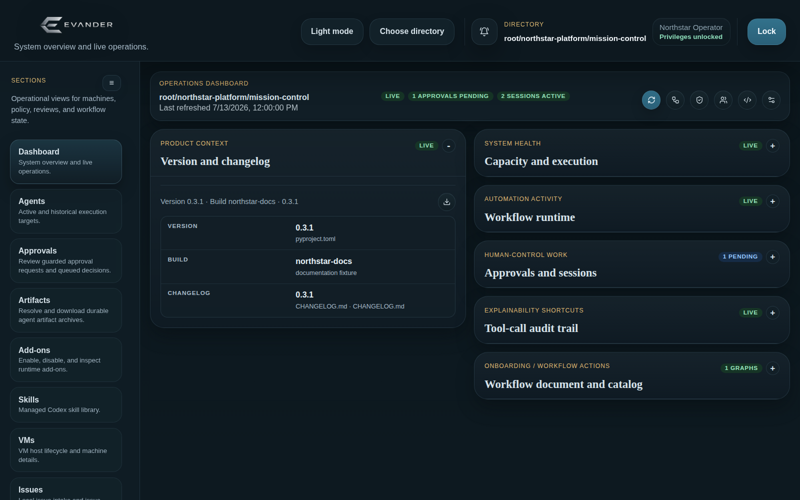

<p class="figure-caption">Figure 15.1 — The dashboard is an orientation layer over live detail APIs, not a replacement source of truth. Sanitized Northstar fixture.</p>

## Operator surfaces

The core interface exposes:

- dashboard health and automation activity;
- VMs, issues, agents, sessions, and logs;
- approvals, tool visibility, and read-only tool-call audit;
- workflow packs, editor, runs, reports, events, and webhooks;
- Git repositories, artifacts, skills, add-ons, and Team navigation;
- configuration, workers, capacity, model pricing/usage, users, and groups;
- chat and operator steering where enabled.

Use the selected directory as part of every diagnosis. Directory inheritance changes effective provider, policy, communication-target, workflow, and repository visibility. A root owner can see more than a project-scoped workflow maintainer; comparing their screens without noting scope is misleading.

Session IDs are durable control-plane identities. Creating a session fails when that ID already
exists rather than replacing its manifest. Supported deletion revokes the session's managed-Git
grants and bindings and removes its legacy PR-routing entries plus matching feedback cursors/items;
it does not delete the provider-side pull request or comments. Record those effects before
recreating an ID during recovery.

## Authentication, authorization, and privileged unlock

Signing in, being permitted to change a project, and temporarily unlocking a sensitive host operation are three separate decisions. A user may be able to see a page without being able to change it, or be able to change ordinary project settings without being able to perform a sensitive host action.

Authentication answers *who*. RBAC answers *whether that identity can act in this directory*. Privileged unlock is an additional per-login-session guard for sensitive host mutations. It does not add a missing RBAC permission and should not be treated as a permanent administrator mode.

Approval gates are separate again. A privileged owner can configure policy but an agent's gated tool invocation still needs its matching, unexpired approval. The approved tool, session, and payload digest must match at execution time.

> <span class="sidebar-kicker">Deeper detail</span> **Admin identity and inherited permissions**
>
> Admin users and groups are stored in `runtime/admin-web.db`. Built-in groups include owner, operator, workflow maintainer, workflow viewer, auditor, and viewer. Permissions are directory-scoped and inherited downward. Direct workflow write implies workflow read; ownership expands to the full permission catalog.

## Revision-checked changes

Configuration, workflow packs, model pricing, add-on enablement, and other shared documents expose a content revision. The client sends the revision it read. If another operator saved first, Evander returns a conflict instead of overwriting newer work.

On conflict:

1. preserve your intended change outside the form;
2. reload the current document and read the other change;
3. merge deliberately;
4. save against the new revision.

Never work around a revision conflict by writing the live JSON file directly. Workflow pack edits also use lock and revision behavior; a checked-in example pack is not necessarily the live operator pack.

## Observability and evidence

Start in Admin Web with the selected directory, then open the record closest to the symptom: a run, session, approval, tool call, worker, artifact, or Team item. Record the exact status and identifiers before refreshing or retrying. Those details let an administrator move from the interface to the matching service and durable record.

### Administrator detail: health and capacity

Start broad:

```bash
evander-cli status --runtime-dir runtime --json
systemctl --failed
```

The capacity endpoint, `/api/admin/capacity-health`, reports control-plane disk, known storage roots, session samples, and unavailable/permission-denied telemetry explicitly. Built-in disk thresholds warn below 15% free and become critical below 5% unless configured otherwise. “Unknown” is not healthy.

### Administrator detail: journals and structured runtime records

Use service journals for process startup, reload, provider transport, and worker-loop failures:

```bash
journalctl -u evander-admin-web.service --since today
journalctl -u evander-trigger-orchestrator.service --since today
journalctl -u evander-effect-orchestrator.service --since today
```

Then move to the durable domain record: session manifest, trigger event, orchestration row, effect attempt, wake dispatch, managed Git operation, or add-on database. Correlate by stable IDs and exact SHA, not timestamps alone.

### Tool-call audit

`runtime/audit.jsonl` is the canonical append-only tool-call and policy evidence by default. `runtime/audit.db` is a rebuildable search index used by Admin Web; it is imported incrementally from JSONL. If the index is corrupt or incomplete, preserve the JSONL and rebuild the index:

```bash
evander-cli rebuild-audit-index --config runtime
```

Audit redaction intentionally removes configured sensitive fields. Absence of a secret from an audit row is expected, not evidence that no credential was used.

The remainder of the backup and restore material is administrator reference. An operator reporting a problem should preserve the visible records and identifiers; they should not copy, replace, or delete runtime databases.

## Administrator reference: durable state inventory

Before backup or repair, inventory the configured paths. Common current stores include:


<p class="figure-caption">Figure 15.2 — A recoverable snapshot preserves every canonical store at one consistency boundary and rebuilds derived state only after restore.</p>

| Data | Typical location | Recovery role |
|---|---|---|
| Host/directory config | `runtime/host-config.json`, `runtime/directory-config/` | Effective runtime configuration |
| Sessions/issues/approvals and JSON repositories | paths below `runtime/` selected by config | Control-plane identity/state |
| Orchestration | `runtime/orchestration.db`, event journals | Workflow runs, jobs, effects |
| Audit | `runtime/audit.jsonl`; rebuildable `audit.db` | Security evidence/index |
| Admin identities | `runtime/admin-web.db` | Users, groups, grants |
| Managed Git | `runtime/managed-git-repositories.json`, `runtime/managed-git/` | Canonical cached objects and controlled refs |
| Published output | `runtime/published-artifacts/`, artifact-space metadata | Immutable deliverables and organization |
| Communications/wakes/usage | provider inbox DBs, wake DB, `model-usage.db` | Cursors, dispatches, observations |
| Add-on state | `runtime/addons/<id>/`, including Team `state.db` | Add-on-private durable records |
| VM and worker execution storage | libvirt images and configured worker storage | Running execution state, outside the runtime directory |

Ephemeral Git worktrees under `runtime/git-worktrees/` are reconstructible scratch space. Bare managed repositories are not the same thing and must not be discarded casually: host-only pinned and Team/review refs may not yet exist upstream.

Secrets and local service configuration—`config/*.env`, provider JSON, `secrets.env`, systemd environment, certificates—may live outside `runtime/`. Back them up separately with stricter permissions. Never place them in published artifacts or documentation captures.

## Administrator procedure: consistent backup

There is no single “copy this directory while everything runs” guarantee across JSON, SQLite WAL, bare Git, add-on databases, VM disks, and external providers. Choose a consistency boundary.

For a control-plane backup:

1. Record the Evander revision, installed package version, effective config paths, enabled add-ons, and current service list.
2. Quiesce writers: stop trigger/effect, provider ingest/wake, Admin Web, gateway mutations, worker control, and add-on services as appropriate. Keep the outage explicit and bounded.
3. Confirm no managed Git operation or Team lease is active. Do not freeze midway through an upstream push.
4. Back up `runtime/`, including SQLite `-wal`/`-shm` companions if any remain. With services stopped, a file-level snapshot is consistent; while live, use SQLite's backup API per database rather than `cp`.
5. Back up external execution storage only if recovery must resume those exact VMs/worker homes. Otherwise record that executions will be recreated.
6. Back up operator config and secrets separately with restrictive ownership.
7. Hash the backup, record its scope/time, and test restore into an isolated path.
8. Restart services in dependency order and run the health checks below.

External provider state is not captured by this backup. Record outstanding PRs, messages, and call IDs when an incident or migration requires end-to-end reconciliation.

## Administrator procedure: restore and recovery

Restore to a compatible checkout/package revision first. Keep services stopped while placing runtime and secrets. Restore file ownership and modes, then initialize only missing state—do not run `init-state` over a restored runtime without reviewing what it will seed.

Recommended order:

1. host config, directory config, secrets, and admin identity store;
2. runtime databases/JSON/journals and add-on state;
3. managed bare repositories and published artifacts;
4. optional VM disks or worker storage;
5. firewall and relay services;
6. Admin Web/gateway, then trigger/effect and provider/wake workers.

After startup, verify:

```bash
evander-cli status --runtime-dir runtime --json
./scripts/install_systemd_units.sh --preflight
```

Check SQLite integrity with the SQLite tooling appropriate to each database, inspect migration provenance where retained, and verify a read through the owning API. Rebuild only derived indexes such as `audit.db`. Do not replace a current SQLite authority with a retired JSON file; restore only the canonical database or an approved backup.

For a partially failed operation, prefer domain reconciliation over rollback by file editing. Examples: reconcile a managed Git operation against its pinned SHA and destination lease; reconcile an effect attempt against provider state; reconcile a Team lease/outbox entry through Team operations; reconcile a wake against its dispatch history.

## Failure behavior

An operator can use the first and third columns to describe what they see and which evidence an administrator should collect next.

| Symptom | Interpretation | Next evidence |
|---|---|---|
| Admin Web is unavailable | UI process/config/auth may be down; runtime can still be intact | service status/journal, then CLI and files |
| UI shows revision conflict | Concurrent write was detected | reload and merge; do not force file write |
| Tool Calls is empty but JSONL has rows | Search index is stale/corrupt | audit index status and rebuild |
| Dashboard says unknown capacity | Collection failed or lacks permission | endpoint errors and filesystem ownership |
| SQLite says locked | A live writer or abandoned operation holds access | identify owning service; do not delete WAL/lock files |
| Restored worker repeats effects | Store/provider boundary was captured inconsistently | inspect effect idempotency key and provider state before enabling workers |
| Team/Add-on data is missing after restore | Private add-on directory was omitted or wrong add-on not loaded | restored add-on state, enablement, restart, API read |

## Troubleshooting and operator handoff

In Admin Web, select the affected directory and record the expected outcome, the last completed step, and the exact visible error. Capture the session, workflow run or trace, source event, approval, effect, task, or release ID that is relevant; capture only the identifiers that exist for this incident.

If repeated work could change an external system, do not keep retrying while the result is uncertain. Tell the administrator what has already been attempted and whether an external issue, message, Git ref, or release may have changed. Do not delete audit rows, SQLite side files, workflow packs, leases, or worktrees to make the interface look clean.

## Administrator incident runbook

1. **Stabilize.** Stop only the component causing unsafe repeated mutations; preserve journals and state files before repair.
2. **Declare scope and time.** Record directory, session/workflow/effect/provider IDs, commit SHA, and first observed failure.
3. **Read durable truth.** Inspect the owning repository/database and provider. Treat UI caches and derived indexes as secondary.
4. **Build the event chain.** Trigger → workflow run/job → effect attempt → provider result → wake/session, or issue → session → managed ref → pinned SHA → publication.
5. **Classify uncertainty.** Distinguish “not attempted,” “attempt failed,” and “provider may have accepted.” The last case requires reconciliation before retry.
6. **Repair through the owner.** Use Admin/API/CLI service operations, migrations, maintenance, or an isolated restore. Avoid direct live edits.
7. **Verify both sides.** Check local state, external provider state, audit entry, and user-visible result.
8. **Capture prevention.** Add a focused regression test, update the runbook/CHANGELOG, and retain a redacted incident timeline.

## Source trail

- `src/evander/admin/composition.py`
- `src/evander/admin/web/app.py`
- `src/evander/admin/web/rbac.py`
- `src/evander/admin/web/shared.py`
- `src/evander/admin/services/operations_service.py`
- `src/evander/admin/services/approval_audit_service.py`
- `src/evander/admin/services/capacity_health_service.py`
- `src/evander/capacity_health.py`
- `src/evander/repositories/audit_index.py`
- `src/evander/admin/web/user_store.py`
- `docs/operations.md`
- `docs/admin-ui-user-manual.md`
- `scripts/install_systemd_units.sh`
- `tests/test_admin_web_rbac.py`
- `tests/test_admin_web_config_mutation_auth.py`
- `tests/test_admin_web_tool_calls.py`
- `tests/test_capacity_health.py`
- `tests/test_operations_admin_service.py`


<div class="page-break"></div>

# Part III: Team Add-on

Move from the Team domain model through commands, wakes, collaboration, review, and exact-SHA release publication.

# 16. Team Add-on Boundary and Domain Model

> **At a glance.** Core Evander knows how to run bounded agent work safely. The Team Add-on adds the organizational story around that work: who belongs to a team, what a project is trying to achieve, who owns a task, who reviews it, and how a release is governed. This chapter draws the line between those responsibilities so Team coordination does not become a second, competing execution system.

## What Team adds—and what it leaves alone

Core Evander is responsible for running work safely. The Team Add-on is responsible for organizing that work. Keeping those jobs separate means an operator can change who owns a task without accidentally changing sandbox policy, and can change an execution backend without rewriting the Team's reporting structure.

Team is optional: it is a second control plane inside Evander, not a second product or a competing execution system. Core continues to own sessions, execution backends, workflows, managed Git, communications, artifacts, policy, and model usage.

For the Northstar example, the distinction looks like this:

- Team can say that Imani owns the telemetry-retry task; core Evander decides which isolated session may perform it.
- Team can say that Rowan must review the result; core Evander records and checks the exact commit Rowan reviewed.
- Team can say that Riley has release authority; core Evander still enforces the Git lease and publication checks.

Evander core therefore answers questions such as “which isolated session should run?”, “which tools may it use?”, and “which pinned commit may be published?” The Team Add-on answers a different set:

- Which persistent agent is the manager, lead, implementer, or reviewer?
- Which project, case, task, deliverable, review, or release does an action belong to?
- Who may direct, review, stand down, delegate, or publish work?
- What durable context should survive an individual model conversation?

The distinction matters operationally. A Team agent refers to a core Evander session, but it is not the session. A Team project may refer to a core managed repository, but it does not own the upstream repository definition. A Team release requests core Git effects, but it does not bypass their leases and compare-and-swap checks.

> <span class="sidebar-kicker">Technical sidebar</span> **How the add-on joins Evander**
>
> The add-on is loaded through Evander's generic add-on mechanism. It contributes:
>
> - a self-contained Admin UI at <code>/addons/team-addon/</code>;
> - an Admin API below <code>/api/addons/team-addon/</code>;
> - Team-owned MCP read and command tools;
> - trigger, query, and effect providers;
> - the registered <code>team-runtime.v1</code> workflow-pack definition.
>
> No Team-specific model has to be embedded in core Admin Web or the core gateway. Disabling the add-on removes those registered surfaces; it does not turn Team records into core records.


<p class="figure-caption">Figure 16.1 — Team owns organizational truth while core owns execution and integration capabilities.</p>

## Canonical and derived state

When Team information disagrees between two screens or services, begin with the record that owns the fact. Team roles, projects, tasks, reviews, and releases belong to Team state. Sessions, repositories, workflow runs, artifacts, and model usage remain core Evander records that Team refers to by stable ID.

Some convenient views are copies or summaries. They can be refreshed or rebuilt; changing one of them does not change the underlying Team record.

> <span class="sidebar-kicker">Technical sidebar</span> **The canonical Team store**
>
> The canonical Team database is relational SQLite:
>
> <code>runtime/addons/team-addon/state.db</code>
>
> It contains the validated Team domain plus command-support tables for dispatch activity, idempotency, and the durable outbox. The store uses foreign-key enforcement, a busy timeout, write-ahead logging, and serialized write transactions. A new database initializes an empty Team state; retired <code>state.json</code> files are not read.

The following useful projections are deliberately non-canonical:

| Projection | Purpose | Rebuild or recovery rule |
|---|---|---|
| Core session <code>metadata.team_addon</code> | Compact routing and operator context | Refresh it from Team state; never edit it as Team truth. |
| Team UI view payloads | Scoped, revision-tagged read models | Reload after an invalidation or revision conflict. |
| Qdrant Team-memory collection | Semantic retrieval index | Reindex from canonical memory records. |
| Timeline view | Human-readable events derived from current state | Do not treat it as an append-only audit log. |
| Artifact-space and managed-Git records | External durable capabilities referenced by Team state | Diagnose them in their owning core services as well as Team state. |

This boundary prevents a common debugging error: changing a session manifest, a Qdrant point, or a UI payload does not repair the Team record that produced it.

## The domain from the outside in

The durable model follows the same questions an operator asks while work moves through a Team:

1. **Who is responsible?** Teams, roles, agents, and reporting lines describe the organization.
2. **What are they trying to accomplish?** Projects and goals describe the intended outcome.
3. **What work exists now?** Cases and tasks hold intake and assignable work.
4. **What proves the work is ready?** Deliverables, reviews, and releases hold evidence and decisions.
5. **What must survive the next conversation?** Runtime, communication, and memory records preserve continuity.

The exact record types below are useful when reading the UI, API, or later chapters.

### Organization

A <code>Team</code> has a manager, optional cost cap, optional operator communication target, projects, roles, agents, and a policy that chooses direct operator escalation or governance escalation. A <code>GovernanceGroup</code> spans one or more Teams and has its own manager and agenda.

A <code>TeamRole</code> names an organizational function. It may be project-scoped and may grant narrow permissions such as <code>create_root_task</code> or <code>request_release</code>. A <code>PersistentAgent</code> binds an organizational identity to a core Evander session. Reporting lines and project assignments are explicit records, not deductions from a display name.

### Work

A <code>Project</code> groups goals and executable work. It may reference a core <code>managed_repo_id</code>, base branch, canonical release prefix, and release policy. A <code>Case</code> holds intake and lifecycle context; a <code>Task</code> is the assignable unit of execution. Tasks can form parent/child and dependency graphs.

The links around a task are intentionally not interchangeable:

| Link | Meaning | Does it gate completion? |
|---|---|---|
| <code>parent_task_id</code> | This task is a constituent part of the parent outcome. | Yes. Every descendant must resolve before the parent can resolve or release. |
| <code>dependency_task_ids</code> | Another task must resolve before this task is actionable. | It always gates readiness. For Git-backed work, accepted current Git deliverables from direct dependencies are also composed into the prepared successor checkout; a dependency with no Git deliverable remains lifecycle-only. |
| <code>originating_task_id</code> | Work on another task caused this independent work to be created. | No. It is provenance only and grants no creation or access authority. |
| <code>case_id</code> | Several tasks share one intake, correction, or feedback story. | No. The case groups records; task and finding state still decide completion. |
| <code>source_deliverable_ids</code> | A parent deliverable incorporated these exact accepted direct-child outputs. | Yes for contribution coverage. Transitive lineage is derived recursively. |

If work can continue independently after another task finishes, model it as an
independent root, optionally with <code>originating_task_id</code>. Do not make it
a child merely because one task discovered or requested it.

An explicit <code>integration_boundary</code> marks a final acceptance boundary
regardless of task title or hierarchy depth. Its <code>deliverable_contract</code>
can require pinned Git provenance and the exact direct-child or dependency task
contributions that the final deliverable must name. Parent containment does not
itself inherit Git content: use dependencies for accepted predecessor commits
that the successor checkout must compose, and
<code>source_deliverable_ids</code> for exact contribution evidence.

### Evidence and decisions

A <code>Deliverable</code> records an agent's evidence for a task: artifact references, a pinned Git context, verification status, contribution sources, and supersession history. A <code>ReviewRequest</code> binds a deliverable, reviewer, optional profile, criteria, findings, and immutable decision. A <code>ReleasePackage</code> freezes accepted scope and the candidate evidence needed to decide whether publication is safe. When policy requires a person to test or accept the candidate, a <code>HumanReviewRequest</code> pins that same candidate and a <code>HumanReviewFinding</code> preserves any requested correction through a later successor release.

### Runtime and communication

<code>AgentRuntime</code> records leases, wake timing, context-rotation policy, and no-progress state. A durable <code>TeamDispatch</code> records the immutable task, blocker, review, inbox, project, and repository scope actually delivered by one wake. <code>GitWorkContext</code> records dispatch-bound checkout authority, while <code>WorktreeCleanupCandidate</code> retains the evidence needed to reclaim one resolved or reassigned task checkout safely. Inbox items, conversations, messages, stand-downs, ephemeral assignments, Git promotions, blockers, and governance agenda items connect durable intent to asynchronous runtime work.

### Memory

<code>TeamMemory</code> preserves decisions, preferences, facts, runbooks, postmortems, research, and handoffs. Scope and visibility remain part of the canonical record even when semantic search is enabled.


<p class="figure-caption">Figure 16.2 — Durable Team records connect organization, work, evidence, runtime, and governance.</p>

## Northstar: one thread through the model

Throughout this manual, Northstar uses the stable fixture below:

| Record | Example |
|---|---|
| Team | <code>northstar-platform</code> |
| Project | <code>mission-control</code> |
| Manager | Mira |
| Project lead | Priya |
| Implementer | Imani |
| Reviewer | Rowan |
| Release agent | Riley |
| Work | Add safe retry behavior to telemetry delivery |

Mira is the Team manager and organizational root. Priya leads <code>mission-control</code>. Imani owns the telemetry retry task. Rowan reviews its deliverable under the project's review policy. Riley has release authority but does not acquire managerial authority merely by holding it.

This example demonstrates why the records stay separate. Mira's Team role, Priya's project leadership, Imani's task ownership, Rowan's assigned review, and Riley's release permission are five independent authorization facts. A friendly title such as “senior engineer” would not safely encode them.

## Deeper detail: invariants that protect the graph

An operator normally encounters these rules as a rejected edit with a useful explanation: for example, a task cannot depend on itself through a cycle, and a reviewer cannot be silently borrowed from another project. Underneath that behavior, the repository validates the complete next state before committing it. Important invariants include:

- referenced Teams, projects, roles, agents, tasks, cases, deliverables, and reviews must exist and have compatible scope;
- an agent attached to a Team has a valid role and reporting relationship; a teamless agent cannot retain Team reporting metadata;
- a project lead and project members are registered agents of the owning Team;
- parent and dependency task links cannot create cycles or cross project boundaries;
- case/task links are bidirectional and remain in the same Team and, where applicable, project;
- task ownership, deliverable production, review assignment, and release scope must agree;
- IDs and map keys agree, and enumerated states are validated;
- a Team manager remains the reporting root rather than an ordinary subordinate.

Task states are <code>pending</code>, <code>in_progress</code>, <code>blocked</code>, <code>waiting_for_review</code>, <code>finished</code>, <code>accepted</code>, <code>rejected</code>, and <code>cancelled</code>. Cancellation is a terminal, reason-coded disposition with actor, time, and optional successor; it is not a synonym for acceptance or an editable description. Cases use <code>open</code>, <code>triage</code>, <code>in_progress</code>, <code>waiting</code>, <code>resolved</code>, and <code>closed</code>. Other records have domain-specific state machines; do not infer that the same word has identical transition rules everywhere.

Agents enter and leave intrinsic blocked work through
<code>team_report_blocker</code> and source-aware blocker resolution. Generic
Admin task <code>PATCH</code> rejects transitions into or out of
<code>blocked</code>. Repair a legacy contradiction through
<code>POST /api/addons/team-addon/tasks/&lt;id&gt;/repair-state</code> with a
required reason; the linked blocker event history retains the Admin actor and
references.

Task resolution and readiness are also derived, not hand-maintained. The recursive
<code>TaskAssessment</code> first detects invalid historical or structural state,
then valid terminal dispositions, blockers, unresolved descendants,
dependencies, acceptances, and reviews. A blocked child therefore leaves its
parent waiting on children while exposing the child's canonical blocker; Team
does not manufacture a second parent blocker.

Task read payloads carry that relationship as a non-persisted, deduplicated
<code>inherited_blockers</code> projection with the upstream task ID, canonical
blocker ID, reason code and explanation, source, owner/delegate, route, and
escalation context. Scoped reads omit a row when its upstream task or blocker
is outside the caller's visible records.

The project status is recalculated from its goals, assessments, reviews,
releases, human requests, findings, and canonical blockers. A project becomes
complete only when its goals are accepted, every task is validly resolved, and
no acceptance, review, release, human finding, or blocker remains active. It is
not an operator-maintained cosmetic flag.

## Deeper detail: how writes enter Team state

Three supported write paths share the repository rules:

1. Ordinary Admin API and UI domain mutations use an explicit expected Team revision. Append-specialized surfaces such as Chat use their own current-record contract.
2. Team MCP commands run with session-derived identity and a current dispatch context.
3. Team workflow effects perform operator-authored automation through registered providers.

Templates are a fourth convenience surface, but they materialize the same Team records through one optimistic mutation. A template does not create a core session, VM, container job, managed repository, or external accounting action. Those resources must already exist or be created through their owning Evander flows.

Reads are grouped rather than duplicated across every chapter. Operators use the scoped Team UI views and Admin API. Agents use Team list/get tools such as tasks, inbox, cases, deliverables, reviews, releases, projects, agents, runtime attention, identity, and memory search. During an active wake, <code>team_get_current_dispatch_context</code> hydrates the immutable dispatch scope and its scoped task, inbox, blocker, review, project, and Git records; it does not widen that scope. Workflows use <code>query:team:state</code>, <code>query:team:memory</code>, and <code>query:team:session-routing</code>.

## Troubleshooting

Begin with the owning record and its stable ID. If the Team UI and a core Evander view disagree, do not choose one at random and edit it; decide whether the disputed fact is Team-owned or core-owned, reload the relevant view, and follow the reference between them.

| Symptom | Likely boundary mistake | Correct first move |
|---|---|---|
| Team UI shows stale data after a write | A scoped projection was retained across a revision invalidation. | Reload the affected view and compare its revision. |
| A session exists but no Team agent can act | Core session creation was mistaken for Team registration. | Register the persistent agent and validate its Team role and project assignment. |
| Editing session metadata has no lasting effect | A mirror was changed instead of canonical Team state. | Repair through the Team API or supported command surface. |
| A managed repository cannot be found | Team state contains an obsolete or wrong managed-repository ID. | Inspect the core managed-Git registry, then update the project through the revision-checked API. |
| Legacy JSON changes are ignored | SQLite has already been initialized. | Treat <code>state.db</code> as authoritative; do not replay JSON over it. |
| A Timeline row is missing an old intermediate value | Timeline was mistaken for an audit ledger. | Use command activity, workflow runs, Git promotion records, and external audit stores appropriate to the event. |

## What to hand to an administrator

From the Team UI, capture the selected Team and project, the affected agent or work-record ID, the current Team revision, and the visible symptom. If the issue crosses into core Evander, also capture the referenced session, managed repository, workflow run, artifact, communication target, or model-usage ID. Say which screen or action produced the discrepancy and whether reloading changed it.

Do not repair a mismatch by editing session metadata, a Qdrant point, generated UI data, or SQLite. Those changes either target a projection or bypass the model rules that keep the records consistent.

## Administrator runbook

For a live deployment:

1. Confirm the add-on is enabled and registered before interpreting missing Team routes as missing data.
2. Read the broad status and Team bootstrap/view payloads through the supported UI or API.
3. For a state discrepancy, inspect <code>runtime/addons/team-addon/state.db</code> with the current schema. Prefer the deployment's own Evander environment and a read-only or safely copied database.
4. Compare the relevant core resource by stable ID: session, managed repository, workflow run, artifact ref, communication target, or model-usage record.
5. Perform repairs through the Team API, UI, MCP command, or workflow effect that owns the invariant. Do not edit SQLite rows by hand.
6. Verify the new revision, the affected scoped view, and any queued outbox or workflow work.

For backup, use a SQLite-consistent backup mechanism or stop writers before copying the database. Back up referenced artifacts, avatars, core voice-session records, managed repositories, workflow configuration, and model-usage data separately; not all of those bytes live in Team SQLite.

## Source trail

- <code>src/evander_team_addon/addon.json</code> and <code>src/evander_team_addon/__init__.py</code> — add-on identity, UI/API mounts, MCP registration, providers, and runtime-pack registration.
- <code>src/evander_team_addon/models.py</code> — canonical domain types, state machines, graph validation, and project derivation.
- <code>src/evander_team_addon/repository.py</code> and <code>src/evander_team_addon/sqlite_store.py</code> — optimistic repository updates, relational persistence, migration, and schema.
- <code>src/evander_team_addon/api.py</code>, <code>mcp.py</code>, and <code>providers.py</code> — the three supported integration surfaces.
- <code>docs/addons.md</code> — add-on loading, Team boundary, UI, and operator contracts.
- <code>tests/test_team_addon_models.py</code>, <code>tests/test_team_addon_repository.py</code>, and <code>tests/test_team_addon_api.py</code> — domain invariants, storage behavior, and mounted UI/API behavior.


# 17. Enabling and Operating the Team Add-on

> **At a glance.** The Team Add-on is enabled from Admin Web and becomes part of the same Evander installation after its services are restarted. Once enabled, its views let operators inspect teams, projects, tasks, conversations, reviews, releases, and governance in one place. This chapter covers both the initial readiness check and the everyday habits that prevent one operator from overwriting another's recent change.

## What enabling Team changes

Enabling Team adds a coordinated set of screens and background capabilities to the existing Evander installation. After the required services restart, operators can create the organization, connect persistent agents to existing Evander sessions, follow work, and handle reviews and releases. The add-on does not create those sessions, repositories, or execution environments on its own.

There are two useful readiness questions:

1. **Can people open and use the Team views?** This checks the add-on UI and API.
2. **Can Team work actually run?** This also needs the gateway, workflows, sessions, and whichever integrations the chosen process uses.

A working screen with stalled background work is therefore possible and diagnosable. It does not mean the enablement setting was ignored.

## Before enabling it

An operator should know which Team features the installation intends to use and who can restart the affected Evander services. Features such as managed Git, semantic memory, or external communication can be added when needed; they are not prerequisites for every Team.

> <span class="sidebar-kicker">For administrators</span> **Package and service prerequisites**
>
> The bundled Python package must include <code>evander_team_addon</code>, its <code>addon.json</code>, and the packaged UI assets. The deployment also needs the core capabilities used by the workflows you intend to run:
>
> - persistent Evander sessions for registered Team agents;
> - a working gateway for Team MCP tools;
> - trigger and effect orchestrators for wakes and asynchronous effects;
> - a configured execution backend for persistent and ephemeral work;
> - managed Git, artifact publication, communications, model relays, and Qdrant only where the chosen Team features need them.

The add-on is disabled by default. Enabling it is a host configuration change, not merely a browser preference.

## Enablement flow

The supported operator path is:

1. Open Admin Web at <code>/#addons</code>.
2. Select **Team Add-on** and enable it.
3. Save the revision-checked change.
4. Let the Add-ons service materialize the registered <code>team-runtime.v1</code> definition into operator-owned workflow configuration.
5. Restart every service listed by the page, normally including Admin Web, the trigger orchestrator, the effect orchestrator, and the gateway.

If the operator cannot restart host services, record the saved configuration revision and the restart list shown by Admin Web, then hand those to an administrator. Do not expect the new screens, tools, and workflow providers to appear consistently until that restart boundary has been completed.

> <span class="sidebar-kicker">Deeper detail</span> **Configuration and runtime-pack ownership**
>
> Equivalent configuration sets <code>addon_loader.enabled_addon_ids</code> to include <code>team-addon</code>. Explicit module and Python entry-point loading remain compatibility mechanisms, but the Add-ons page is the normal operational surface because it coordinates host and worker configuration and reports the restart boundary.
>
> When the packaged runtime definition changes, use **Refresh runtime pack** on the same page or its equivalent revision-checked Admin API action. A live workflow pack is operator state. Never copy over its JSON file, rewrite it from a checkout, or race another editor with a stale document.

## Administrator check: verify the complete registration

After restart, verify all four planes:

| Plane | Positive check |
|---|---|
| Admin | <code>/api/admin/state</code> lists <code>team-addon</code>. |
| UI and API | <code>/addons/team-addon/</code> loads and <code>/api/addons/team-addon/templates</code> returns a catalog. |
| MCP | The gateway exposes Team tools only in an authorized Team context. |
| Workflow | The workflow editor catalog and validator recognize <code>trigger:team:*</code>, <code>query:team:*</code>, and <code>effect:team:*</code> providers. |

A <code>404</code> from all Team routes usually indicates loading or restart state. An empty Team view with working routes usually indicates valid but empty Team state. Those are different failures.

## The fifteen operator views

An operator does not need to learn all fifteen views at once. **Workspace** is the broad starting point; **Operations** answers “why is an agent waiting?”; **Delivery** follows evidence, reviews, and releases; and **Teams**, **Projects**, **Task board**, and **Cases** hold the main organizational and work records. The remaining views support communication, dispatch activity, memory, governance, planning, history, and reporting structure.

The add-on UI currently has these top-level views:

| View | Primary purpose |
|---|---|
| **Workspace** | Broad operational summary and the next records that need attention. |
| **Operations** | Wake, lease, session, context, stand-down, and runtime attention. |
| **Delivery** | Attention-first, project-grouped deliverables, reviews, releases, Git promotions, and exact gate evidence. |
| **Memory** | Durable Team memory and semantic-index operations. |
| **Projects** | Project goals, leads, Git configuration, and release policy. |
| **Task board** | Task ownership, hierarchy, dependencies, state, and priority. |
| **Cases** | Intake records, lifecycle state, external references, and linked tasks. |
| **Teams** | Team setup, persistent agents, roles, assignments, and stand-down controls. |
| **Chat** | Human-operator conversations with one persistent agent. |
| **Mail** | Sent and received projections over one durable Team inbox collection. |
| **Activity** | Redacted dispatch/tool success and failure history, filterable by Team, agent, dispatch, status, and tool. |
| **Governance** | Cross-Team groups, agendas, cost warnings, and directives. |
| **Planning** | Planning-oriented summaries of goals and work. |
| **Activity timeline** | A derived chronological rendering of current Team records. |
| **Org chart** | Reporting hierarchy and operational details per agent. |

There is no top-level **Roles** view. Roles are maintained inside **Teams** and setup/edit forms. Reviews and releases similarly live inside **Delivery**, not separate top-level tabs.

**Delivery** opens on records that still need attention. Projects remain
collapsed until selected or opened, and the project selector and status filters
narrow the workspace without removing accepted or historical records from
**All records**. Opening a deliverable shows the evidence stages that current
state can prove: implementation, deliverable acceptance or agent review,
release inclusion, automated verification, release-agent review, human review,
and publication. The view calls out the current stage and blocker rather than
presenting every record as equally urgent. For release-backed work, **Load exact
gate evidence** reads the existing permission-filtered release detail so
individual verifier attempts and review decisions appear only when authorized
evidence is available.

When a project policy enables the human release gate, **Delivery** also exposes
**My Human Reviews** and the human-review detail on the release. The filter is
assignment-aware: it shows requests the signed-in Admin user may currently
decide, not every release the user can read. The detail keeps the immutable
candidate SHA and tree beside automated verification, agent review decisions,
test instructions or prepared preview target, checklist, carried findings,
release-attempt lineage, and publication state.

The initial human actions are **Approve**, **Request changes**, and **Blocked**.
They are release decisions, not ordinary Team-agent commands. A decision
requires the current request revision, an idempotency key, privileged-operation
confirmation, the directory-scoped
<code>team.human_reviews.decide</code> permission, and current assignment
eligibility. There is deliberately no MCP tool that can decide on behalf of a
person.

The Org chart is diagnostic as well as visual. Agent nodes expose session, project, reporting, task, inbox, wake, and ephemeral-capacity information when available. It renders unreachable or malformed references for inspection; rendering never repairs persisted state.

The task board and task detail expose **Cancel task** as a separate audited
action. Its dialog requires a stable reason code and explanation and may name
an optional same-project successor. When lifecycle rules forbid cancellation,
the action remains visible but disabled and its hover explanation names the
unresolved descendants, active acceptance, or active review that must be
settled first. The generic task editor cannot move work directly into
<code>accepted</code> or <code>cancelled</code>.

**Planning** and **Task board** use the same revision-checked task editor. When a
title, description, owner, dependency frontier, deliverable contract, or another
preparation input changes after Git preparation, Team abandons that context and
queues a fresh generation. The task status distinguishes queued re-preparation,
an active agent lease, and a review awaiting dispatch. A priority-only edit does
not invalidate the checkout.

Background state and cost refreshes preserve open **Planning** project, task,
hierarchy, full-brief, worktree, and technical-detail disclosures, so a live
update does not collapse the operator's place in a long task. Disclosure state
is scoped to the owning Team view, and project-local goal keys are additionally
scoped by project, so shared renderers and repeated local IDs cannot couple
hidden copies. Chat state-stream and automatic refreshes similarly preserve a
reader's scroll position; an intentional thread change, send, or already-bottom
transcript still follows the newest message.

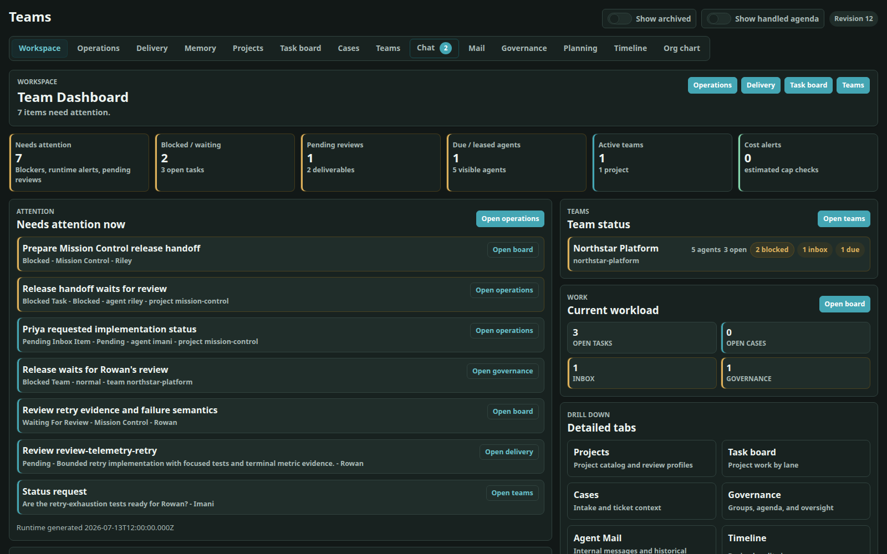

<p class="figure-caption">Figure 17.1 — Workspace brings cross-cutting attention together while retaining links to the owning detailed view. Sanitized Northstar fixture.</p>

## Bootstrap Northstar

The quickest way to learn the UI is to preview a built-in template, such as the development-squad template, then materialize it once. Templates create Team-domain records in a single optimistic write. For the Northstar example, use stable IDs and names:

- Team <code>northstar-platform</code>, managed by Mira;
- project <code>mission-control</code>, led by Priya;
- Imani as implementer, Rowan as reviewer, and Riley as release agent;
- project goal and root task for safe telemetry retry behavior.

Before materialization, create or identify the Evander sessions that the persistent agents will reference. A Team template does not provision VMs or containers, create sessions, register managed repositories, push Git branches, or contact an external service.

After materialization:

1. Inspect the reporting tree in **Org chart**.
2. Confirm each agent's stable session mapping and active status in **Teams**.
3. Confirm Priya's project-lead assignment in **Projects** without changing her reporting role.
4. Inspect Imani's task in **Task board** and any intake case in **Cases**.
5. Leave release policy and managed Git unset until the corresponding core resources and verification design are ready.

## When two changes happen at once

Suppose one operator changes Imani's task while another changes the same Team from a different screen. Team does not silently let the last browser overwrite the first operator's work. It detects that the state has advanced and asks the later editor to reload, compare, and deliberately apply the intended change to the current record.

The practical response is straightforward:

1. Preserve the intended edit.
2. Reload the affected record.
3. Compare what changed while it was open.
4. Merge or reapply the intent deliberately.
5. Save again and verify the result.

> <span class="sidebar-kicker">Deeper detail</span> **Revisions, scoped reads, and conflict policy**
>
> The canonical Team state has a monotonically advancing revision. Ordinary domain edit routes require <code>expected_revision</code>:
>
> - missing or null revision returns <code>400</code>;
> - a stale revision returns <code>409</code>;
> - a valid mutation commits the complete validated state and advances the revision.
>
> The UI does not need to reload the full state after every successful write. Endpoints return scoped views and revision invalidations. A state stream can announce that a newer revision exists without embedding all changed records.
>
> Some edit flows support a narrowly defined conflict policy, <code>target_unchanged</code>, with a base resource token. That allows a mutation to rebase only when the particular target still matches what the operator read; creation can rebase only when the explicit ID is still absent. It is not a general “last writer wins” switch.
>
> Append-only Chat send is the important exception. It validates the current conversation and agent and deliberately does not reject a message merely because an unrelated global Team revision advanced. Conversation ownership, signed-in operator identity, agent eligibility, and the asynchronous dispatch rules still apply.
>
> When a <code>409</code> occurs:
>
> 1. Preserve the operator's intended change.
> 2. Reload the affected record and current revision.
> 3. Compare the concurrent change field by field.
> 4. Reapply or deliberately merge the intent.
> 5. Submit against the new revision and verify the returned view.

Never solve a conflict by directly replacing a live pack file or Team database.

## UI identity, privilege, and special media

Administrative mutations are protected by Admin authentication and the add-on's privileged-mutation guard. Human release decisions additionally require a real session principal; client-supplied user or actor fields are rejected rather than falling back to a generic administrator identity. Assignment is reconciled against current group membership and permission before notification, reassignment, resume, or decision. If no eligible reviewer remains, the same request and candidate become blocked until an audited reassignment or directory repair restores eligibility.

Chat creation and message submission follow the signed-in human conversation contract rather than pretending to be an agent command; users inspecting another operator's Chat through <code>team_chats.read_all</code> receive read-only behavior.

Optional avatars are UI metadata. Uploaded PNG, JPEG, or WebP images are normalized to square WebP under the Team add-on runtime directory. An OpenAI-generated preview becomes durable only after explicit acceptance. Avatars are not injected into prompts or used as core session identity.

Browser voice calls use OpenAI Realtime with a projection of the selected agent's Team context. They are not DIDWW, Asterisk, or SIP calls. Core voice-session records live outside the Team database; a call started from Chat can be projected back into that conversation as a system message.

## Troubleshooting

Use the symptom to distinguish registration from empty state and foreground UI from background runtime. Capture the enabled configuration revision, the selected Team or project, the failing page or action, and any visible run or session ID before asking for host-level help.

| Symptom | Cause to test first | Recovery |
|---|---|---|
| Add-on appears enabled but Team UI is absent | Admin Web was not restarted or packaged UI files are missing. | Restart the listed unit and verify the installed package contents. |
| UI loads but tools are missing | Gateway was not restarted with the add-on enabled. | Restart the gateway and test from an authorized Team session. |
| Workflow pack validates as unknown nodes | Trigger/effect service config did not load the add-on or pack refresh was incomplete. | Verify enabled IDs in both runtime configurations, restart, then refresh through the Add-ons API. |
| Template materialization rejects agent references | Core sessions or chosen Team agent IDs do not match the template inputs. | Correct the mapping; do not invent placeholder sessions for production use. |
| Repeated <code>409</code> writes | Another operator or runtime command is advancing Team state. | Reload narrowly, merge intentionally, and retry once with the new revision. |
| An enabled add-on has no runtime behavior | The registered pack is disabled, invalid, or its orchestrators are stopped. | Inspect the live workflow document, validation report, run history, and service state. |
| Human review is visible but actions are disabled | The signed-in user is not a current eligible assignee, lacks the directory permission, or privileged operations are locked. | Inspect assignment, group membership, scoped RBAC, and the privilege banner; do not supply another user's ID. |
| Human review says assignment unavailable | No current assignee satisfies the snapshotted reviewer groups or an audited explicit assignment. | Repair directory membership or use the authorized reassignment action; resume the same request rather than creating a replacement release. |

## Operator checklist

After enablement, an operator can confirm that **Workspace** loads, create or preview a Team, inspect its reporting structure, and make one harmless revision-checked edit. If agents should run, also confirm that a wake appears in **Operations** and that the expected Team tools and workflow nodes are available. A failure in that second group is useful evidence for an administrator even when the UI itself works.

## Administrator runbook

### Enable

1. Confirm package and UI assets.
2. Enable **Team Add-on** at <code>/#addons</code>.
3. Save and record the resulting configuration revision.
4. Restart every service named by the page.
5. Verify Admin, UI/API, MCP, and workflow registration.

### Establish a new Team

1. Create persistent core sessions with the right backend and model configuration.
2. Register or select any managed Git repository in the core registry.
3. Preview a Team template or create the Team, roles, agents, project, and assignments explicitly.
4. Configure project Git using only <code>managed_repo_id</code>; configure release policy deliberately.
5. Create the first case, goal, and root task, then confirm reporting and ownership in the Org chart.
6. Trigger or wait for a wake and verify the Operations view, session logs, and resulting command activity.

### Upgrade

1. Deploy the new package.
2. Read release notes and back up Team SQLite plus external referenced stores.
3. Restart through the normal service procedure.
4. Refresh the registered runtime pack through the Add-ons page.
5. Validate it before enabling or resuming runs.
6. Smoke-test a read, a harmless revision-checked edit, one agent wake, and one asynchronous outbox event.

## Source trail

- <code>src/evander_team_addon/__init__.py</code>, <code>addon.json</code>, and <code>ui_static/</code> — registration, mounts, and the current fifteen-view UI.
- <code>src/evander/admin/web/addons.py</code> and the add-on loader services — revision-checked enablement, runtime-pack materialization, and restart reporting.
- <code>src/evander_team_addon/api.py</code> — bootstrap, scoped views, state stream, optimistic writes, templates, avatars, Chat, and voice routes.
- <code>src/evander_team_addon/templates.py</code> — built-in catalog, preview, input binding, and materialization.
- <code>src/evander_team_addon/workflow_packs.py</code> — registered <code>team-runtime.v1</code> definition.
- <code>docs/addons.md</code> — bundled enablement and Team operator surface.
- <code>tests/test_admin_web_addons.py</code>, <code>tests/test_team_addon_api.py</code>, and <code>tests/test_team_addon_runtime.py</code> — loading, conflict behavior, pack registration, and runtime integration.


# 18. Organization, Projects, Tasks, and Cases

> **At a glance.** A Team needs to remember two different things: how its agents are organized and what work they are doing. Reporting relationships answer who may direct or support whom; projects, cases, goals, and tasks answer what should be accomplished. Keeping those structures separate makes responsibility clearer and prevents a job title from silently becoming permission to change unrelated work.

## Start with four questions

When an operator opens a Team record, four questions usually locate the work:

1. **Which outcome matters?** The project and goal describe why the work exists.
2. **What arrived or changed?** A case preserves the intake story and outside reference.
3. **Who must do what next?** Tasks carry ownership, dependencies, and current state.
4. **Who may direct or decide?** Roles, reporting lines, review assignments, and release policy answer different parts of that question.

The same agent can appear in both the organization and the work without those relationships becoming interchangeable. A project lead coordinates the project; a direct superior occupies a reporting relationship; a reviewer decides on submitted evidence; and a release authority governs publication.

## Two graphs that meet at an agent

The organizational graph says who reports to whom. The work graph says what depends on what. They meet at persistent agents, but neither should be reconstructed from the other.

For Northstar:

- Mira is manager of <code>northstar-platform</code>.
- Priya reports through that hierarchy and leads <code>mission-control</code>.
- Imani owns the telemetry retry task.
- Rowan is assigned its review.
- Riley has release permission.

Priya's project leadership does not make her the Team manager. Rowan's review assignment does not make Rowan Imani's superior. Riley's release permission does not confer task ownership. Keeping these statements independent makes authorization explainable.

## Teams, roles, and reporting lines

A Team has exactly one manager identity and may contain subordinate agents. Agents are stable domain records attached to core session IDs. Display names and avatars help people navigate the UI but do not participate in authorization.

> <span class="sidebar-kicker">Deeper detail</span> **What a role and reporting edge record**
>
> A role contains:
>
> - a stable ID and display name;
> - a Team and optional project scope;
> - a default ephemeral-delegation policy;
> - a narrow permission set;
> - archival state.
>
> Current permission names include <code>create_root_task</code>, <code>prepare_bookkeeping_action</code>, <code>request_payment_preparation</code>, <code>request_release</code>, and <code>review_bookkeeping_action</code>. They are capabilities, not a replacement for contextual checks. For example, <code>request_release</code> is still limited to the relevant project and accepted scope.
>
> Reporting relationships constrain agent mail:
>
> - questions and progress reports travel upward to the direct superior;
> - status requests travel downward to a direct subordinate;
> - no ordinary tool permits skip-level messaging.
>
> This keeps routine coordination local. Broader intervention uses task reassignment, manager routing, governance, or an operator directive rather than a covert communication shortcut.

An active stand-down overlays the hierarchy. An agent-scoped hold pauses only
the named agent; a subtree hold also prevents descendants from acquiring Team
work even if their tasks otherwise appear ready. Chapter 20 covers its runtime
effect and the narrow completion exception for work already leased before a
hold.


<p class="figure-caption">Figure 18.1 — The Org chart projects explicit reporting and operational relationships; it does not infer authority from project work. Sanitized Northstar fixture.</p>

## Project membership and leadership

A project belongs to one Team and has:

- a stable project lead chosen from registered Team agents;
- explicit member assignments;
- goals and derived status;
- optional managed-Git configuration;
- optional release policy.

Assignments distinguish <code>project_lead</code> and <code>project_member</code>. Project leadership is stored on the project and its assignment, not encoded by changing the agent's primary Team role or reporting line.

Project Git configuration references a core <code>managed_repo_id</code>. It may also select the default base branch for newly created root tasks and a canonical release prefix. Changing that default does not retarget existing tasks. The Team Add-on does not accept a host checkout path as repository identity.

## Goals

Goals express outcomes and use the shared record states <code>pending</code>, <code>in_progress</code>, <code>accepted</code>, <code>rejected</code>, and <code>blocked</code> to drive project status. They are not tasks: a goal can be satisfied by multiple tasks and deliverables.

For <code>mission-control</code>, a goal might be “telemetry delivery survives transient upstream failures without duplicate submissions.” Imani's retry implementation, Rowan's review, and Riley's eventual release are steps toward that outcome. Accepting a single task should not automatically accept a broader goal unless the evidence really establishes it.

The <code>team_update_goal</code> command permits an authorized agent to update goal state inside its current Team context. Admin and workflow paths expose corresponding project state through revision-checked APIs and queries.

## Tasks: the executable work graph

To an operator, a task is the clearest answer to “who owns the next concrete piece of work?” It can be waiting, active, blocked, under review, or complete. Parent and dependency links explain why a seemingly pending task may not yet be ready.

> <span class="sidebar-kicker">Technical reference</span> **Task fields**
>
> A task records Team, project, owner, creator, title, description, priority, state, and optional:
>
> - parent task;
> - dependency tasks;
> - an originating task for provenance;
> - a durable Git base-branch snapshot;
> - case;
> - deliverables;
> - task kind, outcome contract, and structured completion;
> - integration-boundary designation and deliverable contract;
> - reason-coded cancellation;
> - metadata and timestamps.

Task state has a deliberate review-aware lifecycle:

| State | Meaning |
|---|---|
| <code>pending</code> | Defined but not yet actively executed. |
| <code>in_progress</code> | The owner is working or reworking it. |
| <code>blocked</code> | Work cannot proceed without a named dependency or intervention. |
| <code>waiting_for_review</code> | Evidence has been submitted and active review remains. |
| <code>finished</code> | Support or coordination work completed directly. |
| <code>accepted</code> | Required deliverables and reviews accepted the task's durable outcome. |
| <code>rejected</code> | The task outcome was rejected under the applicable transition. |
| <code>cancelled</code> | Authorized actor recorded why the task became obsolete, when, and optionally which task succeeds it. |

The state payload includes a recursive assessment with child IDs, unresolved
descendants, dependency status, active acceptance and review IDs, canonical
blocker IDs, integration readiness, and contribution coverage. A task whose
descendants or dependencies remain unresolved is not ready merely because its
own state says pending.

Only agents with project-scoped <code>create_root_task</code> authority may
create ordinary roots. Supplying <code>originating_task_id</code> never grants
that authority. An owner may decompose assigned work into constituent child
tasks within policy, and <code>team_create_tasks</code> provides one validated
batch mutation. Batch validation happens before commit, so a bad item does not
leave a half-created plan. The only system-authorized root-creation exception is
the atomic transition from authenticated human changes-requested feedback to
same-project correction or triage work.

A Git-backed root snapshots the project default when it is created. An explicit
task base takes precedence, and a child inherits its parent's snapshot even when
both are created in one batch. The base can be edited until the first Git work
context, deliverable, or promotion exists; after that Team returns
<code>git_base_locked</code>. The task base chooses where work starts, not where
it is published.

Task graphs cannot contain parent or dependency cycles. Dependencies and parents remain within the project. A deliverable, review, or Git work context cannot silently migrate a task to another project.

### Containment, ordering, provenance, and grouping

Use the relationship that describes the real lifecycle:

- <code>parent_task_id</code> means the child is constituent work supervised by
  the parent. It recursively gates parent resolution. An explicit integration
  boundary owns combined submission, acceptance, and release; a
  <code>task_kind=coordination</code> parent never does.
- <code>dependency_task_ids</code> means this task must wait for another task to
  resolve. It does not transfer ownership. For Git-backed work, preparation
  also verifies and composes the accepted current Git deliverables of direct
  dependencies into the successor's worktree. A dependency with no Git
  deliverable remains lifecycle-only. If exact accepted inputs genuinely conflict,
  Team records immutable conflict evidence instead of exposing a partial checkout.
  A supervisor explicitly selects an active project resolver and starts one pinned
  integration child. The reviewed result becomes the successor's composed base only
  after managed Git proves that it contains the original base and every exact input.
- <code>originating_task_id</code> records that another task caused independent
  work to be created. It is immutable provenance only: neither task gates the
  other, and the reference confers no visibility or authority.
- <code>case_id</code> groups tasks around one intake, correction, or feedback
  story. A case is not a hidden parent task.

For example, an investigation child whose result must be integrated belongs
under the incident outcome. A newly discovered, separately releasable
improvement is an independent root with optional provenance. Human review
corrections use one <code>task_kind=coordination</code> parent inside the correction case and one
child per immutable finding. Those children may retain provenance to the
historical source task, but they never rewrite or become children of that
accepted historical task.

### Explicit integration and final-acceptance boundaries

Use <code>task_kind=coordination</code> for long-lived orchestration. It may own
and supervise children, but it cannot own a deliverable, outcome contract,
deliverable contract, integration boundary, or Git work context. When its
source-producing children are accepted, create a fresh top-level integration
task with no <code>parent_task_id</code>, the coordination task in
<code>originating_task_id</code>, and the exact accepted contribution tasks in
both <code>dependency_task_ids</code> and the deliverable contract. Finish the
coordination task directly after that handoff.

When a leaf task must produce an accepted Git deliverable but does not
integrate other tasks, select <code>require_git_provenance</code> without making
it an integration boundary. This contracted leaf cannot finish directly: its
accepted deliverable must carry the server-verified branch and pinned commit.
It cannot name <code>required_contribution_task_ids</code> because contribution
aggregation belongs only to an integration boundary.

Do not infer the task that owns final integration from words such as “root,”
“lead,” or “integration,” or from hierarchy depth. Set
<code>integration_boundary=true</code> explicitly and attach a
<code>deliverable_contract</code>. That contract can:

- require authoritative pinned Git provenance with
  <code>require_git_provenance</code>; and
- name exact <code>required_contribution_task_ids</code>.

Required contribution tasks must be direct children or dependencies in the
same project. The boundary's final deliverable must name the current accepted
deliverable from every required task in
<code>source_deliverable_ids</code>—no missing, unexpected, stale, or
superseded source satisfies the contract. When Git provenance is required,
artifact-only submission, direct finish, and direct acceptance cannot bypass
the boundary.

Before any deliverable has been submitted, the task owner, an authorized
supervisor, the project lead, or the same-Team manager may designate or edit
the boundary and contract. Once any deliverable exists, or once the task is
terminal, that policy is immutable. Plan the boundary and exact contribution
set before execution rather than weakening it after evidence arrives.

### Support work and outcome work

Team distinguishes coordination from work that must produce a durable external result:

- a <code>support</code> task is administrative, delegation, coordination, acknowledgement, or
  other work that can finish directly without manufacturing a deliverable;
- an <code>outcome</code> task has an <code>outcome_contract</code> naming required and forbidden
  outcome kinds, choosing <code>all</code> or <code>any</code> matching, and optionally allowing
  an evidence-backed no-op.

An outcome deliverable records typed outcomes with durable reference IDs and
optional evidence refs. A report alone does not satisfy the contract. Every
submitted outcome for an outcome task must identify the durable record it
represents. When the work genuinely has no new external effect,
<code>evidenced_noop</code> is submitted as a deliverable completion, follows
the normal direct-acceptance or formal-review path, and is valid only if the
contract allows it and evidence refs are present. Only acceptance copies that
completion to the task and moves it to <code>accepted</code>. Agents cannot
finish an outcome task directly. A normal <code>delivered</code> completion
derives from outcomes on accepted current deliverables that satisfy the
contract.

These rules apply to both agent and operator command paths. A task also cannot be hidden by
marking it finished while a current deliverable, review, or blocker remains blocked.

### Recursive resolution and cancellation

Team computes one non-persisted <code>TaskAssessment</code> for every lifecycle
decision. Valid resolution is intentionally narrow:

| Task form | Valid resolution |
|---|---|
| Support or coordination | <code>finished</code> |
| Outcome with an accepted delivered result | <code>accepted</code> |
| Outcome with an accepted evidenced no-op | <code>accepted</code> |
| Any task made obsolete through an authorized disposition | <code>cancelled</code> |

<code>blocked</code> and <code>rejected</code> never resolve a task for an
ancestor. A parent in <code>finished</code> or <code>accepted</code> while a
descendant remains unresolved is invalid, as is an outcome task merely marked
<code>finished</code>. Readiness precedence is invalid state, valid terminal
resolution, intrinsic blocker, unresolved descendants, unsatisfied
dependencies, active acceptance, active review, then actionable.

The task board and task details render the canonical reason and routing context
for each inherited dependency or descendant blocker. The row points back to
the upstream task and blocker rather than creating another blocker on the
waiting task.

Cancellation is explicit audit evidence, not a shortcut around the outcome
contract. It records a stable reason code, explanation, actor kind and ID,
timestamp, and optional same-project successor. Team rejects cancellation while
descendants remain unresolved and reconciles source-aware blockers after the
transition.


<p class="figure-caption">Figure 18.2 — The task board is a workflow-lane projection over validated tasks, dependencies, and ownership. Sanitized Northstar fixture.</p>

## Cases: intake, not execution

A case holds the durable story around incoming work:

- title, description, state, priority, owner, and tags;
- optional project scope;
- optional external <code>source</code> and <code>source_ref</code>;
- linked task IDs.

Cases use <code>open</code>, <code>triage</code>, <code>in_progress</code>, <code>waiting</code>, <code>resolved</code>, and <code>closed</code>. External systems such as GitHub, Jira, Zendesk, or email remain references only; the base Team Add-on does not synchronize them.

Suppose Northstar receives support report <code>OBS-184</code>: telemetry delivery fails during short gateway outages. Create case <code>telemetry-retry-incident</code> with <code>source=observability</code> and <code>source_ref=OBS-184</code>. Link Imani's execution task to it. The case can remain open while several tasks investigate, implement, document, and deploy the fix.

The case/task link is bidirectional. If a task names a case, the case must list that task; repository mutations maintain and validate both sides. A project-scoped case cannot link work from another project.

## Deeper detail: work creation surfaces

The UI is the normal operator surface. Agent commands and workflow effects create the same validated records when work must be decomposed or ingested automatically; they do not bypass the ownership and scope rules described above.

Operators can create and edit projects, cases, goals, and tasks through the UI and Admin API with <code>expected_revision</code>. Agent commands include:

- <code>team_create_case</code> and <code>team_update_case</code>;
- <code>team_create_task</code> and <code>team_create_tasks</code>;
- <code>team_update_task</code> and <code>team_update_goal</code>;
- task, case, project, agent, and identity read tools.

Workflow authors can use <code>effect:team:create-case</code>, <code>effect:team:update-case</code>, and <code>effect:team:create-task</code>. These providers are useful for an intake bridge: first create or update a case using the external stable reference, then create concrete Team work and let the runtime wake its owner.

The effect providers use the same model validation. They are not a back door around ownership, scope, or graph rules.

## How Team decides what is ready

Team does not wake every agent who has an unfinished task. It looks for work that can actually advance: dependencies must be satisfied, the right person must be active, and a task under review belongs with the reviewer rather than the producer. This is why “the task is still open” is not enough to explain who should wake next.

> <span class="sidebar-kicker">Deeper detail</span> **Readiness inputs**
>
> The shared assessment service evaluates ready work rather than letting each
> command, wake, release, and UI invent terminal-state rules. It considers:
>
> - ownership and active agent status;
> - recursive descendant resolution and direct-child contribution coverage;
> - dependency readiness and canonical blockers;
> - exact accepted dependency Git inputs when the worktree must inherit code;
> - pending direct acceptance, reviews, and rework;
> - inbox and action feedback;
> - active leases, stand-downs, no-progress state, and cost caps.

A task in <code>waiting_for_review</code> with an active review normally wakes
its reviewer, not its producer. An independent rejected review returns the task
to active rework; a sealed-cohort rejection waits until every active slot
settles, then returns one consolidated rework obligation. Accepted deliverables
and closed findings can cascade the task to accepted. Only then should project
goals and status be reevaluated.

An aggregate parent that is merely waiting on children does not receive
periodic implementation wakes. Notify its owner on child blocker, handoff,
rejection, resolution, or the transition to integration-ready. If the parent
owner must also implement part of the result, represent that substantive work
as an explicit self-owned child.

The repository derives project status. A project is completed only when all required goals are accepted and no active work remains. Blocking work can produce blocked status; otherwise it remains active. An operator should fix the underlying goal/task state rather than overwrite the project summary.

## Northstar work breakdown

One sensible plan is:

1. Case <code>telemetry-retry-incident</code> captures <code>OBS-184</code>, user impact, reproduction evidence, and priority.
2. Aggregate root <code>telemetry-retry</code>, owned by Priya, defines the
   combined retry outcome.
3. Constituent children cover implementation, verification, and operator
   guidance; Priya's own integration work is an explicit self-owned child.
4. Each child resolves through support completion, accepted outcome,
   evidenced no-op, or authorized cancellation as appropriate.
5. Priya's consolidated deliverable names the exact accepted direct-child
   <code>source_deliverable_ids</code>.
6. Rowan reviews the current combined deliverable, not a moving branch tip.
7. Priya updates the goal only when the accepted evidence demonstrates the intended outcome.
8. Riley requests a release only after the hierarchy and release rules are satisfied.

That sequence lets later chapters build from one traceable line of work.

## Troubleshooting

Start with the record that appears stuck. For a task, read its owner, dependencies, current deliverable, and active review before changing state. For a project, inspect its goals and remaining active work. For a missing external update, remember that a case's source reference records provenance but does not provide synchronization by itself.

| Error or symptom | Meaning | Recovery |
|---|---|---|
| Unknown role, agent, or project | A referenced stable ID is absent or archived. | Reload Team state and choose an active in-scope record. |
| Reporting cycle or invalid manager hierarchy | The organizational graph would no longer have a valid root. | Correct the proposed reporting edge; do not patch the database. |
| Parent or dependency cycle | The task graph would make readiness undefined. | Remove or reverse the bad edge and resubmit the whole intended mutation. |
| Dependency resolves but successor preparation fails | A current Git-backed dependency is unaccepted, moved, belongs to another managed repository, or cannot be composed at its pinned commit. | Inspect the preparation blocker and dependency Git sources; repair or replace the exact accepted source instead of starting from project base. |
| Integration deliverable reports contract mismatch | Required Git provenance or the exact current accepted contribution set is missing, unexpected, stale, or superseded. | Read contribution coverage, then submit one pinned deliverable naming the required current source deliverables. |
| Parent is terminal with unresolved descendants | Historical or manual state contradicts recursive resolution. | Inspect the assessment's exact descendant IDs and repair through supported task/deliverable transitions; do not force project status. |
| Outcome task is merely <code>finished</code> | No accepted contracted result or evidenced no-op exists. | Submit and accept a contract-compatible deliverable, or record an authorized cancellation when the work is truly obsolete. |
| Root creation denied despite provenance | The caller lacks <code>create_root_task</code>; provenance does not grant authority. | Ask an authorized planner/lead to create the root or use the normal proposal/inbox path. |
| Case/task mismatch | Only one side of the relation, Team, or project agrees. | Update through the supported case/task mutation so both sides converge. |
| Task never wakes | It is not actually ready, or runtime safety guards apply. | Inspect derived dependency status, active review, lease, stand-down, cost, and no-progress attention. |
| Project status looks wrong | A goal, task, review, or deliverable remains active or blocked. | Inspect the underlying records; project status is derived. |
| External ticket changes do not appear | A source reference was mistaken for synchronization. | Add a workflow integration or update the case through its API/effect. |

## Operator runbook

When establishing a project:

1. Confirm every persistent agent has a valid core session, active Team record, role, and reporting position.
2. Create the project and select an existing agent as lead.
3. Add explicit project-member assignments.
4. Define goals as outcomes, not implementation steps.
5. Create intake cases with stable external references where useful.
6. Create root tasks with clear owners, then add only necessary parent and dependency edges.
7. Designate any integration boundary and exact deliverable contract before its
   first submission.
8. Verify the Org chart, Task board dependency summary, Cases links, and project status at the returned revision.

When work appears stuck:

1. Read the task, owner, dependencies, current deliverable, and active review.
2. Read the agent runtime attention and inherited stand-down state.
3. Inspect pending inbox and action feedback.
4. Check Team cost coverage and cap.
5. Correct the domain record or runtime blocker through its owning surface.
6. Confirm that a wake is queued or that the normal scheduler will evaluate it.

If the domain records look ready but no wake or session activity follows, hand an administrator the Team and project IDs, task and owner IDs, current Team revision, relevant review or inbox ID, and the last visible runtime-attention state. Do not remove dependency edges, accept goals, or overwrite project state merely to force the work forward.

## Source trail

- <code>src/evander_team_addon/models.py</code> — Team, role, agent, assignment, project, goal, case, and task models plus graph validation.
- <code>src/evander_team_addon/services/commands/task_creation_commands.py</code>, <code>task_update_commands.py</code>, and <code>case_commands.py</code> — task and case authorization and mutation behavior.
- <code>src/evander_team_addon/api.py</code> — revision-checked project, role, agent, case, and task routes.
- <code>src/evander_team_addon/mcp.py</code> — agent-facing organization and work commands and grouped read tools.
- <code>src/evander_team_addon/providers.py</code> and <code>provider_schemas.py</code> — workflow case/task effects, accepted dependency-Git preparation, and filtered state queries.
- <code>docs/addons.md</code> — Team roles, cases, tasks, templates, communication, and runtime overview.
- <code>tests/test_team_addon_models.py</code>, <code>tests/test_team_addon_mcp.py</code>, and <code>tests/test_team_addon_api.py</code> — graph, authorization, link, and transition cases.


# 19. Commands, Identity, Revisions, and the Durable Outbox

> **At a glance.** When an agent changes Team state, Evander treats the change as one complete, accountable operation rather than a handful of unrelated edits. Either the important records are accepted together or the change fails without leaving a half-finished result. If the same request is safely repeated after a timeout, Evander can return the earlier answer instead of performing the work twice.

## Three promises behind a Team command

The transaction machinery in this chapter exists to keep three operator-visible promises:

1. **No half-finished Team update.** If Imani submits a deliverable and handles the directive that caused it, Team records both changes together or records neither.
2. **A safe retry does not repeat the business action.** If the response is lost in transit, repeating the same request can return the first result rather than create a second task, message, or release request.
3. **Accepted does not mean externally completed.** Team can durably accept “promote this commit” before Git has performed the promotion. The request and its later execution have separate status and evidence.

These promises are usually enough to interpret the UI. The rest of the chapter explains the exact identity, revision, replay, and delivery records behind them.

## Deeper detail: two write contracts

The Team Add-on exposes two related but distinct write contracts.

Ordinary administrative domain writes use optimistic state revisions. The client reads revision 41, submits <code>expected_revision=41</code>, and either commits revision 42 or receives a conflict because someone else already advanced the state. Append-only Chat is deliberately outside this general edit contract and validates its current conversation instead.

Agent MCP commands use a runtime identity and dispatch contract. The caller supplies the business arguments and, for replay-sensitive operations, a <code>request_id</code>. It does not get to claim “I am Imani on dispatch X.” The gateway connection and session determine that.

Both paths end in the same validated SQLite state, but they solve different problems:

Routine persistence compares records within explicit table-owning groups and
writes only changed owners and their ordered child rows. A no-match lease or
Chat claim, or any other domain no-op, performs no normalized state write and
does not advance the Team revision. Append-only audit or delivery records keep
their own transaction and retention semantics.

| Concern | Admin mutation | Team command |
|---|---|---|
| Human or automation identity | Admin authentication or workflow context | Ambient MCP session plus resolved Team scope |
| Concurrency | <code>expected_revision</code> | Serialized transaction plus active dispatch/lease |
| Replay | Client resolves revision conflicts | <code>request_id</code> idempotency record |
| Async work | Route or service may enqueue it | Durable outbox intent in the command transaction |
| Inbox handling | Separate revision-checked route or edit | Optional atomic <code>handled_inbox_item_ids</code> |

## Identity is ambient

An agent does not tell Team who it is by putting a name or session ID in a command. Team starts from the already authenticated Evander connection and the currently leased dispatch. That prevents a caller from impersonating another Team member merely by changing an argument.

For an ordinary persistent wake, the command executor resolves:

- the ambient core session;
- the registered persistent Team agent;
- Team, role, project, and reporting scope;
- the current active Team dispatch and unexpired lease;
- active stand-downs and agent status.

An old explicit <code>session_id</code> argument may be accepted for compatibility, but it must agree with the connected session. It cannot switch identity.

Governance commands use a governance-group scope and validate that the caller manages that group and, when required, holds its current lease. Ephemeral commands use the assignment/session scope; an ephemeral worker does not borrow its parent's persistent dispatch. Its narrow tool surface is described in Chapter 23.

An inactive, teamless, stood-down, mismatched, or unleased persistent agent cannot mutate normal Team state. Tool hiding improves the prompt, but server authorization remains decisive even if a client manually invokes a hidden name.

## Durable dispatch scope

A persistent wake first creates a durable <code>TeamDispatch</code> in
<code>preparing</code>. Its task, blocker, review-request, inbox, project, and
managed-repository ID lists are the exact records selected by the scheduler.
They are immutable authorization scope, not a convenient snapshot that an
agent may widen.

The lists remain source-specific. A blocker that mentions a scoped task is not
automatically in <code>blocker_ids</code>; another agent's task mentioned by a
review is not automatically in <code>task_ids</code>. Before applying a
command, Team confirms that the target is in the corresponding list and is
still assigned, open, and actionable. Work created during a dispatch becomes
eligible for a later dispatch.

Repository preparation happens before the dispatch becomes
<code>leased</code>. Every required task/repository checkout must succeed and
receive a fresh dispatch-bound Git context; otherwise the complete dispatch is
marked <code>failed</code>, partial contexts are finalized, and the runtime
reservation is released. Team never silently drops one failed checkout and
resumes the agent with a smaller scope.

This is why a valid Team command needs both ambient identity and the current
leased dispatch. A session that remembers an older task or Git context still
cannot act on it after its authorization scope has ended.

## One command, one durable result

Suppose Imani has read Priya's request and is ready to submit the telemetry deliverable. A single command can validate Imani's current authority, create the deliverable, mark the selected inbox item handled, record activity, and queue the next asynchronous work. If any required part is invalid, the intended Team change is not partly committed.

> <span class="sidebar-kicker">Technical sidebar</span> **The command transaction, step by step**
>
> Conceptually, a successful command follows this order:
>
> 1. Normalize command context, payload, and inbox IDs.
> 2. Begin a serialized SQLite write transaction.
> 3. Read and validate the complete current <code>TeamState</code>.
> 4. Resolve the ambient caller and command scope.
> 5. Check for an idempotent replay.
> 6. Validate every requested inbox item and the command-specific authorization.
> 7. Apply the domain mutation in memory.
> 8. Mark the caller-owned pending inbox items handled.
> 9. Advance the Team revision and validate the complete next state.
> 10. Insert or reuse durable outbox records.
> 11. Record successful dispatch activity and its progress classification.
> 12. Store the idempotency response, including created domain and event IDs.
> 13. Commit.
>
> If validation fails after identity can be resolved, the executor records a failure activity and returns a structured correction response without applying the requested domain mutation or advancing Team state. If the transaction itself fails, SQLite rolls it back.

This design gives Northstar a useful guarantee. If Imani submits the telemetry retry deliverable while marking Priya's status request handled, a committed response means both Team facts are committed together. It cannot acknowledge the request while silently losing the deliverable.


Read the figure as one commit boundary: the Team change, inbox handling, activity, replay response, and instruction for later work become durable together.

<p class="figure-caption">Figure 19.1 — State, inbox handling, activity, replay evidence, and outbox intent commit together.</p>

## Human changes requested is one transaction

An authenticated Admin human decision uses a separate HTTP identity boundary,
but its domain cascade follows the same all-or-nothing principle. A
<code>changes_requested</code> decision atomically:

1. stores the immutable decision and deterministic findings;
2. ends the pinned release attempt without queuing canonical publication;
3. creates or reuses one correction <code>TeamCase</code>;
4. creates one coordination-only parent and one exact-text child per finding;
5. derives the affected candidate work and direct owner when that mapping is
   deterministic;
6. links each finding to its child task; and
7. creates or reuses the Team inbox, immediate wake, and work-due consequences.

The idempotency key covers the complete cascade. A retry or racing identical
terminal decision reuses the same decision, case, tasks, notices, and wake
obligations. A failure in any part rolls the transition back; Team never leaves
a recorded human veto without actionable correction work, or correction work
without the veto that authorized it.

Every new finding must select its affected work explicitly: either the entire
release candidate or one or more named candidate deliverables. A
single-owner deliverable selection routes to that current owner. The entire
candidate, a multi-owner selection, or a selection whose historical owner is
unavailable routes to the project lead and does not require a second routing
step. Scope-less legacy findings remain readable; only those old records can
retain ambiguous-routing metadata and require
<code>team_route_human_finding_correction</code> recovery.

The system may create this narrowly scoped graph because the authenticated
request and target release already authorize the same-team, same-project
relationship. It does not grant <code>create_root_task</code> to the original
agent. Accepted tasks, deliverables, agent reviews, and the predecessor
candidate remain immutable. Correction worktree preparation verifies the
rejected release ref, commit, and tree, then uses that immutable candidate as
the base regardless of later movement on the main branch.

After every finding child has exactly one current accepted correction
deliverable with required review evidence, Team derives the resolution summary
and evidence from those deliverables and creates one changed successor release
automatically. The coordination parent produces no deliverable and finishes
when that successor exists.

No agent is asked to author a fifth, combined deliverable. Successor creation
queues one platform-owned <code>correction_aggregate</code> promotion: its
ordered sources are the accepted correction SHAs, its exact base is the
rejected candidate, and every source must descend from that candidate. The
resulting aggregate is then integrated once with the current configured base
branch to produce the candidate that enters release gates. Conflicts are
recovered at whichever one of those two serial boundaries actually failed.

## Idempotency

**Idempotency** means that repeating the same request has the same business effect as making it once. It matters when the caller cannot tell whether a timeout happened before or after Team committed the command.

Commands that create, append, send, or enqueue asynchronous work should use a stable <code>request_id</code>. Choose request IDs at the semantic operation boundary—that is, one stable ID for one meaningful business operation—such as:

<code>northstar:telemetry-retry:deliverable:v2</code>

Retry that same operation with the same request ID and payload. Use a new ID for a genuinely new operation, such as submitting version 3.

> <span class="sidebar-kicker">Deeper detail</span> **How replay is recognized**
>
> The effective replay key contains:
>
> - tool name;
> - resolved caller identity;
> - scope kind and scope ID;
> - request ID.
>
> The executor also stores a digest of the normalized payload.
>
> Reusing the same key with the same payload returns the original stored response. It does not create a second task, message, deliverable, escalation, ephemeral assignment, Git promotion, or outbox row. Reusing the same key with a different payload returns <code>idempotency_conflict</code> and does not mutate state.

Do not generate a fresh random request ID on every network retry, because that converts a transport retry into a new business command. Do not reuse one ID for “submit v2” and “submit v3,” because those are different operations.

Responses must refer to the durable row that actually won deduplication. When an outbox idempotency key already exists, the transaction returns the stored outbox record ID rather than a newly generated but unpersisted candidate ID.

## Atomic inbox handling

Many commands accept <code>handled_inbox_item_ids</code>. Every listed item must:

- exist;
- be pending;
- belong to the resolved caller;
- be legal for that command context.

The executor validates the complete list before changing any item. One bad ID rejects the whole command. This is preferable to a two-call pattern in which an agent handles a directive and then crashes before recording the work it performed.

Use the feature for genuine “read, act, and close” operations. A message with <code>response_requested=false</code> normally needs no acknowledgement, but the recipient should still handle it after reading or acting. Chapter 21 explains that reply intent and wake priority are independent.

## Deeper detail: dispatch activity and progress

Every resolved command attempt can produce a durable <code>TeamDispatchActivity</code> with:

- tool and caller identity;
- persistent agent, governance group, or ephemeral assignment;
- dispatch and request IDs;
- correlation and causation IDs;
- success or failure status;
- progress classification;
- related action or audit record IDs.

The dispatch finalizer, not the individual command, closes a persistent lease. It reads this ledger and decides whether substantive progress occurred. Context-only actions and no-op communication can be tracked without falsely resetting the no-progress throttle.

Use one <code>correlation_id</code> to group related actions across a Northstar telemetry-retry dispatch. Use <code>causation_id</code> to identify the directive, inbox item, or earlier action that caused the next one. These fields improve diagnosis; they do not alter authorization.

## The durable outbox

Some accepted commands describe work that must happen elsewhere or may take longer: wake an agent, start an ephemeral worker, promote a Git commit, recover a release, or deliver an escalation. Team first saves an **outbox** record—a durable instruction for that later work. This keeps the accepted command from disappearing if a service restarts between the database change and the external effect.

The command response is therefore a receipt, not always a completion notice. “Promotion requested” means the request and outbox intent are committed. It does not mean Git finished. “Escalation queued” does not mean the communication provider delivered it.

> <span class="sidebar-kicker">Technical sidebar</span> **Outbox records and publication**
>
> Some accepted commands describe work that cannot safely happen inside the database transaction: publish an internal event, wake an agent, start an ephemeral worker, perform Git promotion, run release recovery, or route an escalation.
>
> The command writes a <code>TeamOutboxRecord</code> instead. Important fields include:
>
> - intent type;
> - aggregate type and ID;
> - optional unique idempotency key;
> - payload and availability time;
> - status, attempt count, claim token, and claim expiry;
> - last error and timestamps.
>
> Outbox state moves through <code>pending</code>, <code>claimed</code>, <code>completed</code>, and <code>failed</code>. A publisher claims eligible rows with a lease. On success it completes them. On a configured retry it records the error and makes the row pending at a later availability time. A failure recorded without a retry delay remains failed.
>
> The bundled runtime pack calls <code>effect:team:publish-outbox-events</code> on its cron loop and after command-driven dispatch paths. Publication creates the Team internal event that the rest of the workflow graph consumes.

## Northstar transaction traces

### Create a task

Priya calls <code>team_create_task</code> with a stable request ID. The transaction validates her authority, creates the task, advances the revision, records command activity, and stores the replay response. If the ready-task transition emits a wake event, its outbox row is committed with the task.

### Submit a deliverable

Imani publishes local <code>artifact_paths</code> before the final Team transaction. The command then validates task ownership and Git work context, creates the deliverable, changes the task to <code>waiting_for_review</code>, handles selected inbox items, and queues any notice or wake intent. If artifact publication succeeded but the Team transaction later fails, the stable artifact can be orphaned; replay or deliberate cleanup must reconcile it.

### Request a release

Riley's command freezes the accepted scope and any prerequisite Git promotions, stores the release package, and enqueues the next durable intent. The response says which release, promotion, and outbox records were accepted. The Delivery view and later workflow runs say whether verification and publication actually succeeded.

## Troubleshooting

First ask which promise appears to have failed: was the Team command rejected, safely replayed, durably accepted but still waiting on its outbox work, or completed downstream with an unexpected result? That distinction prevents an operator from retrying a finished business action under a new request ID or deleting the evidence needed to trace it.

| Response or symptom | Meaning | Operator or caller action |
|---|---|---|
| Identity/session conflict | Supplied compatibility identity disagrees with the connection. | Stop supplying identity fields; use the intended session. |
| No active dispatch or lease mismatch | A persistent agent called outside its leased Team wake. | Diagnose routing and lease state; do not fabricate a dispatch ID. |
| Target is not in dispatch scope | The current wake did not deliver that task, blocker, review, or inbox record in the corresponding scope list. | Finish or finalize the current dispatch and let the scheduler construct a later scope; do not reuse a remembered ID. |
| Dispatch is still <code>preparing</code> | Required repository/task-worktree setup has not completed. | Inspect the exact preparation failure; commands remain denied until the complete immutable scope is leased. |
| Stand-down error | The caller or an ancestor has an active hold. | Resolve the hold through its authorized revocation path. |
| <code>idempotency_conflict</code> | One request ID was reused for different normalized content. | Read the original response and issue a new semantic request ID only for truly new work. |
| Invalid handled inbox item | At least one ID is missing, already handled, or owned by another agent. | Reload the caller inbox and resubmit the atomic command with the correct set. |
| Command accepted but effect absent | The outbox row is still pending, claimed, retrying, or failed. | Inspect the exact outbox record, publisher workflow run, and downstream event route. |
| Duplicate external activity despite one command | A downstream effect lacks or violated its own idempotency/lease contract. | Preserve evidence and diagnose the effect; do not delete the Team idempotency record. |

## Operator handoff

From the visible command result, capture the Team and project, agent and session, tool name, request ID, Team revision, and any returned activity or outbox IDs. State whether the command was rejected, returned an earlier replayed result, or was accepted while the later effect remained absent. If a task, deliverable, message, promotion, or release was created, include its stable ID.

Retry with the same request ID only when repeating the same semantic payload. Do not create a fresh ID merely because the first response timed out, and do not delete a Team idempotency or outbox record to make the UI look clear.

## Administrator runbook

For an agent command problem:

1. Capture the tool, ambient session, request ID, returned activity ID, outbox IDs, and Team revision.
2. Read the current persistent-agent or assignment mapping and runtime lease.
3. Look up dispatch activity for that dispatch and caller.
4. If replay is involved, inspect the stored idempotency record and payload digest.
5. If asynchronous work is involved, follow the exact outbox record through claim, event publication, workflow run, and effect result.
6. Retry with the same request ID only when repeating the same semantic payload.

For an Admin <code>409</code>, do not look for a command replay. Reload the resource, merge the competing revision, and submit with the new <code>expected_revision</code>.

For database inspection, use a consistent snapshot and current schema. The relevant tables are relational Team-domain tables plus <code>team_dispatch_activity</code>, <code>team_idempotency_records</code>, and <code>team_outbox</code>. Direct edits bypass full-model validation and are unsupported.

## Source trail

- <code>src/evander_team_addon/services/commands/executor.py</code>, <code>context.py</code>, and <code>types.py</code> — ambient identity, command scopes, validation, transaction order, and activity.
- <code>src/evander_team_addon/services/commands/outbox.py</code> and <code>responses.py</code> — event conversion, durable response IDs, replay, and correction payloads.
- <code>src/evander_team_addon/services/domain/dispatch_scope.py</code> and <code>human_reviews.py</code> — immutable source-specific dispatch scope and atomic human-decision cascades.
- <code>src/evander_team_addon/sqlite_store.py</code> — serialized command transaction, idempotency keys, outbox claims, retries, and schema.
- <code>src/evander_team_addon/mcp.py</code> — grouped command/read registration and session-aware call context.
- <code>src/evander_team_addon/providers.py</code> and <code>workflow_packs.py</code> — outbox publication provider and runtime routes.
- <code>tests/test_team_addon_mcp.py</code>, <code>tests/test_team_addon_outbox_runtime.py</code>, and <code>tests/test_team_addon_repository.py</code> — identity, replay, rollback, stored outbox IDs, and publication behavior.


# 20. Wakes, Leases, Context Rotation, and Stand-down

> **At a glance.** A wake is Evander's decision to bring a persistent agent back to ready work; it is not the automatic consequence of every message or scheduled check. Before waking an agent, Team considers whether the work is eligible, whether another session is already busy with it, and whether safety or cost limits say to wait. This chapter explains that decision and what happens when an agent should pause, rotate context, or stand down.

## What an operator needs to know

Most wake questions reduce to three checks:

1. **Is there work for this agent that can advance now?** An open task may still be waiting on a dependency or reviewer, while a normal-priority message may be ready immediately.
2. **Is the agent allowed and available to resume?** A live lease, busy session, stand-down, cost cap, or repeated no-progress cycle can delay otherwise ready work.
3. **What should happen to conversational context?** The agent may continue its current context, rotate after becoming idle, or start an eligible wake with a fresh context according to policy.

A wake is therefore a scheduling decision, not a message receipt. The Operations view brings the reasons and blockers together; the exact timing and lease mechanics below explain what that view reports.

## When Team wakes an agent

Team periodically looks for eligible persistent agents, and important events can request a targeted evaluation sooner. When an agent is selected, Team prepares the session, relevant repository, and a current summary of the work before resuming it.

> <span class="sidebar-kicker">Technical sidebar</span> **The wake loop and live defaults**
>
> The registered Team runtime pack runs a periodic evaluation, by default every fifteen minutes. Its wake effect asks the Team runtime to lease due agents. The current service defaults are:
>
> | Setting | Default |
> |---|---|
> | Maximum leases per evaluation | 10 |
> | Dispatch lease | 900 seconds |
> | Normal wake interval | 900 seconds |
> | No-progress threshold | 3 |
> | Low-priority batch threshold | 4 evaluation cycles |
>
> These are provider parameters and may be configured in the live workflow pack. Treat that revision-checked live pack as operational truth.
>
> The wake effect prepares the persistent session, optionally prepares the project's managed repository checkout, constructs a dynamic Team context, and resumes the agent. Static Team guidance is maintained in a managed section of the guest's <code>AGENTS.md</code>; repeated wakes do not need to restate every rule.

## Eligibility is not just “has an open task”

For example, Imani should not wake merely to stare at a deliverable that Rowan is reviewing. Rowan may be the person whose work can advance. If the review is rejected, the resulting rework notice and task state can make Imani eligible again.

An active persistent agent can be eligible because it has:

- ready task work;
- wakeable pending inbox;
- action feedback that requires attention;
- a pending manual or idle context rotation. The <code>every_wake</code> policy, by contrast, marks only an otherwise-eligible wake.

Task work enters ordinary dispatch scope only when the canonical recursive
assessment says it is <code>actionable</code>. An aggregate parent waiting on
children, a task waiting on dependencies, and a task waiting on active
acceptance or review are not implementation work for their owners. Pending
review work wakes the assigned reviewer. Child blockers and handoffs notify the
accountable parent owner without turning the waiting aggregate into a periodic
polling task.

Child-resolution transitions always retain durable parent-owner history. When
the parent owner's own active dispatch caused or observed that resolution,
Team records the notice as already handled and does not mark the owner due or
emit a redundant wake request. A resolution learned from another agent still
uses the ordinary pending-notice and wake path.

The runtime then applies safety guards:

- agent and Team remain active;
- no effective stand-down exists;
- Team is not blocked by its cost cap;
- no live Team dispatch lease exists;
- core session is not already busy;
- normal wake interval has elapsed where applicable;
- no-progress suppression does not block task-only polling.

The manager fallback is last, not first. If a Team has open work but no member obtained a lease, the due Team manager can receive a broad routing summary. It exposes coordination gaps without waking the whole hierarchy. Open work includes a durable pending initial-release decision for a newly accepted ordinary root deliverable. Handling the project lead's root-resolution notice does not remove that decision. The fallback continues until an authorized lead or manager requests a release or records an audited not-planned reason; reopening that decision makes it eligible again. Historical accepted deliverables remain untracked so upgrades do not create a wake flood.


The narrowing path is intentional: having something pending is only the first test, and each later check can safely defer the wake.

<p class="figure-caption">Figure 20.1 — Eligibility is filtered through readiness, priority, batching, and runtime safety guards.</p>

## Inbox wake semantics

The exact rule for whether a pending inbox item can wake is:

<code>response_requested OR priority is not low</code>

This means:

| Priority | <code>response_requested</code> | Wake behavior |
|---|---:|---|
| high | false or true | Wakeable immediately, subject to safety guards and debounce. |
| normal | false or true | Wakeable immediately, subject to safety guards and debounce. |
| low | true | Wakeable, but normally enters low-priority batching. |
| low | false | Not a wake reason by itself. It is still delivered with a later wake and should eventually be handled. |

Do not interpret <code>response_requested=false</code> as “do not deliver” or “cannot wake.” It says the recipient should not send a no-op acknowledgement. Priority controls urgency; reply intent controls expected response.

Normal/high inbox creation emits a debounced <code>team.agent.wake_requested</code> event, with a default one-second debounce. The event path targets that agent and uses <code>respect_wake_interval=false</code>. It still respects active leases, busy sessions, stand-down, cost, and other safety checks.

Low-priority items accumulate evaluation cycles and are batched after the configured threshold unless another reason wakes the agent earlier. The resulting context includes the pending inbox, so a low/no-reply progress report can be read during useful work without causing a conversational ping-pong.

## Deeper detail: leases and dispatch identity

A lease is Team's temporary claim that one dispatch is responsible for this persistent agent's current work. It prevents a second scheduler pass from starting another Team dispatch at the same time, and it gives later commands and completion events an exact job identity to match.

Before leasing, the scheduler persists a <code>TeamDispatch</code> with:

- a new <code>dispatch_id</code>;
- cause kind and optional cause ID;
- exact task, blocker, review-request, inbox, project, and repository scope;
- status <code>preparing</code>;
- creation and preparation timestamps.

Preparation then:

1. derives every required project, repository, and task checkout;
2. prepares all repositories and stable physical task worktrees;
3. persists a fresh dispatch-bound Git context for every prepared task;
4. changes the complete dispatch to <code>leased</code>; and
5. only then resumes the agent.

The agent runtime lease records:

- the same dispatch ID and wake reason;
- <code>last_wake_at</code>, <code>next_wake_at</code>, and lease expiry;
- the bounded tasks, cases, inbox, reviews, releases, feedback, reporting context, and visible operator-chat participants.

The active dispatch ID and each source-specific scope list are authorization
boundaries. Normal Team commands must come from the bound session, reference a
record delivered in the corresponding list, and use the active lease. A new
task created during the wake cannot silently widen it.

If any repository or task-worktree preparation fails, Team marks the dispatch
<code>failed</code>, finalizes contexts already created for it, releases the
runtime reservation, and reports the exact error. It does not resume with one
scoped task omitted or choose a repository from incidental list order.

The same task/repository/dependency preparation cause in the same semantic
generation creates or reuses one durable high-priority preparation blocker.
While that blocker remains current, ordinary inference and another attempt at
the identical failed setup are suppressed. A fresh generation requires either
explicit source-aware blocker recovery or a meaningful change to task
instructions, ownership/state, integration contract, dependencies, project Git
configuration, or current deliverable candidates. Priority, timestamps,
creator/case bookkeeping, dispatch churn, and denormalized ID lists do not
pretend the cause changed.

A dependency merge conflict uses a stricter typed recovery. The preparation blocker
records the exact base tree, ordered accepted source commits, failed input, and
conflicted paths. Generic resolution is disabled. A supervisor or privileged operator
selects the resolver, then Team creates one pinned integration-boundary recovery task.
Its worktree fetches the exact inputs without attempting the failed automatic merge.
After normal review, managed Git verifies that the submitted branch tip contains the
base and every source; acceptance resolves the blocker and a fresh target wake adopts
that reviewed commit. If the source generation changes first, Team supersedes the stale
recovery rather than mixing old evidence with new inputs.

Review repository or artifact preparation failure is also terminal for that
immutable attempt before inference: Team blocks the exact review and records
the missing evidence rather than waking a reviewer without it. Recover with
the supported review retry, cohort-slot replacement, or deliverable
replacement after the underlying access or repository issue is fixed. Blocker
recovery, delegated blocker work, future tasks, and unrelated dispatch scopes
exclude the failed setup, so investigating the incident does not accidentally
run it again.

Every prepared coding task is shown with this mapping:

| Task | Project | Repository | Worktree | Branch | Context |
|---|---|---|---|---|---|
| Stable task ID | Owning project | Managed repository ID | Deterministic task path | Deterministic task branch | Fresh dispatch-bound context ID |

The base repository checkout is labelled a control checkout. The agent enters
the task worktree before editing. A physical task/repository checkout keeps a
stable deterministic path across dispatches, while every dispatch receives a
fresh authorization context. Submission still rejects another task's, agent's,
branch's, or dispatch's context.

The workflow's session-completion route calls <code>effect:team:finalize-agent-dispatch</code> with session, agent, and dispatch IDs. The finalizer rejects unrelated or stale completions and reads the durable activity ledger. Individual MCP tools never close the lease.

Successful activity counts as substantive progress only when its progress
classification says so. Failure activity does not. The finalizer resets
<code>no_progress_count</code> on progress and increments it otherwise.

At the configured limit, Team creates or reuses one canonical blocker with
<code>source_kind=agent_execution_stall</code> and the agent ID as its source.
The blocker records the exhausted dispatch and affected task IDs, routes through
the reporting line and Team/governance/operator fallbacks, notifies distinct
accountable parent owners, and suppresses ordinary task dispatch for those
still-owned tasks. It does not change the intrinsic task states. Source-aware
resolution of that blocker resets the allowance; deleting a lease or editing
the counter does not.

Progress on any validly scoped task, blocker, review, or inbox action can reset
the agent-wide counter. Neglecting one task while progressing another is a
separate starvation concern, not permission to fabricate a task blocker.

## Context rotation

Each persistent agent has one of four policies:

| Policy | Behavior |
|---|---|
| <code>off</code> | No automatic context rotation. Manual rotation remains possible. |
| <code>idle</code> | After substantive activity, when the agent becomes truly idle, wait for its configured continuous idle grace, then prepare a durable handoff and rotate before later work. |
| <code>every_wake</code> | Mark an otherwise-eligible wake to start with a fresh context. It does not make an idle agent eligible by itself. |
| <code>work_lineage</code> | Keep one resumable context thread per task family. Dispatch one lineage at a time and resume its prior thread when that family returns. |

“Truly idle” means no active lease, active tasks, pending wakeable work, reviews, or ephemeral acceptance needing that agent. The per-agent <code>context_clearing_idle_grace_seconds</code> value can be from 0 through 604800 seconds. Zero preserves immediate idle clearing. A positive value records the idle start and next expiry. Work arriving before the expiry cancels the idle window and retains the current context. Work arriving at or after the expiry waits behind the normal bounded handoff and fresh-context reset. A delayed wake requests reconciliation at the precise expiry, while the 15-minute Team runtime tick remains a fallback. Existing agents migrate to zero; the editor suggests 60 minutes when an operator switches a zero-grace agent from another policy to idle.

With <code>work_lineage</code>, a new root task starts a lineage. Child and
successor tasks inherit it, including correction tasks created from a rejected
release or deliverable. A release inherits its single input lineage; a mixed or
partly unbound release starts a release-specific lineage, and its successors
inherit that lineage. Existing unbound records are not backfilled. If an agent
has unrelated ready work, only one lineage is included in a dispatch and the
other work remains queued. A wake without bound work starts fresh and does not
create a retained lineage thread.

The prompt labels the context lifecycle explicitly:

| Context mode | When it is used | What it carries |
|---|---|---|
| <code>fresh_full</code> | First successful wake, manual or idle rotation, <code>every_wake</code>, the first wake for a work lineage, an unbound <code>work_lineage</code> wake, or an explicit <code>new_context</code> resume. | A compact complete working set for the immutable dispatch. |
| <code>retained_current</code> | Successful retained same-session wake. | The current independent working set, including identity, role, instructions, scope, obligations, and retrieval references. |
| <code>context_handoff</code> | The bounded preparation dispatch before manual or idle reset. | One advisory continuity summary only; this is a dispatch cause, not an ordinary work context mode. |

Lifecycle state and resume behavior choose the mode. Agent display names,
model names, and provider names do not. Both modes remain actionable after
compaction without relying on earlier messages. Preview caps retain overflow
IDs, current obligation summaries, counts, and collection-level read references.
Urgent messages and operator directives remain complete. Shared Git bindings and
review snapshots are represented once within the payload and referenced by ID.

Start from the current Team context JSON supplied in the wake. Fetch missing
task, review, inbox, project, and release details directly with individual record
reads. Use <code>team_get_current_dispatch_context(detail="summary")</code> to
recover a missing dispatch working set or refresh it for a specific reason;
prefer an individual read when only one record needs refreshing. The summary
returns complete frozen scope IDs and compact records with exact dispatch Git
bindings. The default <code>detail="full"</code> keeps the existing full response;
use it when the complete records across the dispatch are needed. Use
<code>team_get_source_evidence_snapshot(snapshot_id=...)</code> for a complete
capture in the active dispatch. Summary reads never widen execution scope or
substitute a newer binding. Managers' <code>supervisory_overview</code> counts and
paginated reads preserve awareness across lineages within existing read access.
The [deployment and pilot runbook](team-context-reduction-runbook.md)
explains measurement limits, guidance versioning, policy changes, and rollback.

Case and session context remain intentionally selective even in
<code>fresh_full</code>. Full compact case rows are included only when a
structured task, blocker, review, release decision, or inbox reference links
the case to the immutable dispatch. Team Chat and management wakes add a
bounded <code>case_index</code> for other visible active cases containing only
ID, title, status, priority, and project. Session health includes a count
summary on every ordinary context and emits individual rows only for missing,
expired, unhealthy, failed, stalled, stopped, or exited sessions or executions.
Use the existing case read tools or runtime-operations views when complete
catalog detail is needed.

Manual and expired-idle rotations also make one bounded 120-second attempt to resume
the prior context and record a single advisory self-handoff. The summary is
limited to 1,200 characters, is clearly separate from durable Team state, and
cannot delay the fresh-context reset if it is missing, rejected, or times out.
The <code>every_wake</code> policy deliberately skips this agent-authored step
and keeps only its deterministic checkpoint.

A <code>context_handoff</code> dispatch grants only
<code>team_record_context_handoff</code>, exactly once; ordinary Team reads,
mutations, and messages are unavailable. The fresh reset proceeds after
success, completion without a summary, failure, or timeout, while the outcome
remains observable.

A pending rotation is cleared only after the new dispatch starts successfully. If session startup fails, it remains pending. Manual rotation can queue a change when the policy is <code>off</code> or <code>idle</code>; it is unavailable for <code>every_wake</code> and <code>work_lineage</code>, whose context choice is already determined per wake.

Chat follows the same reset and <code>every_wake</code> semantics. Its current
operator message is exact and singular, while historical transcript bodies are
bounded. Only a successful mutation-enabled Chat dispatch seeds ordinary Team
context; a reply-only Chat dispatch leaves a pending ordinary reset intact.
When Chat creates root tasks, the system captures only the current dispatch's
message IDs and messages mechanically marked seen by that dispatch. Several
unrelated roots created from one exchange receive different lineages but share
the same exact source anchors. On a later lineage wake, only that conversation's
assigned agent can page the anchored transcript with
<code>team_list_conversation_messages</code>; delegated agents rely on the task
description and cannot read another agent's conversation.

For Northstar, Imani might use <code>idle</code> with a 60-minute grace: related telemetry reviews stay in one context across short gaps, then rotate after a genuine break. Rowan might use <code>every_wake</code> for strongly isolated review passes. Trudy might use <code>work_lineage</code> so each intake task family resumes its own context after unrelated work intervenes. None of these policies makes an agent poll constantly; the agent still needs a task, review, message, or other wake reason.

## Stand-down

Stand-down is a durable operational hold, not deletion and not a prompt suggestion.

There are two sources:

- **operator** — set through the Admin surface and revocable only through the operator path;
- **superior** — set by an authorized direct superior. The issuing superior can revoke its own
  direct hold, and a human operator can revoke that direct hold through the Admin surface.

A stand-down has explicit scope. <code>agent</code> pauses only the target;
<code>subtree</code> pauses the target and reporting descendants. The UI exposes
separate **Stand down** and **Stand down subtree** actions so an ordinary
single-agent pause does not silently stop a larger organization, and its
ordinary action defaults to direct-agent scope. For compatibility, omitting
<code>scope</code> from the API or MCP command retains the legacy
<code>subtree</code> default; callers should always send the intended scope
explicitly. The runtime skips every affected agent and refuses dispatches
leased after any effective hold.

A dispatch leased before every effective hold has one narrow terminal
exception. It may use only <code>team_submit_deliverable</code>,
<code>team_submit_deliverable_for_review</code>,
<code>team_decide_deliverable</code>, <code>team_decide_review</code>,
<code>team_accept_ephemeral_result</code>,
<code>team_reject_ephemeral_result</code>,
<code>team_link_deliverable_replacement</code>, or
<code>team_reply_to_chat</code>; support work may additionally call
<code>team_update_task</code> with exactly
<code>{"state":"finished"}</code>. No title change, combined update, new work,
scope widening, or other mutation is admitted. This lets an already-running
turn record its exact terminal evidence without treating the hold as authority
to continue work.

Human operators can revoke either an operator-issued or agent-issued hold at its
direct target. An inherited subtree hold must be revoked at that hold's root.
Agents remain limited to revoking only their own direct superior-issued holds.
If another inherited hold remains, the agent stays down. When the last effective
hold clears, ready work can be made due for fresh evaluation.

Use stand-down for a real operational reason: incident containment, unsafe output, cost investigation, credential concern, or explicit operator pause. Preserve the recorded reason and actor.

## Reclaiming resolved task worktrees

Persistent coding tasks use stable worktrees so an agent can resume the same
checkout across dispatches. When a task validly resolves or is permanently
reassigned away from the checkout owner, Team creates a durable,
checkout-specific <code>WorktreeCleanupCandidate</code>. Cleanup is separate
from task resolution: refusal never reopens accepted work or discards evidence.

When <code>worktree_cleanup_dry_run</code> is omitted, cleanup is staged: the
first eligible pass records an audited dry run, leaves the candidate pending
with <code>last_safety_check=dry_run_safe</code>, and schedules it after the
retry interval; a later eligible pass repeats all checks and may physically
remove the worktree. Explicit <code>true</code> remains audit-only. Explicit
<code>false</code> permits an immediate physical attempt on the first eligible
pass. The reconciler also recovers interrupted or retryable candidates after
configurable grace intervals. Before physical removal it acquires the same
session/repository coordinator lock used by preparation, rereads Team state
twice, and proves:

- the task remains resolved or permanently reassigned;
- no <code>preparing</code> or <code>leased</code> dispatch references it;
- no active Git context references the path;
- project, repository, deterministic path, and branch still match;
- the expected commit is retained by durable deliverable/Git evidence;
- <code>HEAD</code> is expected and tracked files are clean; and
- no non-ignored untracked files remain.

The selected libvirt or container-worker backend then locks the repository and
repeats physical inspection immediately before using Git worktree removal.
Ignored caches and generated files may be removed only after those source
checks pass; their paths and byte counts are audited. Only after physical
removal and Git pruning succeed may Team prune obsolete, unreferenced context
metadata.

A refusal becomes <code>recovery_required</code> with the task, repository,
exact path, branch, failed safety check, timestamp, byte totals, exact ignored
file count, full-inventory SHA-256, and a deterministic sample of at most 200
paths. Preserve and inspect that recovery item. Never bypass it with a broad
recursive delete.

## Northstar wake sequence

1. Priya creates Imani's telemetry retry task. A ready-work event is queued.
2. The wake-request route leases Imani if the session is free, the Team is under its cap, and no hold exists.
3. Imani's context contains the task, case <code>OBS-184</code>, project Git checkout information, reporting line, and relevant inbox.
4. Imani records commands. The lease remains active.
5. Session completion finalizes the exact dispatch. Substantive activity resets no-progress state.
6. Deliverable submission moves the task to review and queues Rowan rather than waking Imani to poll.
7. If Rowan rejects it, the normal-priority, response-requested rework notice wakes Imani for a successor deliverable.
8. If an operator stands down Imani during investigation, new commands fail and no new lease is granted until authorized revocation.

## Deeper detail: runtime and workflow surfaces

The bundled pack coordinates:

- the cron wake evaluation;
- debounced <code>team.agent.wake_requested</code> events;
- core session completion classified by <code>query:team:session-routing</code>;
- persistent dispatch finalization;
- Chat claims, governance wakes, ephemeral lifecycle, outbox publication, Git, release, and escalation routes described later.

The primary runtime provider is <code>effect:team:wake-due-agents</code>.
<code>run_global_maintenance</code> defaults to enabled; the bundled scheduled
wake uses that behavior, while targeted Chat and requested-agent routes disable
it so global correction, reviewer-assignment, and worktree scans do not delay
the requested agent. Operators should inspect effect outputs, including leased
agents and repository-preparation failures, rather than assuming a workflow run
with no prompt is a model failure.

The complete lease context is used to build the prompt but is not retained in
workflow output. Wake nodes return bounded, versioned <code>lease_summaries</code>
(currently <code>lease_summary_version: 1</code>) containing counts, identifiers,
dispatch status, and bounded errors. The <code>leases</code> field is a compatibility
alias for the same summaries, not the former full task and release history.

The Operations view and Team runtime-attention reads expose wake due state, leases, stand-down, context policy, no-progress counters, and downstream failures. Core session logs remain necessary for startup and provider failures.

## Troubleshooting

Begin in **Operations** with the agent's wake reason, runtime attention, active lease, stand-down, and context policy. Then compare the task, review, inbox, or action feedback that should have made the agent eligible. The table below helps distinguish expected scheduling from a stuck workflow.

| Symptom | What to check |
|---|---|
| Normal-priority no-reply mail woke an agent | This is correct: non-low priority is wakeable independently of reply intent. |
| Low-priority report does not wake | Confirm whether it requests a response, the batch cycle count, and whether another wake delivered it. |
| Task owner never wakes | Check dependency status, active deliverable review, interval, no-progress count, Team cap, stand-down, busy session, and active lease. |
| Dispatch remains <code>preparing</code> | Inspect every scoped repository/worktree and the recorded preparation error; Team will not lease a partial scope. |
| The same preparation error does not run again | Inspect the current cause-specific preparation blocker and its semantic generation. Recover it only after fixing the cause, or make a meaningful task/dependency/project-Git/candidate change. |
| Wake preview omits detail | Use the supplied working set and fetch missing detail directly with the record-specific tools in <code>retrieval</code>; read relevant <code>overflow</code> records before acting. |
| Task appears in context but no worktree mapping does | Confirm the task actually needs the project's managed repository and that the complete dispatch preparation succeeded. |
| Two prompts seem concurrent | Compare core session activity and Team <code>active_dispatch_id</code>; one may be a non-Team wake or an expired/stale completion. |
| Lease remains after the model stopped | Session completion may not have routed or matched the active dispatch. Inspect session routing and finalizer workflow run. |
| Tasks stop dispatching after repeated empty wakes | Inspect the canonical <code>agent_execution_stall</code> blocker, its affected tasks, route, and events. Resolve it through the blocker recovery path after addressing the cause. |
| Cleanup reports <code>recovery_required</code> | A state, path, branch, commit, or dirty-file safety check failed. Preserve the worktree, inspect the named check, and retry the candidate only after the mismatch is understood. |
| Cleanup reports <code>dry_run_safe</code> but reclaims no bytes | If cleanup mode was omitted, wait for the later eligible physical pass; explicit <code>true</code> is intentionally audit-only. |
| Context rotates repeatedly | Verify policy, pending flag, session startup result, and whether successful start clears it. |
| Revocation appears ineffective | Another operator or inherited superior hold may remain active. Inspect the effective stand-down list. |
| Manager wakes without owned tasks | Manager fallback found open Team work with no member lease; inspect the supplied routing summary. |

## Operator handoff

Capture the Team, agent, core session, last wake reason and time, current task or review, visible inbox priority and reply intent, effective stand-down, and any dispatch or workflow-run ID. For “did not wake,” state the specific work you expected to be eligible. For “woke unexpectedly,” record the reason shown in Operations rather than inferring it from the latest message alone.

Do not clear a lease, no-progress counter, or stand-down directly. If the visible records do not explain the decision, give those identifiers and the last known Team revision to an administrator.

## Administrator runbook

For “why did this agent wake?”:

1. Record agent, session, dispatch ID, wake reason, Team revision, and workflow run.
2. Read the lease payload and pending inbox at that revision.
3. Apply the exact inbox formula and inspect task dependencies, action feedback, and context rotation.
4. Read the durable dispatch and its source-specific scope, preparation state,
   task/worktree mapping, and lease.
5. Verify safety inputs: busy session, effective stand-down, cap, interval, and
   execution-stall blocker.
6. Follow the matching prompt and session-completion run.

For “why did this agent not wake?”:

1. Confirm the agent and Team are active and the agent has a valid Team/session mapping.
2. Prove an eligible reason exists; an open but review-waiting task is not enough.
3. Inspect the Operations/runtime-attention payload.
4. Check the live runtime-pack parameters and service state.
5. Fix the blocking condition through its owner, then verify a new debounced event or next cron evaluation.

Do not clear leases, no-progress counters, or stand-down rows directly in SQLite. The supported services preserve the correlations needed for safe finalization.

## Source trail

- <code>src/evander_team_addon/services/runtime_service.py</code> — leasing, low-priority cycles, busy-session guard, manager fallback, finalization, and attention payloads.
- <code>src/evander_team_addon/services/domain/dispatch_scope.py</code> and <code>task_assessment.py</code> — immutable source-specific dispatch construction and recursive readiness.
- <code>src/evander_team_addon/services/domain/preparation_failures.py</code> — cause and semantic-generation fingerprints, durable blockers, and retry suppression.
- <code>src/evander_team_addon/services/worktree_cleanup_service.py</code> and <code>src/evander/execution/task_worktree_cleanup.py</code> — durable cleanup candidates, double-checked state and Git safety, backend removal, audit, and recovery.
- <code>src/evander_team_addon/services/domain/wake.py</code> and <code>task_supervision.py</code> — exact inbox wake predicate, ready-work rules, debounce, parent-transition history, and redundant self-wake suppression.
- <code>src/evander_team_addon/services/domain/context_rotation.py</code> and <code>stand_down.py</code> — context policies, durable handoff, agent/subtree holds, and revocation.
- <code>src/evander_team_addon/providers.py</code>, <code>services/wake_prompt_context.py</code>, and <code>workflow_packs.py</code> — wake effect, lifecycle-aware context construction, session routing, and event paths.
- <code>src/evander_team_addon/models.py</code> — runtime lease, context, inbox priority, and stand-down records.
- <code>docs/team-addon-wake-decision-tree.md</code> and <code>docs/addons.md</code> — operator-oriented decision tree and integration overview.
- <code>tests/test_team_addon_runtime.py</code> and <code>tests/test_team_addon_outbox_runtime.py</code> — eligibility, batching, no-progress, Chat/busy guards, rotation, and event publication.


# 21. Chat, Agent Mail, Voice, and Escalation

> **At a glance.** Team offers several ways to communicate because a person chatting with an agent is not the same as one agent assigning work to another. Chat serves durable operator identities from built-in signed-in UI or a fixed authenticated external bridge, Agent Mail carries agent-to-agent messages, voice supports a live spoken conversation, and escalation raises an issue beyond the ordinary reporting path. Choosing the right channel preserves who is speaking, what response is expected, and whether the message should wake anyone.

## Choose the path by who is speaking

| Source and destination | Correct path |
|---|---|
| Human operator → persistent agent | **Chat**, or an operator directive when durable Team work is intended |
| Persistent agent → direct superior | Agent Mail question or progress report |
| Persistent superior → direct subordinate | Agent Mail status request |
| Top-level manager → human/external operator target | Direct escalation workflow |
| Top-level manager → governance manager | Governance agenda escalation |
| Human operator ↔ persistent agent by audio | Browser voice call |

The paths are not interchangeable. A Chat transcript is not an agent inbox. A
communication target by itself does not grant inbound access to the manager's
session; the bridge needs explicit fixed identity and author authority. A voice
call is not an Agent Mail exchange. The channels may share some wake machinery,
but not identity, authorization, storage, or delivery semantics. The
distinction protects both user expectations and authorization.

For Northstar, an operator who wants to discuss a task with Imani uses Chat. Imani reports routine progress upward to Priya through Agent Mail. A durable instruction to the Team goes to Mira as an operator directive. Mira escalates beyond the Team only when ordinary reporting cannot resolve the issue. The speaker, intended recipient, and desired durability choose the channel.

## Operator Chat

A Team conversation contains exactly one durable Team operator identity and
one persistent agent. Built-in Chat binds that identity to the signed-in
operator. The external bridge maps an authenticated source message to its
fixed <code>operator_user_id</code> and records
<code>external_origin</code>; it does not treat message text as identity. That
operator/agent pair has one durable conversation. Messages record sender,
status, content, timestamps, error information, and dispatch metadata.

Operators normally see their own conversations. A user with <code>team_chats.read_all</code> may inspect another operator's history, but the UI marks that mode read-only and blocks sending. The permission does not broaden Agent Mail visibility.

Chat messages may contain text, attachments, or both. Use the attachment control beside the composer to select common documents and images; selected files appear before sending, and supported images render inline in the transcript. Downloads use the same conversation authorization as the message, so read-all access remains read-only and does not make attachments public.

The **Files** dialog controls Team Chat's directory-scoped attachment policy. Its root defaults allow operator-to-agent and agent-to-operator files, at most five files per message and 10 MiB per file, limited to common text, JSON, PDF, and raster-image types. Agent sends require exact approval by default. Child directories inherit the closest configured values. This policy belongs entirely to the Team Add-on: Microsoft Teams and the core communication connectors may use different file rules, and their settings neither grant nor deny built-in Chat attachments.

The reply may take time because sending a Chat message records work for the agent rather than running the model inside the browser request. A reply-only dispatch can answer with text but cannot attach agent files or change Team state; a mutation-enabled dispatch can perform an otherwise authorized Team action and then explain the result. Later messages in the same conversation may use a different dispatch mode.

If the agent is already working under an active Team lease, a queued plain-text Chat message is delivered once as soft steering in its next Team MCP response and is immediately marked `seen`. It does not require a Chat reply. Messages with attachments remain queued for a normal Chat dispatch so their files can be copied safely into the agent workspace. When the agent is available, queued messages in the same conversation and external return path are grouped into one dispatch; the agent receives every message ID and one reply covers the batch. Different conversations, providers, targets, or threads remain separate.

Live state-stream and automatic Chat refreshes preserve an operator's reading
position. If the reader is already at the bottom, changes conversations, or
sends a message, the view intentionally follows the newest message; otherwise
new data does not jump the transcript away from the passage being read.

> <span class="sidebar-kicker">Deeper detail</span> **How a Chat message is dispatched**
>
> Sending a Chat message does not execute the agent inline in the API request:
>
> 1. The Admin API records the operator message and queues <code>team.chat.message_queued</code>.
> 2. The Team runtime claims queued messages only when the agent is active, not stood down, not cost-blocked, not already leased, and its core session is not busy. Compatible messages in the same conversation and external return path form one batch.
> 3. It creates one Chat dispatch and prompts the agent with the human operator identity, every batched message ID, and message context. Attached files are first copied into <code>/home/agent/team-chat-attachments/&lt;message-id&gt;/</code> and are identified as untrusted operator input.
> 4. The agent replies once with <code>team_reply_to_chat</code>, covering the batch.
> 5. Dispatch finalization marks every operator message in the batch replied; a dispatch without a successful reply marks the batch failed with the available error context.
>
> A Chat dispatch can be **reply-only** or allow ordinary Team mutations. Mutation-enabled Admin Chat requires privileged operations to be unlocked and the sender to hold directory-scoped <code>team_chats.mutate</code> authority over both the recipient agent and each included project. The server snapshots the intersection of that authority and the agent's visible projects when the message is accepted; repository scope is derived from those projects. A mutation-authorized message fails without resuming the agent if that intersection becomes empty before lease. Missing or legacy mutation metadata is reply-only. When a human asks “please change Imani's task priority,” an authorized mutation-enabled dispatch can perform the state change and reply. A reply-only dispatch must answer with text only and without changing Team state.
>
> The agent may use <code>team_send_operator_chat_message</code> only for operator participants listed in its current dispatch context. That is a bounded proactive message, not a way to enumerate arbitrary Admin users.
>
> For an outbound file from a mutation-enabled Chat dispatch, the agent first calls <code>team_stage_chat_attachment</code> with a regular file under <code>/home/agent</code>. It then supplies the session-owned staged ID to <code>team_reply_to_chat</code> or <code>team_send_operator_chat_message</code>. Reply-only Chat cannot stage or attach agent files, including files staged by an earlier dispatch. Staging expires after 24 hours. When the effective policy requires approval, the approval is bound to the target, message body, staged IDs, filenames, sizes, MIME types, and SHA-256 hashes.

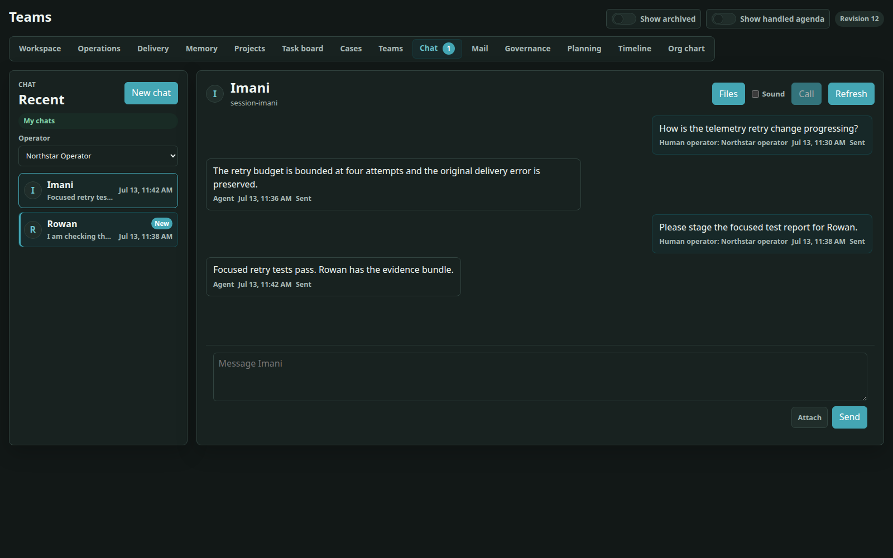

<p class="figure-caption">Figure 21.1 — Human Chat is visually and operationally separate from Agent Mail and ordinary Team work. Sanitized Northstar fixture.</p>

## External communication into Team Chat

A workflow can bridge an authenticated Discord or Microsoft Teams message into
the same durable operator Chat lifecycle:

<code>trigger:communication:new-message → effect:team:enqueue-operator-chat-message</code>

Configure exactly one fixed <code>conversation_id</code> or
<code>agent_id</code>, a fixed <code>operator_user_id</code>, and a declared
<code>communication_target_id</code>. Never derive the Team conversation,
agent, or operator identity from message text. The target provider must match
the incoming provider and the target must grant <code>read</code>. A preserved
Microsoft Teams channel thread additionally requires <code>reply</code>;
top-level Teams replies and every Discord reply require <code>write</code>.
Discord thread IDs are discarded so the response is a top-level channel
message.

Ingress is durable and idempotent on provider, communication target, and source
message ID. An exact replay returns the original conversation, message, and
<code>team-chat:&lt;message-id&gt;</code> dispatch. The effect queues the normal
<code>team.chat.message_queued</code> event, so transcript, lease, busy-session,
tool-grant, and reply behavior remain the built-in Chat behavior.

Set <code>import_attachments=true</code> to opt into first-class external file
delivery. Teams inline hosted images, ordinary Teams and Discord files, and
email attachments are copied into Team-owned private storage, policy-checked,
shown in the Chat transcript, and delivered to the agent through the normal
attachment workspace path. Partial failures are shown as warnings and do not
discard valid files or the external message.

The bridge defaults to <code>allow_team_mutations=false</code>. Enabling Team
mutations requires a non-empty fixed <code>authorized_author_ids</code> list,
and the authenticated source author must match it. A Discord trigger should
also filter allowed authors and exclude the Evander bot, but the effect-side
author allowlist remains required. The recipient agent and every included
project must also remain inside the workflow effect's directory scope.

When the agent replies, Team commits the internal sent message first, creates a
pending <code>ExternalChatDeliveryRecord</code>, and transactionally emits
<code>team.chat.external_reply_requested</code>. The packaged runtime sends
through the generic communication effect and records external delivery as
<code>sent</code> or <code>failed</code>; the durable state model also
distinguishes <code>pending</code>, <code>sending</code>, and
<code>unknown</code>. The Team reply remains visible if external delivery
fails, so inspect the persisted delivery ID and state before deciding whether
any retry is safe.

For a reply with Team Chat attachments, the outbound event retains the exact
internal text as <code>team_chat_body</code> and carries both
<code>attachment_ids</code> and attachment metadata. Its external
<code>body</code> appends textual references containing each filename, MIME
type, and byte count; an attachment-only reply therefore still has a
deliverable non-empty body. This contract represents the Team files in text
for the generic communication effect. It does not claim or require
provider-native file upload.

## Agent Mail

Agent Mail is structured internal coordination, not free-form access to any agent. The reporting relationship chooses the legal recipient, while priority and reply intent tell Team how urgently to present the item and whether a meaningful response is expected.

> <span class="sidebar-kicker">Technical reference</span> **Inbox records and message types**
>
> The **Mail** view renders durable <code>AgentInboxItem</code> records. Each item has a type, sender, recipient, priority, reply intent, payload, state, and timestamps. Types include:
>
> - <code>operator_directive</code>;
> - <code>question</code>;
> - <code>status_request</code>;
> - <code>progress_report</code>;
> - <code>deliverable_notice</code>;
> - <code>escalation</code>.
>
> State is <code>pending</code> or <code>handled</code>. The UI presents received and sent projections over this one durable inbox collection, with structured payload details, errors, and fallback content. There is no separate Agent Mail outbox collection, and Mail is not backed by the Chat conversation tables.

Direction is enforced:

- <code>team_ask_question</code> targets the caller's direct superior;
- <code>team_send_progress_report</code> targets the direct superior and defaults to low priority with no response requested;
- <code>team_request_status</code> targets a direct subordinate and normally requests a response;
- ordinary agent mail does not permit skip-level or lateral routing.

If broader coordination is necessary, change the work structure, ask the manager to route it, or use a governance/operator surface. Do not disguise lateral communication as a status report.

### Reply intent is not wake permission

<code>response_requested</code> tells the recipient whether a meaningful response is expected. It does not control delivery and is only one part of wake eligibility.

- normal or high priority can wake even when <code>response_requested=false</code>;
- low priority wakes by itself only when a response is requested, and is then normally batched;
- low/no-reply mail is delivered on another eligible wake;
- every processed item should eventually be marked handled.

When no response is requested, do not send a thank-you, receipt, or empty acknowledgement. Read it, act if needed, and handle it atomically with the relevant command where possible.

For Northstar, Imani can send Priya a low/no-reply progress report saying the retry algorithm is implemented and tests are running. It should not cause an immediate conversational cycle. Priya can send Imani a normal status request, which wakes Imani and expects a useful answer.

## Operator directives

A directive is durable Team work addressed to a Team manager, not merely a Chat utterance. It can be created through:

- the Team Admin API;
- <code>effect:team:create-operator-directive</code> from Discord, Teams, Admin Web, or another workflow;
- <code>team_create_operator_directive</code> by an authorized governance manager.

It becomes a pending normal-priority, response-requested <code>operator_directive</code> in the manager's inbox, makes the manager due, and atomically records a debounced <code>team.agent.wake_requested</code> event. Publication is requested immediately, while the periodic Team runtime tick remains the recovery path. A governance manager can direct only a member Team and only its manager. The manager handles it through ordinary Team work and communication.

Use a directive when “please investigate telemetry retry safety” should survive a Chat failure, become schedulable work, and have explicit handled state.

## Browser voice

Voice is for a live spoken exchange with one persistent agent. It uses a bounded snapshot of that agent's Team context; it does not turn the audio session into unrestricted access to every Team record, and it does not share an implementation path with telephone or Agent Mail integrations.

> <span class="sidebar-kicker">Technical sidebar</span> **Voice projection and reconciliation**
>
> The Team UI can start a direct browser voice call to a persistent agent. The add-on prepares an OpenAI Realtime session with a projection of the agent's current:
>
> - Team, role, project, and reporting context;
> - tasks, cases, inbox, reviews, deliverables, and runtime state;
> - authorized visible tool context;
> - optional voice profile and speaking style.
>
> The browser talks to OpenAI Realtime using the prepared session. This path does not use DIDWW, Asterisk, or SIP. Core voice-session state is stored in <code>runtime/voice-sessions-store.json</code>, outside Team SQLite.

Projected context is intentionally bounded. If the realtime agent needs nonprojected detail, it can create a durable <code>query_origin_agent</code> request for the originating text agent. Terminal calls schedule reconciliation so those requests and final call state can re-enter the normal wake flow.

A call launched from Chat can add a voice-call system message to that conversation. The audio call still remains a voice session rather than a sequence of Chat messages.

An avatar is unrelated UI metadata. Saving an agent's portrait does not select that agent's voice or change prompt identity.

## Escalation

Only the top-level Team manager may escalate out of the Team.

### Direct operator escalation

The manager can send a durable escalation to the Team's configured operator destination. Team records the request first; the ordinary Evander communication workflow performs and records delivery.

> <span class="sidebar-kicker">Deeper detail</span> **Direct escalation routing**
>
> When <code>Team.escalate_to_governance</code> is false, the Team needs an <code>operator_communication_target_id</code>. The manager's <code>team_escalate_operator</code> command records durable intent and an outbox event. The runtime pack routes <code>team.operator.escalation_requested</code> to the generic <code>effect:communication:send-message</code> provider bound to that target.
>
> The Team service does not call a Discord or Teams sender directly. The workflow document owns routing and delivery evidence.

The Team's <code>operator_communication_target_id</code> is outbound-only. It
does not by itself let external users address or wake Mira's real session.
Inbound access requires a separate, explicitly authorized core-session route
or the fixed-identity communication-to-Team-Chat workflow described above.

### Governance escalation

When <code>escalate_to_governance</code> is true, the command creates pending governance agenda items in the groups containing that Team and makes their runtimes due. The governance manager receives Team summaries and decides whether to route an operator directive, mark the agenda handled, or take another authorized action.

This path is useful when Mira must report that the telemetry fix is blocked by a cross-Team API policy. It is not a substitute for a routine question to Priya.

## Troubleshooting

Start by identifying the channel. A queued Chat message, pending Agent Mail item, undelivered escalation, and incomplete voice call have different owners and evidence. Capture the stable conversation, message, inbox, outbox, workflow, or voice-session ID shown by the relevant view rather than searching by text alone.

| Symptom | Interpretation and next check |
|---|---|
| Chat message remains queued | Inspect agent active status, stand-down, cost cap, active lease, busy core session, event publication, and Chat-claim workflow. |
| Chat dispatch finishes without a reply | Finalizer should mark the message failed; inspect command activity and prompt/session logs. |
| External message is ingested but no Team Chat message appears | Trace the communication trigger, fixed bridge configuration, source target capabilities, and durable ingress idempotency record. |
| Team reply is visible but missing externally | Inspect its <code>ExternalChatDeliveryRecord</code>, external-reply event, workflow effect execution, target capability, and recorded provider error before retrying. |
| Agent cannot mail a peer | Lateral routing is intentionally forbidden; use reporting or work-routing mechanisms. |
| No-reply normal mail woke the recipient | Correct behavior: priority is non-low. |
| Low/no-reply mail is unseen | It waits for another eligible wake; inspect pending Mail and eventual handling. |
| Escalation is recorded but not delivered | Follow the outbox row, internal event, workflow run, communication target, and provider result. |
| External operator cannot message the manager through the escalation target | The outbound target was mistaken for inbound authorization. Configure a separate fixed-identity Team Chat bridge or authorized core-session route. |
| Voice has incomplete knowledge | The projection is bounded; inspect or retry the durable origin-agent query path. |
| Voice record is absent from Team SQLite | Correct storage boundary; inspect the core voice-session store and optional Chat projection. |

## Operator handoff

For any communication problem, record the Team, channel, sender, intended recipient, time, visible state, and stable message or session ID. Include the agent's session and any dispatch or workflow-run ID if shown. Say whether the content was never accepted, accepted but waiting, dispatched without a reply, or completed without external delivery.

Do not resend under a new request ID merely because delivery is delayed, and do not reinterpret an outbound escalation target as inbound permission to reach an agent. The detailed trace below is for administrators and support.

## Administrator runbook

For Chat:

1. Record conversation ID, operator message ID, agent/session, and message status.
2. Follow <code>team.chat.message_queued</code> from its published internal event into the runtime workflow. When a queued event originated in a Team command or finalizer, include its outbox row in that trace.
3. Inspect lease/busy/cost/stand-down guards.
4. Match the Chat dispatch to <code>team_reply_to_chat</code> activity and finalization.
5. For externally originated Chat, correlate the ingress record and source
   message ID; then follow <code>team.chat.external_reply_requested</code> to
   the persisted external delivery record and success/failure recorder.

For Agent Mail:

1. Confirm sender and recipient are a legal direct reporting pair.
2. Inspect type, priority, <code>response_requested</code>, and pending/handled state.
3. Apply the wake rule from Chapter 20 rather than assuming all pending mail wakes.
4. When acting, handle the item in the same command transaction.

For escalation:

1. Verify the caller is the top-level manager.
2. Confirm direct-versus-governance Team policy.
3. For direct delivery, verify the communication target and live workflow route.
4. For governance, verify group membership, agenda creation, manager lease, directive, and handled state.

For voice:

1. Capture voice-session ID and originating Team conversation if any.
2. Inspect the prepared projection and terminal status in the core voice store.
3. Follow unresolved <code>query_origin_agent</code> records and reconciliation wakes.

## Source trail

- <code>src/evander_team_addon/services/chat_service.py</code> and <code>services/domain/chat.py</code> — conversation ownership, external ingress idempotency, queued messages, claim guards, delivery state, and reply finalization.
- <code>src/evander_team_addon/services/commands/agent_message_commands.py</code>, <code>chat_commands.py</code>, and <code>operator_escalation_commands.py</code> — directional Mail, Chat replies, and escalation commands.
- <code>src/evander_team_addon/api.py</code> — Chat streams/messages, inbox views, operator directives, and browser voice routes.
- <code>src/evander_team_addon/providers.py</code> and <code>workflow_packs.py</code> — external Chat bridge and delivery recording, Chat wake prompts, escalation routing, governance wakes, and voice reconciliation integration.
- <code>src/evander_team_addon/models.py</code> — conversations, messages, external ingress/delivery, inbox, communication targets, voice profiles, and governance agenda.
- <code>docs/addons.md</code> — Chat/Mail distinction, voice boundary, communication direction, and escalation.
- <code>tests/test_team_addon_runtime.py</code>, <code>tests/test_team_addon_mcp.py</code>, and <code>tests/test_team_addon_api.py</code> — operator isolation, reply-only dispatch, direction, wake, and escalation behavior.


# 22. Deliverables, Reviews, and Decision Cascades

> **At a glance.** Marking a task “done” is not enough to explain what was produced or why it was accepted. Team records a deliverable for each attempt, attaches the evidence, and asks a reviewer to decide against that exact submission and code version. If rework is needed, the next attempt becomes a new record so the earlier evidence and decision remain understandable.
>
> On a first read, remember three things: the producer submits a specific result, each reviewer decides only on that result, and corrections create a successor instead of rewriting history. The exact fields, artifact rules, Git checks, and command surfaces later in the chapter are reference detail for readers who operate or troubleshoot the delivery system.

## A review in plain language

Suppose the implementation agent finishes Northstar's telemetry-retry change. “Finished” is only the agent's claim. Team still needs a package that a reviewer can inspect: the exact code version, the tests that ran, any supporting artifacts, and an honest account of anything that could not be checked. That package is the **deliverable**.

A **review request** points to that deliverable rather than to the task in general. The reviewer can accept it, reject it with findings, or say that the review is blocked because the evidence or process is unavailable. If the producer corrects a defect, the correction becomes a new deliverable. The rejected attempt remains visible, so a later reader can understand what changed and why.

This gives an operator two explicit decision paths to follow:

```text
task -> submitted deliverable
     -> direct superior -> accepted result or a new rework deliverable
     -> formal review(s) -> accepted result, blocked review, or a new rework deliverable
```

The key question is always **“Which exact deliverable and code version did this decision cover?”**

## Evidence before opinion

Tasks describe intended work. Deliverables describe what was produced and how it was checked. Review requests bind a reviewer and policy to that evidence.

An operator will usually start with the summary, verification result, artifacts, code version, and current reviews. Those are enough to understand whether the work is ready, waiting, or returning for correction.

> <span class="sidebar-kicker">Technical sidebar</span> **What a deliverable can record**
>
> A deliverable can include:
>
> - a summary and producer;
> - stable artifact references;
> - a persistent Git work-context ID and derived agent branch/commit;
> - verification status, summary, and evidence refs;
> - structured outcome kinds, durable reference IDs, and outcome evidence refs;
> - the direct-acceptance recipient and that superior's immutable decision, when applicable;
> - supersession links;
> - review findings and state.
>
> Verification status is <code>passed</code>, <code>failed</code>, <code>partial</code>, <code>not_run</code>, or <code>unknown</code>. “Tests could not run because the integration service was unavailable” is <code>not_run</code> with a concrete explanation, not <code>passed</code>.

For Northstar, Imani's first telemetry retry deliverable might contain:

- the pinned commit from Imani's task worktree;
- unit and fault-injection test evidence;
- an artifact with the retry-state-machine trace;
- verification status <code>passed</code>;
- a concise summary of backoff, jitter, idempotency, and exhaustion behavior.

## Outcome contracts prevent report-only completion

Some tasks exist to coordinate or acknowledge work; others must create a durable external result.
Team records the distinction on the task instead of relying on wording in its description.

A <code>support</code> task can finish directly without inventing a deliverable. An
<code>outcome</code> task carries an <code>outcome_contract</code> that names required and
forbidden outcome kinds, chooses whether any or all required kinds must be present, and may
explicitly permit an evidence-backed no-op.

Deliverables for outcome tasks include typed outcomes. Each submitted outcome must carry durable
<code>reference_ids</code>; evidence refs can support that result but cannot replace its identity.
A review profile can require outcome kinds before the review is requested or accepted. When no new
external effect is correct, submit an <code>evidenced_noop</code> deliverable completion with
evidence refs, and only when the contract allows it. That submission still follows direct
acceptance or formal review; only acceptance copies the completion to the task. A prose report,
review, or evidence-only deliverable does not satisfy an outcome contract by itself.

## Composing an aggregate result

A parent task represents a combined outcome, not a label placed over unrelated
work. Before its final deliverable can be submitted, every descendant must be
validly resolved. The parent deliverable then names the exact accepted,
current, non-superseded deliverables incorporated from its direct children in
<code>source_deliverable_ids</code>.

Contribution coverage follows these rules:

- every resolved direct outcome child contributes its accepted deliverable,
  unless it resolved through an accepted evidenced no-op or authorized
  cancellation;
- a support child contributes an accepted assessable deliverable when it has
  one, but a support task that finished without output needs no artificial
  deliverable;
- every named source must belong to a direct child and be current and accepted;
- missing or unexpected direct-child sources make the parent not
  integration-ready; and
- if a child is itself aggregate, its accepted deliverable carries the next
  layer. Recursive lineage is derived rather than copying every leaf into the
  root.

The resulting parent Git commit or artifact bundle is the submitted object.
Source IDs prove which accepted components were integrated; they do not copy
child state or make a branch tip trustworthy. A release selects the accepted
top-level aggregate deliverable instead of releasing it alongside the sources
already contained within it. Independent root deliverables may still coexist
in one release.

## Artifact publication boundary

An artifact is supporting material that can be opened again after the temporary workspace is gone—for example, a trace, test report, screenshot, or generated package. Team stores a stable reference to published material; merely typing a reference does not copy the underlying bytes into artifact storage.

If a reviewer cannot retrieve an artifact, that is an evidence-access problem. It does not mean the artifact disproved the change.

> <span class="sidebar-kicker">Deeper detail</span> **Publication and reviewer imports**
>
> There are two different ways artifact information can appear:
>
> - <code>artifact_paths</code> asks the command adapter to publish safe paths from the current session's <code>/artifacts</code> tree and store the resulting stable refs;
> - <code>artifact_refs</code> or an artifact-space reference records already-published metadata.
>
> Supplying a ref does not publish bytes. Paths are validated as safe relative paths, and host publication is replay-idempotent. Publication occurs before the final Team state transaction because it crosses service boundaries. If publication succeeds but the Team mutation fails, the artifact may be orphaned until the same command is replayed or an operator cleans it up deliberately.
>
> For an ordinary task or inbox handoff, the recipient can call <code>team_import_artifact</code> with an <code>artifact-space:</code> ref. The host checks the calling <code>team-agent:&lt;id&gt;</code> read grant and imports the latest requested artifact version into that caller's own <code>/artifacts/team-artifact-imports/...</code> tree. A path under another agent's <code>/home/agent</code> or <code>/artifacts</code> tree is never a shared path.
>
> Reviewer wakes import referenced review artifacts to a bounded path below:
>
> <code>/artifacts/team-review-inputs/&lt;review&gt;/&lt;deliverable&gt;/...</code>
>
> The review context records successful imports and permission or retrieval errors. A reviewer should distinguish “evidence disproves the change” from “evidence could not be accessed.”

## Persistent Git work contexts

When the result includes code, Team does not trust a branch name typed into the submission. It checks that the code came from the task's prepared Git workspace and derives the accepted branch itself. This is what lets a reviewer return later to the same code version.

The branch remains internal evidence at this stage. Review does not publish it to the project's canonical upstream branch; Chapter 24 covers that later boundary.

The local commit must first be published to this internal managed agent branch. Run
<code>git push-agent</code>, require it to succeed, and confirm the managed branch resolves to
the same SHA as <code>git rev-parse HEAD</code> before calling a deliverable submission tool.
A commit that exists only in the worker worktree cannot be reviewed or accepted.

> <span class="sidebar-kicker">Technical sidebar</span> **Persistent work-context checks**
>
> When a project uses managed Git, a persistent Team wake reuses the stable
> physical task/repository worktree path but creates a fresh dispatch-bound work
> context. The context binds:
>
> - agent, task, project, session, and dispatch;
> - deterministic agent branch;
> - prepared checkout/worktree;
> - base branch, base commit, and current verified commit;
> - status and timestamps.
>
> The base branch is copied from the task's durable snapshot and the first
> preparation pins its exact commit. Later dispatches reuse that commit even if
> the project default or remote branch advances.
>
> An explicitly Git-backed deliverable supplies
> <code>branch_context_id</code> and <code>git_refs.commit_sha</code>. Unknown Git
> reference fields are rejected. The server verifies caller, task, dispatch,
> context, current managed branch tip, and exact commit, then derives the
> accepted agent branch and pins the same submitted SHA for review.
>
> Omitting Git fields is not a way to hide changed code. If exactly one active
> task context exists, Team resolves its live branch tip. A tip different from
> the pinned base is automatically bound to the deliverable with the exact
> context, branch, and commit. If the tip still equals the base, an artifact-only
> result is legitimate. No active context also remains artifact-only. Multiple
> contexts, an unavailable base, or an unresolvable branch fails with an
> actionable correction instead of guessing. Historical accepted records
> without pinned provenance remain readable and immutable; any explicit rework
> replacement must satisfy the current rules.
>
> The branch is evidence inside the managed bare repository, not a canonical publication. Promotion begins only through the reviewed Git flows in Chapter 24.

### Immutable dependency composition

When a task declares dependencies or required contribution tasks, Team derives the Git inputs
from the accepted deliverables. Every newly submitted Git candidate is retained immediately under
an immutable <code>refs/evander/team-reviews/...</code> deliverable ref before either a direct or
formal handoff. Formal reviews also retain their own immutable review snapshot. Later preparation
resolves the accepted retained ref, not the mutable agent branch, so a subsequent push cannot
change an already accepted input.

The prepared context records a dependency-composition manifest containing the pinned task base,
base tree, every source relationship, deliverable, immutable ref and commit, the ancestry-reduced
commit frontier, the deterministic source fingerprint, and the resulting composed commit and
tree. Required contributions are derived from the deliverable contract even when the planner did
not duplicate them as ordinary task dependencies. Redundant ancestor commits are recorded as
reduced sources rather than cherry-picked twice. A genuine content conflict still creates the
typed dependency-composition recovery; it never falls back to an unreviewed history merge.

These rules apply prospectively. Historical accepted deliverables remain readable and use their
legacy branch/context validation. A new formal review records policy version 2 and must satisfy
the immutable-ref and composition gates that apply to its Git task; direct acceptance uses the
submission-time retained ref without acquiring formal-review criteria.

A policy-v2 integration submission with Git-backed sources must carry the server-generated
composition manifest from its current preparation generation. Team rejects a missing or stale
manifest before creating either the deliverable or its reviews. Global maintenance repairs an
older nonterminal malformed record exactly once by preserving its Git evidence, retiring its
review handoffs, rejecting the candidate, reopening the task, and queueing a freshly prepared
replacement. Accepted historical evidence is not rewritten.

## Submitting, superior acceptance, and formal review

The producer submits the evidence, then chooses the handoff the task actually requires:

- <code>team_submit_deliverable</code> sends a deliverable notice to the producer's direct
  superior. The task exposes <code>waiting_reason: superior_acceptance</code>; this is not formal
  review work. That recorded recipient uses <code>team_decide_deliverable</code> to accept or
  reject the exact handoff and handles the notice in the same command.
- <code>team_submit_deliverable_for_review</code> submits the evidence and creates the intended
  formal review handoff in one command.
- <code>team_request_review</code> attaches a formal review to an existing deliverable.

A top-level agent with no direct superior cannot use the superior-acceptance form. It must use
formal review for a reviewable deliverable, or finish support/coordination work directly without
manufacturing one. Team prevents accidental duplicate active reviews of the same deliverable by
the same reviewer.

For a direct handoff, acceptance can cascade to task acceptance once every active deliverable is
accepted. Rejection requires a concrete reason, returns the task to <code>in_progress</code>, and
queues actionable rework for the owner. The superior can request specialist review instead, or
report a blocker when evidence or a dependency prevents a decision. Once a formal review is
attached, the direct decision command cannot bypass it; the assigned reviewer path becomes
authoritative.

A review may be requested by an authorized producer, supervisor, project lead, or Team manager. The assigned reviewer must be active, in the same Team, and compatible with any selected review profile.

An assigned reviewer must inspect the immutable work specification, not only
the deliverable summary. For a leaf, read the complete task description,
outcome and deliverable contracts, profile, implementation, artifacts, and
verification. For a composite task, also traverse the declared contribution
tasks, required current source deliverables, and recursively relevant ancestor
specifications and evidence. Complete contribution IDs prove coverage, not
correct integration. If any required task or evidence record is unavailable,
decide <code>blocked</code> and name the missing IDs instead of guessing.

Review profiles can apply by project and role, define required and optional criteria, and require
specific outcome kinds. Archived profiles cannot be assigned to new reviews. When more than one
profile matches a reviewer, delivered outcome kinds narrow the implicit choice; an ambiguous
remainder requires an explicit profile ID. Use profiles for repeatable policy such as:

| Criterion | Requirement for telemetry retry |
|---|---|
| Behavior | Bounded exponential backoff and idempotent retry are demonstrated. |
| Tests | Transient recovery and terminal exhaustion tests pass. |
| Observability | Attempt count and final failure are diagnosable without sensitive payloads. |
| Scope | Changed paths match the task and reviewed evidence. |

Creating the same active review for one deliverable and reviewer is replay-safe: the service returns the existing review rather than duplicating inbox and wake work.

### Acceptance evidence and release verification

Reviewers must record criterion decisions when a review profile is configured and explain
rejections and carried-finding resolutions. Criterion evidence references, agent-reported tests,
logs, and links are optional diagnostics. The immutable repository snapshot is server-owned Git
provenance, not reviewer-supplied evidence.

After required deliverables are accepted and provenance, dependency composition, and candidate
integrity validate, Team creates the release package and frozen candidate. Configured commands run
in order against that candidate through a fresh, visible disposable
<code>container_worker_vm</code> verification run; this server-owned run is the authoritative
build/test result. Typed infrastructure retries retain the same candidate and release lineage while
preserving every attempt. Historical acceptance-verification and waiver records remain readable
for audit, but new submissions do not create or consume them.

> <span class="sidebar-kicker">Technical sidebar</span> **Submission and automatic review creation**
>
> Both submission paths record evidence and change the task to
> <code>waiting_for_review</code>. The derived <code>waiting_reason</code> distinguishes
> <code>superior_acceptance</code> from <code>review</code>, so UI labels and manager routing do
> not treat an ordinary superior notice as an unassigned reviewer gap.
>
> Workflow authors can use <code>trigger:team:deliverable-created</code>.
> <code>effect:team:create-review-request</code> creates an independent review
> request when each request should retain its ordinary individual lifecycle. If
> the complete reviewer set must decide as one round, use one
> <code>effect:team:create-review-cohort</code>; it creates, seals, and queues
> every reviewer slot in one transaction. Exact retries are idempotent, while
> mismatched membership or pre-existing independent requests fail closed. The
> combined <code>team_submit_deliverable_for_review</code> command likewise
> atomically seals the review list supplied with a new deliverable. The trigger
> owns its cursor and suppresses old deliverables when first enabled, avoiding
> an accidental historical review storm.

## Review decisions

Only the assigned reviewer may decide a review. The decision is immutable.

“Immutable” means the decision is not edited later to improve the history. Rework creates another deliverable and another review, while the earlier decision remains evidence.

### Accepted

For a profiled review, every required criterion must be present and passed. Optional criteria may be omitted. Evidence references are optional diagnostics and are preserved when supplied; Team does not duplicate the immutable repository snapshot across criterion rows. The snapshot remains separate, server-owned provenance for the exact reviewed commit.

A deliverable becomes accepted only when:

- all current, non-retired attached reviews are accepted; and
- no carried review finding remains open.

When every current required deliverable for the task is accepted, every
descendant is resolved, and aggregate contribution coverage is complete, the
task can become accepted. Project status and goals then recalculate under their
own rules.

### Rejected

For an ordinary independent review, a rejection immediately:

- marks the reviewed deliverable rejected;
- returns the task to <code>in_progress</code>;
- creates a rework inbox item for the producer;
- preserves concrete findings.

For a sealed cohort, the review decision and findings are still persisted
immediately, but deliverable rejection and the consolidated rework notice wait
until every other active cohort slot is accepted or rejected. A pending or
blocked slot keeps the cohort unresolved as described below.

Imani does not edit the rejected deliverable after Rowan finds that jitter can exceed the deadline. Imani produces a new deliverable that explicitly supersedes the rejected one. Open findings are carried forward.

An accepted later review can resolve only findings owned by its same review profile. For legacy reviews without a profile, reviewer-role compatibility is used. One unrelated reviewer cannot silently close another policy's finding.

### Blocked

Use <code>blocked</code> when the review process or evidence access cannot proceed, not when the candidate is known to be defective. For an ordinary deliverable review, blocked state propagates blocking state to the deliverable/task and preserves a concrete blocker.

Release-review blocked behavior is stricter and retry-oriented; Chapter 24 distinguishes it from candidate rejection.

A blocked non-release review can be retried with <code>team_retry_review</code>. Retry preserves
the blocked attempt, links a new pending successor, reopens the deliverable, and resolves the
obsolete review blocker. Do not overwrite the original decision.

For a Git-backed retry, Team re-resolves the work context's authoritative agent
branch. The retry proceeds only when that tip still equals the one pinned
reviewed/submitted commit. A missing or inconsistent context, missing pinned
commit, or advanced branch requires a replacement deliverable; the immutable
review is never retargeted to new code.

An authorized requester, producer, supervisor, project lead, or manager can withdraw a mistaken
pending non-release review with <code>team_withdraw_review</code>. A project lead or manager can
retire a terminal non-release attempt with <code>team_retire_review</code>. Withdrawal records no
decision; both actions preserve history. Retirement preserves the decision and does not resolve or
waive open findings.

An ordinary rejected or blocked deliverable can be replaced by a same-task
rework submission. A sealed-cohort deliverable cannot be replaced while any
cohort slot is pending or blocked; settle the round or recover the exact
blocked slot first. When an accepted deliverable from another task is the
intentional replacement, an authorized project lead or manager can link it
explicitly with <code>team_link_deliverable_replacement</code>. Migration does
not guess replacement lineage.

When a current accepted deliverable later proves invalid, the task owner,
project lead, or same-Team manager uses
<code>team_reopen_task_for_rework</code> with that exact accepted deliverable
and a reason. The recorded task owner must still be active and a member of the
project's Team; otherwise the reopen fails before creating an obligation. The
original acceptance and reviews remain immutable. The task
returns to <code>in_progress</code>, its ancestor/project/release readiness is no
longer complete, and the original owner receives one high-priority rework
obligation. The next same-task deliverable must explicitly supersede that
accepted ID and repeat every current required review profile through fresh
formal review; direct finish, direct superior acceptance, unrelated
replacement, and cross-project or foreign deliverables cannot close the
rework. The original owner receives one high-priority item and targeted wake,
not a stream of duplicate obligations. If the accepted predecessor had a
sealed cohort, the replacement must create the complete fresh cohort described
below.

An unlocked operator has equivalent revision-checked <code>/withdraw</code> and
<code>/retire</code> routes. Release reviews continue through their release-gate recovery path.

## Independent reviews and sealed cohorts

Independent requests retain the ordinary lifecycle above: each decision is
immutable and a rejection can return the deliverable to rework while other
independent evidence remains visible.

A sealed cohort represents one coordinated review round. Suppose Northstar
requires Rowan's software-quality slot and Priya's operational-readiness slot:

1. Imani submits D1 with both reviewer slots, or a workflow atomically creates
   the complete cohort on existing D1.
2. Rowan may accept while Priya remains pending; D1 stays under review.
3. If Priya rejects, Team persists that decision but waits for every other
   active slot to settle before notifying Imani. One early rejection does not
   interrupt reviewers who are still producing evidence.
4. A blocked slot makes the cohort and task unresolved while the other
   reviewers may still decide. Recover that exact slot with a retry or
   authorized replacement; do not discard the rest of the cohort.
5. Once no active slot is pending or blocked, Team consolidates all rejected
   reviews and open findings into one rework notice.
6. Imani submits D2 superseding D1. D2 must atomically create a complete fresh
   cohort preserving every predecessor slot: review-profile multiplicity and
   each unprofiled reviewer identity.
7. The new cohort reviews D2's exact pinned commit and carried findings. Only
   complete acceptance can accept D2 and the task.

Membership is sealed: no late reviewer can be appended, two slots cannot be
collapsed onto one reviewer, and the final active member cannot simply be
withdrawn. An exact terminal-cohort workflow retry remains terminal; it does
not reopen accepted or rejected decisions. This cascade prevents “one approval
wins,” preserves the complete evidence round, and keeps rework replacement
from silently reducing required review coverage.


<p class="figure-caption">Figure 22.1 — Immutable decisions either advance accepted evidence or create an explicit rework successor.</p>

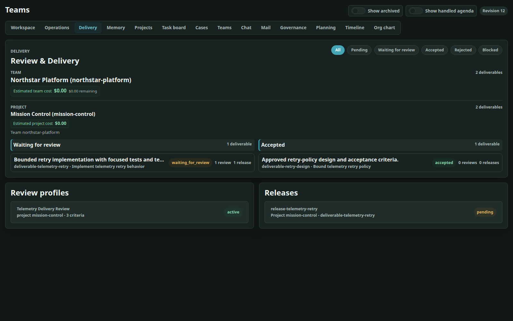

<p class="figure-caption">Figure 22.2 — Delivery groups deliverables, review evidence, and decisions while keeping their durable identities visible. Sanitized Northstar fixture.</p>

## Review authorization and tool surface

The distinction operators should remember is that **seeing a review is not the same as being allowed to decide it**. A manager can inspect delivery state, but only the assigned reviewer records that review's decision. Release authority also does not authorize rewriting a deliverable review.

> <span class="sidebar-kicker">Technical reference</span> **Commands and integration surfaces**
>
> Ordinary Team command tools in this domain are:
>
> - <code>team_submit_deliverable</code>;
> - <code>team_submit_deliverable_for_review</code>;
> - <code>team_decide_deliverable</code> for the superior recorded on a direct handoff;
> - <code>team_import_artifact</code> for permission-checked ordinary artifact handoffs;
> - <code>team_request_review</code>;
> - <code>team_decide_review</code>;
> - <code>team_retry_review</code>;
> - <code>team_withdraw_review</code>;
> - <code>team_retire_review</code>;
> - <code>team_link_deliverable_replacement</code>;
> - <code>team_reopen_task_for_rework</code>;
> - delivery list/get tools;
> - Git promotion and release tools covered in Chapter 24.
>
> Admin routes provide revision-checked operator create/edit/decision paths and explicit review
> retirement. Workflow providers add deliverable-created triggering and deterministic
> review-request creation. All paths reuse the same repository invariants.

## Decision and state failures

| Symptom or error | Meaning | Recovery |
|---|---|---|
| Artifact path rejected | The requested path escapes the allowed artifact root or has invalid shape. | Publish from a safe relative path below the session artifact root. |
| Artifact ref exists but bytes are unavailable | Metadata was recorded without publication, permission/version access failed, or an ordinary recipient has not imported it yet. | Inspect the artifact-space record; for ordinary handoffs call <code>team_import_artifact</code>, and for reviews inspect the reviewer import error. |
| Git context mismatch | Agent/task/session/dispatch or derived branch does not match the submitted context. | Use the current task work context; never type an alternate branch. |
| Artifact-only submission gains Git provenance or is rejected | The single active task branch changed from its pinned base, or Team could not prove a safe unchanged/unique context. | Accept the automatic exact binding, or supply the named current context and commit; do not omit Git fields to hide code. |
| Reviewer cannot be assigned | Agent is inactive, cross-Team, or incompatible with the profile. | Select an active same-Team reviewer matching policy. |
| Accepted decision rejected by validation | A required criterion is missing/failed or findings remain open. | Record complete criterion results and resolve only authorized findings. |
| Second decision refused | Review decisions are immutable. | Create the appropriate successor deliverable/review; do not overwrite history. |
| Task stays waiting after one acceptance | Another active review or open carried finding remains. | Inspect the complete current deliverable review set. |
| Cohort rejection does not wake the producer yet | Another sealed-cohort slot is pending or blocked. | Let remaining reviewers decide and recover any blocked slot; rework is consolidated only after the cohort settles. |
| Sealed-cohort replacement is refused | The fresh review list omitted a predecessor profile slot or unprofiled reviewer identity, or attempted a direct-acceptance replacement. | Resubmit through <code>team_submit_deliverable_for_review</code> with the complete fresh cohort and exact predecessor ID. |
| Previously accepted result is now known invalid | Immutable acceptance cannot be edited in place. | Use <code>team_reopen_task_for_rework</code>; the original owner must submit an explicit formally reviewed replacement. |
| Rejected task has no useful next step | Findings were vague. | Preserve evidence and create concrete, testable findings in the review decision. |
| Outcome deliverable rejected before review | Its outcome kind is missing, forbidden, or lacks a durable reference ID. | Match the task contract and identify the actual external record; do not substitute prose or evidence-only output. |
| Evidenced no-op does not resolve the task | The contract disallows it, evidence refs are absent, or the submitted completion has not been accepted. | Correct the contract-compatible evidence and follow the normal acceptance/review path; do not mark the outcome task finished. |
| Aggregate deliverable reports missing or unexpected sources | Named <code>source_deliverable_ids</code> do not exactly cover current accepted direct-child contributions. | Read contribution coverage, resolve descendants, and integrate only the listed current child outputs. |
| Blocked review remains current after recovery | Immutable history needs an explicit successor. | Use <code>team_retry_review</code> with a recovery reason. |
| Retirement does not accept the deliverable | Another current review or carried finding still blocks acceptance. | Inspect the current review set and resolve findings through their owning profile. |
| Plain submission has no recipient | The producer has no direct superior for superior acceptance. | Use formal review, or finish support work directly when no deliverable is required. |

## Troubleshooting and handoff

In **Delivery**, begin with the task and identify its current deliverable. Then check every active review and every unresolved finding. Capture the task ID, deliverable ID, review IDs, verification status, artifact references, and reviewed commit. If an artifact cannot be opened, include the visible import or permission error rather than describing the candidate as failed.

Do not edit a terminal review or force the task state merely because one acceptance did not advance it. Another review or a carried finding may still be open. Give the captured identities and the relevant row from the failure table to a Team administrator or the responsible producer/reviewer.

## Producer, reviewer, and operator runbooks

### Producer

1. Confirm the task, active dispatch, and task-specific Git context.
2. Run proportionate verification and record honest status.
3. Publish artifacts from safe paths or attach existing stable refs.
4. For an outcome task, record the required outcome kinds and durable reference IDs.
5. Choose superior acceptance or formal review deliberately; use the combined submission command
   when formal review is already known.
6. Mark related inbox items handled atomically.

### Reviewer

1. Confirm the review targets the current deliverable and pinned commit.
2. Inspect imported artifacts and any access failures.
3. Apply every required profile criterion.
4. Record specific findings and decide once.
5. Use rejected for a product defect and blocked for an actual process/evidence blocker.

### Operator

1. In **Delivery**, trace task → current deliverable → all active reviews → findings.
2. Match each review to its profile, reviewer, evidence refs, and reviewed commit.
3. When a cascade looks stuck, inspect open findings before changing task state.
4. Retry, replace, or retire through the explicit recovery surface; do not rewrite a terminal
   attempt.
5. Reconcile orphaned published artifacts deliberately.

## Source trail

- <code>src/evander_team_addon/models.py</code> — task outcome contracts/completions plus deliverable, verification, review, profile, criterion, finding, and supersession models.
- <code>src/evander_team_addon/services/commands/deliverable_submission_commands.py</code> and <code>review_commands.py</code> — submission, request authority, deduplication, and immutable decisions.
- <code>src/evander_team_addon/services/commands/task_update_commands.py</code> — accepted-deliverable rework plus outcome-completion and blocked-source guards.
- <code>src/evander_team_addon/services/domain/deliverables.py</code>, <code>review.py</code>, and <code>git_work_contexts.py</code> — outcome validation, acceptance cascades, retries, findings, artifact/Git evidence, and context validation.
- <code>src/evander_team_addon/providers.py</code> — deliverable trigger, independent/cohort review effects, artifact import, and hierarchy-aware reviewer prompt projection.
- <code>src/evander_team_addon/mcp.py</code> and <code>api.py</code> — grouped delivery tools and operator routes.
- <code>docs/addons.md</code> — artifact publication, review profiles, rework findings, and release handoff.
- <code>tests/test_team_addon_mcp.py</code>, <code>tests/test_team_addon_workflow_primitives.py</code>, and <code>tests/test_team_addon_runtime.py</code> — submission, profile enforcement, duplicate review, cascade, and reviewer-input behavior.


# 23. Ephemeral Delegation

> **At a glance.** A regular Team agent can sometimes ask a temporary helper to investigate or implement one clearly bounded piece of work. The helper receives only that assignment and a narrow way to return its result; it does not become a new permanent team member. The parent agent remains responsible for checking the evidence and deciding whether to use it.
>
> Think of this as controlled parallel work, not hiring another member of the organization. The request, temporary session, result, parent decision, and cleanup are all recorded separately. Operators can follow those milestones without needing to understand the workflow nodes that move the assignment between them.

## When a temporary helper is useful

Persistent agents carry organizational identity, reporting relationships, Team memory visibility, inbox, and recurring responsibility. Ephemeral agents are intentionally different. They are short-lived workers for a bounded prompt such as:

- reproduce a failing telemetry retry test;
- inspect one dependency's retry semantics;
- implement a small isolated change on a deterministic branch;
- gather evidence in parallel.

The parent remains responsible for the Team task. Delegation increases execution capacity without multiplying durable organizational actors.

For Northstar, Imani can delegate “add deterministic jitter edge-case tests” while continuing the main retry implementation. The child cannot reassign Imani's task, message Priya, request release, or decide Rowan's review.

The parent therefore asks a narrow question, receives evidence, and remains accountable for the task. A useful assignment has a clear stopping point—such as a test, patch, or research report—and does not imply authority to coordinate the Team.

```text
parent requests bounded help -> temporary worker runs -> result returns
                             -> parent accepts or rejects -> workspace is cleaned up
```

Completion and acceptance are deliberately separate. A worker can finish successfully while the parent still decides that its result is obsolete, incomplete, or unsuitable.

## Admission and capacity

Before creating a helper, Team checks that the parent really owns the work, that delegation is enabled, and that enough capacity remains for the whole request. A batch either passes together or creates nothing; one invalid assignment cannot leave a half-created set behind.

> <span class="sidebar-kicker">Technical sidebar</span> **Admission and capacity checks**
>
> The parent persistent agent has an effective ephemeral policy with <code>max_concurrent</code>. A value of zero disables delegation. Active capacity counts assignments in <code>requested</code>, <code>spawn_pending</code>, and <code>running</code>.
>
> A request is valid only when:
>
> - the caller is the resolved persistent parent on an active dispatch;
> - the parent has positive capacity and the complete requested batch fits;
> - each target task belongs to a project assigned to the parent;
> - the parent owns the target task;
> - requested model, provider mode, execution backend, image, tools, TTL, directory, and metadata pass schema and policy validation.
>
> Batch requests validate all items before mutation. One invalid child does not leave the other children partially created.
>
> The default execution backend is <code>container_worker_vm</code>. An assignment may carry an explicit compatible model/provider, image, and <code>ttl_hours</code>. These are bounded execution inputs, not general secret or host-path transport.

## The assignment record

The assignment is the durable envelope around disposable work. It remains after the worker session is removed and tells an operator what was requested, which session ran it, what came back, what the parent decided, and whether cleanup finished.

> <span class="sidebar-kicker">Technical reference</span> **Assignment fields and states**
>
> An <code>EphemeralAssignment</code> captures:
>
> - parent agent, Team, project, and task;
> - title and complete prompt;
> - eventual core session ID;
> - model/provider/backend/image choices;
> - allowed tools and TTL;
> - directory and metadata;
> - summary, artifacts, optional agent branch, error, and timestamps;
> - lifecycle state.
>
> States are <code>requested</code>, <code>spawn_pending</code>, <code>running</code>, <code>completed</code>, <code>accepted</code>, <code>rejected</code>, <code>cleanup_pending</code>, <code>cleaned_up</code>, and <code>failed</code>. They describe execution, decision, and cleanup milestones rather than one mandatory linear chain. In particular, core-session cleanup can finish before the parent accepts a completed result, and the parent may accept a result whose session is already cleaned up. Failures may occur during spawn, execution, result validation, or cleanup; durable records remain useful evidence after compute is gone.

## Asynchronous lifecycle

The helper does not have to start before the parent's command returns. Team first records the request, then the ordinary Evander workflow creates and prompts the temporary worker in the background. When the result returns, the parent is notified and the worker session is destroyed.

> <span class="sidebar-kicker">Deeper detail</span> **The composed workflow path**
>
> The parent's <code>team_request_ephemeral_agent</code> or batch command performs only the durable request transaction. It creates the assignment and outbox intent. The registered runtime pack then:
>
> 1. consumes <code>team.ephemeral.requested</code>;
> 2. creates an ordinary core Evander agent/session through <code>effect:agent:create</code>;
> 3. records the spawned session with <code>effect:team:mark-ephemeral-spawned</code>;
> 4. prompts the worker through <code>effect:agent:prompt</code>;
> 5. routes the completed session through <code>query:team:session-routing</code>;
> 6. records result/completion and notifies the parent;
> 7. destroys the core agent/session;
> 8. records cleanup through <code>effect:team:mark-ephemeral-cleaned-up</code>.
>
> The lifecycle composes core execution effects; the add-on does not implement a hidden second container scheduler.


<p class="figure-caption">Figure 23.1 — A durable assignment surrounds disposable execution, parent decision, and cleanup evidence.</p>

## The worker's authority

The worker receives no ordinary Team command surface. It can report the result of this assignment, but it cannot inherit the parent's identity, lease, or organizational authority.

> <span class="sidebar-kicker">Technical sidebar</span> **The one Team command and the Git branch check**
>
> An ephemeral wake exposes only:
>
> <code>team_report_ephemeral_result</code>
>
> The executor resolves the assignment from the ambient worker session. The child cannot call ordinary persistent Team commands. It receives the prompt and execution resources necessary for the assignment, but not the parent's organizational identity or lease.
>
> A successful report requires a useful summary. It may attach stable artifact references and a Git branch. An error report marks the assignment failed with its evidence.
>
> If the child reports Git output, the branch must be exactly:
>
> <code>agents/&lt;session-id&gt;/&lt;assignment-id&gt;</code>
>
> The server derives and verifies the name. A mismatched branch fails the assignment instead of accepting untraceable code.

## Completion is not acceptance

When the worker reports success, the assignment becomes <code>completed</code>. The parent receives an inbox item and wake intent. The parent must inspect the summary, artifacts, and Git evidence, then call:

- <code>team_accept_ephemeral_result</code>; or
- <code>team_reject_ephemeral_result</code>.

Only the parent may make that decision.

Acceptance idempotently creates a Team deliverable attributed to the parent, records the child evidence, and moves the parent task toward review. The attribution is deliberate: the persistent agent owns the Team obligation and is accountable for selecting the child's result.

Rejection records a concrete reason and does not convert the output into accepted task evidence. A parent can use useful observations in a later attempt without rewriting the rejected assignment.

The child's core session is cleaned up after routing. Session destruction does not delete the durable assignment, its result, or the acceptance/rejection decision.

## Northstar parallel work

Imani has capacity two and requests:

1. assignment E1: “Add deterministic tests for jitter boundaries.”
2. assignment E2: “Probe upstream timeout and retry-after behavior; report findings only.”

Both requests are committed in one batch. The runtime starts two disposable container sessions. E1 returns a deterministic branch and test evidence; E2 returns a research artifact without Git.

Imani inspects both. E1 is accepted and becomes a deliverable attached to the telemetry retry task. E2 is rejected as a deliverable because its probe used an obsolete upstream version, but its raw artifact remains evidence. Imani then submits the combined current deliverable for Rowan's review.

At no point can either child declare the task accepted or request release.

## Git handoff

An accepted child branch is still internal. An authorized persistent actor may request publication to an add-on review branch:

<code>team/&lt;team-id&gt;/reviews/&lt;assignment-id&gt;</code>

That request becomes a Git promotion intent and runs through the same managed-Git effect and recording flow as persistent evidence. Later feature/release promotion pins the accepted commit; it does not merge whatever happens to be at the source branch tip.

Artifact-only ephemeral work is fully supported and needs no repository.

## Failure patterns

| Symptom or error | Meaning | Recovery |
|---|---|---|
| Delegation disabled | Parent's effective <code>max_concurrent</code> is zero. | Change the role/agent policy through a revision-checked operator action if delegation is actually intended. |
| Capacity exceeded | Active plus requested assignments exceed the parent limit. | Wait for completion/cleanup or reduce the batch; do not create children under another identity. |
| Task rejected for delegation | Parent does not own it or lacks the project assignment. | Delegate the parent's own bounded work or reassign the task explicitly. |
| Assignment stays requested | Outbox/event/runtime-pack path did not reach core agent creation. | Follow outbox, workflow run, worker configuration, and create-effect result. |
| Spawned session is not marked running | Core creation succeeded but Team lifecycle recording failed. | Preserve the session ID and reconcile via the workflow/effect path before retrying. |
| Git result rejected | Branch differs from the deterministic assignment branch. | Push/report the exact derived branch; investigate possible wrong session checkout. |
| Completed result never becomes deliverable | Parent has not accepted it, or acceptance failed validation. | Wake the parent, inspect evidence, and accept or reject deliberately. |
| Cleanup failed | Core destroy or Team cleanup recording failed. | Preserve the assignment/session evidence, retry cleanup safely, and confirm worker resources are gone. |

## Troubleshooting and handoff

In Team Operations, begin with the assignment rather than the temporary worker. Record the assignment ID, parent, task, session ID if one exists, lifecycle state, and the last transition. If the assignment is still waiting, capture its outbox ID and workflow run. If it finished, capture the summary, artifact references, branch, error, and the parent's decision.

A useful handoff states the boundary that failed: the request was not picked up, the session was created but not recorded, the worker could not report, the parent has not decided, or cleanup is incomplete. Do not delete the assignment after removing leaked compute; it is the evidence that connects the cleanup to the original request.

> <span class="sidebar-kicker">Administrator tracing checklist</span> **Follow one assignment end to end**
>
> 1. Record assignment ID, parent, task, session ID, lifecycle state, outbox ID, and workflow run.
> 2. Follow create → mark spawned → prompt → session routing → report → destroy → cleanup.
> 3. Inspect the worker's only Team command activity.
> 4. Verify branch, artifact refs, summary, and error independently.
> 5. Keep the durable assignment even after fixing leaked compute.

## Delegation runbook

Before delegating:

1. Confirm parent ownership, project assignment, and remaining capacity.
2. Write a bounded prompt with a verifiable output and no implied Team authority.
3. Select backend/model/image only when the defaults are unsuitable.
4. Decide whether the result should be artifact-only or use the deterministic Git branch.
5. Use stable request IDs for the semantic batch.

To accept:

1. Inspect the exact output and verification.
2. Confirm it still applies to the current parent task.
3. Accept with a stable request ID or reject with a concrete reason.
4. Continue through normal deliverable review and Git promotion; do not skip those gates.

## Source trail

- <code>src/evander_team_addon/models.py</code> — ephemeral policy, assignment record, states, result, and validation.
- <code>src/evander_team_addon/services/domain/ephemeral.py</code> and <code>services/ephemeral_service.py</code> — admission, capacity, acceptance/rejection, spawn, result, and cleanup transitions.
- <code>src/evander_team_addon/services/commands/ephemeral.py</code> — parent requests, worker report, deterministic branch validation, and idempotent acceptance.
- <code>src/evander_team_addon/git_naming.py</code> — assignment and review branch derivation.
- <code>src/evander_team_addon/workflow_packs.py</code> and <code>providers.py</code> — composed core create/prompt/destroy lifecycle and session routing.
- <code>docs/addons.md</code> — ephemeral tool scope, artifacts, Git handoff, and runtime flow.
- <code>tests/test_team_addon_mcp.py</code>, <code>tests/test_team_addon_runtime.py</code>, and <code>tests/test_team_addon_outbox_runtime.py</code> — capacity, authority, result validation, workflow composition, and cleanup.


# 24. Team Git Promotion and Release Gates

> **At a glance.** A safe release must publish the exact code that passed review, not whatever a branch happens to contain later. Team carries that exact version through its internal preparation and verification steps, then gives the final publication a narrow, time-bounded authority. If the code itself fails verification, it must change and be reviewed again; a retry is reserved for failures in the surrounding infrastructure or process.
>
> An operator can follow the release with four questions: What exact code was approved? What evidence and policy apply? Did each required gate pass? What exact version reached the canonical branch? The internal branch names, worktrees, leases, and record fields later in the chapter explain how Evander makes those answers reliable.

## The release promise

A branch name can move after review. A commit SHA cannot: it identifies one exact snapshot. Team therefore turns accepted deliverables into a fixed release candidate, checks that candidate, and publishes that same candidate only after its gates pass.

In plain language, the path is:

```text
accepted work -> fixed candidate -> enabled gates in configured order
              -> canonical publication of that same candidate
```

Internal review, feature, and release branches are preparation areas. The release package's canonical branch and published commit are the final publication evidence. If content fails, it must be corrected and reviewed as new content. If the candidate is sound but a test worker times out or a reviewer cannot access evidence, a linked retry may run against the unchanged candidate.

## Cancelling an unwanted release

A directory owner can choose **Cancel release** on a release card or its human-review
details. The reason is optional. Cancellation permanently ends that attempt without
creating a blocker, assigning rework, or automatically requesting another release.
Outstanding reviews, verification runs, release-owned blockers and exclusive correction
tasks are closed together. Completed and shared work, candidate Git refs, findings and
earlier decisions remain available as history; cancellation does not claim a finding was fixed.

Cancellation is available before canonical publication is queued. Once a canonical push
has been queued or attempted, the action is unavailable because an external Git effect
may already have run. Cancel the current attempt when an older attempt has a successor.
Cancellation does not undo published code. A running isolated check may finish, but its
late result cannot resume the cancelled release or create correction work.

The authenticated operator API is `POST /release-packages/{release_package_id}/cancel`
under the Team add-on API prefix. Send the current `expected_revision` and an optional
`reason`. It requires `admin.owner` in the project's directory. Repeating cancellation
preserves the original audit record. A subsequent release must be explicitly requested;
the cancelled attempt cannot be retried or used as a successor's predecessor.

SQLite schema 77 adds nullable `team_release_packages.cancellation_json`. Old rows retain
their existing behavior. Upgrade all Team processes together before using cancellation;
older binaries do not understand the new `cancelled` release/review states.

## The repository boundary

Team refers to a repository by its registered identity rather than by an arbitrary host folder. Every preparation branch stays inside the managed repository until the one canonical publication step.

> <span class="sidebar-kicker">Technical reference</span> **Repository identity and deterministic branches**
>
> A Team project stores only a core <code>managed_repo_id</code>, directory scope, optional base branch, and canonical release prefix. The central managed-Git registry owns the upstream identity and host bare repository. Team commands never accept a trusted host checkout path as repository authority.
>
> All Team branches before canonical publication live in that managed bare repository:
>
> | Stage | Deterministic shape | Purpose |
> |---|---|---|
> | Ephemeral agent | <code>agents/&lt;session&gt;/&lt;assignment&gt;</code> | Disposable worker output |
> | Review | <code>team/&lt;team&gt;/reviews/&lt;source-id&gt;</code> | Captured reviewed source |
> | Feature | <code>team/&lt;team&gt;/features/&lt;task&gt;-&lt;agent&gt;</code> | Consolidated accepted task work |
> | Internal release | <code>team/&lt;team&gt;/releases/&lt;release&gt;</code> | Consolidated candidate |
> | Canonical | default <code>releases/&lt;project&gt;/&lt;release&gt;</code> | The only Team branch pushed upstream |
>
> Branch validation rejects whitespace, control characters, colon, a leading slash, <code>..</code>, and a leading <code>refs/</code>. Operators may configure the canonical prefix, but it remains a validated plain branch name.

## Intent, effect, and evidence

Requesting a promotion and completing it are two different events. The first records what should happen; a background workflow performs the Git operation; a result record then says what actually happened. A successful request therefore does not by itself prove that Git changed.

> <span class="sidebar-kicker">Deeper detail</span> **Intent, effect, and promotion record**
>
> Every promotion is a durable <code>GitPromotionRecord</code>. It records promotion kind, source refs and pinned SHAs, expected commit, target branch, state, output, and error.
>
> The flow has three steps:
>
> 1. An authorized MCP/Admin command records promotion intent and durable outbox event.
> 2. The workflow pack invokes the relevant managed-Git effect.
> 3. <code>effect:team:record-git-promotion</code> attaches the actual success/failure and updates related Team evidence.
>
> The command's success means intent was recorded. The promotion record and effect output say whether Git succeeded.
>
> Managed-Git effects use operation-scoped worktrees and temporary refs. Target updates are compare-and-swap operations. Conflicts fail; Evander never auto-resolves them. Temporary resources are removed on success and failure.

## The promotion ladder

Each rung freezes evidence for the next one. The names below are useful when an operator follows a release record; the exact command and manifest behavior matters most to release administrators.

### Agent or ephemeral output → review

The first step captures the exact output that is ready to be reviewed. It does not publish that output upstream.

> <span class="sidebar-kicker">Technical detail</span> **Capturing the review ref**
>
> <code>team_publish_review_branch</code> captures a persistent deliverable's validated agent branch/commit or an accepted ephemeral assignment branch into a deterministic review ref. The actor must be the producer/parent, an authorized superior, project lead, or manager as applicable.

### Review → feature

Accepted results for one task are combined into a task-level feature branch. Only the exact commits accepted by review may enter it.

> <span class="sidebar-kicker">Technical detail</span> **Consolidating accepted review evidence**
>
> <code>team_update_feature_branch</code> consolidates accepted current deliverables for one task. Each source must match the commit actually accepted by review. The resulting reviewed manifest freezes:
>
> - base and result tree;
> - included commits;
> - changed paths;
> - source deliverable/review evidence.

### Feature → internal release

Accepted task results from one project are combined into the fixed release candidate.

> <span class="sidebar-kicker">Technical detail</span> **Freezing the internal release candidate**
>
> <code>team_request_release</code> selects accepted deliverables from one project. If needed, prerequisite feature promotions are created first. Release consolidation adopts a single dominant pinned commit directly or combines divergent pinned feature commits in one meaningful integration commit, then freezes the candidate SHA and tree.

### Internal release → approved handoff → optional canonical publication

After every required check and review passes, Team emits
<code>team.release.approved</code> for that fixed candidate. This durable handoff
does not depend on whether Team publishes a canonical branch.

The internal release branch is not a branch operators should test or advertise.
When automatic publication is enabled, the release package's
<code>canonical_branch</code> and <code>published_commit_sha</code> are the remote
publication truth. When it is disabled, <code>published_commit_sha</code> and
<code>published_at</code> remain empty and the approval event supplies the exact
candidate and internal source ref to the operator workflow.

> <span class="sidebar-kicker">Technical detail</span> **Publishing the exact candidate**
>
> Only after every gate passes may the workflow create the canonical-push
> promotion. It does so when
> <code>automatic_release_branch_publication</code> is enabled. Core
> <code>effect:git:push-branch</code> verifies the exact approved
> commit, requires an existing canonical destination to still equal the
> release's immutable canonical base commit, and applies a destination lease
> before pushing. A generated destination that does not exist yet is created
> only when that pinned base is an ancestor of the approved candidate, under an
> empty-ref lease. Correction successors keep this canonical base separate from
> their rejected-candidate merge base. A release based on another branch cannot
> carry that branch's pre-existing changes to this destination; deliberate
> cross-base work must be reviewed through an integration task based on the destination.
> <code>effect:team:mark-release-published</code> records canonical branch,
> published commit, timestamp, and accepted package state.


<p class="figure-caption">Figure 24.1 — Reviewed commits move through internal refs and immutable gates before approval and any configured canonical push.</p>

## Creating a release package

The release package is the sealed description of one candidate: what work it contains, what reviewers accepted, what changed, which checks must run, and who requested it. Later policy changes do not silently rewrite that package.

All selected deliverables must be accepted and belong to one project. Artifact-only releases are allowed without Git configuration. A Git release requires project Git configuration and an explicit release policy. An explicit policy with every gate disabled is the deliberate ungated configuration; a missing policy still blocks approval. Set <code>automatic_release_branch_publication</code> to <code>false</code> when an operator workflow should publish only its own named branch. The setting and managed-repository scope are frozen into the candidate manifest, so later project edits do not redirect an in-flight release or its publication identity.

Git inputs must also share one authoritative task base branch and exact base
commit. Team returns <code>mixed_git_base_branches</code> before creating a
package when they do not. To merge workstreams deliberately, create an explicit
integration task on the chosen base and release only its accepted integrated
deliverable. For coordinated work, that integration task is a fresh top-level
task: leave <code>parent_task_id</code> unset, link the coordination task through
<code>originating_task_id</code>, and declare the exact accepted source tasks as
dependencies and required contributions. A task based on <code>feature/foo</code> does not publish there by
implication. Agent release requests cannot override <code>canonical_branch</code>;
Team derives it from the project's canonical release branch policy. An
authenticated operator may explicitly select a different destination for an
exceptional manual release, which still uses exact-SHA, fast-forward, and
destination-lease protections.

The first release package remains an explicit authorized request. A successor
for post-release feedback also remains explicit and must name its feedback
case. The exception is system-generated correction work for a failed candidate
verification, rejected agent release review, or human
<code>changes_requested</code>: after its required correction deliverables are
accepted and reviewed, Team creates the successor automatically.

For a newly accepted ordinary root deliverable in a release-configured project,
Team records an initial-release disposition as <code>pending</code>. This closes
the coordination gap without making the initial release automatic. The project
lead or top-level Team manager must request a package or use
<code>team_decide_initial_release</code> to record <code>not_planned</code> with
a reason. Pending rows remain manager-fallback work even if their inbox notices
were handled. A fallback dispatch can batch only compatible deliverables and is
authorized for the exact IDs shown in its prompt. An authorized
<code>reopen</code> restores a not-planned row to pending while preserving the
reopen audit. Existing deliverables from before this mechanism stay untracked.

This prevents policy drift after request time from silently redefining what was approved.

> <span class="sidebar-kicker">Technical reference</span> **Request authority and frozen manifest**
>
> The caller must be:
>
> - the project lead;
> - the top-level Team manager; or
> - an agent whose same-project role grants <code>request_release</code>.
>
> The release package freezes a typed manifest containing:
>
> - deliverable IDs, verification status, evidence refs, and waiver records;
> - accepted immutable deliverable reviews;
> - reviewed change manifests;
> - candidate commit and tree;
> - task/release base branch and exact base commit;
> - scope-validation result;
> - ordered enabled/disabled release-gate sequence;
> - ordered verification commands;
> - release-review requirements;
> - optional human reviewer groups, checklist, test instructions, and
>   preparation mode;
> - predecessor release, correction deliverables, contribution graph, and
>   carried human findings when this is a correction successor;
> - actor and timestamp evidence.

## Verification evidence

Deliverable verification status and evidence are advisory diagnostics. A report can be
<code>passed</code>, <code>failed</code>, <code>partial</code>, <code>not_run</code>, or
<code>unknown</code> without blocking acceptance or package intake. The release candidate's
server-executed command results are authoritative and run after candidate construction. Historical
waiver records remain visible for audit only; new release decisions never use them.

## Release policy

The project policy says how the fixed candidate will be checked and who must review it. Automated verification, agent review, and human review may each be enabled or disabled and may run in any order. An explicit all-disabled policy is valid.

> <span class="sidebar-kicker">Technical sidebar</span> **Release-policy fields and verifier behavior**
>
> <code>Project.release_policy</code> selects:
>
> - <code>container_worker_vm</code> verification backend;
> - optional container image;
> - optional <code>resource_limits</code> with a Docker memory string,
>   positive CPU count, and positive integer <code>pids_limit</code>;
> - <code>gate_sequence</code>, containing each gate exactly once with an
>   <code>enabled</code> flag, in execution order;
> - ordered commands, each with name, working directory, argv, and timeout;
> - required reviewer/profile pairs;
> - optional human-review requirement with Admin reviewer groups, checklist,
>   manual or workflow-prepared test instructions, and directory scope.
>
> Settings for a disabled stage remain stored for later reuse. New policies use
> agent review, automated verification, then human review by default. Policies
> without <code>gate_sequence</code> retain the historical verification,
> agent-review, then human-review order. The legacy <code>allow_ungated</code>
> input remains readable and upgrades to an explicit all-disabled sequence.
>
> The verifier creates a disposable worker session, clones by
> <code>managed_repo_id</code>, checks out the exact candidate SHA, runs
> commands in order, records bounded results, and destroys the session. Agent
> release reviewers decide that same candidate SHA under their profiles. When
> human review is configured, its group resolution and instructions are
> snapshotted into the candidate manifest rather than reread as mutable policy
> during the decision.

When a new release reaches agent review, Team first validates the complete
reviewer/profile set frozen in the manifest and seals those slots as one cohort.
No reviewer handoff is created unless the whole set is valid. Decisions remain
independent, but correction does not begin on the first rejection: Team waits
until every current cohort slot is accepted or rejected, then creates at most
one correction task and wake containing all rejected findings in manifest
order. If all reviewers accept, the release advances. A blocked review pauses
the cohort until a retry replaces the same frozen slot against the same
candidate. Review rows created before cohort support are not backfilled and
retain their legacy eager-rejection behavior.

If <code>resource_limits</code> is omitted, a Team release verifier uses the
worker/host CPU and memory defaults plus a 2,048 process/thread limit. A
configured field overrides its corresponding default, and only an explicitly
configured CPU value creates a Docker CPU quota. These limits are read from the
live project policy for each disposable verifier session, including a retry;
unlike candidate commands and review requirements, they are not frozen candidate
evidence.

Worker inspection reports <code>pids_limit_exhausted</code> from cgroup
<code>pids.events</code> and <code>memory_limit_exhausted</code> from Docker's
OOM-killed state. Those structured causes are infrastructure failures, not
strings inferred from test output, and enter the evidence-gated retry path.

## Scope validation

Feature promotion records the exact reviewed commits and changed paths. Release consolidation computes the candidate's changes and compares them with the union of reviewed manifests.

An extra commit or path outside that union is a hard blocker. It cannot be waived. This catches accidental merge content and deliberate attempts to smuggle unreviewed scope into the candidate.

For Northstar, if the reviewed telemetry change covers <code>src/telemetry/retry.py</code> and its tests but the release candidate also changes an authentication policy file, the release stops even if all tests pass.

## Gate outcomes and retries

Candidate identity never changes within one release package.

The practical distinction is **content failure versus process failure**. Content failure means the candidate must change. Process failure may justify another attempt against the same candidate. Git-promotion recovery is a third, separate path.

### Terminal candidate failures

A verification command returning nonzero means the candidate failed. The release is rejected. A release-review decision of <code>rejected</code> also means the candidate is defective. For a sealed review cohort, Team records each decision but waits for every slot to reach <code>accepted</code> or <code>rejected</code>, then creates one candidate-pinned correction containing all rejected findings. Repair the content and complete its accepted, reviewed Git deliverables; Team then creates one deterministic successor with the new reviewed tree. The project lead does not make a second release request.

The review acceptance and successor intent are persisted atomically. Scheduled
maintenance applies the same idempotent reconciliation to interrupted or older
states and recognizes an existing direct successor instead of duplicating it.
If Team cannot validate or package the resolved correction, it opens a durable
blocker for the correction owner rather than waiting for a manager to remember
the release.

That blocker is a downstream release-recovery incident, not a reason to reopen
the completed correction task. It therefore does not invalidate the correction
or tasks that depend on it. In Admin Web, **Retry packaging** re-evaluates the
current evidence, **Create verified replacement** creates dependency-free work
pinned to the accepted correction branch and exact commit, and **Authorize
waiver** records the operator and reason before packaging. Generic blocker
resolution cannot bypass these actions. Reconciliation continues while the
incident remains open, accepts a passed downstream recovery deliverable, and
resolves the incident immediately when a direct successor already exists.

The system refuses a cosmetic new release of the same failed deliverables and tree.

### Retryable process failures

Verification timeout or infrastructure failure can be retryable. A release review recorded <code>blocked</code> with a concrete process/evidence blocker can also be retried. <code>team_retry_release_gate</code> creates a linked immutable successor attempt against the same candidate SHA with reason and requester identity. It never edits the old run or review. In a sealed cohort, that successor occupies the same frozen reviewer/profile slot and the cohort remains paused until the blocker is replaced and every slot has a final content decision.

Retry is not polling. An agent should request it only after citing concrete
evidence that the infrastructure recovered and what changed. If an
agent-requested verification retry fails against the unchanged candidate, no
agent may schedule another verification retry in that chain; escalate the
current run and recovery requirement to an operator. An authorized operator
may decide whether another typed recovery is justified. This agent bound does
not change the separate blocked release-review retry rules.

Use <code>blocked</code> only when the review process cannot complete. Use <code>rejected</code> for an actual candidate defect.

### Git recovery

<code>team_recover_release</code> is different. It recovers failed prerequisite feature or internal release Git promotions. It is not a verification or review-gate retry mechanism.

Legacy nonterminal packages without current immutable candidate evidence are rejected with <code>legacy_unpinned_release</code> and must be recreated. Historical terminal records remain readable.

## One ordered release-gate sequencer

Every gate callback returns to the same idempotent sequencer. For the frozen
manifest it checks:

1. candidate identity, hierarchy, aggregate contribution coverage, and reviewed
   scope;
2. each enabled stage in <code>gate_sequence</code>, in its configured order;
   and
3. final approval and canonical publication.

The sequencer creates only the next missing stage and stops while that stage is
pending or blocked. A disabled stage is skipped while its settings remain in the
project policy; no separate callback may jump ahead. In particular,
<code>approved_commit_sha</code> is not set while an applicable human request
is preparing, pending, blocked, or changes-requested.

| Gate result | What happens to the pinned release attempt |
|---|---|
| Verification candidate failure | Terminal rejection; generated correction work requires changed, reviewed content, then Team creates its successor automatically. |
| Verification infrastructure failure or timeout | Same attempt is blocked and may retry the unchanged candidate only after concrete recovery evidence; a failed agent-requested retry requires operator escalation. |
| Agent review rejection | Candidate failure is recorded immediately. A sealed cohort waits for all other slots, then generates one correction from every rejection; legacy uncohorted reviews keep their eager behavior. |
| Agent review blocked | Same candidate stays blocked until the typed review recovery runs. |
| Preview preparation failure or expiry | Same human request and candidate are blocked; preparation can rerun. |
| Human <code>blocked</code> | Same request and candidate remain recoverable without product changes. |
| Human <code>changes_requested</code> | Attempt ends without publication and correction work is created atomically. |
| Human <code>approved</code> | Carried findings are confirmed, final approval passes, and publication may be queued once. |

## Authenticated human release review

The human request is created only after verification and all required agent
release reviews have accepted. It freezes the release ID, candidate SHA and
tree, Admin directory, reviewer groups, initially eligible users, checklist,
test instructions, and preparation mode.

Manual mode creates a <code>pending</code> request. Workflow mode creates a
<code>preparing</code> request and one idempotent preparation event. If the
snapshotted groups have no eligible current users, Team still preserves the
same request and candidate in <code>blocked</code> and opens the canonical
assignment-unavailable blocker. It never skips the gate or creates a new
release merely because assignment failed.

A human decision requires all of the following:

- a real authenticated Admin Web session, not client-supplied actor fields;
- directory-scoped <code>team.human_reviews.decide</code>;
- current assignment plus continued group membership, or an explicit audited
  assignment;
- privileged-operation confirmation;
- the current request revision and a stable idempotency key; and
- candidate SHA/tree equality with the frozen release.

One eligible <code>approved</code> decision passes the initial policy.
<code>changes_requested</code> immediately vetoes the attempt, and
<code>blocked</code> is nonterminal. Concurrent or late decisions cannot change
a terminal result. Agent MCP reads expose compact gate state and next action,
but no MCP mutation can approve, reject, or unblock a human request.

The Admin surface is:

```text
GET  /api/addons/team-addon/human-review-requests?assigned_to=me
GET  /api/addons/team-addon/human-review-requests/<id>
GET  /api/addons/team-addon/human-review-requests/<id>/review-bundle
POST /api/addons/team-addon/human-review-requests/<id>/decisions
POST /api/addons/team-addon/human-review-requests/<id>/reassign
POST /api/addons/team-addon/human-review-requests/<id>/resume
```

Use **My Human Reviews** and the release detail to compare the candidate,
verification, agent decisions, contribution graph, test target, checklist,
carried findings, and publication state before deciding.

For a remotely hosted control plane, **Download review bundle** downloads a
source-only ZIP of that same pinned candidate. It contains no Git history or
credentials; `EVANDER-REVIEW.json` records the request, release, immutable ref,
commit, tree, test instructions, and release manifest. Unpack it locally and
run the repository's normal setup, such as `dotnet restore` and `npm ci` where
applicable. The export fails rather than silently substituting a moved release
ref.

The authorized release detail also includes **Test this candidate**. It shows
the canonical repository, immutable internal release ref, exact candidate
commit and tree, and a copyable supported command:

<pre><code>evander-cli team checkout-release-candidate &lt;release-package-id&gt; \
  --target ./release-candidate-review \
  --expected-commit-sha &lt;candidate-sha&gt; \
  --runtime-dir /absolute/path/to/evander/runtime</code></pre>

The command resolves the private managed repository inside Evander, verifies
the ref, commit, and tree again, and creates a new detached checkout at the
chosen target. The absolute runtime root keeps the copied command independent
of the current working directory; it refuses existing targets and never
exposes the internal bare repository path.

### Blocked review, reassignment, and preview preparation

A human <code>blocked</code> decision, assignment loss, preview-preparation
failure, or expired target opens or reuses a
<code>TeamBlocker</code> sourced from the human request. The candidate and
request remain unchanged. Project-lead, Team, governance, operator, and
directory-owner routes are selected according to the reason; a downstream
waiting task does not receive a duplicate blocker.

At request creation Team resolves the frozen group and directory requirement
against current Admin membership, active users, and directory-scoped
<code>team.human_reviews.decide</code> permission. It does not trust the
policy-time eligibility list. An empty result routes accountable recovery to
directory-scoped <code>admin.owner</code>, while the project lead retains
read-only visibility of the blocker and its history.

An authorized reassignment increments <code>assignment_generation</code>,
reconciles current eligibility, resolves the assignment blocker, and returns
the same request to <code>pending</code> or <code>preparing</code>. Resuming a
manual testing blocker returns the same request to <code>pending</code>.
Resuming workflow preparation increments
<code>preparation_generation</code> and emits a fresh idempotent request.

The preparation workflow receives only request ID, candidate SHA/tree, and
generation. Its authenticated result may store a URL or alias, expiry,
instructions, and evidence refs. Secret-bearing fields are rejected; preview
credentials remain in host-owned workflow/provider state. URL userinfo and
secret-bearing query or fragment parameters are rejected as credentials too.

### Changes requested and successor closure

<code>changes_requested</code> is one atomic Team transition. It records the
human decision and actionable findings, ends the immutable release attempt,
guarantees no canonical publication event exists, creates or reuses one
correction case, creates one coordination-only parent and one immutable-text
child task per finding, links each finding to its child, and creates
deduplicated inbox/wake obligations.

Accepted historical tasks, deliverables, reviews, and candidate content are not
reopened. Each new finding explicitly selects either the entire release
candidate or one or more named candidate deliverables. A single-owner
deliverable selection routes to that task's current owner and records the
original task as provenance. The entire candidate, a multi-owner selection, or
a selection whose historical owner is unavailable routes directly to the
project lead without waiting for a second routing decision. Only scope-less
legacy findings can retain ambiguous-routing metadata. The coordination parent
groups the response but has no combined deliverable or agent-authored
integration branch of its own.

Each finding child starts from the verified rejected candidate and must produce
exactly one current accepted correction deliverable with required review
evidence. Team then derives the finding's resolution summary and evidence and
automatically creates one successor with
<code>supersedes_release_package_id</code>. The successor:

- uses the predecessor candidate as its baseline;
- preserves the original accepted top-level scope;
- adds accepted correction deliverables and recursive contribution lineage;
- carries every still-open human finding with proposed resolution and evidence;
- requires a different candidate tree; and
- runs its own frozen enabled gates in order.

If that successor disables the stage that rejected its predecessor, Team blocks
publication until a directory owner records an audited reason tied to the
predecessor, gate, and new candidate SHA. The waiver remains visible on the
release package and does not alter the predecessor's immutable rejection.

The platform, not the coordination-parent owner, performs the Git aggregation.
It orders the correction sources deterministically by finding and deliverable,
pins every accepted reviewed source SHA, verifies that every source descends
from the rejected candidate, and merges them once into
<code>team/&lt;team&gt;/corrections/&lt;successor&gt;</code> with the rejected
candidate as the exact base. The separate finding deliverables and reviews
remain the evidence records; they do not become independent merges against
<code>main</code>.

After that correction aggregate succeeds, Team performs one final release
promotion using the predecessor candidate workstream recorded on the successor
release. It never rereads the project's mutable default. That integration result
becomes the candidate before verification and review gates begin. A
correction-to-correction conflict and a later aggregate-to-release conflict are
therefore two distinct, serial package-level recovery boundaries. Recovery
reuses the failed boundary's pinned branch and commit and never fans the package
back out into per-finding promotions. The predecessor's explicit canonical
publication destination is preserved on the successor.

The coordination parent finishes when that successor exists. The new human
approval must explicitly confirm every carried finding ID. Only then do those
findings become resolved and publication become eligible. A changed candidate
never reuses the predecessor human request.

### Publication and post-release feedback

Approval always emits <code>team.release.approved</code> with the candidate,
approved SHA, internal source ref, project/repository scope, and publication
policy. With automatic publication disabled, the package becomes accepted at
that point without claiming a canonical push occurred. Custom packaging should
trigger from this event.

When automatic canonical publication is enabled, final publication requires the candidate, approved, and published SHA to be
identical and a linked succeeded <code>canonical_push</code> promotion from the
release branch to the configured canonical branch. The human request must be
approved against the same candidate SHA/tree, with one durable approval
decision and every carried finding confirmed.

After publication, **Report regression or adjustment** creates or reuses a
deterministic post-release case and one project-lead triage root under the
authenticated reporter. It preserves the published package unchanged. Triage
may close an invalid report with evidence, create independent correction
roots, request a separately controlled rollback, or later authorize a linked
successor. Reporting alone never rolls back, mutates the package, or creates a
successor release. A later successor request must explicitly name both the
published `supersedes_release_package_id` and the still-open linked
`post_release_feedback_case_id`; only current accepted correction contributions
from resolved tasks in that case may extend the predecessor candidate.

## Northstar release trace

1. Rowan accepts Imani's current telemetry deliverable and pinned commit.
2. Priya promotes its review evidence into the task feature branch.
3. Riley requests release <code>telemetry-retry-2026-07</code>.
4. The package freezes deliverables, reviews, reviewed paths, commands, required release reviewers, candidate SHA, and tree.
5. A disposable verification worker checks out that SHA and runs unit and integration commands.
6. Scope validation confirms no unreviewed paths entered consolidation.
7. Required release reviews accept the same SHA.
8. Team emits <code>team.release.approved</code> for the exact candidate.
9. Because this project enables automatic publication, canonical push publishes it to the configured <code>releases/mission-control/...</code> branch under a destination lease.
10. The accepted release package records the canonical branch and published SHA.

If integration verification times out, Riley may request one evidence-backed
audited retry against the same SHA after the worker recovers. If that
agent-requested attempt also fails for infrastructure reasons, Riley must
escalate it rather than retry again. If a command exits nonzero, Imani must
change and re-review the content; no one can retry it into approval.

## Complete App walkthrough: guarded line-speed control

The following representative manufacturing flow combines task hierarchy,
composition, durable dispatch, human testing, correction lineage, exact-SHA
publication, and cleanup. The IDs are illustrative, but every transition maps
to the supported records described in Chapters 18–24.

1. A plant engineer reports that Packaging Line 4 can accept a line-speed
   setpoint above the commissioned limit. Team creates case
   <code>App-482</code> and an outcome root
   <code>guard-line-speed</code>, owned by the App project lead. The contract
   requires a reviewed software change and operator-verification evidence.
2. The lead decomposes three levels: PLC/domain validation, API enforcement,
   operator UI, automated tests, operating instructions, and a self-owned
   integration child. Parent edges mean constituent work. The UI child depends
   on the domain contract. A separately discovered historian optimization is a
   new root with <code>originating_task_id=guard-line-speed</code>, not a child.
3. The scheduler computes one immutable dispatch per agent. Each coding task is
   shown with project, managed repository, stable task worktree, deterministic
   branch, base commit, and a fresh dispatch-bound context. A preparation
   failure fails the complete dispatch rather than omitting a repository.
4. Leaf owners submit pinned deliverables. The documentation support task
   finishes directly. A hardware-lab probe that correctly finds no configured
   exception submits an evidence-backed no-op only because its outcome
   contract permits it; a reviewer accepts that no-op.
5. The integration child accepts the leaf contributions. The root deliverable
   names the exact accepted direct-child <code>source_deliverable_ids</code>;
   Team derives the recursive graph and rejects missing, unexpected, stale, or
   superseded sources.
6. Specialist reviews accept the root's current combined deliverable. The
   release package freezes its candidate SHA/tree, reviewed paths,
   contribution graph, verification commands, agent reviewers, human reviewer
   groups, checklist, and manual or preview instructions.
7. A disposable worker checks out the pinned candidate and passes domain, API,
   UI, and integration verification. Required agent release reviews accept the
   same SHA.
8. Workflow preview preparation creates a short-lived Line 4 simulation target
   without returning credentials to Team state. The assigned plant engineer
   opens **My Human Reviews**, verifies limit enforcement, audit messages, and
   operator recovery, then chooses **Request changes** because the HMI warning
   does not identify the commissioned limit.
9. The decision atomically ends the attempt without publication, records the
   finding, creates one human-review correction case and coordination parent,
   creates one exact-text HMI correction child with provenance to the UI task,
   and queues its derived owner. The accepted original work remains immutable.
10. The correction child starts from the verified rejected candidate. Its
    reviewed correction deliverable is accepted, Team derives the finding's
    proposed resolution and evidence, and Team automatically creates one
    successor from the predecessor release and candidate baseline. The new tree
    must differ, while original scope, corrections, and the carried finding
    remain visible.
11. The successor reruns automated and agent gates. Its preview cannot start
    because the simulator allocation is temporarily unavailable, so the same
    human request and candidate become <code>blocked</code>. An operator repairs
    capacity and resumes that request; Team increments the preparation
    generation rather than creating another release.
12. The plant engineer tests the replacement target, explicitly confirms the
    carried finding, and approves. Team resolves the finding and queues one
    canonical push. Remote readback, the succeeded promotion, and the release
    package all show the same approved SHA.
13. Resolved task checkouts become cleanup candidates. Clean expected
    worktrees are reclaimed and audited. A worktree containing an unexpected
    calibration note remains <code>recovery_required</code> with its exact
    path and failed safety check; no broad delete discards it.
14. A later operator report that the warning should be localized creates a
    post-release case and triage root only. The published App release stays
    immutable, and rollback or a further successor requires a separate
    controlled decision.

## Failure patterns

| Failure | Correct interpretation |
|---|---|
| Source branch moved after review | Promotion uses the pinned reviewed commit if it remains contained; a moving tip is not silently substituted. |
| Merge conflict | Deterministic consolidation failed; Evander does not auto-resolve. Create reviewed conflict-resolution content. |
| Compare-and-swap target mismatch | Another operation advanced the target. Re-read promotion truth and decide whether a new intent is valid. |
| Missing release policy | Git publication is blocked unless explicitly ungated. Configure policy; do not bypass the gate. |
| Unreviewed changed path | Hard scope failure, never waiver-eligible. Rebuild from reviewed content. |
| Verification command nonzero | Terminal candidate defect. Complete the generated candidate-pinned correction with accepted, reviewed Git content; Team creates one successor automatically. |
| Verification infrastructure error, including structured PID or memory exhaustion | Potentially retryable immutable successor run only after concrete recovery evidence. After an agent-requested retry fails, further agent retry is blocked and operator recovery is required. |
| Release review rejected | Terminal candidate defect. For a sealed cohort, wait until all slots decide, then complete the single correction containing every rejection; Team creates the successor automatically without a manager release request. |
| Resolved generated correction has no successor | Reconciliation must either create or recognize one direct successor. Inspect the durable <code>candidate_correction_successor_failed</code> blocker; do not ask the manager to submit a release request. |
| Release review blocked | Retryable only with a concrete process/evidence blocker. |
| Human assignment unavailable | Same request and candidate stay blocked. Repair group membership or use audited reassignment; do not skip the gate. |
| Human preview preparation failed or expired | Same request and candidate stay blocked. Resume to prepare a new generation after fixing the target. |
| Human requested changes | Predecessor attempt is terminal and cannot publish. Complete the generated correction finding children with accepted, reviewed deliverables; Team creates the changed successor automatically. |
| Successor omits or silently closes a human finding | Candidate is not publishable. Carry every finding and require explicit confirmation in the successor approval. |
| Post-release issue was reported | This is intake, not rollback or a new release. Follow the case and triage root. |
| Release package says accepted but upstream seems different | Compare canonical branch/published SHA, promotion record, core push effect, and remote ref. Do not inspect only the internal release branch. |

## Troubleshooting and handoff

Start with the release package in Team Delivery. Capture its ID, predecessor or
successor ID, state, candidate SHA and tree, scope-validation result,
verification run, agent release reviews, human request/revision/assignment,
carried finding IDs, prerequisite promotion IDs, and any canonical branch or
published SHA. State whether the failure is a candidate defect, a
process/evidence problem, human assignment/testing, or Git promotion; the
correct recovery differs for each.

If the package says accepted but the upstream result looks wrong, do not test or advertise the internal release branch. Hand the package's <code>canonical_branch</code> and <code>published_commit_sha</code>, the canonical-push promotion, and the visible remote mismatch to a release administrator.

Never turn a failed test or rejected review into a retry merely to preserve the same package. Complete the generated candidate-pinned correction with new reviewed content and let Team create its successor.

## Release runbook

Before release:

1. Confirm every selected deliverable is current, accepted, and in one project.
2. Verify each Git source resolves to the pinned reviewed commit.
3. Inspect reviewed manifests and expected path union.
4. Treat agent-reported verification as diagnostic context. Do not create a waiver; the frozen
   candidate receives a fresh visible server-owned verification run after the package is created.
5. Validate the project release policy, worker image/commands, agent reviewers,
   and any human reviewer groups/checklist/preparation instructions.

During release:

1. Track release package, prerequisite promotions, candidate SHA/tree,
   verification run, agent reviews, human request/preparation/decision, and
   scope validation.
2. For a sealed agent-review cohort, let every unblocked slot finish before
   expecting correction work; retry a blocked slot against the same candidate.
3. Treat outbox acceptance and effect completion as separate facts.
4. Retry only typed retryable failures through
   <code>team_retry_release_gate</code>, cite concrete infrastructure recovery,
   and stop agent retries after an agent-requested attempt fails.
5. Use <code>team_recover_release</code> only for eligible Git promotion failure.
6. For a blocked human request, recover or reassign the same request; for
   changes requested, follow the generated case and let Team create the changed
   successor after every finding child has accepted, reviewed work.
7. For failed candidate verification or a closed cohort with rejected agent
   reviews, complete the generated correction task and let Team create its
   successor; do not hand a release-request obligation to the project lead.

After release:

1. Confirm the package's frozen automatic-publication setting and exact approved SHA.
2. If automatic publication is disabled, verify the approval-triggered workflow published only its named destination branch; empty <code>published_commit_sha</code> and <code>published_at</code> are expected.
3. If automatic publication is enabled, match <code>canonical_branch</code>, <code>published_commit_sha</code>, and <code>published_at</code> to the successful canonical-push promotion and core Git effect, then verify the remote ref equals the approved SHA.
4. Verify the approved human request matches the same SHA/tree and explicitly
   confirms every carried finding.
5. Preserve the immutable manifest and all gate attempts as release evidence.
6. Route later feedback through the post-release report action, not direct
   release mutation.

## Source trail

- <code>src/evander_team_addon/git_naming.py</code> — deterministic internal and canonical branch names and validation.
- <code>src/evander_team_addon/services/commands/git_release.py</code> and <code>services/git_release_service.py</code> — promotion/release authority, intent, recovery, and state transitions.
- <code>src/evander_team_addon/services/domain/git_promotion.py</code>, <code>release_packages.py</code>, and <code>release_gates.py</code> — pinned sources, manifests, scope, verification, reviews, and retries.
- <code>src/evander_team_addon/services/release_verification_runner.py</code>, <code>src/evander/effects/providers/agent_session.py</code>, and <code>src/evander/worker/docker_runtime.py</code> — live verifier limits, disposable sessions, and structured resource-exhaustion evidence.
- <code>src/evander_team_addon/services/domain/human_reviews.py</code> and <code>human_review_projection.py</code> — candidate-pinned human requests, identity-safe decisions, preview preparation, findings, successors, feedback intake, and bounded read views.
- <code>src/evander_team_addon/providers.py</code> — publish, consolidate, verify, record, and mark-published effects.
- <code>src/evander_team_addon/workflow_packs.py</code> — review, feature, release, verification, and canonical-push routes.
- <code>src/evander/admin/services/managed_git_service.py</code> and core Git effects — managed bare repositories, operation worktrees, leases, compare-and-swap, and remote push.
- <code>docs/addons.md</code> and <code>docs/git-remotes.md</code> — Team release and core managed-Git contracts.
- <code>tests/test_team_addon_git_effects.py</code>, <code>tests/test_team_addon_mcp.py</code>, and <code>tests/test_team_addon_runtime.py</code> — promotion, scope, gates, retry, recovery, and publication behavior.

### Task commit authors

Set **Commit author name** and **Commit author email** on a task to attribute its Git
commits to the delegating user. The `authored_by` identity is copied to child and
follow-up tasks and to corrections of that work. With no task identity, the project
author is used. Aggregate corrections involving different authors also use the project
default. Clearing the two task fields restores that fallback. Changes apply to future
commits after the task next resumes, and do not rewrite history or existing descendants.


# 25. Governance, Memory, Cost, and Internals

> **At a glance.** Some concerns sit above a single task: another group may need to advise a team, agents may need durable organizational memory, and managers may need a practical limit on model spending. Team supports all three without taking ownership away from the team doing the work. This chapter explains those features and the limits that keep advice, search results, and cost estimates from being mistaken for final authority.
>
> The first half is for operators and Team managers: it explains when governance may advise, what belongs in memory, and what a cost cap really means. The second half is administrator reference material about databases, workflow providers, diagnosis, backup, and recovery. You can understand the operational promises without reading the storage internals on the first pass.

## Four ideas in one chapter

These features answer different questions:

| Question | Team feature | Limit to remember |
|---|---|---|
| How can another group raise or route a concern? | Governance groups and agendas | Governance advises through the member Team's manager; it does not inherit ownership of the Team's work. |
| How can useful knowledge survive later sessions? | Durable Team memory | A memory record is curated context, not a substitute for the underlying artifact or current state. |
| How can a manager stop new Team work after an estimated limit? | Cost caps | The estimate can have incomplete pricing or attribution and is not an invoice. |
| How can an administrator explain or restore the system? | Canonical stores, ledgers, workflow records, and backups | Derived views and search indexes are not the sole source of truth. |

Northstar might use governance to route a telemetry-policy conflict, memory to preserve the resulting retry decision, and a cost cap to pause future Team wakes if estimated model use grows too large. Each feature keeps its own evidence and authority boundary.

## Governance across Teams

Governance gives an oversight agent a bounded view of several Teams and a way to direct concerns to their managers. It does not place that agent above every project lead, producer, or reviewer. For Northstar, a governance manager may direct Mira to assess a telemetry-policy conflict, but should not assign Imani's implementation details directly or declare Rowan's review accepted.

Membership answers **which Teams may receive governance attention**. The agenda answers **which concern is pending**. A directive routes the resulting decision back through the member Team's manager.

> <span class="sidebar-kicker">Technical reference</span> **Governance records, agenda, and lease**
>
> A <code>GovernanceGroup</code> has:
>
> - one persistent governance manager;
> - a set of member Team IDs;
> - goals and optional estimated cost cap;
> - a durable agenda;
> - runtime lease, wake timing, and change fingerprints.
>
> The governance manager is an oversight role, not the manager of every member Team. The manager receives summaries of member Teams, projects, Team managers, open/blocked work, cost, and pending agenda. It can create an operator directive for a member Team's manager and mark its own agenda handled.
>
> Current agenda types include:
>
> - <code>operator_directive</code>;
> - <code>team_escalation</code>;
> - <code>cost_cap_warning</code> and <code>cost_cap_reached</code>;
> - <code>stale_team</code> and <code>blocked_team</code>;
> - <code>scheduled_checkin</code>;
> - <code>policy_decision</code>.
>
> Adding or removing group membership creates a pending <code>policy_decision</code> agenda item containing previous, added, removed, and current Team IDs. It also makes governance evaluation due, so the next prompt contains the new Team summaries.
>
> The runtime leases a governance manager when agenda is pending and due or when member-Team cost/blocked fingerprints materially changed. Governance commands require the correct managed group and lease. The tool surface is deliberately small: create a directive and mark an agenda item handled, plus appropriate reads.
>
> Membership proves that a Team is an authorized governance target. It does not prove that the governance manager owns a product decision.

## Escalation into governance

When a concern needs governance attention, a Team with escalation enabled can route it to every governance group configured to receive that Team's concerns. The governance manager sees the context, decides whether a directive is justified, and sends that directive to the Team manager rather than bypassing them.

For Northstar, when <code>northstar-platform</code> has <code>escalate_to_governance=true</code>, Mira's escalation creates agenda in each group containing Northstar. The manager sees the Team and project summaries, decides what action is justified, creates a directive to Mira if needed, and handles the agenda.

This creates an auditable loop:

<code>Team escalation → governance agenda → governance lease/decision → Team-manager directive → Team work → handled states</code>

Do not mark an agenda handled merely to silence a wake before routing the necessary directive or recording the decision.


<p class="figure-caption">Figure 25.1 — Governance routes decisions through Team managers instead of bypassing ownership.</p>

## Durable Team memory

Team memory is a curated notebook for knowledge that should outlive one conversation or dispatch. Good entries say what was decided, learned, preferred, or handed off. Bulky evidence stays in artifacts and is linked from the memory record.

Normal wake prompts do not inject the entire notebook. An agent searches memory when it needs recall, preventing a growing knowledge base from consuming every dispatch context.

For Northstar, useful records include:

- decision: “Telemetry retries must preserve the original idempotency key.”
- runbook: “Diagnose retry exhaustion using attempt count, terminal reason, and upstream correlation.”
- handoff: “D2 supersedes D1 after jitter deadline correction; Rowan review R4 is current.”

> <span class="sidebar-kicker">Technical reference</span> **Memory types, scopes, and lifecycle**
>
> Team memory is for compact knowledge that should survive dispatches and model contexts:
>
> - <code>decision</code>;
> - <code>preference</code>;
> - <code>fact</code>;
> - <code>runbook</code>;
> - <code>postmortem</code>;
> - <code>research</code>;
> - <code>handoff</code>;
> - <code>other</code>.
>
> Scopes are <code>team_global</code>, <code>project</code>, <code>agent_private</code>, and <code>governance</code>. Records can be active, superseded, or archived. They contain title, summary, tags, refs, optional body, ownership/scope, and timestamps.
>
> Broad state and search payloads omit the potentially long body. Explicit detail reads return it. Store bulky logs, datasets, and test evidence as immutable artifacts, then link their refs from the memory record.
>
> Normal wake prompts do not inject all memory. Agents call <code>team_search_memory</code> when recall is useful. This prevents a growing knowledge base from consuming every dispatch context.
>
> Memory commands include <code>team_record_memory</code> and <code>team_archive_memory</code>. Archiving or superseding preserves history; it does not mutate the old statement into a new one. These actions are classified as context activity rather than substantive task progress, so repeatedly writing notes does not defeat no-progress protection.

## Semantic indexing

Semantic search helps find relevant memory by meaning rather than exact wording. It is an index over the Team's canonical memory, not a second authoritative knowledge store. If the index is unavailable, the records remain; an administrator can rebuild it.

Search results are checked again against current visibility. Finding or possessing an internal index identifier never grants access to a private record.

> <span class="sidebar-kicker">Deeper detail</span> **Canonical records and the Qdrant index**
>
> Canonical memory records live in Team SQLite. Qdrant stores a derived per-Team semantic collection with a generated name based on Team ID. Semantic results are joined back to canonical records and filtered by current visibility.
>
> Visibility protects:
>
> - agent-private records for the owning agent;
> - project records for agents with visible project scope;
> - governance records for the appropriate governance context;
> - broader subordinate/project context available to authorized managers.
>
> The exact visibility evaluator, not possession of a Qdrant point ID, determines access.
>
> Workflow providers are:
>
> - <code>query:team:memory</code>;
> - <code>effect:team:index-memory</code>;
> - <code>effect:team:reindex-memory</code>.
>
> If Qdrant is unavailable or corrupt, canonical memory remains. Repair connectivity and reindex rather than treating the vector collection as the backup.

## Cost as an operational guard

A cost cap is a brake on future Team wakes, not a billing system. The displayed total is an estimated lifetime amount based on the usage Evander can price and attribute. Always read it together with its coverage information.

When a Team reaches its cap, future Team wakes are blocked, including queued Chat. Existing external provider spend may already have occurred, and unrelated core workloads are not retroactively canceled. Raising or clearing the cap re-enables evaluation; do so only after understanding coverage.

Each Team has a durable governance warning ratio, defaulting to `0.8`. When a
governed Team reaches that portion of its own cap, governance can emit a
warning; reaching the cap produces an agenda item. The warning ratio is Team
policy rather than workflow-pack configuration, so Teams in the same governance
group can use different thresholds and refreshing the Team Runtime pack cannot
change them. A warning is not proof of exact invoiced spend.

> <span class="sidebar-kicker">Technical sidebar</span> **How the estimate is assembled**
>
> A Team may have <code>max_cost_usd</code>; a governance group may also have a cap. Cost aggregation reads recorded model usage from <code>runtime/model-usage.db</code>, applies the runtime pricing catalog, and may backfill supported Claude transcript usage. It deduplicates records and attributes them using request, dispatch, session, Team/project, and ephemeral-assignment metadata.
>
> The result separates Team, project, and unattributed amounts and includes:
>
> - estimated cost;
> - priced and unpriced usage;
> - <code>coverage_status</code>;
> - <code>coverage_reasons</code>.
>
> These totals are an estimated lifetime operational safety rail, not billing-grade truth. Missing prices, incomplete attribution, transcript gaps, or ingestion delay can produce partial coverage.

## What an operator should be able to explain

At the end of the telemetry retry release, an operator should be able to answer:

- Which governance decisions affected Northstar and who handled them?
- Which current memory records explain the retry policy and supersede old guidance?
- What proportion of Northstar usage was priced and attributed?
- Which command activity and outbox rows led to the release?
- Which canonical branch and SHA were published?

If the answer depends only on a Chat transcript or Timeline rendering, the durable operational record is incomplete.

## Troubleshooting and handoff

Start in the Team surface that shows the symptom. Record the Team or governance-group ID, selected project, affected agent or manager, visible state, and time of the last change. For memory, capture the query, scope, expected record, and whether an exact metadata search can find it. For cost, capture the estimated total, coverage status and reasons, unpriced amount, and active cap.

Use the table below to identify the first authoritative source an administrator should inspect. Do not treat a missing Timeline entry, Chat message, or semantic-search result as proof that the underlying record does not exist.

| Symptom | First authoritative sources |
|---|---|
| Wrong Team ownership/state | <code>state.db</code> current schema and revision-checked Team API |
| Agent did or did not wake | Team Operations/runtime payload, runtime row, live pack parameters, workflow run, core session state |
| Async action missing | Team outbox row, internal event, workflow run, effect result |
| Git release discrepancy | release package, promotion record, managed bare ref, canonical push effect, remote ref |
| Memory search omission | canonical memory visibility, Qdrant health/index generation, query result |
| Cost discrepancy | model-usage DB, attribution metadata, pricing catalog, coverage reasons |
| Voice discrepancy | core voice-session store and optional Team Chat projection |

Avoid broad guesses from UI appearance alone. If a private memory record appears to the wrong identity, treat that as an authorization incident and preserve the query context immediately.

### Common failure patterns

| Symptom | Correct response |
|---|---|
| Governance manager targets a Team outside the group | Membership authorization fails; update membership through revision-checked policy only if genuinely intended. |
| Same agenda wakes repeatedly | Inspect pending/handled state, lease finalization, cost/blocked fingerprint change, and whether a directive was actually routed. |
| Memory exists but semantic search misses it | Confirm visibility and canonical status, then inspect/rebuild the Team collection. |
| Search exposes a private record | Treat as an authorization defect; preserve query context and inspect canonical visibility rejoin immediately. |
| Team cap blocks Chat unexpectedly | Chat is a Team wake and is intentionally guarded; inspect estimated total and coverage. |
| Cost total differs from invoice | Expected possibility; reconcile usage ingestion, pricing, attribution, and unpriced events. |
| SQLite is locked | Identify the legitimate writer and long transaction; do not disable serialized writes or hand-edit WAL files. |
| Live runtime behavior differs from packaged definition | The operator-owned pack may be customized or stale; inspect its current revision and history, then refresh/merge through the supported API. |

The remainder of the chapter is administrator and maintainer reference material.

## Administrator reference: SQLite internals

<code>state.db</code> contains normalized relational tables for Teams, roles, agents, assignments, runtimes, projects, tasks, cases, deliverables, reviews, inbox, conversations, memory, governance, releases, promotions, ephemeral assignments, and related evidence.

Three support ledgers are particularly important:

- <code>team_dispatch_activity</code>;
- <code>team_idempotency_records</code>;
- <code>team_outbox</code>.

Writes use <code>BEGIN IMMEDIATE</code> and full <code>TeamState</code> validation before commit. WAL and busy timeout improve concurrent service behavior but do not make direct multi-writer SQL safe.

The broad domain model is current-state storage. Dispatch activity, idempotency, and outbox records provide more durable execution evidence, but the UI Timeline itself is a derived rendering of current records. It cannot reconstruct every overwritten intermediate field value.

The one-time legacy <code>state.json</code> import is recorded in database metadata with path, timestamp, and digest. Once SQLite exists, changing the JSON does nothing.

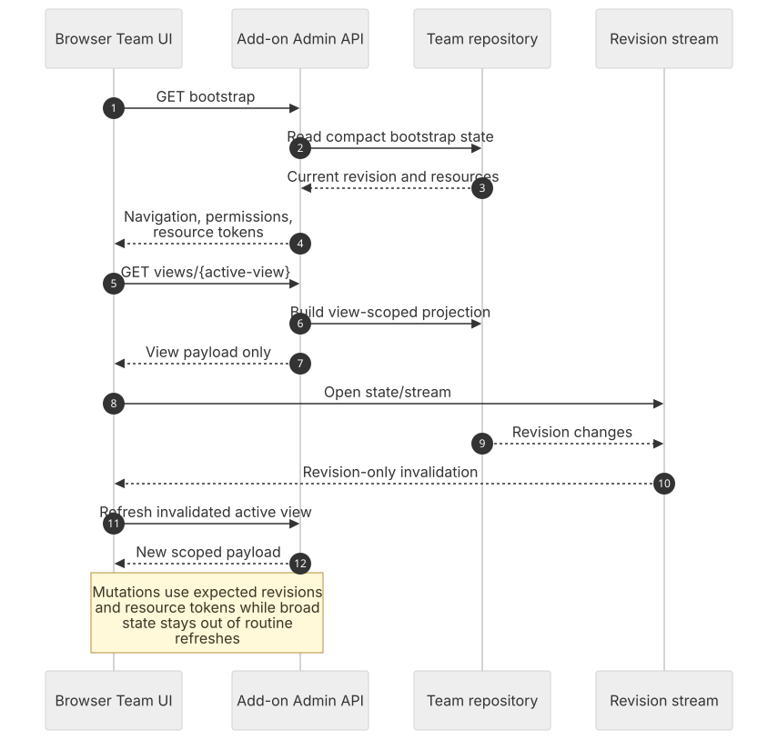

<p class="figure-caption">Figure 25.2 — Scoped UI reads refresh from revision-only invalidations while optimistic writes remain explicit.</p>

## Administrator reference: workflow and provider internals

The add-on registers its providers only while enabled. The main grouped contract is:

| Kind | Current Team providers |
|---|---|
| Trigger | <code>trigger:team:deliverable-created</code> |
| Query | <code>query:team:state</code>, <code>query:team:memory</code>, <code>query:team:session-routing</code> |
| Runtime effects | wake due agents, wake governance managers, publish outbox, finalize dispatch |
| Domain effects | create/update cases and tasks, create directives/reviews, ephemeral lifecycle |
| Git/release effects | publish review branch, consolidate, record promotion, verify candidate, mark published |
| Memory effects | index and reindex |

The registered <code>team-runtime.v1</code> pack composes these with core agent, communication, Git, and event effects. Internal event routes include Chat queued, agent wake requested, ephemeral requested/completed, operator escalation, Git promotion/recovery, and release-candidate verification. The former deliverable acceptance-verification route remains only as a one-release no-op compatibility handler for already-queued events.

The packaged Python definition is a source definition. Enablement materializes an operator-owned live workflow document under the normal revision and lock contract. Refresh it through the Add-ons surface. Never directly rewrite a live workflow-pack file, even during incident repair.

## Administrator backup and recovery

A useful backup set includes:

1. a SQLite-consistent backup of <code>runtime/addons/team-addon/state.db</code>;
2. Team avatar files;
3. referenced artifact data and artifact-space metadata;
4. core managed repositories and registry;
5. live workflow configuration and its revision history;
6. core voice-session and model-usage stores;
7. Qdrant only as a convenience snapshot, because it can be rebuilt.

Either stop Team writers before a filesystem copy or use SQLite's supported backup mechanism. Copying only the main DB file while WAL writes are active can yield an inconsistent backup.

Recovery order:

1. restore canonical Team SQLite and validate it with the current code/schema;
2. restore referenced core stores;
3. start services and verify add-on/provider registration;
4. inspect pending/claimed outbox and stale leases before resuming runtime;
5. rebuild semantic memory index;
6. reconcile managed Git refs, artifacts, voice records, and cost coverage.

Do not replay legacy JSON over restored relational state.

## Administrator runbook

### Governance

1. Confirm group manager, membership, goals, cap, and current runtime lease.
2. Read agenda and member-Team summaries.
3. Route only justified directives to member Team managers.
4. Mark agenda handled after the decision/action is recorded.

### Memory

1. Search canonical metadata by Team/project/scope before blaming semantic retrieval.
2. Read detail for long body content.
3. Supersede or archive; never overwrite the meaning of an old decision.
4. Reindex Qdrant from canonical records and retest visibility by representative identities.

### Cost

1. Read totals together with coverage status/reasons and unpriced usage.
2. Trace attribution to session, dispatch, project, and ephemeral metadata.
3. Compare the active pricing catalog with event timestamps/models.
4. Change caps only with explicit operational intent.

### Internals

1. Take a consistent snapshot before deep inspection.
2. Inspect current schema, Team revision, support ledgers, and live workflow pack.
3. Follow stable IDs across Team, workflow, session, Git, artifact, and usage stores.
4. Repair through supported services and verify the resulting revision/readback.

## Source trail

- <code>src/evander_team_addon/models.py</code> — governance, memory, cost-cap, runtime, activity, idempotency, and outbox records.
- <code>src/evander_team_addon/services/commands/governance_commands.py</code> and <code>services/domain/governance.py</code> — group authorization, directives, agenda, and membership decisions.
- <code>src/evander_team_addon/services/memory_service.py</code> and <code>services/commands/memory_commands.py</code> — canonical memory, visibility, semantic retrieval, and lifecycle.
- <code>src/evander_team_addon/costs.py</code> and <code>src/evander/model_usage/</code> — usage attribution, pricing, coverage, and cap payloads.
- <code>src/evander_team_addon/sqlite_store.py</code> and <code>repository.py</code> — relational schema, WAL, transactions, migration, and support ledgers.
- <code>src/evander_team_addon/providers.py</code>, <code>provider_schemas.py</code>, and <code>workflow_packs.py</code> — grouped node contracts, governance runtime, indexing, and live-pack definition.
- <code>docs/addons.md</code> — governance, memory, cost, runtime, and enablement contracts.
- <code>tests/test_team_addon_costs.py</code>, <code>tests/test_team_addon_models.py</code>, <code>tests/test_team_addon_mcp.py</code>, and <code>tests/test_team_addon_runtime.py</code> — visibility, cap, agenda, transactions, and provider behavior.


<div class="page-break"></div>

# Part IV: Engineering and Evolution

Explain how to extend and verify Evander, then separate the historical decisions from the current contract.

# 26. Engineering and Extension Guide

> **At a glance.** Not every new requirement calls for changing Evander's core. Many can be expressed as configuration, a workflow, a provider plugin, or a self-contained add-on. This chapter helps an engineer choose the smallest extension point that fits, so new capability arrives without bypassing the security, recovery, and audit behavior the rest of the system relies on.
>
> This is an engineering chapter, so it keeps exact contracts and implementation checklists. Read **Choose the right seam** and **Seven rules every extension must preserve** first. Then go directly to the section for the extension you are building, and use the testing and troubleshooting sections as the completion gate.

## Choose the right seam

Before writing code, ask whether the requirement changes **values**, **composition**, **a reusable integration**, **a product-sized domain**, **where isolated work runs**, or **Evander's own durable semantics**. Pick the first seam in the table that fully expresses the requirement.

| Requirement | Preferred seam |
|---|---|
| Change an endpoint, model, allowlist, threshold, or backend selection | Directory/host configuration |
| Compose existing triggers, gates, queries, and effects | Workflow pack |
| Add a reusable typed workflow node | Provider plugin |
| Add a cohesive UI/API/MCP/workflow feature with private state | Add-on |
| Add a new isolated execution mechanism | `ExecutionBackend` implementation plus deployment bundle |
| Change policy, lifecycle, identity, or durable core semantics | Focused core service/repository change |

Northstar Platform's telemetry-retry process, for example, needs no new core scheduler: a communication or issue trigger, existing Git/session effects, and Team workflow primitives are enough. A genuinely new telemetry SaaS might warrant a provider plugin; a full telemetry-management product with its own records and UI might warrant an add-on.

Three follow-up questions catch many over-sized designs:

1. Can existing typed nodes express the behavior as a workflow?
2. Does the feature need private durable state and its own UI/API surface, or only one reusable provider?
3. Would the proposal introduce a second owner for secrets, source code, identity, or durable truth?

If the third answer is yes, revise the boundary before implementation.

## Seven rules every extension must preserve

1. **Host paths and secrets stay private.** Public contracts use managed IDs, relative artifact paths, target IDs, and environment-variable names.
2. **Code moves with Git.** Do not add MCP payload transport for repositories.
3. **Directory ownership is part of identity.** Resolve effective config and authorize against the owning scope.
4. **Writes are explicit and replay-aware.** Define an idempotency key or compare-and-swap/lease boundary for every external mutation.
5. **Schemas reject ambiguity.** Typed models, forbidden extras where appropriate, stable normalized outputs, and explicit provider-only fields make failures reviewable.
6. **Durable truth has one owner.** Derived caches and indexes must be rebuildable or visibly stale.
7. **Cleanup is part of success.** Temporary credentials, refs, worktrees, containers, leases, and pending records need terminal cleanup and startup reconciliation.

These rules are not merely style conventions. They are compatibility with Evander's security, retry, and audit model. An extension that works on the happy path but bypasses one of them is incomplete.

## Extending the Admin runtime

`src/evander/admin/composition.py::build_admin_runtime` and `AdminRuntimeComponents` are the supported assembly seam. Domain behavior belongs in a focused service under `src/evander/admin/services/`; web routes should validate HTTP/auth concerns and delegate. CLI and gateway adapters should use the same service rather than reimplementing business rules.

Use this seam when the new behavior belongs to Evander's supported administration surface and should be shared consistently by Admin Web, CLI, or gateway adapters.

> <span class="sidebar-kicker">Engineering checklist</span> **A new Admin domain normally needs**
>
> - a dependency dataclass/port for the narrow collaborators it uses;
> - a service with plain, testable methods;
> - construction and exposure in `AdminRuntimeComponents`;
> - thin route and payload models;
> - RBAC/privileged-unlock/revision behavior for mutations;
> - focused service tests and route authorization tests.

Do not recreate the removed monolithic `AdminService` facade or rely on another service's private attributes. Compatibility adapters, when unavoidable, should be thin and scheduled for removal.

## Adding a workflow node

Workflow nodes are divided by semantics:

- **trigger** discovers or accepts an event;
- **gate** makes a deterministic routing/state decision;
- **query** reads without external mutation;
- **effect** performs a mutation or long-running action.

Putting a write in a query or a provider poll in an effect makes retry behavior impossible to reason about.

Start by classifying the node by what it does to the outside world. That decision determines its retry contract: triggers discover, gates decide, queries read, and effects mutate.

### Complete node contract

A node is not complete when only its Python provider runs. It must also be validatable, discoverable in the editor, bindable by later nodes, configurable at runtime, and testable under failure and replay.

> <span class="sidebar-kicker">Engineering checklist</span> **Complete production-node contract**
>
> A production node includes all of the following:
>
> 1. A namespaced node type such as `query:telemetry:deployment`.
> 2. A typed definition model and resolver from `WorkflowNodeEnvelope`.
> 3. A provider subclass of the appropriate base with declared node capability.
> 4. A stable output schema registered for expression binding.
> 5. Runtime-context use for directory config, secret resolution, services, and transport—never ambient guest state.
> 6. A workflow-editor catalog entry with useful labels, field schemas, defaults, and output documentation.
> 7. An internal event catalog entry only if the node introduces a stable event type.
> 8. Registration in built-ins or a `ProviderPluginRegistration`.
> 9. Validation, materialization, provider, registry, expression-binding, failure, and replay tests.
> 10. Documentation, configuration reference, and `CHANGELOG.md` entry.

`ProviderPluginRegistration` can contribute trigger, gate, effect, and query mappings; definition resolvers; editor entries; and internal event entries. The loader rejects duplicate catalog entries and catalog entries that do not match a provider of the declared kind. Module and `evander.providers` entry-point plugins are assembled at startup.

### Effect design checklist

An effect crosses the most important boundary because it changes something. Define its replay, uncertainty, approval, and cleanup behavior before writing the provider call.

> <span class="sidebar-kicker">Engineering checklist</span> **Before implementing an effect, write down**
>
> - canonical input and normalized output;
> - external idempotency key and what a retry observes;
> - timeout/cancellation behavior;
> - which state is persisted before and after the call;
> - how an uncertain provider acceptance is reconciled;
> - policy/approval and audit fields;
> - secret redaction;
> - terminal and abandoned-work cleanup.

Northstar Platform's “publish telemetry branch” effect should carry `managed_repo_id`, exact approved SHA, destination ref, and lease—not a host path and mutable branch tip.

## Building an add-on

Choose an add-on when the extension is a cohesive product surface with private state and several integration points—not merely one reusable workflow node.

An add-on package exposes `register_addon()` returning `AddonRegistration` or a compatible mapping. A typical package contains:

```text
my_addon/
├── addon.json
├── __init__.py
├── api.py
├── service.py
├── repository.py
├── workflow.py
└── ui_static/
```

Use `AddonContext.addon_runtime_dir` or `addon_storage_path`; never construct traversal-prone paths from user input. Keep add-on state private and references to core entities explicit. If the add-on needs core behavior, depend on a supported service/port rather than opening core databases itself.

Admin route factories register under `/api/addons/<id>/...`; UI under `/addons/<id>/...`; MCP tools register through the gateway hook; workflow providers use the same provider-plugin contract. Enablement is revision-checked and restart-gated. Document exactly which processes must restart.

Add-on migrations must be transactional and idempotent. A legacy import should be one-way, marker-gated, and leave enough provenance to explain what happened. Discovery may report a broken disabled package without loading it; an explicitly configured or enabled add-on should fail assembly clearly rather than leave half of its routes/providers registered.

## Adding an execution backend

An execution backend owns the full life of a temporary workspace. A successful start method is not enough; generic Evander workflows must be able to observe, stop, destroy, and reconcile the resource through the same abstraction.

> <span class="sidebar-kicker">Engineering checklist</span> **Complete <code>ExecutionBackend</code> protocol**
>
> Implement the complete `ExecutionBackend` protocol, not only “start”:
>
> - create/start/stop/destroy;
> - status, list, and logs;
> - command execution and file transfer where the contract requires them;
> - cancellation and terminal cleanup;
> - stable mapping from session/execution ID to backend resource;
> - normalized errors and bounded timeouts.

Register the backend in `ExecutionBackendRegistry`, expose explicit configuration, and ensure generic workflow effects continue to address `execution_backend` rather than backend-specific implementation names.

Threat-model the backend independently. The container worker, for example, needs authenticated control-plane calls, worker identity binding, no general egress, private runtime state, relay endpoints, restricted Git keys, package caches, resource limits, and startup reconciliation. A smoke test is not a substitute for lifecycle and isolation tests.

## Adding a host relay or service

A host relay or service changes deployment as well as application code. Decide who must reach it, which credential remains on the host, how calls are authenticated, and how operators will see its health before choosing its listener and firewall behavior.

> <span class="sidebar-kicker">Engineering checklist</span> **A new host service touches more than its Python module**
>
> Update:
>
> - a `pyproject.toml` entry point;
> - config model/example and secret-variable documentation;
> - systemd template and `scripts/install_systemd_units.sh` rendering/preflight;
> - firewall defaults only for ports guests or workers must reach;
> - bootstrap/session configuration if guests consume it;
> - runtime assembly and health/status reporting;
> - `README.md`, `docs/operations.md`, and `docs/configuration-reference.md`;
> - focused service, install-script, firewall, and documentation tests;
> - `CHANGELOG.md`.

Bind management-only services to loopback. If a guest-reachable port is needed, authenticate it with session-scoped capability and enforce the same policy server-side. Forward streaming response lifetime correctly and redact credentials from logs.

## Storage, revisions, and migrations

Choose storage based on concurrency and query needs. JSON repositories are suitable for small, low-contention records when atomic replacement/locking is explicit. SQLite is preferred for concurrent claims, leases, histories, and relational invariants. Enable foreign keys and define busy timeout/transaction boundaries consciously.

For operator-edited documents, expose a deterministic revision and require `expected_revision`. For workflow packs, use the existing editor lock/revision path. For remote publication, use provider leases or compare-and-swap. These are the same concurrency principle at different layers.

A migration changes which representation is authoritative. State that transition explicitly and avoid leaving old and new stores as indefinite co-owners.

> <span class="sidebar-kicker">Engineering checklist</span> **A migration plan must specify**
>
> - old and new authority;
> - whether migration is breaking or dual-read;
> - exact preflight and blocking conditions;
> - idempotent apply and dry-run behavior;
> - rollback limit;
> - active-worker/session handling;
> - verification and cleanup of legacy state.

Avoid indefinite dual authority. The managed Git migration deliberately replaced path-based checkouts with IDs and bare repositories rather than teaching every future feature both models.

## Testing and verification

Test the narrow contract while developing, then run the complete Python suite before treating the extension as ready. Add failure, replay, authorization, cleanup, and deployment coverage in proportion to the seam you changed.

Run focused tests while developing, then the Python suite:

```bash
./.venv/bin/pytest -q tests/test_workflow_plugins.py tests/test_workflow_validation.py
./.venv/bin/pytest -q
```

For a new node, include registry and runtime-contract tests plus provider-specific failure/retry tests. For a service, include install/preflight and docs assertions. For UI/browser tests, apply explicit command timeouts; stop a hung process and report its last useful output rather than leaving it running.

Before committing in a dirty tree:

```bash
git status --short
git diff --check
git diff --cached --name-only
```

Preserve unrelated user changes. Record every feature and bug fix in `CHANGELOG.md`.

## Troubleshooting an extension

First identify which boundary failed: registration, schema materialization, scoped configuration, provider transport, replay, cleanup, migration, or documentation/deployment. Then trace one stable identity through that boundary instead of changing several layers at once.

### Engineering runbook

1. **Confirm loading.** Check the provider/add-on catalog, process restart, and duplicate-registration errors.
2. **Validate the schema.** Materialize the smallest node/config payload and read the exact diagnostic before debugging transport.
3. **Inspect effective scope.** Verify directory config, secret environment name, target/repository ownership, and policy.
4. **Trace one ID.** Follow one trigger/run/effect/dispatch or one API request through its service and repository.
5. **Test replay.** Execute the same idempotency key twice and simulate a timeout after provider acceptance.
6. **Test cleanup.** Cancel and crash at each resource-acquisition boundary; run startup reconciliation.
7. **Check compatibility.** Run migration dry-run and verify old data cannot silently become a second authority.
8. **Verify documentation surfaces.** Search for stale command paths, service names, config fields, and generated UI pointers.

## Source trail

- `src/evander/admin/composition.py`
- `src/evander/admin/services/`
- `src/evander/workflow/plugins.py`
- `src/evander/workflow/catalog.py`
- `src/evander/workflow/contracts.py`
- `src/evander/workflow/validation.py`
- `src/evander/triggers/providers/base.py`
- `src/evander/gates/providers/base.py`
- `src/evander/queries/providers/base.py`
- `src/evander/effects/providers/base.py`
- `src/evander/providers/builtin.py`
- `src/evander/addons.py`
- `src/evander/execution/backend.py`
- `src/evander/execution/registry.py`
- `docs/addons.md`
- `docs/execution-backends.md`
- `tests/test_workflow_plugins.py`
- `tests/test_provider_runtime_contracts.py`
- `tests/test_workflow_validation.py`
- `tests/test_addons.py`
- `tests/test_execution_registry.py`
- `tests/test_install_systemd_units_script.py`
- `tests/test_firewall_defaults.py`


# 27. Design History and Compatibility Boundaries

> **At a glance.** Evander began as a guarded host around disposable virtual machines, then acquired more kinds of work, more operators, another execution method, prepared workflows, optional domains, and stronger release evidence. Growth forced shared mechanisms to say clearly *whose work this is, who may act, and which record is current*.
>
> This chapter follows those turning points. It is non-normative—background, not instruction—but it explains why today's system insists on clear ownership, temporary job permissions, one current source of truth, and the exact code version that was reviewed. The precise technical names and migration consequences follow the plain story. Whenever history and the preceding technical chapters seem to disagree, the current implementation and its source trail win.

## How to read this history

This is an architectural reconstruction from the changelog, retained design notes, tests, and current contracts. It is not an incident report, and it does not assume that every redesign followed a production failure. In many cases, a second writer, backend, or use case simply made an ambiguity visible. The history does not by itself tell us whether that ambiguity ever caused a concrete incident.

An earlier design can therefore have been a sensible step and still be wrong to restore today. The host heartbeat, JSON coordination stores, action artifacts, repository paths, and the broad Admin facade each solved a real problem at one stage. They were retired or narrowed when the problem acquired more owners, more concurrency, or stronger evidence requirements.

For an operator, three lessons matter more than the dates:

1. **An old name can explain a leftover file without making that file current.** Confirm which service and store the running revision actually uses.
2. **A migration bridge is not a second source of truth.** Once current state has moved, changing the old representation should not be expected to change the system.
3. **Newer boundaries usually exist because the older shortcut became ambiguous or unsafe.** Work through the current API or service instead of restoring the shortcut.

> <span class="sidebar-kicker">Historical perspective</span> **An earlier design can be both correct and retired**
>
> A design is judged against the system that exists around it. One host loop is easy to understand when it has one periodic duty. One JSON document is practical when one owner edits a small record. A host path can be an adequate local reference while only one process uses it. The same choices become poor authorities when several workers claim jobs, several directories use the same upstream repository, or review and release must prove that they acted on one exact version.
>
> The lesson is not that the first design was foolish. It is that compatibility work must preserve the *meaning* of old state without preserving every old shortcut as a permanent operating model.

## The recurring design pattern

Evander grew from a host gateway around disposable VMs into a directory-scoped control plane with provider-neutral workflows, multiple execution environments, packaged add-ons, and managed Git. Across those changes, the same five-stage pattern appears repeatedly:

1. A small system uses one shared mechanism because its owner and meaning are obvious.
2. A second writer, directory, backend, or domain arrives.
3. Location, identity, permission, and durable authority begin to blur together.
4. Evander introduces an explicit ID, owner, transaction, lease, or interface.
5. The earlier surface becomes migration input, a narrow compatibility bridge, or a retired design.

Different parts of the system reached those stages at different times:

| Earlier pressure | Boundary that became explicit | What the boundary protects |
|---|---|---|
| One global configuration described all work | directory path, inherited overlay, and direct ownership | whose rules and records apply |
| One periodic loop owned unrelated duties | dedicated trigger/effect, ingest, wake, proxy, and PR workers | one accountable owner for each kind of work |
| A VM looked like the session itself | provider-neutral session plus `ExecutionBackend` | policy identity independent of compute mechanism |
| JSON files coordinated concurrent claims and histories | selective SQLite repositories and transactions | atomic claims, retries, paging, and relational invariants |
| One large Admin facade mediated every domain | explicit composition graph and focused services | visible dependencies and one owner per domain |
| Team mutations arrived as guest artifacts | Team MCP commands, idempotency, private SQLite state, and outbox | validated intent separate from result files |
| One host path represented “the repo” | `managed_repo_id`, owned ref namespaces, and operation worktrees | repository identity independent of storage location |
| A branch name represented reviewed code | pinned commit SHA, compare-and-swap, and publication lease | the exact content approved for release |

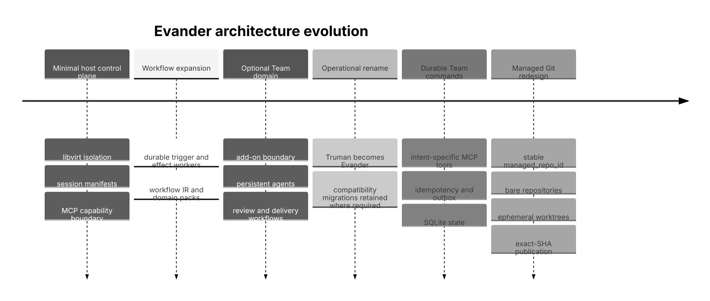

The figure is cumulative, not a sequence of discarded products. The original guarded host boundary remains underneath the later layers. Most redesigns made ownership *inside* that boundary more precise.

<p class="figure-caption">Figure 27.1 — New capabilities repeatedly turn implicit location or authority into an explicit identity and owner.</p>

## What did not change

The history contains many replacements, but its central promises were unusually stable:

- Broad credentials and policy decisions remain host-owned rather than being copied into an agent workspace.
- Agent compute remains constrained and disposable; adding container workers did not make the host or worker generally accessible.
- A session remains the job and permission identity even when its execution environment changes.
- Git carries source code, MCP carries controlled operations, and artifact storage carries result files. Later designs made those roles sharper rather than merging them.
- Durable host-side evidence is expected to outlive temporary compute.
- Reachability is not authority. A visible service, a known session ID, an approval, and permission to perform one action remain separate checks.

These invariants are the thread to follow when an older path or service name appears. The implementation around the invariant may have changed; the security or evidence promise usually did not.

## Chronology at a glance

The detailed stories below overlap. This compact chronology preserves the order of the main seams before examining why they mattered.

| Period | What Evander learned to make explicit |
|---|---|
| March 20, 2026 | keep broad authority on the host |
| March 21–April 2 | give work an owner and a scope |
| April 3–20 | turn automation into durable, understandable workflows |
| April 21–May 4 | separate the job from the machine that runs it |
| May 19–31 | make approvals, results, and retries explainable after a restart |
| June 9–25 | add Team without creating a second control plane |
| June 22–July 4 | make people, services, and add-ons explicit actors and owners |
| July 2–14 | replace guessed identity and movable labels with proof and exact versions |

## From a guarded host to scoped ownership

### March 20: establish the boundary first

The initial platform established the security shape that all later work inherited: host-side policy and audit, an MCP gateway, an OpenAI relay, firewall and service templates, disposable libvirt VMs, cloud-init, and Git-based code transport. Discord and NuGet support quickly exercised the same rule—provider integrations and secrets live on the host; guests receive narrow endpoints.

This first version was small, but its separation of *control* from *execution* mattered. Later abstractions did not turn guests into trusted hosts or grant them general internet access. They supplied more precise ways to describe which host-controlled capability a particular job could use.

### March 21–April 2: automation needs an owner and a scope

Issue VM automation, provider email, Azure DevOps polling, pull-request feedback, Teams and Discord ingest, and scheduled wakes made “one global configuration” insufficient. Directory metadata, inherited configuration overlays, scoped issue identities, approvals, local-versus-remote issue records, and ownership queries followed.

Directory scope began as a way to place configuration and records. It gradually became an authority boundary: workers resolve the owning directory; workflow graphs and session queries stay in the selected scope; ambiguous issue identities are rejected instead of guessed; and authorization checks use the same ownership context. A directory is not merely a folder-like label. It answers which configuration lineage and owner apply to the work.

> <span class="sidebar-kicker">Design turning point</span> **The heartbeat changed owners twice**
>
> Early guest heartbeat behavior made the temporary worker responsible for noticing more work. Moving that responsibility to a host heartbeat improved secret ownership and allowed the host to wake idle sessions, reconcile state, and report status without trusting the guest.
>
> As periodic duties multiplied, however, one host loop became another ambiguous owner. Azure DevOps feedback and completion, provider ingest, Discord wake, scheduled wake, proxy freshness, and workflow polling acquired dedicated workers. There is no current `evander-host-heartbeat` service; optional guest heartbeat assets remain disabled by default.
>
> This is evolution rather than reversal: responsibility moved from an isolated worker to the host, then from a shared host loop to the specific host service that owns each duty.

## From scripts to a durable workflow language

### April 3–20: a graph becomes an executable contract

The first workflow model separated “something happened” from “change something.” It then gave decisions and read-only lookups their own visible steps. Saving events and results made a process resumable; validating its routes before activation made it understandable. Automation was becoming a durable program rather than a chain of scripts that happened to run in order.

Workflow packs were the next step. The shared runtime could own progress and recovery while optional providers supplied the behavior for a particular external system. Operators could edit a process without allowing an invalid draft to displace the last known good version.

Once a workflow could perform consequential external work, however, “the action succeeded” was no longer the whole story. Evander also had to know whether the result had been safely published for the next step. Completion and publication became separate, recoverable facts.

> <span class="sidebar-kicker">Deeper detail</span> **Why typed capabilities replaced arbitrary scripts**
>
> Triggers, effects, gates, and queries gave discovery, mutation, routing, and read-only observation distinct contracts. Durable event queues, provider registries, asynchronous completion, graph validation, trace IDs, and the visual editor turned those contracts into typed workflow programs. Provider-owned schemas and runtime contexts let domain packs use host services without ambient access. Revisions, atomic saves, and live reload kept the previous compiled graph active after an invalid edit.
>
> The later `completion_pending` state captured the difference between completion and publication: retry publishing the result of an already completed effect without rerunning the external mutation itself.
>
> This history explains two current engineering rules: a node's kind must match its read or write semantics, and editor catalog/schema work is part of adding a provider rather than optional UI polish.
>
> An arbitrary host-script node can do almost anything, which also means the workflow definition cannot state its real inputs, outputs, authority, retry behavior, or safe destinations. Typed pipeline, diagnostics, and Git effects progressively covered concrete needs with bounded schemas and policy. The legacy host-script workflow effect was then removed.
>
> The design preference is not “Python instead of shell.” Host installation and machine orchestration still use shell where appropriate. The boundary is that an operator-authored workflow invokes a named, validated capability rather than supplying arbitrary host code or paths.

## Separating the job from the machine

### April 21–May 4: repositories and execution become interfaces

Repository interfaces began progressively replacing high-value broad file access with domain operations for sessions, triggers, executions, review requests, wakes, and feedback. This was deliberately incremental; some compatibility-shaped repository methods and transitional callers remain. The important move was to give durable behavior an owning interface before changing every backing store.

At roughly the same time, VM-provider identity was separated from session semantics, and issue VM creation was split from repository preparation. The `ExecutionBackend` abstraction then added `container_worker_vm` without removing `libvirt_vm`, which remains the default.

Container workers made a distinction visible that one VM per job had allowed the system to blur: a **session** is the job's identity, policy, expiry, and evidence boundary; an **execution backend** supplies and manages the compute. Supported lifecycle and `effect:agent:*` operations became backend-aware, while backend-specific VM behavior and some issue/PR paths remained outside that portable surface.

The later guarded VM-to-container migration is useful proof of the separation. It preserved the session manifest and its model, tools, approvals, Team metadata, and thread history while changing only the backend identity fields and copying the durable session home. The session remained the same job identity even though the machine mechanism changed.

> <span class="sidebar-kicker">Deeper detail</span> **An abstraction is a promise with a boundary**
>
> `ExecutionBackend` does not claim that every libvirt operation works on every future environment. It defines the supported preparation, start, stop, inspection, destruction, and log seams that generic callers may rely on. Backend-aware `effect:agent:*` workflow operations build on that abstraction. Container-worker authentication, private session homes, relay networking, package caches, resource profiles, and reconciliation remain implementation responsibilities.
>
> This qualification matters during upgrades: “backend-aware” is not evidence that an older VM-only command has become portable.

## Durability follows the coordination problem

### May 19–31: successful actions become durable evidence

By May, workflows could accept external events, grant run-scoped tool leases, publish immutable artifacts, and link a run to sessions, approvals, tool calls, communications, and binding traces. Approval gained exact-payload retry checks and argument policies. Session expiry was enforced across resume, workflow, wake, queue, and relay paths rather than only in one UI action. These changes made a run explainable across restarts and across several cooperating services.

Artifacts also separated into clearer roles. A session's `/artifacts` directory is a mutable workspace. Staging and publication create an immutable host-owned result that workflows and operators can inspect or later import. Team eventually added hierarchical artifact spaces over those published keys. Not every file in `/artifacts` is immutable; publication is the transition that creates durable evidence.

### May 21–27: storage follows the coordination problem

Teams and Discord inboxes, scheduled wakes, worker jobs, and orchestration adopted SQLite where concurrent claims, paging, write-ahead logging, or transactional history required it. Tool-call audit deliberately kept append-only JSONL as canonical evidence and added SQLite only as a rebuildable search index.

> <span class="sidebar-kicker">Storage sidebar</span> **Storage follows coordination, not fashion**
>
> A small operator-owned document with one writer remains a good candidate for atomic, locked JSON. A queue in which several workers claim rows, renew leases, retry, page results, and preserve history needs transactions and indexes, so SQLite is a better fit. An append-only security record benefits from JSONL's simple canonical sequence, even when SQLite makes searching it faster.
>
> The wake and worker migrations used a temporary one-way JSON import while SQLite became the live authority. After the supported deployments were verified, those import paths were removed and the JSON sources were archived. The repository APIs remained stable while their persistence semantics changed.

This was never a blanket “JSON is obsolete” migration. The owner repository and concurrency contract determine the format.

## Optional domains without a second control plane

### June 9–25: Team grows behind the add-on boundary

The generic add-on boundary arrived with a strong architectural claim: opinionated product domains may extend Admin Web, workflow providers, MCP, and private storage without forcing their concepts into core session and workflow schemas. Add-ons are discovered separately from being enabled, store state beneath their own runtime area, and must not become alternate owners of core secrets, execution, or policy.

Team was the first large proof of that seam. On June 9 it introduced private organizational state, persistent agents, durable work and review, and Git-first delivery while core remained Team-agnostic. Over the following weeks, roles, governance, communication, leases, wake rules, and release recovery tested whether a rich add-on could remain private without becoming a second control plane.

On June 17, Team's canonical state moved from `state.json` to relational `state.db` with a one-time import. Roles, assignments, leases, task/review/release records, artifact references, and activity needed transactional invariants that were awkward to maintain as one document.

On June 25, the clean MCP cutover retired action-artifact providers. Agents began reporting mutations through Team-owned MCP tools bound to dispatch permissions and idempotency. The mutation, revision, activity entry, idempotency result, and outbox intent can be committed together. A separate publisher turns pending outbox rows into workflow events and records completion or retry.

> <span class="sidebar-kicker">Design turning point</span> **Artifacts are nouns; commands are verbs**
>
> A deliverable file is naturally an artifact: it can be published, reviewed, retained, and referred to by an immutable key. “Finish this task,” “request review,” or “change this assignment” is different. A command needs an authenticated actor, permission and lease checks, validation, an idempotency key, one transactional outcome, and a useful response if the caller repeats it after a timeout.
>
> Using artifacts for both blurred evidence and authority. Team MCP commands and the outbox separated the verb from its resulting evidence. Artifacts remain important for deliverables; they are no longer a covert command bus.

The distinction between add-on and core remained intact as more add-ons appeared. Bokio and Skatteverket proved that the same seam could host very different domain integrations without adding their concepts to the core gateway. Runtime workflow packs and later package discovery made enablement an operator-managed lifecycle: a pack cannot remain active when its provider implementation will not load, and affected processes must restart after an enablement change.

## Explicit people, focused services, and a persisted name

### June 22–23: the operator becomes an explicit actor

Multi-user local authentication made the signed-in person's identity and permissions part of each operation. Team chat became per operator rather than one global conversation. The broad Lock/Unlock control was eventually narrowed to a local UI read-only guard; backend authority still comes from authentication, RBAC, privileged-operation checks, directory scope, and revisions. A visual lock is useful protection against accidental clicks, but it is not an authorization boundary.

### June 26–30: naming becomes part of the upgrade

Operational naming was standardized on Evander: Python package, `evander-*` services, `EVANDER_*` variables, and guest `.evander` and `/etc/evander` paths. Installer and setup code retained narrow upgrade handling for earlier service, firewall, network, environment, and guest paths.

> <span class="sidebar-kicker">Compatibility sidebar</span> **A rename becomes a migration when the old name is durable**
>
> Changing a heading is cosmetic. Changing a systemd unit, environment-variable prefix, network name, package import, runtime path, guest profile hook, or stored workflow field changes how a running installation finds its state. The Evander rename therefore needed discovery, repair, cleanup, and compatibility logic—not merely search and replace.
>
> Older rollback artifacts can contain names from their era. Treat deployed configuration and current service paths as the authority for an upgrade.

### June 27–30: focused services expose domain ownership

In parallel, Admin domains were extracted behind protocol ports and focused services. The large `AdminService` facade had been useful as a shared entry point. The refactor treated construction and domain ownership as separate concerns: the composition root would assemble the graph, while focused services would own behavior.

The transition was unusually quick. June 27 guidance described `AdminService` as a compatibility facade while focused services and a composition builder were introduced. By June 30 that guidance had been superseded: the facade was removed, and Admin Web, gateway, CLI, providers, and tests assembled one explicit graph through `build_admin_runtime` and `AdminRuntimeComponents`.

The lesson is not that facades are inherently bad. A convenient entry point should simply not become the hidden owner of unrelated domains. The composition root may know how services fit together; each focused service should own its own behavior.

## From a session label to proof-bearing authority

### July 2–14: tighten every consequential identity

On July 2, per-session MCP proof tokens made an important distinction explicit: knowing a `session_id` is not proof that a caller represents that session. The token bound the MCP transport more tightly. Subsequent hardening scoped relay access, HTTP targets, Git repositories, branch namespaces, approval reads, and workflow effects to their actual directory and session authority.

This was defense maturation, not evidence of a documented breach. It applied the original rule—reachability is not permission—at more boundaries as the number of reachable services grew.

Git tells the same story over a longer arc. The first platform already used host-mediated cloning, restricted agent pushes, promotion, and pull-request creation. Private container Git, mirror serialization, deterministic Team namespaces, typed Git effects, server-owned work contexts, and pinned reviewed commits progressively removed ambient paths and movable labels from consequential operations.

On July 13, managed Git completed that arc. It replaced issue-specific mirrors and persistent-checkout routing with a deterministic ID and one directory-owned bare repository per canonical upstream. Guest, refresh, review, Team, and operation refs gained disjoint owners. Host workflows pin exact commits; compare-and-swap protects internal targets; explicit leases protect upstream publication; and unique detached worktrees are created for one operation, removed on normal completion or termination, and reconciled after abnormal termination. This was a breaking migration, not an indefinite dual read.

Where a repository happens to be stored is therefore no longer how the rest of the system identifies it. The path is private implementation detail; `managed_repo_id`, directory ownership, ref, and exact SHA carry the meaning.

The same commit-identity machinery enabled bounded code consultations: a disposable read-only worker answers one question against one pinned commit, submits a structured result with validated citations, and is cleaned up. July release work also froze candidate and review criteria, classified candidate failures separately from transient infrastructure failures, and retained immutable attempt lineage. A retry may repeat an eligible gate against the same pinned candidate; it may not quietly substitute different code.

> <span class="sidebar-kicker">Deeper detail</span> **Why exact identity keeps returning**
>
> Directory paths, session IDs, event IDs, idempotency keys, managed repository IDs, commit SHAs, workflow revisions, and approval payload digests identify different things. Architecturally, they answer the same question: *what exact object or decision does this later action refer to?*
>
> A stable ID alone is not always enough. The system may also need an owner, expected current value, lease, expiry, or proof token. That combination prevents a stale label, retry, or neighboring directory from silently changing the meaning of the action.

## Current compatibility surfaces

Compatibility is intentionally narrow. Treat these as migration bridges, not design examples.

If an operator encounters one of these names, the safest first step is to record where it appeared and which live Evander revision is running. Do not copy data from the older surface into the newer one until an administrator has identified the migration contract and current authority.

| Surface | Current status | New work should use |
|---|---|---|
| Older guest session/config paths | read/repair fallback in selected bootstrap paths | `/etc/evander/session.env`, `/home/agent/.agent/config.env`, and current `/home/agent/.evander` run-state paths |
| `runtime/pr-map.json` | live compatibility store for session-bound and legacy PR streams; repository-scoped streams can bypass it | explicit PR workflow streams and managed repository identity |
| JSON wake/inbox/worker/Team stores | one-time import where the owning repository supports it | the current SQLite store |
| ADO-specific workflow node types | supported compatibility surfaces, and still appropriate for ADO-only semantics | provider-neutral remote issue/PR nodes where semantics match |
| Historical Team action artifacts and unpinned terminal releases | retained evidence; incomplete unpinned releases do not satisfy current gates | Team MCP commands and exact pinned release evidence |
| `AdminService` references | historical design or short-lived compatibility guidance | focused services assembled by `build_admin_runtime` |
| Legacy managed-Git path fields | unsupported historical residue, not live routing authority | `managed_repo_id`, owned ref, and exact SHA |
| Old service/firewall/network names | installer/setup cleanup only | `evander-*` services and current network/config names |
| Checked-in workflow pack examples | examples or built-ins, not assumed live authority | revision-checked live packs through Admin Web/API |

> <span class="sidebar-kicker">Migration model</span> **Compatibility should have a direction**
>
> A healthy migration flows one way:
>
> ```text
> old authority -> inventory/import/repair -> current authority -> verification -> finalization
> ```
>
> A bridge may read an old record long enough to import or repair it. It should not leave both ends accepting ordinary writes indefinitely. Two writable representations invite dual authority: each can be internally valid while disagreeing about the real state.

Once a SQLite repository is live authority, editing a retired JSON file must not change live state. Archive it with a manifest after finalization; do not leave an executable import path as rollback machinery.

## Retired designs: do not revive them

| Retired shortcut | Ambiguity or risk | Current owner or surface |
|---|---|---|
| `evander-host-heartbeat` or guest heartbeat as general scheduler | one loop appears to own unrelated provider and wake duties | dedicated PR, ingest, wake, proxy, trigger, and effect workers |
| Team commands written as action artifacts | a file cannot cleanly prove actor, permission, idempotency, and transactional outcome | Team MCP commands plus Team outbox/runtime workflow |
| repositories addressed by trusted-checkout or mirror paths | location is mistaken for identity and directory ownership | registered `managed_repo_id` |
| agent-authored code run in managed-Git operation worktrees | host scratch space is mistaken for an isolation boundary | disposable VM/container execution backend |
| new calls routed through `AdminService` | composition entry point appears to own unrelated domains | focused service from `AdminRuntimeComponents` |
| live workflow packs edited from a stale file copy | concurrent operator changes can be overwritten | lock and revision APIs |
| repository contents carried through gateway or MCP | control messages become an unbounded code transport | Git clone/fetch/push through managed Git |
| `audit.db`, semantic vectors, proxy caches, or UI payloads treated as canonical | a rebuildable or partial projection becomes a second truth | the owning canonical log, repository, provider, or record |

## Why compatibility sometimes fails closed

Upgrade shims stop when continuing would hide ambiguity. The refusal protects a specific invariant:

| Ambiguity | Why guessing is unsafe | Invariant protected |
|---|---|---|
| an issue number matches several directory/provider records | the wrong project could receive the operation | directory and provider identity |
| an old repository path cannot map uniquely to a managed repository | refs or credentials could cross ownership boundaries | repository ownership |
| active workers or Team leases make a Git migration unsafe | old and new writers could mutate the same work | exclusive writer and lease ownership |
| a workflow references a provider the add-on loader will not load | the graph would advertise an implementation that is absent | pack/provider consistency |
| a legacy nonterminal Team release lacks exact pinned evidence | release could proceed without proving the reviewed content | exact candidate identity |
| an existing semantic collection has a different vector schema | results from incompatible representations could be mixed | semantic result correctness |

The remedy is an explicit migrator or operator decision, not a guess. A fail-closed upgrade can be inconvenient, but it preserves the identity or evidence the newer invariant was introduced to protect. Historical terminal records may remain readable even when an incomplete old operation must be rejected and recreated under the current contract.

## Questions this history teaches us to ask

When an unfamiliar compatibility surface appears, six questions usually reveal its role:

1. What is the stable identity: a path, or an explicit ID and owner?
2. Which component is allowed to write the canonical state?
3. Is this record canonical, derived, cached, or migration input?
4. Which resource is intentionally temporary, and which evidence must survive it?
5. What value must be pinned exactly before review, retry, or publication?
6. How does the migration end, and what prevents both designs remaining writable?

These are reading questions, not a demand that an operator solve the architecture. They help distinguish a stale instruction from a supported recovery path before anything is changed.

## Troubleshooting and operator handoff

When a screen, log, or local instruction refers to an older design, record the exact name, path, command, or error together with the affected directory and time. Also capture the running version shown by the installation, if available. An operator does not need to decide which historical store is authoritative before asking for help.

Avoid “trying both” old and new commands, enabling a retired service, or editing both candidate stores. Those actions can create the dual authority that the migration was designed to remove.

## Administrator runbook: upgrade archaeology

When a deployment behaves as if an older design is still active:

1. **Identify the running revision.** Record package or checkout commit, service unit `ExecStart`, config path, and runtime path. Do not assume the shell checkout is what systemd serves.
2. **Read the relevant changelog window.** Find both the introduction and later retirement. A June compatibility note may have been superseded days later.
3. **Inspect current assembly.** Check `pyproject.toml` entry points, systemd templates and install script, `build_admin_runtime`, provider/add-on catalogs, and the owning repository constructor.
4. **Find migration markers and both candidate stores.** Determine which one current code opens before editing either.
5. **Run the supported preflight or diagnostic.** For add-ons, use discovery and enablement diagnostics; for a service rename, use installer preflight.
6. **Quiesce the writers named by the migrator.** Preserve backups and active lease or operation evidence.
7. **Apply once and verify through the current API.** Check IDs, counts, SHAs, revisions, and provider state—not merely that the new file exists.
8. **Finalize only when rollback artifacts are no longer needed.** Do not leave two writable authorities.
9. **Remove stale operational instructions.** Update local runbooks and automation so the next operator does not invoke a retired command.

## Source trail

- `CHANGELOG.md`
- `README.md`
- `docs/architecture.md`
- `docs/execution-backends.md`
- `docs/addons.md`
- `docs/git-remotes.md`
- `docs/repository-layer-refactor-note.md`
- `src/evander/admin/composition.py`
- `src/evander/workflow/plugins.py`
- `src/evander/execution/backend.py`
- `src/evander/repositories/session_manifests.py`
- `src/evander/messaging/wake_store.py`
- `src/evander/repositories/audit_index.py`
- `src/evander/addons.py`
- `src/evander/admin/services/managed_git_service.py`
- `src/evander_team_addon/repository.py`
- `src/evander_team_addon/sqlite_store.py`
- `src/evander_team_addon/services/commands/executor.py`
- `scripts/install_systemd_units.sh`
- `tests/test_workflow_plugins.py`
- `tests/test_container_worker_execution_backend.py`
- `tests/test_addons.py`
- `tests/test_team_addon_repository.py`


<div class="page-break"></div>

# Part V: Reference

Provide compact maps, diagnostic tables, terminology, and the cross-format subject index.

# 28. System Reference

> **At a glance.** This is the manual's lookup chapter. Use it when you remember that Evander has a service, command, port, file, or screen for something but cannot remember its exact name or owner. The earlier chapters explain why the pieces exist; the tables here help you find the right one quickly.

## Find the right map

You do not need to read this chapter from beginning to end. Start with the question you are trying to answer:

| If you are asking… | Go to… |
|---|---|
| “What is this background service for?” | [Persistent control-plane services](#282-persistent-control-plane-services) |
| “What does this port provide?” | [Default guest-reachable ports](#283-default-guest-reachable-ports) |
| “Which saved record is authoritative?” | [Runtime source-of-truth map](#284-selected-runtime-source-of-truth-map) |
| “What command starts this task?” | [Core command map](#285-core-command-map) |
| “Where do I find this in the interface?” | [Admin Web area map](#286-admin-web-area-map) or [Team Add-on view map](#287-team-add-on-view-map) |
| “Which part of the code owns this behavior?” | [Developer reference](#288-developer-reference-source-code-ownership-map) |
| “Which host checks should an administrator run?” | [Administrator runbook](#289-administrator-runbook-fast-orientation-commands) |

For ordinary operation, the screen maps and the plain responsibilities in the service tables are usually enough. Paths, ports, process names, and source locations become useful when an administrator or developer needs to verify the layer behind what the interface shows.

## 28.1 Reference conventions

All paths are relative to the repository root unless an absolute path is shown. Defaults describe the checked-in configuration for this edition; an installed system may override them. A row marked **optional** is part of the supported platform but is only useful when its integration is configured.

There are three names worth keeping distinct:

- a **console entry point**, such as `evander-gateway`;
- a **systemd unit**, such as `evander-gateway.service`;
- a **CLI subcommand**, such as `evander-cli trigger-orchestrator`.

The trigger worker illustrates why the distinction matters: its persistent unit is `evander-trigger-orchestrator.service`, while its executable interface is the `trigger-orchestrator` subcommand of `evander-cli`. There is no standalone `evander-trigger-orchestrator` console script.

## 28.2 Persistent control-plane services

`scripts/install_systemd_units.sh` is the installation inventory. It renders and enables the following units, then prints explicit start commands; installation itself does not start them.

| Unit | Process or command | Responsibility | Start when |
|---|---|---|---|
| `evander-firewall.service` | `scripts/apply_firewall.sh` | Applies the guest-to-host allowlist | Before isolated execution |
| `evander-gateway.service` | `evander-gateway` | MCP gateway, identity, policy, approval, and audit boundary | Agents need host tools |
| `evander-admin-web.service` | `evander-admin-web` | Operator UI and Admin API | Operators need the supported GUI/API |
| `evander-openai-relay.service` | `evander-openai-relay` | Host-owned OpenAI/Anthropic-compatible model access | Agents need configured models |
| `evander-codex-egress-proxy.service` | `evander-codex-egress-proxy` | Source- and destination-restricted subscription egress | Networked container workers use ChatGPT subscriptions |
| `evander-nuget-relay.service` | `evander-nuget-relay` | Allowlisted NuGet feeds and cache | .NET workloads need packages |
| `evander-npm-audit-facade.service` | `evander-npm-audit-facade` | Narrow npm audit/package-cache surface | Front-end workloads need it |
| `evander-http-target-relay.service` | `evander-http-target-relay` | Session-scoped, allowlisted external HTTP targets | A workflow grants an HTTP target |
| `evander-http-target-browser-proxy.service` | `evander-http-target-browser-proxy` | Authenticated browser access to session HTTP target origins | Seeded browser automation is used |
| `evander-didww-sip-bridge.service` | `evander-didww-sip-bridge` | DIDWW/ARI telephony and realtime voice bridge | Telephony is configured |
| `evander-ado-worker.service` | `evander-ado-worker` | Azure DevOps PR-feedback and completion polling | ADO PR automation is configured; work-item intake is workflow-owned |
| `evander-proxy-issue-sync.service` | `evander-proxy-issue-sync` | Refreshes proxy issue status | Proxy issue providers are configured |
| `evander-discord-ingest.service` | `evander-discord-ingest` | Ingests allowlisted Discord commands/messages | Discord is configured |
| `evander-discord-wake.service` | `evander-discord-wake` | Turns eligible Discord inbox activity into wakes | Discord wake is enabled |
| `evander-scheduled-wake.service` | `evander-scheduled-wake` | Resumes sessions whose scheduled wake is due | Scheduled work is enabled |
| `evander-managed-git-refresh.service` | `evander-managed-git-refresh` | Refreshes the exact authorized managed repository before Git reads | Agents clone, fetch, or pull managed repositories |
| `evander-teams-ingest.service` | `evander-cli teams-ingest` via its runner script | Ingests Microsoft Teams messages | Teams is configured |
| `evander-teams-notifications.service` | `evander-teams-notifications` | Receives loopback-proxied Microsoft Graph message and lifecycle callbacks | Teams notifications are installed; public routing is configured only when enabled |
| `evander-teams-meeting-ingest.service` | `evander-teams-meeting-ingest` | Ingests queued meeting transcript and speech-status events | Meeting integration is configured |
| `evander-trigger-orchestrator.service` | `evander-cli trigger-orchestrator` | Polls trigger providers, validates/deduplicates, and publishes durable trigger events | Workflow triggers are enabled |
| `evander-effect-orchestrator.service` | `evander-effect-orchestrator` | Traverses downstream workflow nodes and executes gates, queries, and effects | Workflows may run beyond their trigger |

The container worker is intentionally absent from this list. `evander-worker-daemon` runs on a dedicated worker VM deployed by `ansible/worker.yml`, not as another control-plane service installed by the script above.

## 28.3 Default guest-reachable ports

The firewall's checked-in default is `ALLOWED_TCP_PORTS="22 8000 11434 11666 11777 11778 11881 8081 3142"`. Allowing a port makes a narrow host surface reachable; it does not grant arbitrary host access. The Codex subscription proxy on `11889` is instead admitted only by the deployment's worker-to-control-plane network policy and is intentionally absent from this guest list.

| Port | Surface | Typical guest use | Important qualification |
|---:|---|---|---|
| 22 | Restricted SSH/Git | Clone and push through managed Git | The command wrapper and scoped key enforce allowed repositories and refs |
| 8000 | MCP gateway | Invoke host tools at `/mcp` | A plain `GET /mcp` may return `406` and still prove reachability |
| 11434 | Model relay | OpenAI-compatible `/v1` and configured Anthropic surface | The host keeps upstream credentials |
| 11666 | NuGet relay | Restore from configured NuGet feeds | It is not a general HTTP proxy; health is `/healthz` |
| 11777 | HTTP target relay | Reach a session allowlist of external targets | Guest-supplied auth can pass through; host secrets are not injected |
| 11778 | HTTP target browser proxy | Browse configured session target origins without rewriting them | Session id and proof token authenticate the proxy |
| 11881 | npm audit facade | Narrow npm audit/cache operations | It is not general npm internet access |
| 8081 | Nexus cache | PyPI/npm package cache when enabled | Optional host package-cache service |
| 3142 | apt-cacher-ng | Worker provisioning package cache | Optional and primarily for provisioning |

Admin Web defaults to host port `8100`; it is an operator surface, not part of the default guest allowlist.

## 28.4 Selected runtime source-of-truth map

The runtime tree contains both live configuration and operational state. The table highlights the stores most useful for orientation; it is not an exhaustive file inventory. Back up related stores consistently, avoid ad-hoc concurrent edits, and use the service/API responsible for each path.

| Path | Canonical content | Primary owner or reader |
|---|---|---|
| `runtime/host-config.json` | Host-global bootstrap settings | Host configuration and runtime composition |
| `runtime/directories.json` | Directory tree and ownership metadata | Directory service |
| `runtime/directory-config/root/.../<domain>.json` | Root baseline and directory overlays | Directory configuration service |
| `runtime/admin-web.db` | Admin Web users and authentication state | Admin Web auth service |
| `runtime/sessions.json` | Core session manifests and lifecycle metadata | Session repository |
| `runtime/local-issues.json` | Unified local and proxy issue records | Issue service and provider workflows |
| `runtime/audit.jsonl` | Append-only tool and denial audit journal | MCP gateway and audit writers |
| `runtime/audit.db` | Rebuildable query index over audit entries | Admin Web Tool Calls |
| `runtime/orchestration.db` | Trigger events, internal events/subscriptions/schedules, workflow/effect/gate executions | Trigger and effect orchestrators |
| `runtime/workflow-pack-history/` | Pack revisions and append-only change ledger | Workflow pack service |
| `runtime/workflow-state.json` | Workflow-scoped state records | Workflow state providers |
| `runtime/wake-requests-store.db` | Scheduled wake requests and dispatch history | Scheduled-wake and reconciliation services |
| `runtime/model-usage.db` | Normalized model-usage observations and attribution | Model usage service and Team cost aggregation |
| `runtime/teams-meetings.json` | Teams meeting session/projection state | Teams meeting services |
| `runtime/managed-git-repositories.json` | Stable managed repository identities and bindings | Managed Git service |
| `runtime/managed-git/` | Host-owned bare repositories | Managed Git service and restricted SSH |
| `runtime/git-worktrees/` | Ephemeral operation worktrees | Managed Git effects; safe cleanup is service-owned |
| `runtime/artifact-spaces.json` | Artifact-space metadata and published versions | Artifact-space service |
| `runtime/published-artifacts/` | Host-published artifact blobs | Artifact effects |
| `runtime/communication-targets.db` | Directory-scoped communication targets | Messaging target service |
| `runtime/communication-artifacts/` | Staged message attachments | Communication effects |
| `runtime/review-request-store.json` | PR review-request inbox | Review request provider |
| `runtime/agent-consultations.db` | Consultation lifecycle and results | Consultation service |
| `runtime/host-agent-control-state.json` | Durable enabled/disabled agent state | Wake and execution control paths |
| `runtime/voice-sessions-store.json` | Phone/meeting/realtime session projection | Voice and meeting integrations |
| `runtime/addons/<addon-id>/` | Add-on-private state | The named add-on only |
| `runtime/addons/team-addon/state.db` | Team's canonical relational state | Team repository and Team Admin API |

`runtime/addons/team-addon/state.json` is a legacy import source, not the current Team database. The Team add-on imports it once when appropriate; ongoing state belongs in `state.db`.

## 28.5 Core command map

Run `evander-cli --help` and a subcommand's `--help` for the precise option set in the installed edition. These are the stable operator intentions behind the most common commands.

| Intent | Command or entry point |
|---|---|
| Initialize runtime state | `evander-cli init-state --runtime-dir runtime` |
| Broad machine-readable status | `evander-cli status --runtime-dir runtime --json` |
| Run the trigger loop interactively | `evander-cli trigger-orchestrator` |
| Register or refresh a managed repository | `evander-cli git-repos register ...` |
| Inspect managed repositories | `evander-cli git-repos list ...` |
| Set one managed repository's host commit identity | `evander-cli git-repos set-host-identity ...` |
| Create an issue VM | `evander-cli create-issue-vm <issue-id> ...` |
| Clone by managed identity | `evander-cli clone-repo-into-vm <vm-name> --managed-repo-id <id>` |
| Smoke-test a container worker | `evander-cli execution smoke-container-worker --json` |
| Start the MCP gateway outside systemd | `evander-gateway` |
| Start Admin Web outside systemd | `evander-admin-web` |
| Start the effect loop outside systemd | `evander-effect-orchestrator` |

Service installation has its own preflight contract:

```bash
./scripts/install_systemd_units.sh --preflight
sudo ./scripts/install_systemd_units.sh
```

## 28.6 Admin Web area map

Admin Web is the supported operator GUI. Its core areas answer different questions rather than presenting interchangeable views.

The navigation keeps all areas visible in six permanently expanded groups: **Overview** contains
Dashboard and Reports; **Operations** contains Agents, Sessions, Issues, Approvals, and Artifacts;
**Automation** contains Workflow and Skills; **Extensions** contains Add-ons, Connectors, Host Directories, and
add-on-contributed areas; **Infrastructure** contains Subscriptions, Git Repositories, VMs, and Workers; and **Governance** contains
Tool Visibility, MCP Tools, Tool Calls, Configuration, and Users & Groups. Use **Find page** or
`Ctrl+K` / `Command+K` to search the currently visible built-in and add-on areas without changing
their hash routes or directory scope.

Inside **Configuration**, a second compact navigator exposes the active area's settings and
utilities. **Find setting** searches operator labels and help alongside technical domains and field
keys, then opens and highlights the selected field. Configuration URLs retain the selected area,
section, and optional field so operators can share a precise destination without changing the
underlying save or inheritance rules.

The URL contract uses `config_tab` for the area key, `config_section` for a section or utility
destination key, and optional `config_field` for an exact field name. The
`GET /api/configuration/state` response supplies area identifiers as `tabs[].key` and supplies a
deterministic, URL-safe `key` beside every entry in `tabs[].sections[]`; clients should use that
section key rather than deriving an identifier from the display title. Section keys are unique
within their area. Unknown or stale destinations fall back to the first available section, and an
unknown field is ignored.

| Area | Operator question |
|---|---|
| Dashboard | Is the control plane broadly healthy, and what needs attention? |
| Agents | Which active and historical execution targets represent agent work? |
| Subscriptions | Which named worker ChatGPT profiles are signed in, enabled, rate-limited, running jobs, or holding queued prompts? |
| Approvals | Which gated tool calls require an operator decision? |
| Artifacts | Which durable agent archives can be resolved or downloaded? |
| Add-ons | Which runtime extensions are available, enabled, or awaiting refresh/restart? |
| Skills | Which packaged agent capabilities are visible and managed? |
| VMs | Which libvirt machines exist, and what is their lifecycle state? |
| Issues | Which local/provider issue records are available for work intake? |
| Sessions | Which agent sessions are active, paused, terminal, or awaiting intervention? |
| Tool Visibility | Which tools does a session actually see, and what binding or denial explains that result? |
| MCP Tools | Which directory policy controls approval and denial for each tool? |
| Connectors | Which named host-side integrations and operations are available in this directory? |
| Host Directories | Which approved host roots, agent capabilities, health checks, and quarantined entries are managed here? |
| Git Repositories | Which managed repositories are registered, when were they refreshed, and what host commit identity do they use? |
| Tool Calls | What was invoked, allowed, denied, or failed? |
| Configuration | Which host and directory-scoped values resolve here? |
| Reports | What happened during orchestration and operations, including effects and gates? |
| Users & Groups | Who can authenticate, and which groups/permissions govern operator access? |
| Workers | Which host/background systemd workers are configured, active, or reporting journal errors? |
| Workflow | Which pack revision is active, what do its graphs define, and what is the runtime activity? |

Workflow pack changes made in Admin Web are revision- and lock-aware. Do not bypass those semantics by rewriting a live pack file from a stale checkout.

## 28.7 Team Add-on view map

The Team Add-on contributes one navigation area with fifteen current views. There is no separate top-level **Roles** view; roles are edited in the **Teams** view.

| View | What it projects |
|---|---|
| Workspace | Cross-cutting attention, delivery, team, and work-status summary |
| Operations | Active leases, dispatches, sessions, direct-agent/subtree stand-down controls, and operational exceptions |
| Delivery | Attention-first, project-focused deliverables with review, release, verification, and publication evidence |
| Memory | Durable Team memory records and artifact references |
| Projects | Project definitions, memberships, leads, and goals |
| Task board | Project tasks arranged by workflow lane |
| Cases | Structured operational cases and their lifecycle |
| Teams | Teams, agents, memberships, responsibilities, roles, and models |
| Chat | Built-in and workflow-bridged external Team Chat conversations, messages, and external delivery state |
| Mail | Sent/received projections over the durable Team inbox |
| Activity | Redacted dispatch lifecycle and Team tool outcome events |
| Governance | Governance groups, goals, agenda, oversight, and cost rollups |
| Planning | Goals, deliverables, and status-filtered task context for planning work |
| Activity timeline | Time-ordered domain activity |
| Org chart | Visual team, reporting, and governance relationships |

UI state is a projection. For a disputed operational fact, prefer the Team Admin API payload and then `runtime/addons/team-addon/state.db` over what a stale browser tab last rendered.

## 28.8 Developer reference: source-code ownership map

| Concern | Start here |
|---|---|
| Runtime assembly | `src/evander/admin/composition.py` (`build_admin_runtime`, `AdminRuntimeComponents`) |
| Admin domain logic | `src/evander/admin/services/` |
| Admin Web routes | `src/evander/admin/web/app.py` and domain route modules |
| MCP gateway | `src/evander/gateway/server.py`, `app.py`, and `cli.py` |
| Policy and approval | `src/evander/policy.py`, approval services under `src/evander/admin/services/` |
| Trigger runtime | `src/evander/orchestration/`, `src/evander/triggers/`, and `src/evander/daemons/trigger_orchestrator.py` |
| Effects | `src/evander/effects/` and `src/evander/daemons/effect_orchestrator.py` |
| Event models | `src/evander/events/models.py` |
| Execution abstraction | `src/evander/execution/` |
| VM lifecycle | `src/evander/vm/` plus `scripts/*_vm.sh` |
| Container worker | `src/evander/worker_daemon.py`, `ansible/worker.yml` |
| Managed Git | `src/evander/admin/services/managed_git_service.py`, `managed_git_runtime_service.py`, `managed_git_worktree_service.py`, and `managed_git_common.py` |
| Code consultations | `src/evander/code_consultation_service.py`, `src/evander/gateway/consultation_tools.py`, and `src/evander/effects/providers/code_consultation.py` |
| Relays | `src/evander/relays/` |
| Communications | `src/evander/messaging/` |
| Core providers | `src/evander/providers/` |
| Add-on discovery | `src/evander/addons.py` and Python `evander.addons` entry points |
| Team domain/repository | `src/evander_team_addon/models.py`, `src/evander_team_addon/repository.py`, and `src/evander_team_addon/services/domain/` |
| Team commands | `src/evander_team_addon/services/commands/` |
| Team providers and wake context | `src/evander_team_addon/providers.py` |
| Team MCP tools | `src/evander_team_addon/mcp.py` |
| Team UI | `src/evander_team_addon/ui_static/` |

Route handlers and compatibility adapters should stay thin. New domain behavior belongs in a narrow service or domain module and should enter Admin surfaces through the supported runtime composition layer.

## 28.9 Administrator runbook: fast orientation commands

If an operator is handing off a problem, the useful starting packet is the selected directory, the affected Admin Web area, what was expected, what appeared instead, and any visible run, session, event, approval, or Team work-item ID. The administrator can then choose the narrow check below that corresponds to the reported layer.

These commands avoid intentional business-state mutation. `evander-cli status` is bootstrap-aware: it may create or migrate missing runtime configuration, and it reports a useful core subset rather than every installed service or endpoint. Run it as the intended host operator against the intended runtime directory.

```bash
# Basic control-plane summary; may initialize/migrate missing runtime configuration
evander-cli status --runtime-dir runtime --json

# Installed unit state
systemctl --no-pager --full status evander-gateway.service

# MCP endpoint reachability: 406 is a valid liveness signal for a plain GET
curl -i http://127.0.0.1:8000/mcp

# NuGet relay health
curl -fsS http://127.0.0.1:11666/healthz

# Team database shape without creating a missing database or exposing row contents
test -f runtime/addons/team-addon/state.db && \
  sqlite3 -readonly runtime/addons/team-addon/state.db '.tables'

# Repository and generated-document state
git status --short
python scripts/build_evander_user_manual.py --check
```

When a command reveals secrets or user content, prefer field names, counts, redacted identifiers, and status codes in incident notes. Do not paste raw runtime databases or environment files into tickets or documentation.

## Source trail

- `pyproject.toml` — installed console entry points and add-on registrations.
- `scripts/install_systemd_units.sh` — persistent control-plane unit inventory.
- `config/firewall.env.example` — default guest-reachable ports.
- `docs/configuration-reference.md` — runtime stores and configuration ownership.
- `frontend/admin-web/src/adminRouting.ts` and `frontend/admin-web/src/features/workers/WorkersScreen.tsx` — current Admin navigation and Workers semantics.
- `src/evander_team_addon/ui_static/index.html` and `src/evander_team_addon/ui_static/team-ui.js` — current Team view inventory and projections.
- `src/evander/admin/composition.py` and `src/evander/admin/services/` — supported Admin runtime assembly and domain services.


# 29. Troubleshooting Decision Tables

> **At a glance.** When Evander appears stuck, resist the urge to restart or delete things immediately. First identify the boundary where progress stopped and collect one trustworthy observation from that boundary. The tables in this chapter turn common symptoms into a short investigation and a safe next step.

## 29.1 Start with three questions

An operator can make a useful first report without knowing which database or service owns the work. Begin with:

1. **What did you expect to happen?** For example, “the assigned agent should have started work.”
2. **What is the last thing you can see?** The item arrived, the run started, an approval appeared, a session was created, or the agent finished.
3. **Which identifiers are visible?** Record the directory and any source-item, run, session, approval, task, or release ID shown in Admin Web.

Then find the closest symptom in the tables below. The first column helps describe the problem; the final column gives the safest next action. If that action requires host access, hand the captured details to an Evander administrator rather than deleting records or restarting unrelated services.

> <span class="sidebar-kicker">Deeper detail</span> **The diagnostic discipline**
>
> A technical investigation becomes much simpler when the evidence is read in the following order. These boundaries and records let an administrator follow the same work beyond what Admin Web projects.
>
> 1. **Name the intended outcome.** “The agent should have been woken” is more useful than “Team is broken.”
> 2. **Locate the boundary.** Browser/API, command transaction, durable store, orchestrator, execution backend, relay, or provider.
> 3. **Read the source of truth.** Use live service status, canonical store rows, and exact event/effect records before local speculation.
> 4. **Correlate identities.** Keep the session ID, directory, event ID, workflow run, effect execution, Team task/lease, and Git SHA together.
> 5. **Choose the smallest reversible action.** Retry through the owning API or worker; do not hand-edit a database or live workflow pack.
> 6. **Verify the outcome and the side effects.** A successful HTTP response is not proof that the downstream event, effect, wake, or release happened.

> <span class="sidebar-kicker">For administrators</span> **The first broad host check**
>
> ```bash
> evander-cli status --runtime-dir runtime --json
> ```
>
> Then narrow the investigation. Avoid running broad smoke suites without an explicit timeout; UI and browser processes can retain open handles after nearby assertions have passed.

## 29.2 Core control-plane symptoms

An operator can scan the **Symptom** and **Next safe action** columns first. The middle columns name the host evidence an administrator uses to distinguish similar-looking failures.

| Symptom | First authoritative observation | Likely boundary | Next safe action |
|---|---|---|---|
| Admin Web does not load | `systemctl status evander-admin-web.service` and its journal | Process, bind address, or `config/admin-web.env` | Correct the service/config problem, restart only that unit, then fetch its health/UI URL |
| Admin Web loads but a panel is stale | Compare the panel's API response with its canonical runtime store | Browser cache, API projection, or store/index lag | Hard-refresh; if the API is stale, inspect the owning service rather than rebuilding unrelated state |
| MCP plain `GET` returns `406` | Response is from `/mcp` on the expected host/port | Usually no fault: transport negotiation is missing | Treat it as liveness; test an actual initialized MCP client for protocol behavior |
| Guest cannot reach MCP | Guest `curl -i` to the configured gateway URL, then host firewall/unit status | Guest environment, network, firewall, or gateway | Verify `/etc/evander/session.env`, source `~/.profile`, and compare the configured host IP/port with firewall rules |
| Tool call is denied | Matching entry in `runtime/audit.jsonl` with subject, directory, tool, and reason | Identity, capability, policy, or approval | Correct the narrow policy/capability or approve through Admin Web; do not broaden unrelated tools |
| Approval appears stuck | Approval record and corresponding audit/tool-call state | Approval lifecycle or client retry | Decide/cancel through the approval surface; confirm the resumed call uses the intended request identity |
| Tool call succeeded but no workflow ran | Published event record plus the relevant provider/worker cursor (often `runtime/trigger-cursors-*.json`), not just the tool response | Event emission, trigger match, or cursor | Trace the event type and trigger predicates; then inspect the exact pack revision used |
| Trigger worker is inactive | `evander-trigger-orchestrator.service` status and journal | Worker service/config | Remember the executable is `evander-cli trigger-orchestrator`; run preflight and correct its config before restart |
| Workflow matched but a downstream node did not run | Trigger event, workflow event, and gate/effect execution rows in `runtime/orchestration.db` | Queueing, gate, lease, or effect worker | Trace the node/event identities and inspect `evander-effect-orchestrator.service`; retry only when idempotency semantics permit |
| Workflow edit reports a revision conflict | Current pack revision/lock from Admin API | Concurrent operator edit | Reload, reapply the intended change to the new revision, and save through the API/UI |
| Audit UI disagrees with journal | Tail of `runtime/audit.jsonl` versus query result in `runtime/audit.db` | Rebuildable audit index | Use the documented audit-index refresh; preserve the append-only journal |

## 29.3 Execution and relay symptoms

These symptoms all mean that coordination reached, or tried to reach, the temporary workspace. The table separates a workspace problem from failure in one of its controlled routes to a model, package source, tool, or approved target.

| Symptom | First authoritative observation | Likely boundary | Next safe action |
|---|---|---|---|
| VM creation fails before boot | Exact output of `launch_agent_vm.sh`, libvirt domain/network state | Host prerequisites, storage, libvirt network, or permissions | Keep disks under `/var/lib/libvirt/images/evander`; fix the named prerequisite and rerun the reconciliatory script |
| Guest tool is missing or stale | Tool version inside the guest and relevant bootstrap log | Optional bootstrap layer | Rerun the specific bootstrap script; do not rebuild the base image for one optional toolchain |
| Codex asks for login | `OPENAI_API_KEY`, relay base URL, and current shell profile inside guest | Guest bootstrap/profile | `source ~/.profile`; if values remain absent, rerun `bootstrap_codex_vm.sh` and verify relay-aware config |
| Codex calls `api.openai.com` directly | Effective client base URL inside guest | Relay configuration overwritten or absent | Restore the relay URL from session/bootstrap configuration; do not place the real upstream key in the guest |
| Stream starts and then truncates | OpenAI relay journal plus upstream/downstream status | Streaming relay lifetime, client disconnect, or upstream error | Preserve raw status/timing evidence; verify the relay keeps its upstream client open for the whole stream |
| NuGet restore cannot connect | `curl -fsS http://<host>:11666/healthz` from the relevant network | Firewall, relay service, or feed allowlist | Restore relay health first, then inspect the named feed; do not add general guest egress |
| HTTP target request is rejected | Session's effective target allowlist and relay response | Target grant, method/path policy, or expired session | Reissue the narrow session grant or correct the target; never inject a host secret as a shortcut |
| Container worker smoke fails | `evander-cli execution smoke-container-worker --json` plus worker journal | Control-plane URL/token, worker daemon, image, or network | Correct the exact failed hop; remember worker deployment is owned by `ansible/worker.yml` |
| Browser smoke hangs | Last useful output and process list after command timeout | Pending promise, `networkidle`, unclosed browser/server, or missing UI condition | Stop the process, retain artifacts, and run the focused scenario with explicit assertions and timeout |

## 29.4 Managed Git and artifact symptoms

The everyday question here is whether the agent received the intended code or files, and whether the exact reviewed result was the one published. The identifiers in the middle columns let an administrator prove that chain.

| Symptom | First authoritative observation | Likely boundary | Next safe action |
|---|---|---|---|
| Guest clone is denied | Restricted-SSH log plus managed repository ID/binding | Unknown ID, directory binding, key scope, or wrapper rule | Register/refresh through `evander-cli git-repos`; clone by returned `managed_repo_id` |
| Guest push is denied | Attempted ref and session-scoped allowed prefix | Ref protection or stale scoped key | Push to `refs/heads/agents/<session-id>/<topic>` with the provisioned restricted key |
| Published branch is not the reviewed commit | Review candidate SHA, approved SHA, lease expectation, and remote ref | Exact-SHA/lease gate | Stop publication; re-establish review evidence and promote the exact approved SHA through the managed effect |
| Managed Git operation left a worktree | Operation manifest/lock under `runtime/git-worktrees/` and process liveness | Interrupted operation or stale process | Use the service's reconciliation/cleanup path; do not blindly delete an active worktree |
| Resolved Team task worktree remains | `WorktreeCleanupCandidate` state, exact task/repository/path/branch, last safety check, and active dispatch/context references | Task-worktree cleanup safety or recovery | Preserve the checkout; repair the named state, commit, path, or dirty-file mismatch and retry the candidate through the reconciler |
| Cleanup is `dry_run_safe` but no bytes are reclaimed yet | Candidate `last_safety_check`, `eligible_at`, and whether live `worktree_cleanup_dry_run` is omitted, `true`, or `false` | Staged default or explicit audit-only mode | If omitted, wait through the retry interval for the later eligible pass, which repeats every check before removal. Explicit `true` never removes; change it deliberately only after reviewing evidence. Never substitute a recursive delete |
| Artifact reference exists but reviewer cannot read it | Artifact-space ACL and latest published version | Visibility or version publication | Grant the intended reader at the space boundary or republish correctly; do not copy private blobs into a public path |
| Review session lacks expected files | Review import list/errors in the lease wake context | Artifact publish/import effect | Resolve the reported import error and redispatch; reviewers should use imported `/artifacts` paths, not open `artifact-space:` refs directly |

## 29.5 Provider, communication, and wake symptoms

First establish whether the external item or message was saved inside Evander. Only then investigate whether it was eligible to start or resume work.

| Symptom | First authoritative observation | Likely boundary | Next safe action |
|---|---|---|---|
| Azure DevOps work item never enters a workflow | Matching trigger/query run, workflow-owned cursor, and effective ADO provider config | Trigger/query filters, credentials, cursor, or downstream proxy-issue effect | Trace `trigger:ado:work-item-matching` or `query:ado:work-items`; the ADO worker owns PR feedback/completion, not work-item intake |
| PR feedback is present but agent does not resume | `runtime/pr-feedback-store.json`, agent control state, and ADO worker journal | Ingest, dedupe, disabled agent, or wake | Correlate comment/PR/session IDs; enable only the intended agent or correct the failed wake |
| Scheduled wake is overdue | Scheduled wake record, host agent control state, and worker journal | Due-time parsing, disabled agent, session terminality, or worker | Confirm UTC/time zone and eligibility, then wake through the owning worker/API |
| Discord or Teams message is visible externally but absent internally | Ingest cursor/store and integration worker journal | External permission, poll/webhook, allowlist, or cursor | Repair ingest first; do not debug wake logic until a canonical inbox/message record exists |
| Communication trigger accepted a message but Team Chat has no corresponding row | Trigger run, fixed bridge configuration, target capabilities, and `ExternalChatIngressRecord` keyed by provider/target/source message | Communication-to-Team-Chat effect, fixed identity, author authority, or ingress persistence | Fix the bridge failure and replay the original source ID. Preserve operator identity and avoid duplicate dispatch. |
| Message is stored but no wake occurs | Message/inbox record, wake eligibility, and wake worker log | Priority, handled state, disabled agent, dedupe, or active-session policy | Evaluate current wake rules and idempotency key; avoid duplicating a successful wake |
| Team Chat reply is visible but never reached the external source | `ExternalChatDeliveryRecord`, `team.chat.external_reply_requested`, send effect, success/failure recorder, and target capability | Persisted external delivery or communication provider | Keep the Team reply; inspect `pending`, `sending`, `sent`, `failed`, or `unknown` state and retry only when the persisted evidence makes that safe |
| Outbound notification fails | Effect execution and configured target in `runtime/communication-targets.db` | Target capability, credential, attachment, or provider | Correct the named target/provider and retry the effect only when its idempotency record permits |

## 29.6 Team command and UI symptoms

The Team interface is a view of durable Team state. A stale screen and a failed Team command can look similar, so compare what the interface shows with the response or record named in the table before attempting recovery.

| Symptom | First authoritative observation | Likely boundary | Next safe action |
|---|---|---|---|
| Team view shows old data | Current Team state API revision and browser network response | UI refresh/projection | Reload the view; if API state is current, capture a UI defect without changing `state.db` |
| Team mutation returns conflict | Current resource revision/token and submitted expected revision | Optimistic concurrency | Refresh, reassess intent against the current record, and resubmit with the new expected revision |
| Command says success but derived work is missing | Command receipt, outbox rows, and projection rows in `state.db` | Command transaction, outbox dispatch, or projection | Trace the command ID through outbox processing; never manufacture the missing projection by hand |
| Task looks terminal but project remains active or invalid | Recursive `TaskAssessment`, unresolved descendant IDs, active acceptance/review IDs, contribution coverage, and blocker IDs | Hierarchy or outcome-contract invariant | Repair the exact child, acceptance, contribution, or cancellation transition; do not overwrite project status |
| A dependency or parent appears blocked twice | Canonical blocker source plus descendant/dependency assessment | Duplicate presentation rather than two domain blockers | Follow the source blocker and its route; waiting ancestors should reference it rather than receive copied blockers |
| Role cannot be found in navigation | Teams view for the relevant team | UI mental model | Manage roles inside **Teams**; there is no top-level Roles view |
| Mail appears inconsistent | Durable inbox rows and sent/received projections | Status/filter misunderstanding | Treat Mail as views over one Team inbox collection; compare direction, recipient, pending, and handled fields |
| Team tool is unavailable to an agent | MCP tool catalog for that identity, session, and Team membership | Tool class, add-on registration, capability, or Team scope | Verify the add-on loaded and inspect the specific identity/capability decision |
| Agent is shown busy forever | Active lease, dispatch/session state, and active enqueue-prompt activity | Lease finalization, stuck prompt activity, or lost session | Reconcile through lease/session lifecycle operations; preserve the dispatch and prompt-activity evidence for diagnosis |

## 29.7 Team wake and delivery symptoms

The presence of a task, message, or deliverable does not by itself prove that the next assignment, wake, review, or release transition occurred. Follow the linked records in order and stop at the first missing transition.

| Symptom | First authoritative observation | Likely boundary | Next safe action |
|---|---|---|---|
| Pending Team inbox item does not wake an agent | Inbox priority/handled state, active lease/session, and wake decision payload | Eligibility or duplicate suppression | Current behavior treats non-low pending inbox work as wakeable; inspect the actual decision reason rather than assuming `response_requested` is required |
| Agent wakes with irrelevant or apparently incomplete context | Runtime operations payload, `context_mode`, and immutable dispatch ID for that exact wake | Context compaction, retained delta, scope, or stale related records | For `retained_delta`, use `team_get_current_dispatch_context` to hydrate the frozen scope. If the hydrated membership is wrong, fix the selector/relationship; do not expand every wake with the entire Team database |
| Task remains queued | Task assessment, assignment, unresolved descendants/dependencies, canonical blockers, Team capacity, active dispatches | Planning/dispatch eligibility | Follow the assessment's exact next action and confirm a durable dispatch was actually prepared and leased |
| Dispatch fails before prompt, then identical setup is not attempted again | Durable `TeamDispatch`, cause-specific preparation blocker, semantic generation, and every required repository/worktree/context | Repository, dependency-Git, or review-artifact preparation suppression | Fix the recorded cause and resolve its blocker, or make a meaningful task/dependency/project-Git/current-candidate change. Priority, timestamps, and dispatch churn do not unlock the same failure |
| Accepted dependency commits conflict during automatic composition | `dependency_git_composition_conflict` blocker and its recovery record: base SHA/tree, ordered sources, failed source, and conflict paths | Deterministic multi-parent composition needs semantic human resolution | Do not generically resolve or merge moving branches. Select an active project resolver, start the typed recovery, resolve the exact pinned inputs, submit every source deliverable ID for normal review, and let acceptance adopt the ancestry-verified commit |
| Repeated empty wakes stop task dispatch | Open blocker with `source_kind=agent_execution_stall`, its events, exhausted dispatch, and affected task IDs | Agent-wide no-progress policy | Address the cause and resolve the canonical stall blocker through source-aware recovery; do not edit task states or counters |
| Deliverable was submitted but no review begins | Deliverable, review request, reviewer assignment, and outbox/event state | Review cascade creation or reviewer capacity | Trace deliverable ID to review request and dispatch; requeue only if no idempotent equivalent exists |
| Reviewer rejects but implementer is not reactivated | Review decision, deliverable cohort ID, every active cohort slot, follow-up inbox, and wake | Independent cascade failure or a sealed cohort still settling | For a sealed cohort, this is expected until every pending/blocked slot settles; recover blocked slots and let the round finish. For an independent review with no follow-up, trace the ordinary rejection cascade |
| Ephemeral delegate never exits | Delegation task, lease, child session, terminal result | Cleanup/finalization | Preserve result/artifacts, then run the supported terminal cleanup; do not silently convert it into a persistent agent |
| Release is waiting | Release package, visible candidate-verification run, approved candidate SHA, and gate status | Candidate failure, verifier infrastructure failure, pending review, or lease mismatch | Follow the named gate. A candidate command failure requires corrected reviewed content and a new candidate; an infrastructure failure uses the typed retry on the same release lineage and preserves every attempt. Agent-reported deliverable verification and legacy waivers do not decide release progress |
| Release verifier reports `pids_limit_exhausted` or `memory_limit_exhausted` | Structured worker failure cause, live project `resource_limits`, current verification run, and `retry_requested_by` | Container resource exhaustion, not a test-output guess | Repair or deliberately resize the live verifier policy and cite evidence before retrying. If an agent-requested retry already failed, escalate; another agent retry is forbidden |
| Human release review is blocked with no assignee | Human request, assignment generation, snapshotted groups, current Admin membership/RBAC, and assignment-unavailable blocker | Human assignment reconciliation | Repair membership or use audited reassignment on the same request; never skip the gate or create a replacement attempt |
| Human preview failed or expired | Human request candidate SHA/tree, preparation generation, safe target metadata, and blocker reason | Preview preparation | Repair the host-owned workflow target and resume the same request to create a new preparation generation |
| Human requested changes but no publication follows | Predecessor decision/findings, correction coordination parent and children, preparation blockers, accepted correction deliverables, and successor link | Human correction lifecycle | Route only ambiguous children, repair any pinned-candidate preparation blocker, and complete reviewed correction work. Team derives proposals and creates the changed successor automatically |
| Successor is approved but publication is refused | Candidate/approved SHA, human approval, confirmed carried finding IDs, and linked canonical-push promotion | Successor closure or exact-SHA publication guard | Confirm every carried finding and prove one succeeded canonical push for the same SHA/tree and target |
| Release reports success but remote ref differs | Remote ref readback and recorded published SHA | Publish/readback failure | Treat as failed publication, stop follow-on completion, and reconcile the remote with the exact approved SHA |

## 29.8 What to include when asking for help

An effective handoff contains a small, correlated packet. Capture what is available; you do not need every ID before asking for help:

- expected outcome and actual outcome;
- UTC time window and host/service identity;
- directory, session, workflow run/event/effect IDs;
- for Team: team, project, task, dispatch, lease, review, and release package IDs as applicable;
- for Git: managed repository ID, candidate/approved/published SHA, and target ref;
- relevant status rows or redacted JSON fields;
- exact command, exit status, timeout, and last useful output;
- what was already retried and why that retry was safe.

Do not include API keys, cookies, bearer tokens, private key material, raw environment files, or unrestricted database dumps. A screenshot should be dark-mode when practical and sanitized just like text evidence.

## 29.9 Before a recovery changes or deletes state

Stop and obtain a deliberate operator decision before any action that would:

- rewrite or discard live workflow-pack revisions;
- delete a runtime database, audit journal, managed bare repository, or active worktree;
- recursively delete a Team task worktree that has a pending or
  <code>recovery_required</code> cleanup candidate;
- reset a provider cursor that could replay external actions;
- broaden guest internet access or place a host credential inside a guest;
- bypass an approval, review, verification, or exact-SHA publication gate;
- synthesize Team projection rows instead of repairing the owning command/outbox path.

Recovery is complete only when the original outcome is verified **and** the control evidence agrees: store state, worker status, audit trail, and external readback where applicable.

## Source trail

- `docs/operations.md` — supported operational procedures and live-state locations.
- `docs/live-smoke-tests.md` — bounded end-to-end verification patterns.
- `docs/git-remotes.md` — restricted Git, exact-SHA promotion, and worktree operations.
- `docs/addons.md` — Team state, UI, and MCP boundaries.
- `src/evander_team_addon/providers.py` — current Team wake context, review, artifact, and release behavior.
- `src/evander_team_addon/services/commands/` and `src/evander_team_addon/repository.py` — Team command transactions, revisions, and outbox persistence.


# 30. Glossary

> **At a glance.** Evander gives familiar words such as “session,” “event,” “team,” and “release” specific meanings. Use this glossary whenever a term feels more precise than ordinary conversation or when two nearby concepts seem easy to confuse. Each definition describes the current system rather than a historical or generic software meaning.

## How to use this glossary

Look up the word exactly as it appears in Admin Web, a status message, a workflow, or an administrator's explanation. A definition often says both what the thing **is** and what nearby thing it **is not**; that distinction is part of the meaning, not a qualification to skip.

Several common chains are easier to remember together:

| If these terms seem similar… | Keep this distinction in mind |
|---|---|
| event, trigger, workflow, run | An event is a saved fact; a trigger decides whether it enters a workflow; the workflow is the prepared process; a run is one recorded use of that process. |
| session, sandbox, agent | A session is the bounded job identity; the sandbox is its temporary execution environment; the agent is the execution identity doing the work. |
| task, dispatch, lease | A task describes planned Team work; a dispatch asks for execution; a lease records who currently owns that execution. |
| capability, network route, approval | Permission, reachability, and a person's decision are separate checks. Having one does not imply the others. |
| branch, commit SHA, release | A branch is a movable label; a commit SHA identifies one exact code version; a release publishes the approved version under controlled rules. |
| canonical state, projection | Canonical state is the authoritative saved record; a projection is a useful view derived from it. |

For a broad explanation, use the Subject Index to find the relevant chapter. The **Source trail** below also points to the chapter ranges and implementation references behind these definitions.

## A

**Accepted-deliverable rework**<br>
An authorized recovery that reopens a finished or accepted task without
rewriting its accepted deliverable or reviews. The original owner must submit a
fresh, formally reviewed deliverable that explicitly supersedes the accepted
one.

**Active lease**<br>
A Team record giving an agent responsibility for a dispatch for a bounded period/lifecycle. A task can exist without an active lease; inspect the lease when determining whether work is actually assigned or running.

**Add-on**<br>
A packaged extension identified by `addon.json` and normally discovered by scanning configured package roots. Explicit modules and the `evander.addons` entry-point path remain supported compatibility/opt-in loading surfaces. An add-on may contribute providers, MCP tools, Admin Web UI, schema/catalog metadata, and private state under `runtime/addons/<addon-id>/` without owning core state.

**Admin API**<br>
The host-side HTTP surface behind Admin Web. It exposes composed domain services to authenticated operators and add-on UIs.

**Admin runtime**<br>
The assembled service graph returned by `build_admin_runtime`. CLI, gateway, and Admin Web integrations should use this composition surface rather than rebuilding services independently.

**Admin Web**<br>
Evander's supported operator GUI for health, execution, approvals, audit, workflows, configuration, workers, skills, chat, users, and add-on views.

**Agent**<br>
An execution identity capable of working inside an isolated session. In Team, an agent also has membership, responsibilities, model selection, availability, and potentially a reporting position.

**Agent harness**<br>
The program that coordinates an agent's work by sending prompts and context to the configured model, presenting tools, and applying model responses in the working session.

**Agent Mail**<br>
The Team UI's sent and received projections over the durable Team inbox collection. It is not a second independent mail transport or a pair of unrelated databases.

**Approval**<br>
An operator decision required by policy before a gated tool call may proceed. Approval complements identity and capability checks; it does not replace them.

**Artifact**<br>
A file or bundle moved through a controlled host-owned publishing/import path. Guest files are not durable merely because they existed in a disposable session.

**Artifact space**<br>
A named, access-controlled namespace with published artifact versions, referenced as `artifact-space:<path>`. Review sessions receive allowed versions through controlled imports under `/artifacts`.

**Audit journal**<br>
The append-only `runtime/audit.jsonl` record of tool calls, denials, errors, and related decisions. `runtime/audit.db` is a query index, not the canonical journal.

## B

**Bare repository**<br>
A host-owned Git repository under `runtime/managed-git/` used as the controlled internal remote. It is addressed operationally by a managed repository ID, not exposed host paths.

**Base VM**<br>
The minimal reusable VM image from which disposable overlays are created. Optional language, browser, and package tooling is added by post-launch bootstraps.

**Blocker (Team)**<br>
The canonical durable record for a condition that prevents task, review,
release, human-review, or agent execution progress. It keeps a stable reason
code, source record, affected tasks, owner/delegate, escalation route, events,
and source-aware recovery.

**Bootstrap**<br>
An idempotent or reconciling host script that installs/configures a particular guest capability, such as Codex, .NET, NuGet, Python, or Playwright.

## C

**Canonical branch**<br>
The approved upstream branch that operators and external systems treat as the published result. It must be distinguished from internal candidate or release branches.

**Capability**<br>
An explicit permission associated with an identity/session that is evaluated before a host tool may be used. Capabilities are narrower than general network or host access.

**Case**<br>
A Team domain object for structured operational work that benefits from its own lifecycle and context rather than being represented only as a task or message.

**Cancellation (task)**<br>
An authorized terminal disposition with reason code, explanation, actor, time,
and optional same-project successor. It resolves an obsolete task but does not
claim that its outcome was accepted.

**Chat tool**<br>
A Team MCP operation classified for interactive communication behavior. Classification matters to exposure and wake semantics; `team_reply_to_chat` is a chat tool, not an ordinary mutation.

**Command**<br>
A Team write request applied transactionally to canonical state with validation, authorization, revision checks, receipts, and often outbox records.

**Communication target**<br>
A directory-scoped, host-owned description of a communication endpoint and its supported capabilities—such as read, write, reply, notify, or comment—stored in `runtime/communication-targets.db`.

**Consultation**<br>
A bounded request to another agent/session for analysis or advice, persisted independently from the caller so lifecycle and cleanup can be tracked.

**Context handoff**<br>
The bounded, best-effort advisory-summary dispatch attempted before a manual or
idle Team context rotation. It has 120 seconds and only the handoff-recording
tool; the fresh-context reset continues if it fails, times out, or records
nothing.

**Contribution graph**<br>
The recursively derived lineage from an aggregate deliverable to its exact
accepted direct-child `source_deliverable_ids`. It proves composition without
copying child state or relisting every leaf on the root.

**Container worker VM**<br>
An execution backend in which a dedicated worker VM runs disposable Docker containers through `evander-worker-daemon`. It is additive to, not a replacement for, the libvirt VM backend.

**Control plane**<br>
The trusted host-side services that hold secrets, enforce policy, schedule work, manage state, and expose narrow capabilities to isolated execution environments.

**Cursor**<br>
Durable provider progress used to avoid rereading or replaying external events. Resetting a cursor can duplicate work and must be treated as a recovery action.

## D

**Default-deny egress**<br>
A network posture in which outbound traffic is blocked unless a specific route or destination has been allowed.

**Defense in depth**<br>
The use of several independent controls so that bypassing or misconfiguring one does not remove the others.

**Deliverable**<br>
A Team submission representing completed work, usually tied to a task and containing a Git candidate or published artifact references plus a summary.

**Deliverable contract**<br>
The explicit completion requirements on an integration-boundary task, including
whether Git provenance is mandatory and which direct child/dependency tasks
must contribute their current accepted deliverables.

**Directory**<br>
Evander's hierarchical ownership and configuration scope. `root` is the immutable top-level directory and default baseline.

**Directory overlay**<br>
A domain-specific JSON configuration at `runtime/directory-config/root/...` that inherits from ancestors and overrides only its supplied fields.

**Dispatch**<br>
A Team execution assignment derived from work such as a task or review request. The dispatch describes work to run; a lease records who currently owns it.

**Dispatch hydration**<br>
Reading the exact immutable scope of the current Team dispatch on demand. It
complements compact wake prompts and cannot be used to broaden the assigned
tasks, reviews, blockers, repositories, or command authority.

**Disposable execution**<br>
A VM or container intended to be created for bounded work and removed afterward. Durable state and secrets remain on the host or pass through explicit artifacts/Git surfaces.

## E

**Effect**<br>
A workflow-requested side effect executed by the effect orchestrator, such as session creation, communication, artifact publication, Git operations, or internal event scheduling.

**Effect execution**<br>
The durable orchestration record for an effect attempt, including status, idempotency/lease context, output, and error.

**Ephemeral delegate**<br>
A temporary Team agent/session created for a bounded subtask. It must return a result and follow terminal cleanup rather than silently becoming persistent staff.

**Event**<br>
A typed fact offered to orchestration. An event does nothing by itself until a trigger/provider and active workflow revision match it.

**Evidenced no-op**<br>
An outcome-task completion used when no new external effect is the correct
result. The task contract must allow it, evidence refs are mandatory, and the
submitted completion must be accepted through the normal deliverable path.

**Exact-SHA publication**<br>
The rule that Git publication must use the precise commit that passed review and verification, protected by lease/readback checks rather than a movable branch assumption.

**Execution backend**<br>
The abstraction that creates, resumes, inspects, and terminates isolated execution. Current choices are `libvirt_vm` and the additive `container_worker_vm`.

**External Team Chat bridge**<br>
An operator-configured workflow path that persists an authenticated external
human message in an ordinary Team Chat conversation and durably requests
delivery of the Team reply back to the source. It does not turn arbitrary
external identities into Team operators.

## F

**Fail closed**<br>
To deny an action when a check encounters an error or cannot reach a safe decision, rather than treating uncertainty as permission.

## G

**Gate**<br>
A workflow or release condition that must be satisfied before a dependent effect or transition proceeds. Gates preserve evidence and policy rather than serving as informal checklists.

**Gateway**<br>
The MCP-facing host process (`evander-gateway`) that composes tools, establishes request context, applies policy/approval, invokes handlers, and writes audit evidence.

**Governance agenda**<br>
A Team record surfacing a management signal to the appropriate governance group manager. Pending agenda can contribute to wake and Workspace attention.

**Governance group**<br>
A Team grouping that oversees member teams, goals, agenda, and aggregate cost/operational signals.

**Guest**<br>
An untrusted or less-trusted VM/container execution environment. It receives session-scoped configuration and narrow host URLs, never the host's general secret set.

## H

**Human review finding**<br>
An immutable actionable issue from a human changes-requested decision, linked
to its own child under a coordination-only correction parent. A deterministic
candidate/owner mapping routes that child directly; an ambiguous mapping waits
for explicit routing. The finding stays open through successor lineage until a
later approved human decision explicitly confirms its carried resolution.

**Human review request**<br>
A release-gate record pinned to one candidate SHA/tree, reviewer assignment,
checklist, and manual or prepared test target. Only a real eligible Admin user
with scoped permission and privileged confirmation can decide it.

**Host config**<br>
The host-global bootstrap settings in `runtime/host-config.json`. It is composed with directory-scoped domains to form the runtime configuration.

**HTTP target relay**<br>
A session-scoped relay for explicit external HTTP targets. It forwards guest-managed headers/cookies subject to the grant but does not inject host secrets.

## I

**Idempotency**<br>
The property that repeating an operation has the same intended effect as performing it once. It depends on stable identity and an implementation that honors the retry contract.

**Idempotency key**<br>
A stable identity used to recognize that an event/effect/command has already been applied. It permits safe retry only when the operation's contract actually honors it.

**Identity**<br>
The authenticated subject attached to a request: operator, agent, session, directory, and related scope. Identity answers “who”; policy answers “may they do this here now?”

**Inbox item**<br>
A durable Team communication/work signal with priority, recipient, handling state, and optional response intent. Current wake logic makes pending non-low inbox work eligible without requiring `response_requested`.

**Integration boundary**<br>
An explicit task flag stating that the task owns a reviewed final-acceptance
boundary. Its contract may require Git provenance, named task contributions, or
both. It is independent of the task's title or position in the hierarchy and
prevents direct-finish or artifact-only escape from the declared contract.

**Internal event**<br>
A host-local typed event used to connect commands, schedules, Team transitions, and workflows without pretending it came from an external provider.

## L

**Lease**<br>
A time- or ownership-bounded claim that prevents conflicting workers or actors from safely performing the same mutable operation. Team work and Git release publication both use lease concepts, at different layers.

**Least privilege**<br>
The rule that each job receives only the access needed for its current purpose and duration.

**libvirt VM backend**<br>
The default execution backend using disposable overlays and libvirt domains on the control-plane host.

**Low priority**<br>
A Team inbox priority that does not by itself make the item wakeable. It can still be read and handled through normal work.

## M

**Managed repository ID**<br>
The stable opaque identity returned when an upstream repository is registered. Workflows, Team, CLI, and guest clone operations use it instead of a host filesystem path.

**Managed Git**<br>
Evander's host-owned system for canonical upstream refresh, restricted guest refs, detached operation worktrees, exact-SHA promotion, and lease-protected publication.

**MCP (Model Context Protocol)**<br>
The protocol used to expose typed host tools to agent clients. In Evander, MCP is a narrow control surface, not a code-transport mechanism or general remote shell.

**Membership**<br>
A Team relationship placing an agent in a team with responsibility/role context. Project membership and team membership are related but not interchangeable.

**Memory (Team)**<br>
A durable Team knowledge record with scope and optional published artifacts. It is explicit domain state, not the model's transient context window.

**Model relay**<br>
The host service on the OpenAI relay surface that holds upstream credentials and exposes configured compatible APIs to guests.

## O

**Optimistic concurrency**<br>
The pattern in which a client submits an expected revision/token and a mutation fails on mismatch. The safe response is refresh, reassess, and resubmit—not overwrite.

**Originating task**<br>
A provenance-only link recording that one task caused independent work to be
created. It grants no root-creation authority and creates no ownership,
containment, dependency, or completion edge.

**Org chart**<br>
The Team visual projection of teams, agents, reporting, and governance relationships. It is derived from domain records and is not a separate source of truth.

**Outbox**<br>
Rows written in the same transaction as a Team command so downstream events/actions can be dispatched reliably after canonical state commits.

## P

**Pack revision**<br>
An immutable/versioned view of an operator workflow pack used for validation, concurrency control, and run provenance.

**Parent task**<br>
The aggregate task for which a child is a constituent contribution. Every
descendant recursively gates the parent's submission, acceptance, resolution,
and release.

**Policy**<br>
Rules resolving whether a subject can invoke a tool in a directory/session context and whether the invocation needs approval. Policy denial is itself audited.

**Projection**<br>
A read-oriented representation derived from canonical state, such as the Team Workspace, Org chart, Mail view, or audit SQLite index.

**Project**<br>
A Team scope organizing goals, members, leads, tasks, plans, deliverables, and release activity.

**Provenance**<br>
Evidence of a result's origin and history, including the event, session, code version, decisions, and actions that produced it.

**Provider**<br>
A registered implementation that supplies triggers, gates, queries, effects, schemas, editor metadata, or other runtime behavior to the orchestration catalog.

## Q

**Query**<br>
A workflow node that reads host or provider state and publishes structured outputs without being the external business side effect. Like effect completions, query completions continue the graph through durable events.

## R

**Relay**<br>
A narrow host-owned network service that mediates a specific external capability—models, NuGet, HTTP targets, or npm audit—without granting general guest internet.

**Release package**<br>
The Team record gathering candidate commit, target, review and verification evidence, retry state, waivers, and publication result for a release attempt.

**Resource token**<br>
A Team UI/API concurrency token tied to a mutable resource. It complements numeric revisions where a more specific mutation guard is required.

**Review cascade**<br>
The linked Team lifecycle from deliverable submission through review requests/dispatches, decisions, requested changes, follow-up work, and final acceptance.

**Review cohort**<br>
A sealed, atomically created set of review requests for one deliverable. Team
waits for every active member to decide before consolidating requested changes,
and any replacement must recreate the complete reviewer/profile multiplicity
as a fresh cohort.

**Review request**<br>
A request for a reviewer to evaluate a deliverable or PR. Core's PR review-request inbox and Team review requests are distinct domain records even when a workflow connects them.

**Role**<br>
A Team-defined responsibility profile used within a team. Roles are managed inside the **Teams** view; there is no current top-level Roles view.

**Root directory**<br>
The immutable top node named `root` in Evander's directory tree and the baseline for inherited domain configuration.

**Run**<br>
A durable workflow evaluation/execution instance tied to an event and pack revision. It contains matches, gates, and queued effects rather than being synonymous with an agent session.

## S

**Sandbox**<br>
The bounded execution environment used for an agent session: a disposable VM or a container on a worker VM, not an unrestricted host workspace.

**Scheduled wake**<br>
A durable request to resume an eligible session at/after a time. The dedicated wake worker also respects disabled-agent and terminal-session state.

**Secret boundary**<br>
The design rule that real upstream secrets remain on trusted host surfaces and are not copied into guests; narrow relays/effects perform authorized operations.

**Session**<br>
A bounded agent execution identity and lifecycle, usually associated with one disposable VM/container and session-scoped environment, grants, Git keys, and audit context.

**Session environment**<br>
Guest configuration written to `/etc/evander/session.env` and loaded by the agent shell profile. It contains narrow endpoints and session values, not the host's general secrets.

**Skill**<br>
An Evander-managed, reviewed `SKILL.md` copied into the selected user or system skill library. Skills are distinct from MCP tools and workflow providers; the current managed-skill unit is one instruction file rather than an arbitrary asset bundle.

**Source trail**<br>
The end section of each manual chapter identifying the authoritative implementation and documentation used for verification.

**State database (Team)**<br>
`runtime/addons/team-addon/state.db`, the current canonical SQLite store for Team domain records, leases, command receipts, and related state.

## T

**Task**<br>
A Team unit of planned work with status, ownership/assignment, dependencies, project context, and possible dispatch/deliverable/review relationships.

**Task assessment**<br>
The non-persisted recursive Team value that gives one task's resolution status,
readiness, unresolved descendants, dependencies, acceptances, reviews,
blockers, integration readiness, contribution coverage, and invalid reasons.

**Team**<br>
An organizational domain object containing agents, responsibilities, roles, leadership/reporting context, and project participation. “Team” may also refer to the add-on when capitalized as **Team Add-on**.

**Team Add-on**<br>
The `evander_team_addon` package whose manifest ID is `team-addon` (its Python entry-point name is `team`). It contributes Team state, commands, providers, MCP tools, and an Admin Web area while preserving the core/add-on boundary.

**Team dispatch**<br>
The immutable scheduler-computed task, blocker, review, inbox, project, and
repository scope for one persistent-agent wake. It moves from preparation to a
leased or terminal status; Team commands cannot widen it.

**TOCTOU race**<br>
A time-of-check/time-of-use race: state validated during one step changes before a later action uses it.

**Tool class**<br>
A Team MCP exposure class. Current classes are ordinary, chat, ephemeral-worker, governance, and read; the active wake/session receives only the classes appropriate to its role and dispatch.

**Trigger**<br>
A workflow definition/provider that turns eligible external or internal events into workflow runs when its predicates and cursor rules match.

**Trust zone**<br>
A boundary with a defined threat/authority level: external providers, host control plane, isolated guest/container, and operator browser are separate zones even when they communicate.

## V

**Verification evidence**<br>
Structured proof attached to a release candidate, such as job result, command, commit SHA, artifact, timestamp, log excerpt, and retry lineage. The visible server-executed candidate run is authoritative; agent-reported checks and legacy waiver records remain diagnostic audit data.

**VM overlay**<br>
A disposable disk derived from the base image. New overlays default to 20 GB and belong under `/var/lib/libvirt/images/evander`.

## W

**Wake**<br>
A decision and action that starts or resumes an agent because eligible work exists. A task/message's existence is not proof that a wake row was created or delivered.

**Wake context**<br>
The compact, scoped payload given to an agent when it resumes, containing the relevant work, inbox, lease, review, artifact, and control facts rather than all Team state.

**Workflow**<br>
A revisioned graph connecting triggers, gates, queries, and effects. It coordinates durable host-side reads/actions and may create or resume agent sessions, but it is not itself an agent prompt transcript.

**Workflow pack**<br>
An operator-managed JSON document containing one or more workflows and provider configuration references, edited through revision/lock-aware surfaces.

**Worktree**<br>
Either a short-lived detached core managed-Git operation checkout below
`runtime/git-worktrees/<managed-repo-id>/<operation-id>/`, or a stable
task/repository checkout inside a Team execution environment. The first is
operation-scoped; the second is mapped to fresh dispatch-bound authorization
contexts and has its own safety-checked cleanup lifecycle.

**Worktree cleanup candidate**<br>
A durable Team record proposing reclamation of one resolved or reassigned task
checkout. It stores exact path/branch/commit safety evidence, attempts,
inventoried ignored files, bytes reclaimed, and any
`recovery_required` refusal before context metadata is pruned.

## Source trail

- Chapters 3–15 — core trust, configuration, policy, orchestration, execution, networking, Git, integrations, and operations terminology.
- Chapters 16–25 — Team boundary, domain, commands, wakes, communication, review, delegation, release, and governance terminology.
- `docs/configuration-reference.md` — canonical configuration and store names.
- `docs/addons.md` — add-on and Team contracts.
- `docs/git-remotes.md` — managed Git and exact-SHA publication language.
- `src/evander_team_addon/models.py`, `src/evander_team_addon/services/commands/`, and `src/evander_team_addon/providers.py` — current Team model and runtime behavior.


<div class="page-break"></div>

# 31. Subject Index

> **At a glance.** Use this linked index when you know the concept but not the subsystem that owns it.

## A

- **accepted-deliverable rework** — [22. Deliverables, Reviews, and Decision Cascades](#22-deliverables-reviews-and-decision-cascades).
- **active leases** — [20. Wakes, Leases, Context Rotation, and Stand-down](#20-wakes-leases-context-rotation-and-stand-down), [28. System Reference](#28-system-reference).
- **add-on boundary** — [14. Semantic Memory, Model Usage, Skills, and Add-ons](#14-semantic-memory-model-usage-skills-and-add-ons), [16. Team Add-on Boundary and Domain Model](#16-team-add-on-boundary-and-domain-model).
- **Admin API** — [15. Admin Operations, Observability, Backup, and Recovery](#15-admin-operations-observability-backup-and-recovery), [17. Enabling and Operating the Team Add-on](#17-enabling-and-operating-the-team-add-on).
- **Admin Web** — [2. One Work Item, End to End](#2-one-work-item-end-to-end), [15. Admin Operations, Observability, Backup, and Recovery](#15-admin-operations-observability-backup-and-recovery), [28. System Reference](#28-system-reference).
- **agent harness** — [3. Trust Model and Security Boundaries](#3-trust-model-and-security-boundaries), [9. Execution Backends](#9-execution-backends), [14. Semantic Memory, Model Usage, Skills, and Add-ons](#14-semantic-memory-model-usage-skills-and-add-ons).
- **agent identity** — [6. Identity, Sessions, RBAC, and Policy](#6-identity-sessions-rbac-and-policy), [18. Organization, Projects, Tasks, and Cases](#18-organization-projects-tasks-and-cases).
- **Agent Mail** — [21. Chat, Agent Mail, Voice, and Escalation](#21-chat-agent-mail-voice-and-escalation), [29. Troubleshooting Decision Tables](#29-troubleshooting-decision-tables).
- **agent sessions** — [6. Identity, Sessions, RBAC, and Policy](#6-identity-sessions-rbac-and-policy), [9. Execution Backends](#9-execution-backends).
- **App walkthrough** — [24. Team Git Promotion and Release Gates](#24-team-git-promotion-and-release-gates).
- **approvals** — [7. MCP, Approvals, and Audit](#7-mcp-approvals-and-audit), [15. Admin Operations, Observability, Backup, and Recovery](#15-admin-operations-observability-backup-and-recovery).
- **architecture** — [3. Trust Model and Security Boundaries](#3-trust-model-and-security-boundaries), [4. System Topology, Services, and Ports](#4-system-topology-services-and-ports).
- **artifact spaces** — [11. Managed Git, Artifacts, and Code Consultations](#11-managed-git-artifacts-and-code-consultations), [22. Deliverables, Reviews, and Decision Cascades](#22-deliverables-reviews-and-decision-cascades).
- **audit** — [7. MCP, Approvals, and Audit](#7-mcp-approvals-and-audit), [15. Admin Operations, Observability, Backup, and Recovery](#15-admin-operations-observability-backup-and-recovery).
- **Azure DevOps** — [12. Issues and Provider Integrations](#12-issues-and-provider-integrations), [13. Communications, Meetings, Calls, and Wakes](#13-communications-meetings-calls-and-wakes).
## B

- **backup** — [15. Admin Operations, Observability, Backup, and Recovery](#15-admin-operations-observability-backup-and-recovery), [29. Troubleshooting Decision Tables](#29-troubleshooting-decision-tables).
- **bare repositories** — [11. Managed Git, Artifacts, and Code Consultations](#11-managed-git-artifacts-and-code-consultations), [24. Team Git Promotion and Release Gates](#24-team-git-promotion-and-release-gates).
- **base VM** — [9. Execution Backends](#9-execution-backends), [10. Networking, Relays, Packages, and Secrets](#10-networking-relays-packages-and-secrets).
- **blockers** — [18. Organization, Projects, Tasks, and Cases](#18-organization-projects-tasks-and-cases), [20. Wakes, Leases, Context Rotation, and Stand-down](#20-wakes-leases-context-rotation-and-stand-down), [29. Troubleshooting Decision Tables](#29-troubleshooting-decision-tables).
- **bootstrap scripts** — [9. Execution Backends](#9-execution-backends), [26. Engineering and Extension Guide](#26-engineering-and-extension-guide).
## C

- **cancellation** — [18. Organization, Projects, Tasks, and Cases](#18-organization-projects-tasks-and-cases), [22. Deliverables, Reviews, and Decision Cascades](#22-deliverables-reviews-and-decision-cascades).
- **canonical branch** — [11. Managed Git, Artifacts, and Code Consultations](#11-managed-git-artifacts-and-code-consultations), [24. Team Git Promotion and Release Gates](#24-team-git-promotion-and-release-gates).
- **capabilities** — [6. Identity, Sessions, RBAC, and Policy](#6-identity-sessions-rbac-and-policy), [7. MCP, Approvals, and Audit](#7-mcp-approvals-and-audit).
- **cases** — [18. Organization, Projects, Tasks, and Cases](#18-organization-projects-tasks-and-cases), [28. System Reference](#28-system-reference).
- **chat** — [13. Communications, Meetings, Calls, and Wakes](#13-communications-meetings-calls-and-wakes), [21. Chat, Agent Mail, Voice, and Escalation](#21-chat-agent-mail-voice-and-escalation).
- **CLI** — [15. Admin Operations, Observability, Backup, and Recovery](#15-admin-operations-observability-backup-and-recovery), [28. System Reference](#28-system-reference).
- **code consultations** — [11. Managed Git, Artifacts, and Code Consultations](#11-managed-git-artifacts-and-code-consultations).
- **command receipts** — [19. Commands, Identity, Revisions, and the Durable Outbox](#19-commands-identity-revisions-and-the-durable-outbox).
- **communication targets** — [13. Communications, Meetings, Calls, and Wakes](#13-communications-meetings-calls-and-wakes), [28. System Reference](#28-system-reference).
- **configuration** — [5. Runtime Assembly, Configuration, and Directories](#5-runtime-assembly-configuration-and-directories), [28. System Reference](#28-system-reference).
- **container worker VM** — [9. Execution Backends](#9-execution-backends), [10. Networking, Relays, Packages, and Secrets](#10-networking-relays-packages-and-secrets).
- **context handoff** — [20. Wakes, Leases, Context Rotation, and Stand-down](#20-wakes-leases-context-rotation-and-stand-down).
- **contribution graph** — [22. Deliverables, Reviews, and Decision Cascades](#22-deliverables-reviews-and-decision-cascades), [24. Team Git Promotion and Release Gates](#24-team-git-promotion-and-release-gates).
- **control plane** — [3. Trust Model and Security Boundaries](#3-trust-model-and-security-boundaries), [4. System Topology, Services, and Ports](#4-system-topology-services-and-ports).
- **cost tracking** — [25. Governance, Memory, Cost, and Internals](#25-governance-memory-cost-and-internals).
- **credentials** — [3. Trust Model and Security Boundaries](#3-trust-model-and-security-boundaries), [10. Networking, Relays, Packages, and Secrets](#10-networking-relays-packages-and-secrets).
- **cursors** — [8. Workflow Runtime and Orchestration](#8-workflow-runtime-and-orchestration), [12. Issues and Provider Integrations](#12-issues-and-provider-integrations).
## D

- **dark mode** — [17. Enabling and Operating the Team Add-on](#17-enabling-and-operating-the-team-add-on), [26. Engineering and Extension Guide](#26-engineering-and-extension-guide).
- **default-deny egress** — [3. Trust Model and Security Boundaries](#3-trust-model-and-security-boundaries), [10. Networking, Relays, Packages, and Secrets](#10-networking-relays-packages-and-secrets).
- **defense in depth** — [3. Trust Model and Security Boundaries](#3-trust-model-and-security-boundaries).
- **deliverable contracts** — [18. Organization, Projects, Tasks, and Cases](#18-organization-projects-tasks-and-cases), [22. Deliverables, Reviews, and Decision Cascades](#22-deliverables-reviews-and-decision-cascades).
- **deliverables** — [22. Deliverables, Reviews, and Decision Cascades](#22-deliverables-reviews-and-decision-cascades), [24. Team Git Promotion and Release Gates](#24-team-git-promotion-and-release-gates).
- **design history** — [27. Design History and Compatibility Boundaries](#27-design-history-and-compatibility-boundaries).
- **directories** — [5. Runtime Assembly, Configuration, and Directories](#5-runtime-assembly-configuration-and-directories), [6. Identity, Sessions, RBAC, and Policy](#6-identity-sessions-rbac-and-policy).
- **directory overlays** — [5. Runtime Assembly, Configuration, and Directories](#5-runtime-assembly-configuration-and-directories).
- **Discord** — [13. Communications, Meetings, Calls, and Wakes](#13-communications-meetings-calls-and-wakes), [29. Troubleshooting Decision Tables](#29-troubleshooting-decision-tables).
- **dispatch** — [18. Organization, Projects, Tasks, and Cases](#18-organization-projects-tasks-and-cases), [20. Wakes, Leases, Context Rotation, and Stand-down](#20-wakes-leases-context-rotation-and-stand-down).
- **dispatch hydration** — [20. Wakes, Leases, Context Rotation, and Stand-down](#20-wakes-leases-context-rotation-and-stand-down).
- **disposable execution** — [3. Trust Model and Security Boundaries](#3-trust-model-and-security-boundaries), [9. Execution Backends](#9-execution-backends).
## E

- **effect orchestrator** — [8. Workflow Runtime and Orchestration](#8-workflow-runtime-and-orchestration), [28. System Reference](#28-system-reference).
- **effects** — [8. Workflow Runtime and Orchestration](#8-workflow-runtime-and-orchestration), [26. Engineering and Extension Guide](#26-engineering-and-extension-guide).
- **email** — [13. Communications, Meetings, Calls, and Wakes](#13-communications-meetings-calls-and-wakes), [21. Chat, Agent Mail, Voice, and Escalation](#21-chat-agent-mail-voice-and-escalation).
- **ephemeral delegates** — [23. Ephemeral Delegation](#23-ephemeral-delegation), [29. Troubleshooting Decision Tables](#29-troubleshooting-decision-tables).
- **events** — [8. Workflow Runtime and Orchestration](#8-workflow-runtime-and-orchestration), [19. Commands, Identity, Revisions, and the Durable Outbox](#19-commands-identity-revisions-and-the-durable-outbox).
- **evidenced no-op** — [18. Organization, Projects, Tasks, and Cases](#18-organization-projects-tasks-and-cases), [22. Deliverables, Reviews, and Decision Cascades](#22-deliverables-reviews-and-decision-cascades).
- **exact-SHA publication** — [11. Managed Git, Artifacts, and Code Consultations](#11-managed-git-artifacts-and-code-consultations), [24. Team Git Promotion and Release Gates](#24-team-git-promotion-and-release-gates).
- **execution backends** — [9. Execution Backends](#9-execution-backends), [28. System Reference](#28-system-reference).
- **extension points** — [14. Semantic Memory, Model Usage, Skills, and Add-ons](#14-semantic-memory-model-usage-skills-and-add-ons), [26. Engineering and Extension Guide](#26-engineering-and-extension-guide).
- **external Team Chat** — [21. Chat, Agent Mail, Voice, and Escalation](#21-chat-agent-mail-voice-and-escalation).
## F

- **fail closed** — [3. Trust Model and Security Boundaries](#3-trust-model-and-security-boundaries), [27. Design History and Compatibility Boundaries](#27-design-history-and-compatibility-boundaries).
- **failure recovery** — [15. Admin Operations, Observability, Backup, and Recovery](#15-admin-operations-observability-backup-and-recovery), [29. Troubleshooting Decision Tables](#29-troubleshooting-decision-tables).
- **firewall** — [3. Trust Model and Security Boundaries](#3-trust-model-and-security-boundaries), [10. Networking, Relays, Packages, and Secrets](#10-networking-relays-packages-and-secrets), [28. System Reference](#28-system-reference).
## G

- **gates** — [8. Workflow Runtime and Orchestration](#8-workflow-runtime-and-orchestration), [24. Team Git Promotion and Release Gates](#24-team-git-promotion-and-release-gates).
- **Git** — [11. Managed Git, Artifacts, and Code Consultations](#11-managed-git-artifacts-and-code-consultations), [24. Team Git Promotion and Release Gates](#24-team-git-promotion-and-release-gates).
- **GitHub** — [12. Issues and Provider Integrations](#12-issues-and-provider-integrations), [24. Team Git Promotion and Release Gates](#24-team-git-promotion-and-release-gates).
- **glossary** — [30. Glossary](#30-glossary).
- **governance agenda** — [25. Governance, Memory, Cost, and Internals](#25-governance-memory-cost-and-internals).
- **governance groups** — [18. Organization, Projects, Tasks, and Cases](#18-organization-projects-tasks-and-cases), [25. Governance, Memory, Cost, and Internals](#25-governance-memory-cost-and-internals).
- **guest** — [3. Trust Model and Security Boundaries](#3-trust-model-and-security-boundaries), [9. Execution Backends](#9-execution-backends), [10. Networking, Relays, Packages, and Secrets](#10-networking-relays-packages-and-secrets).
## H

- **host configuration** — [5. Runtime Assembly, Configuration, and Directories](#5-runtime-assembly-configuration-and-directories), [28. System Reference](#28-system-reference).
- **HTTP target relay** — [10. Networking, Relays, Packages, and Secrets](#10-networking-relays-packages-and-secrets), [28. System Reference](#28-system-reference).
- **human release review** — [17. Enabling and Operating the Team Add-on](#17-enabling-and-operating-the-team-add-on), [24. Team Git Promotion and Release Gates](#24-team-git-promotion-and-release-gates).
## I

- **idempotency** — [2. One Work Item, End to End](#2-one-work-item-end-to-end), [8. Workflow Runtime and Orchestration](#8-workflow-runtime-and-orchestration), [19. Commands, Identity, Revisions, and the Durable Outbox](#19-commands-identity-revisions-and-the-durable-outbox), [24. Team Git Promotion and Release Gates](#24-team-git-promotion-and-release-gates).
- **inbox** — [13. Communications, Meetings, Calls, and Wakes](#13-communications-meetings-calls-and-wakes), [20. Wakes, Leases, Context Rotation, and Stand-down](#20-wakes-leases-context-rotation-and-stand-down), [21. Chat, Agent Mail, Voice, and Escalation](#21-chat-agent-mail-voice-and-escalation).
- **index** — [1. How to Read This Manual](#1-how-to-read-this-manual), [30. Glossary](#30-glossary).
- **integration boundary** — [18. Organization, Projects, Tasks, and Cases](#18-organization-projects-tasks-and-cases), [22. Deliverables, Reviews, and Decision Cascades](#22-deliverables-reviews-and-decision-cascades).
- **internal events** — [8. Workflow Runtime and Orchestration](#8-workflow-runtime-and-orchestration), [19. Commands, Identity, Revisions, and the Durable Outbox](#19-commands-identity-revisions-and-the-durable-outbox).
- **issue providers** — [12. Issues and Provider Integrations](#12-issues-and-provider-integrations).
## L

- **leases** — [20. Wakes, Leases, Context Rotation, and Stand-down](#20-wakes-leases-context-rotation-and-stand-down), [24. Team Git Promotion and Release Gates](#24-team-git-promotion-and-release-gates).
- **least privilege** — [3. Trust Model and Security Boundaries](#3-trust-model-and-security-boundaries).
- **libvirt** — [9. Execution Backends](#9-execution-backends), [28. System Reference](#28-system-reference).
## M

- **managed Git** — [11. Managed Git, Artifacts, and Code Consultations](#11-managed-git-artifacts-and-code-consultations), [28. System Reference](#28-system-reference).
- **managed repository ID** — [11. Managed Git, Artifacts, and Code Consultations](#11-managed-git-artifacts-and-code-consultations), [24. Team Git Promotion and Release Gates](#24-team-git-promotion-and-release-gates).
- **MCP** — [7. MCP, Approvals, and Audit](#7-mcp-approvals-and-audit), [16. Team Add-on Boundary and Domain Model](#16-team-add-on-boundary-and-domain-model).
- **meetings** — [13. Communications, Meetings, Calls, and Wakes](#13-communications-meetings-calls-and-wakes), [21. Chat, Agent Mail, Voice, and Escalation](#21-chat-agent-mail-voice-and-escalation).
- **memory** — [14. Semantic Memory, Model Usage, Skills, and Add-ons](#14-semantic-memory-model-usage-skills-and-add-ons), [25. Governance, Memory, Cost, and Internals](#25-governance-memory-cost-and-internals).
- **Microsoft Teams** — [13. Communications, Meetings, Calls, and Wakes](#13-communications-meetings-calls-and-wakes), [21. Chat, Agent Mail, Voice, and Escalation](#21-chat-agent-mail-voice-and-escalation).
- **model relay** — [10. Networking, Relays, Packages, and Secrets](#10-networking-relays-packages-and-secrets), [14. Semantic Memory, Model Usage, Skills, and Add-ons](#14-semantic-memory-model-usage-skills-and-add-ons).
- **model usage** — [14. Semantic Memory, Model Usage, Skills, and Add-ons](#14-semantic-memory-model-usage-skills-and-add-ons), [25. Governance, Memory, Cost, and Internals](#25-governance-memory-cost-and-internals).
## N

- **networking** — [4. System Topology, Services, and Ports](#4-system-topology-services-and-ports), [10. Networking, Relays, Packages, and Secrets](#10-networking-relays-packages-and-secrets).
- **Northstar example** — [2. One Work Item, End to End](#2-one-work-item-end-to-end), [16. Team Add-on Boundary and Domain Model](#16-team-add-on-boundary-and-domain-model), [22. Deliverables, Reviews, and Decision Cascades](#22-deliverables-reviews-and-decision-cascades).
- **NuGet relay** — [10. Networking, Relays, Packages, and Secrets](#10-networking-relays-packages-and-secrets), [28. System Reference](#28-system-reference).
## O

- **observability** — [7. MCP, Approvals, and Audit](#7-mcp-approvals-and-audit), [15. Admin Operations, Observability, Backup, and Recovery](#15-admin-operations-observability-backup-and-recovery).
- **OpenAI relay** — [10. Networking, Relays, Packages, and Secrets](#10-networking-relays-packages-and-secrets), [28. System Reference](#28-system-reference).
- **operator workflows** — [8. Workflow Runtime and Orchestration](#8-workflow-runtime-and-orchestration), [15. Admin Operations, Observability, Backup, and Recovery](#15-admin-operations-observability-backup-and-recovery).
- **optimistic concurrency** — [19. Commands, Identity, Revisions, and the Durable Outbox](#19-commands-identity-revisions-and-the-durable-outbox), [29. Troubleshooting Decision Tables](#29-troubleshooting-decision-tables).
- **Org chart** — [17. Enabling and Operating the Team Add-on](#17-enabling-and-operating-the-team-add-on), [18. Organization, Projects, Tasks, and Cases](#18-organization-projects-tasks-and-cases).
- **outbox** — [19. Commands, Identity, Revisions, and the Durable Outbox](#19-commands-identity-revisions-and-the-durable-outbox), [29. Troubleshooting Decision Tables](#29-troubleshooting-decision-tables).
## P

- **pack revisions** — [8. Workflow Runtime and Orchestration](#8-workflow-runtime-and-orchestration), [15. Admin Operations, Observability, Backup, and Recovery](#15-admin-operations-observability-backup-and-recovery).
- **package relays** — [10. Networking, Relays, Packages, and Secrets](#10-networking-relays-packages-and-secrets), [28. System Reference](#28-system-reference).
- **phone calls** — [13. Communications, Meetings, Calls, and Wakes](#13-communications-meetings-calls-and-wakes), [21. Chat, Agent Mail, Voice, and Escalation](#21-chat-agent-mail-voice-and-escalation).
- **Playwright** — [9. Execution Backends](#9-execution-backends), [26. Engineering and Extension Guide](#26-engineering-and-extension-guide), [29. Troubleshooting Decision Tables](#29-troubleshooting-decision-tables).
- **policy** — [6. Identity, Sessions, RBAC, and Policy](#6-identity-sessions-rbac-and-policy), [7. MCP, Approvals, and Audit](#7-mcp-approvals-and-audit).
- **ports** — [4. System Topology, Services, and Ports](#4-system-topology-services-and-ports), [28. System Reference](#28-system-reference).
- **projects** — [18. Organization, Projects, Tasks, and Cases](#18-organization-projects-tasks-and-cases), [25. Governance, Memory, Cost, and Internals](#25-governance-memory-cost-and-internals).
- **provenance** — [2. One Work Item, End to End](#2-one-work-item-end-to-end), [5. Runtime Assembly, Configuration, and Directories](#5-runtime-assembly-configuration-and-directories), [9. Execution Backends](#9-execution-backends), [11. Managed Git, Artifacts, and Code Consultations](#11-managed-git-artifacts-and-code-consultations).
- **provider registry** — [8. Workflow Runtime and Orchestration](#8-workflow-runtime-and-orchestration), [26. Engineering and Extension Guide](#26-engineering-and-extension-guide).
## Q

- **queries** — [8. Workflow Runtime and Orchestration](#8-workflow-runtime-and-orchestration), [30. Glossary](#30-glossary).
## R

- **RBAC** — [6. Identity, Sessions, RBAC, and Policy](#6-identity-sessions-rbac-and-policy), [19. Commands, Identity, Revisions, and the Durable Outbox](#19-commands-identity-revisions-and-the-durable-outbox).
- **recovery** — [15. Admin Operations, Observability, Backup, and Recovery](#15-admin-operations-observability-backup-and-recovery), [29. Troubleshooting Decision Tables](#29-troubleshooting-decision-tables).
- **relays** — [3. Trust Model and Security Boundaries](#3-trust-model-and-security-boundaries), [10. Networking, Relays, Packages, and Secrets](#10-networking-relays-packages-and-secrets).
- **release gates** — [24. Team Git Promotion and Release Gates](#24-team-git-promotion-and-release-gates), [29. Troubleshooting Decision Tables](#29-troubleshooting-decision-tables).
- **release package** — [24. Team Git Promotion and Release Gates](#24-team-git-promotion-and-release-gates).
- **resource tokens** — [19. Commands, Identity, Revisions, and the Durable Outbox](#19-commands-identity-revisions-and-the-durable-outbox).
- **restricted SSH** — [11. Managed Git, Artifacts, and Code Consultations](#11-managed-git-artifacts-and-code-consultations), [24. Team Git Promotion and Release Gates](#24-team-git-promotion-and-release-gates).
- **review cascades** — [22. Deliverables, Reviews, and Decision Cascades](#22-deliverables-reviews-and-decision-cascades).
- **review cohorts** — [22. Deliverables, Reviews, and Decision Cascades](#22-deliverables-reviews-and-decision-cascades).
- **review requests** — [11. Managed Git, Artifacts, and Code Consultations](#11-managed-git-artifacts-and-code-consultations), [22. Deliverables, Reviews, and Decision Cascades](#22-deliverables-reviews-and-decision-cascades).
- **roles** — [17. Enabling and Operating the Team Add-on](#17-enabling-and-operating-the-team-add-on), [18. Organization, Projects, Tasks, and Cases](#18-organization-projects-tasks-and-cases), [28. System Reference](#28-system-reference).
- **root directory** — [5. Runtime Assembly, Configuration, and Directories](#5-runtime-assembly-configuration-and-directories).
- **runbooks** — [15. Admin Operations, Observability, Backup, and Recovery](#15-admin-operations-observability-backup-and-recovery), [29. Troubleshooting Decision Tables](#29-troubleshooting-decision-tables).
- **runtime assembly** — [4. System Topology, Services, and Ports](#4-system-topology-services-and-ports), [5. Runtime Assembly, Configuration, and Directories](#5-runtime-assembly-configuration-and-directories).
- **runtime stores** — [5. Runtime Assembly, Configuration, and Directories](#5-runtime-assembly-configuration-and-directories), [15. Admin Operations, Observability, Backup, and Recovery](#15-admin-operations-observability-backup-and-recovery), [28. System Reference](#28-system-reference).
## S

- **sandbox** — [2. One Work Item, End to End](#2-one-work-item-end-to-end), [3. Trust Model and Security Boundaries](#3-trust-model-and-security-boundaries), [9. Execution Backends](#9-execution-backends), [11. Managed Git, Artifacts, and Code Consultations](#11-managed-git-artifacts-and-code-consultations).
- **scheduled wakes** — [13. Communications, Meetings, Calls, and Wakes](#13-communications-meetings-calls-and-wakes), [20. Wakes, Leases, Context Rotation, and Stand-down](#20-wakes-leases-context-rotation-and-stand-down).
- **screenshots** — [1. How to Read This Manual](#1-how-to-read-this-manual), [26. Engineering and Extension Guide](#26-engineering-and-extension-guide).
- **secrets** — [3. Trust Model and Security Boundaries](#3-trust-model-and-security-boundaries), [10. Networking, Relays, Packages, and Secrets](#10-networking-relays-packages-and-secrets).
- **semantic memory** — [14. Semantic Memory, Model Usage, Skills, and Add-ons](#14-semantic-memory-model-usage-skills-and-add-ons).
- **services** — [4. System Topology, Services, and Ports](#4-system-topology-services-and-ports), [28. System Reference](#28-system-reference).
- **session environment** — [6. Identity, Sessions, RBAC, and Policy](#6-identity-sessions-rbac-and-policy), [9. Execution Backends](#9-execution-backends).
- **skills** — [14. Semantic Memory, Model Usage, Skills, and Add-ons](#14-semantic-memory-model-usage-skills-and-add-ons), [26. Engineering and Extension Guide](#26-engineering-and-extension-guide).
- **stand-down** — [20. Wakes, Leases, Context Rotation, and Stand-down](#20-wakes-leases-context-rotation-and-stand-down), [23. Ephemeral Delegation](#23-ephemeral-delegation).
- **systemd** — [4. System Topology, Services, and Ports](#4-system-topology-services-and-ports), [15. Admin Operations, Observability, Backup, and Recovery](#15-admin-operations-observability-backup-and-recovery), [28. System Reference](#28-system-reference).
## T

- **task board** — [17. Enabling and Operating the Team Add-on](#17-enabling-and-operating-the-team-add-on), [18. Organization, Projects, Tasks, and Cases](#18-organization-projects-tasks-and-cases).
- **task hierarchy** — [16. Team Add-on Boundary and Domain Model](#16-team-add-on-boundary-and-domain-model), [18. Organization, Projects, Tasks, and Cases](#18-organization-projects-tasks-and-cases), [22. Deliverables, Reviews, and Decision Cascades](#22-deliverables-reviews-and-decision-cascades).
- **Team Add-on** — [16. Team Add-on Boundary and Domain Model](#16-team-add-on-boundary-and-domain-model), [17. Enabling and Operating the Team Add-on](#17-enabling-and-operating-the-team-add-on).
- **Team commands** — [19. Commands, Identity, Revisions, and the Durable Outbox](#19-commands-identity-revisions-and-the-durable-outbox).
- **Team state database** — [16. Team Add-on Boundary and Domain Model](#16-team-add-on-boundary-and-domain-model), [25. Governance, Memory, Cost, and Internals](#25-governance-memory-cost-and-internals), [28. System Reference](#28-system-reference).
- **Team views** — [17. Enabling and Operating the Team Add-on](#17-enabling-and-operating-the-team-add-on), [28. System Reference](#28-system-reference).
- **telephony** — [13. Communications, Meetings, Calls, and Wakes](#13-communications-meetings-calls-and-wakes), [21. Chat, Agent Mail, Voice, and Escalation](#21-chat-agent-mail-voice-and-escalation).
- **TOCTOU race** — [3. Trust Model and Security Boundaries](#3-trust-model-and-security-boundaries).
- **tool classes** — [21. Chat, Agent Mail, Voice, and Escalation](#21-chat-agent-mail-voice-and-escalation), [23. Ephemeral Delegation](#23-ephemeral-delegation), [25. Governance, Memory, Cost, and Internals](#25-governance-memory-cost-and-internals), [30. Glossary](#30-glossary).
- **triggers** — [8. Workflow Runtime and Orchestration](#8-workflow-runtime-and-orchestration), [12. Issues and Provider Integrations](#12-issues-and-provider-integrations).
- **troubleshooting** — [29. Troubleshooting Decision Tables](#29-troubleshooting-decision-tables).
- **trust model** — [3. Trust Model and Security Boundaries](#3-trust-model-and-security-boundaries).
## V

- **verification evidence** — [22. Deliverables, Reviews, and Decision Cascades](#22-deliverables-reviews-and-decision-cascades), [24. Team Git Promotion and Release Gates](#24-team-git-promotion-and-release-gates).
- **verifier resource limits** — [24. Team Git Promotion and Release Gates](#24-team-git-promotion-and-release-gates).
- **VM overlays** — [9. Execution Backends](#9-execution-backends).
- **voice** — [13. Communications, Meetings, Calls, and Wakes](#13-communications-meetings-calls-and-wakes), [21. Chat, Agent Mail, Voice, and Escalation](#21-chat-agent-mail-voice-and-escalation).
## W

- **wake context** — [20. Wakes, Leases, Context Rotation, and Stand-down](#20-wakes-leases-context-rotation-and-stand-down), [25. Governance, Memory, Cost, and Internals](#25-governance-memory-cost-and-internals).
- **wakes** — [13. Communications, Meetings, Calls, and Wakes](#13-communications-meetings-calls-and-wakes), [20. Wakes, Leases, Context Rotation, and Stand-down](#20-wakes-leases-context-rotation-and-stand-down).
- **workflow packs** — [8. Workflow Runtime and Orchestration](#8-workflow-runtime-and-orchestration), [15. Admin Operations, Observability, Backup, and Recovery](#15-admin-operations-observability-backup-and-recovery).
- **workflow runtime** — [8. Workflow Runtime and Orchestration](#8-workflow-runtime-and-orchestration).
- **worktree cleanup** — [20. Wakes, Leases, Context Rotation, and Stand-down](#20-wakes-leases-context-rotation-and-stand-down), [29. Troubleshooting Decision Tables](#29-troubleshooting-decision-tables).
- **worktrees** — [11. Managed Git, Artifacts, and Code Consultations](#11-managed-git-artifacts-and-code-consultations), [20. Wakes, Leases, Context Rotation, and Stand-down](#20-wakes-leases-context-rotation-and-stand-down), [24. Team Git Promotion and Release Gates](#24-team-git-promotion-and-release-gates).

## Source trail

- `docs/evander-user-manual/index.json` — canonical term-to-section mappings.
- `scripts/build_evander_user_manual.py` — target validation and index generation.
