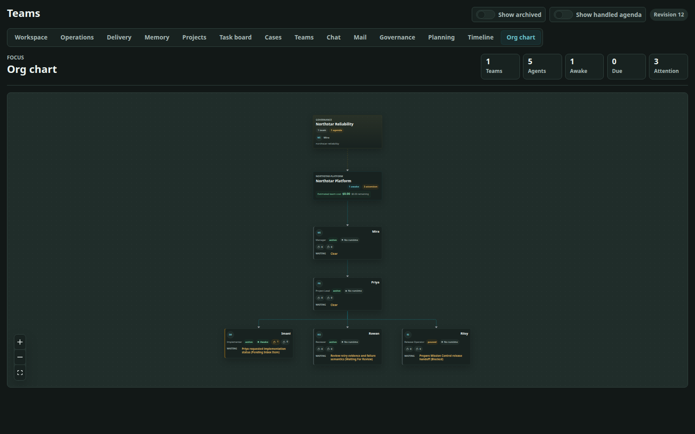
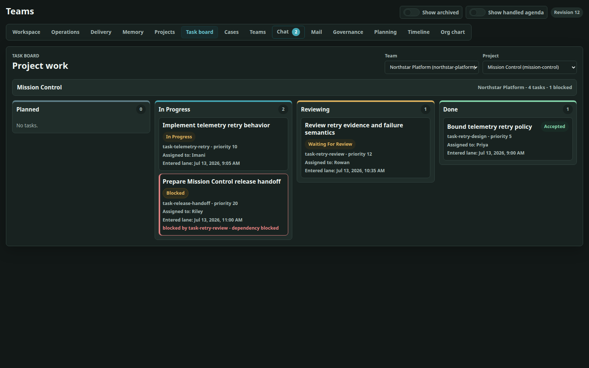

# 18. Organization, Projects, Tasks, and Cases

> **At a glance.** A Team needs to remember two different things: how its agents are organized and what work they are doing. Reporting relationships answer who may direct or support whom; projects, cases, goals, and tasks answer what should be accomplished. Keeping those structures separate makes responsibility clearer and prevents a job title from silently becoming permission to change unrelated work.

## Start with four questions

When an operator opens a Team record, four questions usually locate the work:

1. **Which outcome matters?** The project and goal describe why the work exists.
2. **What arrived or changed?** A case preserves the intake story and outside reference.
3. **Who must do what next?** Tasks carry ownership, dependencies, and current state.
4. **Who may direct or decide?** Roles, reporting lines, review assignments, and release policy answer different parts of that question.

The same agent can appear in both the organization and the work without those relationships becoming interchangeable. A project lead coordinates the project; a direct superior occupies a reporting relationship; a reviewer decides on submitted evidence; and a release authority governs publication.

## Two graphs that meet at an agent

The organizational graph says who reports to whom. The work graph says what depends on what. They meet at persistent agents, but neither should be reconstructed from the other.

For Northstar:

- Mira is manager of <code>northstar-platform</code>.
- Priya reports through that hierarchy and leads <code>mission-control</code>.
- Imani owns the telemetry retry task.
- Rowan is assigned its review.
- Riley has release permission.

Priya's project leadership does not make her the Team manager. Rowan's review assignment does not make Rowan Imani's superior. Riley's release permission does not confer task ownership. Keeping these statements independent makes authorization explainable.

## Teams, roles, and reporting lines

A Team has exactly one manager identity and may contain subordinate agents. Agents are stable domain records attached to core session IDs. Display names and avatars help people navigate the UI but do not participate in authorization.

> Deeper detail **What a role and reporting edge record**
>
> A role contains:
>
> - a stable ID and display name;
> - a Team and optional project scope;
> - a default ephemeral-delegation policy;
> - a narrow permission set;
> - archival state.
>
> Current permission names include <code>create_root_task</code>, <code>prepare_bookkeeping_action</code>, <code>request_payment_preparation</code>, <code>request_release</code>, and <code>review_bookkeeping_action</code>. They are capabilities, not a replacement for contextual checks. For example, <code>request_release</code> is still limited to the relevant project and accepted scope.
>
> Reporting relationships constrain agent mail:
>
> - questions and progress reports travel upward to the direct superior;
> - status requests travel downward to a direct subordinate;
> - no ordinary tool permits skip-level messaging.
>
> This keeps routine coordination local. Broader intervention uses task reassignment, manager routing, governance, or an operator directive rather than a covert communication shortcut.

An active stand-down overlays the hierarchy. An agent-scoped hold pauses only
the named agent; a subtree hold also prevents descendants from acquiring Team
work even if their tasks otherwise appear ready. Chapter 20 covers its runtime
effect and the narrow completion exception for work already leased before a
hold.

Figure 18.1 — The Org chart projects explicit reporting and operational relationships; it does not infer authority from project work. Sanitized Northstar fixture.

## Project membership and leadership

A project belongs to one Team and has:

- a stable project lead chosen from registered Team agents;
- explicit member assignments;
- goals and derived status;
- optional managed-Git configuration;
- optional release policy.

Assignments distinguish <code>project_lead</code> and <code>project_member</code>. Project leadership is stored on the project and its assignment, not encoded by changing the agent's primary Team role or reporting line.

Project Git configuration references a core <code>managed_repo_id</code>. It may also select a base branch and canonical release prefix. The Team Add-on does not accept a host checkout path as repository identity.

## Goals

Goals express outcomes and use the shared record states <code>pending</code>, <code>in_progress</code>, <code>accepted</code>, <code>rejected</code>, and <code>blocked</code> to drive project status. They are not tasks: a goal can be satisfied by multiple tasks and deliverables.

For <code>mission-control</code>, a goal might be “telemetry delivery survives transient upstream failures without duplicate submissions.” Imani's retry implementation, Rowan's review, and Riley's eventual release are steps toward that outcome. Accepting a single task should not automatically accept a broader goal unless the evidence really establishes it.

The <code>team_update_goal</code> command permits an authorized agent to update goal state inside its current Team context. Admin and workflow paths expose corresponding project state through revision-checked APIs and queries.

## Tasks: the executable work graph

To an operator, a task is the clearest answer to “who owns the next concrete piece of work?” It can be waiting, active, blocked, under review, or complete. Parent and dependency links explain why a seemingly pending task may not yet be ready.

> Technical reference **Task fields**
>
> A task records Team, project, owner, creator, title, description, priority, state, and optional:
>
> - parent task;
> - dependency tasks;
> - an originating task for provenance;
> - case;
> - deliverables;
> - task kind, outcome contract, and structured completion;
> - integration-boundary designation and deliverable contract;
> - reason-coded cancellation;
> - metadata and timestamps.

Task state has a deliberate review-aware lifecycle:

| State | Meaning |
|---|---|
| <code>pending</code> | Defined but not yet actively executed. |
| <code>in_progress</code> | The owner is working or reworking it. |
| <code>blocked</code> | Work cannot proceed without a named dependency or intervention. |
| <code>waiting_for_review</code> | Evidence has been submitted and active review remains. |
| <code>finished</code> | Support or coordination work completed directly. |
| <code>accepted</code> | Required deliverables and reviews accepted the task's durable outcome. |
| <code>rejected</code> | The task outcome was rejected under the applicable transition. |
| <code>cancelled</code> | Authorized actor recorded why the task became obsolete, when, and optionally which task succeeds it. |

The state payload includes a recursive assessment with child IDs, unresolved
descendants, dependency status, active acceptance and review IDs, canonical
blocker IDs, integration readiness, and contribution coverage. A task whose
descendants or dependencies remain unresolved is not ready merely because its
own state says pending.

Only agents with project-scoped <code>create_root_task</code> authority may
create ordinary roots. Supplying <code>originating_task_id</code> never grants
that authority. An owner may decompose assigned work into constituent child
tasks within policy, and <code>team_create_tasks</code> provides one validated
batch mutation. Batch validation happens before commit, so a bad item does not
leave a half-created plan. The only system-authorized root-creation exception is
the atomic transition from authenticated human changes-requested feedback to
same-project correction or triage work.

Task graphs cannot contain parent or dependency cycles. Dependencies and parents remain within the project. A deliverable, review, or Git work context cannot silently migrate a task to another project.

### Containment, ordering, provenance, and grouping

Use the relationship that describes the real lifecycle:

- <code>parent_task_id</code> means the child contributes to the parent's
  combined outcome. It recursively gates parent submission, acceptance,
  resolution, and release.
- <code>dependency_task_ids</code> means this task must wait for another task to
  resolve. It does not transfer ownership. For Git-backed work, preparation
  also verifies and composes the accepted current Git deliverables of direct
  dependencies into the successor's worktree. A dependency with no Git
  deliverable remains lifecycle-only.
- <code>originating_task_id</code> records that another task caused independent
  work to be created. It is immutable provenance only: neither task gates the
  other, and the reference confers no visibility or authority.
- <code>case_id</code> groups tasks around one intake, correction, or feedback
  story. A case is not a hidden parent task.

For example, an investigation child whose result must be integrated belongs
under the incident outcome. A newly discovered, separately releasable
improvement is an independent root with optional provenance. Human correction
tasks are likewise independent roots linked by a correction case; they do not
rewrite or become children of the accepted historical task.

### Explicit integration and final-acceptance boundaries

Do not infer the task that owns final integration from words such as “root,”
“lead,” or “integration,” or from hierarchy depth. Set
<code>integration_boundary=true</code> explicitly and attach a
<code>deliverable_contract</code>. That contract can:

- require authoritative pinned Git provenance with
  <code>require_git_provenance</code>; and
- name exact <code>required_contribution_task_ids</code>.

Required contribution tasks must be direct children or dependencies in the
same project. The boundary's final deliverable must name the current accepted
deliverable from every required task in
<code>source_deliverable_ids</code>—no missing, unexpected, stale, or
superseded source satisfies the contract. When Git provenance is required,
artifact-only submission, direct finish, and direct acceptance cannot bypass
the boundary.

Before any deliverable has been submitted, the task owner, an authorized
supervisor, the project lead, or the same-Team manager may designate or edit
the boundary and contract. Once any deliverable exists, or once the task is
terminal, that policy is immutable. Plan the boundary and exact contribution
set before execution rather than weakening it after evidence arrives.

### Support work and outcome work

Team distinguishes coordination from work that must produce a durable external result:

- a <code>support</code> task is administrative, delegation, coordination, acknowledgement, or
  other work that can finish directly without manufacturing a deliverable;
- an <code>outcome</code> task has an <code>outcome_contract</code> naming required and forbidden
  outcome kinds, choosing <code>all</code> or <code>any</code> matching, and optionally allowing
  an evidence-backed no-op.

An outcome deliverable records typed outcomes with durable reference IDs and
optional evidence refs. A report alone does not satisfy the contract. Every
submitted outcome for an outcome task must identify the durable record it
represents. When the work genuinely has no new external effect,
<code>evidenced_noop</code> is submitted as a deliverable completion, follows
the normal direct-acceptance or formal-review path, and is valid only if the
contract allows it and evidence refs are present. Only acceptance copies that
completion to the task and moves it to <code>accepted</code>. Agents cannot
finish an outcome task directly. A normal <code>delivered</code> completion
derives from outcomes on accepted current deliverables that satisfy the
contract.

These rules apply to both agent and operator command paths. A task also cannot be hidden by
marking it finished while a current deliverable, review, or blocker remains blocked.

### Recursive resolution and cancellation

Team computes one non-persisted <code>TaskAssessment</code> for every lifecycle
decision. Valid resolution is intentionally narrow:

| Task form | Valid resolution |
|---|---|
| Support or coordination | <code>finished</code> |
| Outcome with an accepted delivered result | <code>accepted</code> |
| Outcome with an accepted evidenced no-op | <code>accepted</code> |
| Any task made obsolete through an authorized disposition | <code>cancelled</code> |

<code>blocked</code> and <code>rejected</code> never resolve a task for an
ancestor. A parent in <code>finished</code> or <code>accepted</code> while a
descendant remains unresolved is invalid, as is an outcome task merely marked
<code>finished</code>. Readiness precedence is invalid state, valid terminal
resolution, intrinsic blocker, unresolved descendants, unsatisfied
dependencies, active acceptance, active review, then actionable.

The task board and task details render the canonical reason and routing context
for each inherited dependency or descendant blocker. The row points back to
the upstream task and blocker rather than creating another blocker on the
waiting task.

Cancellation is explicit audit evidence, not a shortcut around the outcome
contract. It records a stable reason code, explanation, actor kind and ID,
timestamp, and optional same-project successor. Team rejects cancellation while
descendants remain unresolved and reconciles source-aware blockers after the
transition.

Figure 18.2 — The task board is a workflow-lane projection over validated tasks, dependencies, and ownership. Sanitized Northstar fixture.

## Cases: intake, not execution

A case holds the durable story around incoming work:

- title, description, state, priority, owner, and tags;
- optional project scope;
- optional external <code>source</code> and <code>source_ref</code>;
- linked task IDs.

Cases use <code>open</code>, <code>triage</code>, <code>in_progress</code>, <code>waiting</code>, <code>resolved</code>, and <code>closed</code>. External systems such as GitHub, Jira, Zendesk, or email remain references only; the base Team Add-on does not synchronize them.

Suppose Northstar receives support report <code>OBS-184</code>: telemetry delivery fails during short gateway outages. Create case <code>telemetry-retry-incident</code> with <code>source=observability</code> and <code>source_ref=OBS-184</code>. Link Imani's execution task to it. The case can remain open while several tasks investigate, implement, document, and deploy the fix.

The case/task link is bidirectional. If a task names a case, the case must list that task; repository mutations maintain and validate both sides. A project-scoped case cannot link work from another project.

## Deeper detail: work creation surfaces

The UI is the normal operator surface. Agent commands and workflow effects create the same validated records when work must be decomposed or ingested automatically; they do not bypass the ownership and scope rules described above.

Operators can create and edit projects, cases, goals, and tasks through the UI and Admin API with <code>expected_revision</code>. Agent commands include:

- <code>team_create_case</code> and <code>team_update_case</code>;
- <code>team_create_task</code> and <code>team_create_tasks</code>;
- <code>team_update_task</code> and <code>team_update_goal</code>;
- task, case, project, agent, and identity read tools.

Workflow authors can use <code>effect:team:create-case</code>, <code>effect:team:update-case</code>, and <code>effect:team:create-task</code>. These providers are useful for an intake bridge: first create or update a case using the external stable reference, then create concrete Team work and let the runtime wake its owner.

The effect providers use the same model validation. They are not a back door around ownership, scope, or graph rules.

## How Team decides what is ready

Team does not wake every agent who has an unfinished task. It looks for work that can actually advance: dependencies must be satisfied, the right person must be active, and a task under review belongs with the reviewer rather than the producer. This is why “the task is still open” is not enough to explain who should wake next.

> Deeper detail **Readiness inputs**
>
> The shared assessment service evaluates ready work rather than letting each
> command, wake, release, and UI invent terminal-state rules. It considers:
>
> - ownership and active agent status;
> - recursive descendant resolution and direct-child contribution coverage;
> - dependency readiness and canonical blockers;
> - exact accepted dependency Git inputs when the worktree must inherit code;
> - pending direct acceptance, reviews, and rework;
> - inbox and action feedback;
> - active leases, stand-downs, no-progress state, and cost caps.

A task in <code>waiting_for_review</code> with an active review normally wakes
its reviewer, not its producer. An independent rejected review returns the task
to active rework; a sealed-cohort rejection waits until every active slot
settles, then returns one consolidated rework obligation. Accepted deliverables
and closed findings can cascade the task to accepted. Only then should project
goals and status be reevaluated.

An aggregate parent that is merely waiting on children does not receive
periodic implementation wakes. Notify its owner on child blocker, handoff,
rejection, resolution, or the transition to integration-ready. If the parent
owner must also implement part of the result, represent that substantive work
as an explicit self-owned child.

The repository derives project status. A project is completed only when all required goals are accepted and no active work remains. Blocking work can produce blocked status; otherwise it remains active. An operator should fix the underlying goal/task state rather than overwrite the project summary.

## Northstar work breakdown

One sensible plan is:

1. Case <code>telemetry-retry-incident</code> captures <code>OBS-184</code>, user impact, reproduction evidence, and priority.
2. Aggregate root <code>telemetry-retry</code>, owned by Priya, defines the
   combined retry outcome.
3. Constituent children cover implementation, verification, and operator
   guidance; Priya's own integration work is an explicit self-owned child.
4. Each child resolves through support completion, accepted outcome,
   evidenced no-op, or authorized cancellation as appropriate.
5. Priya's consolidated deliverable names the exact accepted direct-child
   <code>source_deliverable_ids</code>.
6. Rowan reviews the current combined deliverable, not a moving branch tip.
7. Priya updates the goal only when the accepted evidence demonstrates the intended outcome.
8. Riley requests a release only after the hierarchy and release rules are satisfied.

That sequence lets later chapters build from one traceable line of work.

## Troubleshooting

Start with the record that appears stuck. For a task, read its owner, dependencies, current deliverable, and active review before changing state. For a project, inspect its goals and remaining active work. For a missing external update, remember that a case's source reference records provenance but does not provide synchronization by itself.

| Error or symptom | Meaning | Recovery |
|---|---|---|
| Unknown role, agent, or project | A referenced stable ID is absent or archived. | Reload Team state and choose an active in-scope record. |
| Reporting cycle or invalid manager hierarchy | The organizational graph would no longer have a valid root. | Correct the proposed reporting edge; do not patch the database. |
| Parent or dependency cycle | The task graph would make readiness undefined. | Remove or reverse the bad edge and resubmit the whole intended mutation. |
| Dependency resolves but successor preparation fails | A current Git-backed dependency is unaccepted, moved, belongs to another managed repository, or cannot be composed at its pinned commit. | Inspect the preparation blocker and dependency Git sources; repair or replace the exact accepted source instead of starting from project base. |
| Integration deliverable reports contract mismatch | Required Git provenance or the exact current accepted contribution set is missing, unexpected, stale, or superseded. | Read contribution coverage, then submit one pinned deliverable naming the required current source deliverables. |
| Parent is terminal with unresolved descendants | Historical or manual state contradicts recursive resolution. | Inspect the assessment's exact descendant IDs and repair through supported task/deliverable transitions; do not force project status. |
| Outcome task is merely <code>finished</code> | No accepted contracted result or evidenced no-op exists. | Submit and accept a contract-compatible deliverable, or record an authorized cancellation when the work is truly obsolete. |
| Root creation denied despite provenance | The caller lacks <code>create_root_task</code>; provenance does not grant authority. | Ask an authorized planner/lead to create the root or use the normal proposal/inbox path. |
| Case/task mismatch | Only one side of the relation, Team, or project agrees. | Update through the supported case/task mutation so both sides converge. |
| Task never wakes | It is not actually ready, or runtime safety guards apply. | Inspect derived dependency status, active review, lease, stand-down, cost, and no-progress attention. |
| Project status looks wrong | A goal, task, review, or deliverable remains active or blocked. | Inspect the underlying records; project status is derived. |
| External ticket changes do not appear | A source reference was mistaken for synchronization. | Add a workflow integration or update the case through its API/effect. |

## Operator runbook

When establishing a project:

1. Confirm every persistent agent has a valid core session, active Team record, role, and reporting position.
2. Create the project and select an existing agent as lead.
3. Add explicit project-member assignments.
4. Define goals as outcomes, not implementation steps.
5. Create intake cases with stable external references where useful.
6. Create root tasks with clear owners, then add only necessary parent and dependency edges.
7. Designate any integration boundary and exact deliverable contract before its
   first submission.
8. Verify the Org chart, Task board dependency summary, Cases links, and project status at the returned revision.

When work appears stuck:

1. Read the task, owner, dependencies, current deliverable, and active review.
2. Read the agent runtime attention and inherited stand-down state.
3. Inspect pending inbox and action feedback.
4. Check Team cost coverage and cap.
5. Correct the domain record or runtime blocker through its owning surface.
6. Confirm that a wake is queued or that the normal scheduler will evaluate it.

If the domain records look ready but no wake or session activity follows, hand an administrator the Team and project IDs, task and owner IDs, current Team revision, relevant review or inbox ID, and the last visible runtime-attention state. Do not remove dependency edges, accept goals, or overwrite project state merely to force the work forward.

## Source trail

- <code>src/evander_team_addon/models.py</code> — Team, role, agent, assignment, project, goal, case, and task models plus graph validation.
- <code>src/evander_team_addon/services/commands/task_creation_commands.py</code>, <code>task_update_commands.py</code>, and <code>case_commands.py</code> — task and case authorization and mutation behavior.
- <code>src/evander_team_addon/api.py</code> — revision-checked project, role, agent, case, and task routes.
- <code>src/evander_team_addon/mcp.py</code> — agent-facing organization and work commands and grouped read tools.
- <code>src/evander_team_addon/providers.py</code> and <code>provider_schemas.py</code> — workflow case/task effects, accepted dependency-Git preparation, and filtered state queries.
- <code>docs/addons.md</code> — Team roles, cases, tasks, templates, communication, and runtime overview.
- <code>tests/test_team_addon_models.py</code>, <code>tests/test_team_addon_mcp.py</code>, and <code>tests/test_team_addon_api.py</code> — graph, authorization, link, and transition cases.
