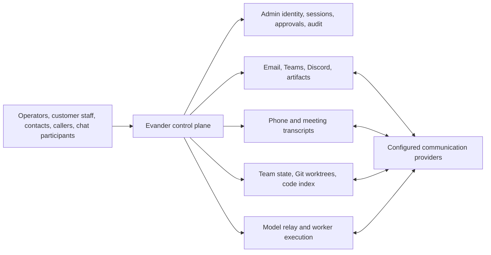

# Evander privacy data map (repository implementation evidence)

**Status:** draft for privacy engineering review

**Evidence date:** 2026-09-21

**Scope:** repository source and documentation, including the privacy-readiness
implementation in this branch. It is not a
production inventory, a data-processing agreement, a privacy notice, or a legal
opinion.

This map is the technical evidence base for a processing register, DPIA screen,
retention schedule, and customer DPA. It deliberately distinguishes facts that
the repository establishes from items that must be confirmed for each deployment.
In particular, configuration can change the active providers, storage locations,
retention values, and the data a customer puts in the system.

## How to read this map

- **Potential personal data** means data that can identify, relate to, or be
  reasonably linked to a natural person. Content fields can also contain special
  category, criminal-offence, or confidential business data; no content-classifier
  guarantees otherwise.
- **Conditional** means the recipient or store exists only when the relevant
  backend, workflow, tool, or integration is enabled.
- **Retention status** records the current code behaviour, not an approved
  business retention period. “No automatic retention found” is limited to the
  named component; it does not prove that the data is absent from backups,
  upstream providers, host logs, or another copy.
- **Deletion** is an engineering observation, not a statement that an erasure
  request must be granted. Legal holds, statutory retention, security evidence,
  and the controller's instructions may require a documented exception.

## System flow

The control plane is the principal persistence boundary. Guest VMs and
container-workers are deliberately short lived, but their workspaces, logs, and
Git output can still contain customer data until cleanup completes. Every arrow
to a provider is conditional on deployment configuration.

## Processing inventory

| Processing activity | Typical data subjects and data | Main local locations | Conditional external recipients | Current lifecycle finding |
| --- | --- | --- | --- | --- |
| Admin access and authorization | Operators/admins: login or email-style identifier, display name, password verifier, roles/groups, SSO identity and login time | `runtime/admin-web.db` | Microsoft Entra when Azure SSO is enabled | Account deletion removes the local user record; related audit, workflow, chat, and provider records need separate handling. No account retention policy was found. |
| Session and approval control | Operators and people linked through agent/session records: session/VM IDs, access grants, channel/mailbox/contact references, timestamps, metadata; approval payloads and decisions | `sessions.json`, `approvals.json`, `directories.json`, `communication-targets.db` | Notification targets through configured email, Teams, or Discord | Session TTL/deletion exists, but it is not a cross-store data-subject deletion workflow. Approval expiry is not a general retention policy. |
| Workflow execution and audit | Operators, employees, customers, contacts, and people referenced in prompts, tool arguments/results, issue/PR data, workflow state, correlation IDs | `orchestration.db`, `audit.jsonl`, audit index, cursors, wake stores | Any provider invoked by a workflow/tool | Completed full orchestration records default to 30 days; compact sanitized inputs/outputs default to 365 days. Audit log retention is not configured here; key-based redaction is not semantic PII removal. |
| Mail and external chat | Mailbox owners, senders, recipients, channel/chat participants: account IDs, addresses, display names, message body/subject, attachments, provider IDs, reactions | `emails.json`, `drafts.json`, email cursors, Teams/Discord inbox databases, Team state | Microsoft Graph, Gmail, Teams, Discord | Teams and Discord inbox cleanup uses a 90-day age threshold plus cursor/consumption eligibility when the relevant store operations run; this is not a guaranteed maximum retention period. No equivalent repository-confirmed retention was found for email records/drafts or Team conversations. Provider-held copies follow provider/customer policy. |
| Calls and meetings | Callers, contacts, participants: phone-number-derived identity, prompts, transcript text, summaries, decisions, action items, meeting event text/metadata | `voice-sessions-store.json`, `teams-meetings.json`, `didww-sip-bridge-store.json`, `retell-phone-calls-store.json` | OpenAI Realtime, Retell, DIDWW/Asterisk, Teams meeting bridge, Microsoft Graph as configured | Retell uses a 90-day created-time threshold during store mutations. No automatic pruning was found for voice, Teams-meeting, or DIDWW bridge stores. Raw-audio non-persistence is documented for specified DIDWW paths only, not every provider/bridge. |
| AI inference and agent-to-agent prompts | Any content placed in prompts, conversation context, code, model output, session IDs, task metadata | Agent prompt/queue stores, consultation records, workflow state; guest/container workspaces | OpenAI relay/Realtime, ChatGPT subscription proxy, Anthropic relay, configured local model endpoint; Jev/Typesafe classification when invoked | Agent prompts are eligible for opportunistic cleanup only when responded/closed and last updated over 90 days ago. Fully cleaned terminal codebase consultations compact after configured retention (default 30 days). Provider retention and training terms are not established by this repository. |
| Team collaboration and memory | Operators and people represented in agent work: chat bodies, attachments, task/case notes, memories, deliverable/review evidence, external chat linkage, model prompts and summaries | `runtime/addons/team-addon/state.db`, add-on-private attachments and avatars, `model-usage.db` | Configured model, chat, Git, and workflow providers | Dispatch activity uses insert-triggered 30-day cleanup; Git work contexts use a 30-day threshold with operational exclusions. Team records, conversations, memories, attachments, and semantic-memory copies do not have one demonstrated system-wide retention/erasure rule. |
| Managed Git, code search, and workspaces | Repository authors/contributors and any persons represented in source, commits, issues, artifacts, or documents | Managed bare repos, worktrees, VM/container workspace, code-index store/snapshots | Customer Git upstreams; configured code-index/vector service | Index retention defaults to 30 days but preserves active/protected/newest usable snapshots. Session deletion intentionally retains shared repositories and unpublished refs pending explicit operator deletion. |
| Website and provider credentials | Named account owners: account identifier, credential field names, token/PAT/OAuth material, profile metadata | Encrypted credential databases and host secret files | Website login target, Azure DevOps, Microsoft Entra/Graph, Gmail and other enabled providers | Website/ADO protections are supplemented in this branch by encrypted Teams delegated credentials; legacy Teams plaintext is migrated atomically on first access, with a separate host key. Credential deletion exists for individual profiles/connections; token revocation and provider-side termination remain separate actions. |
| Communication attachments | Senders/recipients and attachment subjects: original filename, message/channel/mailbox IDs, bytes, MIME type, hash, session metadata | `runtime/communication-artifacts/` | Source and destination provider selected per operation | Default TTL is seven days, with opportunistic cleanup when the store is used. This branch adds an explicit staging-only privacy adapter for retention/holds/erasure; deployment scheduling and provider/workspace/backup copies still need confirmation. |

## Detailed stores and controls

| Store or surface | Repository evidence | Potential personal data | Current retention/deletion evidence | Privacy action needed |
| --- | --- | --- | --- | --- |
| Admin Web user store | `src/evander/admin/web/user_store.py` | Login, display name, group/role grants, created/updated/last-login timestamps, local password verifier | `delete_user()` deletes local account and local password record. No lifecycle rule for linked records was found. | Define account retention and a subject-identity correlation strategy; test what survives account deletion. |
| Session manifests and directory configuration | `src/evander/models.py::SessionManifest`, `src/evander/repositories/session_manifests.py` | Session/VM IDs, model/profile IDs, allowlists that may be contacts, addresses, channels, mailbox identities, plus arbitrary metadata | Individual manifests can be deleted; sessions have expiry. Repository does not show this cascading into all content stores. | Define session expiration cleanup and link it to content records without destroying legitimate audit evidence. |
| Approvals | `approvals.json`; `ApprovalRequest` stores a payload, human summary, approver and decision history | Tool payload may contain customer content; approver identity and notification recipients | Approval request has an expiry but no demonstrated periodic purge. | Classify payload fields, minimize them before storage, and implement an approved retention/hold policy. |
| Workflow history | `orchestration.db`; `orchestration_retention_days` and `orchestration_compact_history_retention_days` | Event payloads, workflow inputs/outputs, source provenance, typed indexes, operator/workflow identifiers | Defaults: full history 30 days; sanitized compact history 365 days. “Sanitized” is not equivalent to anonymous. | Approve each field-level sanitation rule, document a purpose for the 365-day copy, and add subject-targeted deletion/hold behavior. |
| Tool-call audit | `audit.jsonl`, `src/evander/audit.py`, `src/evander/gateway/tool_audit.py` | Actor/session IDs, provider/repo/PR context, redacted or unredacted tool arguments and results | Redaction replaces configured key names recursively; audit logger appends indefinitely in source reviewed. | Define audit retention, immutable-storage/backup policy, access roles, and a safe redaction policy that covers values as well as key names. |
| Email records and drafts | `emails.json`, `drafts.json`, email cursor store; `DraftMessage` contains subject, body, recipients, attachments | Mail content, addresses, provider draft/message/thread IDs | No automatic retention was established in source reviewed. | Create retention/deletion jobs and provider-side deletion instructions; ensure export covers drafts, sent records, and attachments. |
| Teams and Discord inboxes | `teams-inbox-store.db`, `discord-inbox-store.db`, legacy command/message stores | Message bodies, author/sender IDs, channel/chat IDs, attachments, reactions, cursor data | Opportunistic cleanup uses a 90-day age threshold and qualifying consumption cursors; unconsumed or insufficiently advanced cursor records can remain longer. | Validate every related legacy/attachment store and document whether 90 days is appropriate per customer policy. |
| Team Chat, cases, memories, and attachments | Team state includes conversations, conversation messages, external ingress/deliveries, memories, notes, cases, tasks, and attachments | Operator IDs/display names, full chat body, attachment metadata/content, work context, memory body, external message linkage | Dispatch activity has insert-triggered cleanup using a 30-day threshold. Archive actions exist for some records, but an archive is not erasure and no single retention job covers this set. | Design a Team data lifecycle with deletion propagation to attachment files, state rows, semantic indexes, wake context, and model prompts. |
| Semantic memory and code index | `TeamMemorySemanticService`, code-index configuration | Embedded/indexed memory text and payload, source-code text and potentially personal data in code/history | Individual memory delete removes its semantic point. Index retention defaults to 30 days with protected/active exceptions. | Add an index inventory and verify deletion/rebuild propagation, vector-service location, and backup treatment. |
| Voice sessions | `VoiceSessionRecord`, `VoiceSessionStore` | Contact/display name, sanitized caller metadata, projected prompt context, transcript events/text, summary, decisions, action items, session/directory IDs | No `compact`, `prune`, or `delete` lifecycle is present in the reviewed store. | **Priority engineering gap:** add configuration-backed retention, deletion-by-session/subject, index cleanup, and tests. |
| Teams meeting events | `TeamsMeetingStore` | Meeting/session IDs, event text/transcripts, speech metadata, binding metadata | No automatic pruning found. Events can also be mirrored into voice sessions. | **Priority engineering gap:** add retention and synchronized deletion for both stores and document bridge/provider copies. |
| DIDWW bridge call state | `src/evander/didww_sip_bridge.py::DidwwBridgeStore`; `runtime/didww-sip-bridge-store.json` | Call/request/voice-session IDs, transcript events/text, summaries/actions, redacted routing data and metadata | Separate `calls` and `request_index` persistence; no automatic lifecycle. Process-shared transactions now protect concurrent writes. | Include this duplicate store in voice reconciliation and deletion review; provider and live-media resources remain separate. |
| Retell call records | `RetellPhoneCallStore` | Call/provider IDs, metadata, call status and time | Opportunistic compaction during mutations uses created_at older than 90 days; this does not assure deletion at day 90. | Verify exact fields after sanitization and Retell's own retention/processor terms. |
| Agent prompt and wake records | `agent-prompt-store.json`, queued prompts, wake request store | Prompt payload/body, sender/target session IDs, response-token claims, resume prompts and metadata | Prompts: responded/closed and updated over 90 days ago. Wakes: dispatch/message age thresholds of 90 days; requests additionally must be disabled and updated over 90 days ago. Cleanup is operation-triggered. | Verify queues/retry ledgers and copies injected into worker/model context; create subject-location tests. |
| Communication artifacts | `CommunicationArtifactStore` | Attachment bytes and source metadata, original filename, provider identifiers | Default seven-day expiry; cleanup runs opportunistically on store use. | Use the staging-only privacy adapter and verify scheduled execution; approve backup treatment and account for delivered/provider copies separately. |
| Credentials and connection records | Website credentials, ADO user connections, Teams delegated credentials, host environment references | Account IDs, scopes, PAT/access/refresh tokens, credential field names; encryption is store-specific | Website/ADO stores support encryption; Teams credential JSON was plaintext in the original baseline and is encrypted on first access by this branch with a separate key. Individual deletion/removal exists; removal does not itself revoke upstream grants. | Maintain credential inventory, rotation/revocation runbook, and clear controller instruction for each connected account. |
| Model usage and classification attribution | `src/evander/model_usage/runtime.py`, `src/evander/model_usage/models.py`; `runtime/model-usage.db` | Session/directory/workflow/dispatch IDs, provider/model, timestamps, token counts, status, request/response sizes and hashes, usage metadata | A separate durable usage store; no privacy retention/erasure adapter is established. Hashes and operational IDs are not automatically anonymous. | Review fields, correlations, access, retention, and classifier-provider records independently of prompt stores. |
| Published artifacts and artifact spaces | `src/evander/published_artifacts.py`, `src/evander/session_artifacts.py`, `src/evander/artifact_spaces.py`; `runtime/published-artifacts/` plus source/space stores | Archive bytes, filenames, source metadata, session/VM IDs, source file contents | Durable published archives differ from seven-day communication staging; no complete lifecycle adapter is established. | Inventory archives, metadata, space versions, guest source files, delivered links and backups; review manual lifecycle and subject-location routes. |
| Privacy operations evidence | `src/evander/privacy/`; `runtime/privacy.db` and restricted export storage | Subject correlation keys, controller/approval references, cases, holds, job outcomes, incidents and selected export content | New privacy evidence is itself retained data; automated lifecycle coverage is incomplete. | Approve case/evidence retention, export expiry, access, backup and incident treatment; avoid unnecessary content in references. |
| Managed Git and workspaces | Managed Git services, `runtime/managed-git/`, `runtime/git-worktrees/`, worker/VM storage | Full repository content, commits, author names/emails, build output, potentially personal data in source or documents | Repositories/refs remain after session deletion until explicitly deleted; code-index exceptions preserve operational snapshots. | Treat Git and workspace data as in-scope where customer code can contain personal data; define deletion, legal-hold, and upstream-repository responsibilities. |
| Backups, snapshots, OS/service logs, and provider copies | Deployment concern; not fully represented in repository source | Any data in the backed-up/logged source store | Not verified in this repository review. | Inventory backup encryption, location, retention, restoration access, deletion lag, and processor/subprocessor ownership before production use. |

## External recipients and transfer register (configuration-dependent)

This is a recipient discovery list, **not** a verified subprocessor list. Whether
any row is active, which legal entity receives data, the data location, and the
contractual transfer mechanism must be confirmed from the live configuration and
the signed vendor terms.

| Recipient class | Data that can be sent | Trigger/configuration evidence | Required verification |
| --- | --- | --- | --- |
| Model providers: OpenAI API/Realtime, ChatGPT subscription, Anthropic, local OpenAI-compatible endpoint | Prompts, completions, conversation/context, code snippets, and for Realtime call/meeting audio or transcript-related data | Host model relays, Realtime bridge, worker egress configuration | Exact account/tenant, API vs subscription route, retention/training controls, region, DPA/subprocessor role, transfer safeguard, access logs. |
| Jev / Typesafe classification endpoint | Submitted state, classification questions/choices and model selection; results and usage returned | `src/evander/classification/jev.py` posts to `https://api.typesafe.ai/v1/systemone` | Verify actual receiving legal entity/account, purpose, allowed data, DPA/role, processing location, retention and transfer terms. The classifier is an external recipient, not a privacy filter. |
| Microsoft: Entra ID, Graph, Teams, Azure DevOps | Identity claims, mailbox messages, Teams messages/meeting data, account identifiers, work items, PRs/comments and Git metadata | Azure SSO, Graph email/Teams providers, ADO integration | Tenant, delegated vs application permissions, scopes, customer instructions, data residency, DPA and upstream deletion responsibilities. |
| Google/Gmail | Mailbox messages, addresses, drafts, attachments, OAuth-linked account metadata | Gmail mailbox provider | Workspace vs consumer account, OAuth scopes, retention, DPA and data transfer terms. |
| Discord | Channel/chat content, participant IDs, webhook/persona information, attachments | Discord bot API/webhook target | Server/channel scope, role, retention, user notice, DPA/transfer position. |
| Telephony/meeting providers: DIDWW, Asterisk deployment, Retell, Teams meeting media bridge | Phone routing/contact information, media/audio, transcript text, call/meeting metadata | Phone and meeting bridge configuration | Every bridge host, audio/transcript processor, recording behavior, location, retention, incident contact and deletion route. |
| Git/issue/repository providers | Repository content, commit authors, PR/work-item comments and attachments | Managed Git, ADO and configured upstreams | Exact provider/repository, controller instruction, repo/backup retention, and who responds to repository-data requests. |
| Configured HTTP targets, browser proxy, connectors, add-ons | Any headers/cookies and data in requests/responses, depending on target and tool | HTTP target relay/browser proxy and connector/add-on configuration | Enumerate each target and add it to the customer-approved recipient register before enabling it. |

## Data-subject and customer handling map

| Request or event | Product support today | Gap to close before claiming operational readiness |
| --- | --- | --- |
| Access/export | New privacy adapters expose exact structured location for selected JSON stores and allowlisted exports for sessions, voice, voice queries and artifact metadata. Other sources remain manual. | Verify scoped case/export workflows and third-party review; complete unimplemented stores, attachment bytes, free-text discovery and provider/backup follow-ups before asserting completeness. |
| Rectification | Some business records can be edited or superseded; source/provider records remain independent. | Define the authoritative source per data type and a correction propagation policy. |
| Erasure/restriction | Individual deletion paths exist; the new privacy erasure/hold adapter covers communication staging only. Case records do not themselves stop processing. | Implement a case-managed workflow that fans out across every applicable store, respects holds, records exceptions, and asks the customer/controller to act upstream where required. |
| Objection/withdrawal of consent | Privacy case types now include objection/restriction, but a system-wide suppression/preference mechanism is not established. | Do not infer consent. Define the lawful basis and controller instruction per processing purpose, then implement any required suppression/preference control. |
| Personal-data incident | Audit evidence and new privacy incident records support investigation; controller notifications and deadline decisions remain manual. | Add incident classification, customer/controller contacts, evidence capture, notification decision record, and exercises. |

## Live verification checklist

Before this becomes a customer-facing record, an authorised operator must confirm
these facts for **each deployment** without extracting secret values:

1. Effective runtime directory, host/worker locations, filesystem encryption,
   service accounts, backup/snapshot systems, and their retention/restoration
   access.
2. Enabled providers, model routes, Teams/Gmail/Discord/telephony accounts,
   connectors, browser targets, and every external recipient.
3. Effective retention values and whether scheduled jobs actually compact each
   store; capture counts and timestamps, not message/prompt contents.
4. Customer role allocation: who is controller for tenant, operator,
   communication, source-code, and support data; identify any Evander
   independent-controller processing.
5. DPA, subprocessor authorisation, international-transfer, confidentiality,
   security, support-access, and incident-notification terms for every active
   provider.
6. A restore/delete test using synthetic data: verify primary stores, indexes,
   worker/VM cleanup, backups, and upstream-provider request routes.

## Priority remediation backlog

1. Complete the new versioned, configuration-backed retention register with a named owner,
   purpose, subject key, default period, legal-hold behavior, and cleanup
   implementation for every row above.
2. Implement and test retention/deletion for `voice-sessions-store.json` and
   `teams-meetings.json`; propagate to mirrored transcripts and related indexes.
3. Add email/draft/approval/Team-state lifecycle rules, including staged
   attachments, queues, retry ledgers, and semantic-memory copies.
4. Complete and verify the protected privacy-request workflow: verification result,
   scope selection, locate/export, erasure/restriction, controller approval,
   exceptions/holds, provider follow-up, and completion evidence.
5. Establish an operational privacy register, DPA/subprocessor annex, backup
   standard, incident playbook, and live verification evidence pack.

## Implementation coverage and limitations

This branch introduces a capability-declared dataset registry and scoped privacy
operations. See [privacy operations](privacy-operations.md) for commands, rollout
and the current supported capability list. A listed dataset is not a completed
retention/erasure adapter. Communication staging is the only registered automated
retention/hold/erasure dataset; other local records, provider copies and backups
remain partial or manual.

Selected JSON stores support exact structured locators; only sessions, voice,
voice queries and artifact metadata have allowlisted export fields. Meeting
bindings are not a complete transcript/event export. Files, free-text references,
unattributed records, semantic copies and delivered attachments require review.

Provider dispatch approval is limited to the instrumented model relay,
classification and Codex-subscription capabilities. It is not a complete egress
policy for communication, Git, HTTP/browser or add-on paths. Data-category labels
are declarations, not automatic detection. Report-only defaults and an unverified
deployment must not be described as enforced compliance.

Voice, meeting and DIDWW stores now have cross-process-safe transactions, not
automatic lifecycle deletion. Teams credential APIs preserve their caller
interface, but migrate plaintext JSON one-way into an encrypted envelope on first
access. Restart all writers on the same version; preserve the matching
`secrets/<credential-json-filename>.key` when restoring the file. Existing backups
and old copies are not retroactively encrypted or deleted. Missing/wrong keys fail
closed; older binaries cannot read the migrated envelope.

These are implementation findings and proposed engineering priorities, not a
determination that every feature or automated control is legally required before
software can be sold. Legal and deployment owners must assess the selected
processing model and any reviewed manual operating procedures.

## Source anchors

- Runtime store construction: `src/evander/runtime.py`.
- Default paths and orchestrator retention settings: `src/evander/config.py` and
  `docs/configuration-reference.md`.
- Communication retention: `src/evander/messaging/discord_inbox_store.py`,
  `src/evander/messaging/teams_inbox_store.py`, and
  `src/evander/communication_artifacts.py`.
- Voice and meeting persistence: `src/evander/voice_sessions.py`,
  `src/evander/teams_meeting.py`, and `src/evander/didww_sip_bridge.py`.
- Classification and separate derived stores: `src/evander/classification/jev.py`,
  `src/evander/model_usage/runtime.py`, and `src/evander/published_artifacts.py`.
- Implemented privacy coverage: `src/evander/privacy/datasets.py` and
  `src/evander/privacy/providers.py`.
- Workflow retention: `src/evander/repositories/orchestration_db.py`.
- Team-state persistence and memory index: `src/evander_team_addon/sqlite_store.py`
  and `src/evander_team_addon/services/memory_service.py`.
- Credential protection: `src/evander/website_credentials.py`,
  `src/evander/messaging/teams_auth.py`, and `docs/operations.md`.

Update this document whenever a provider, store, workflow node, data category,
or retention rule is added or changed.
