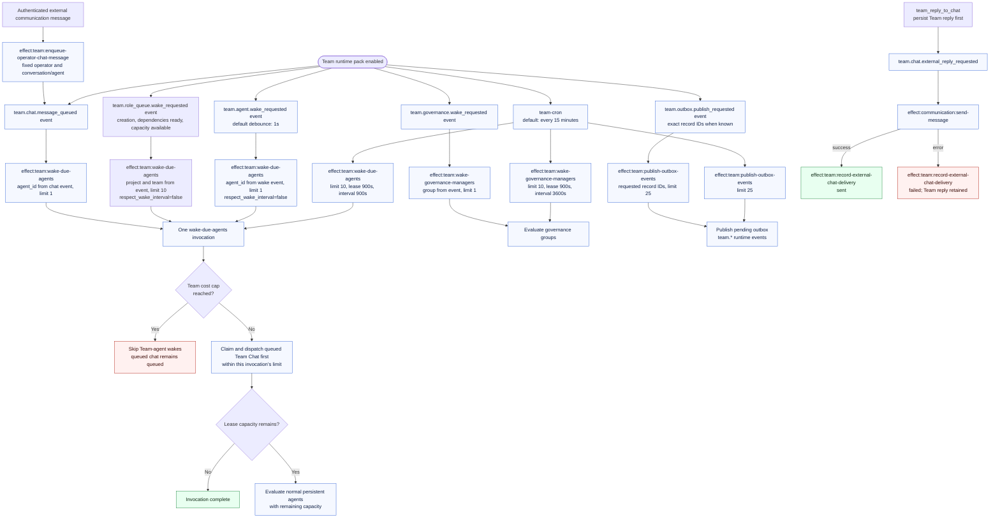
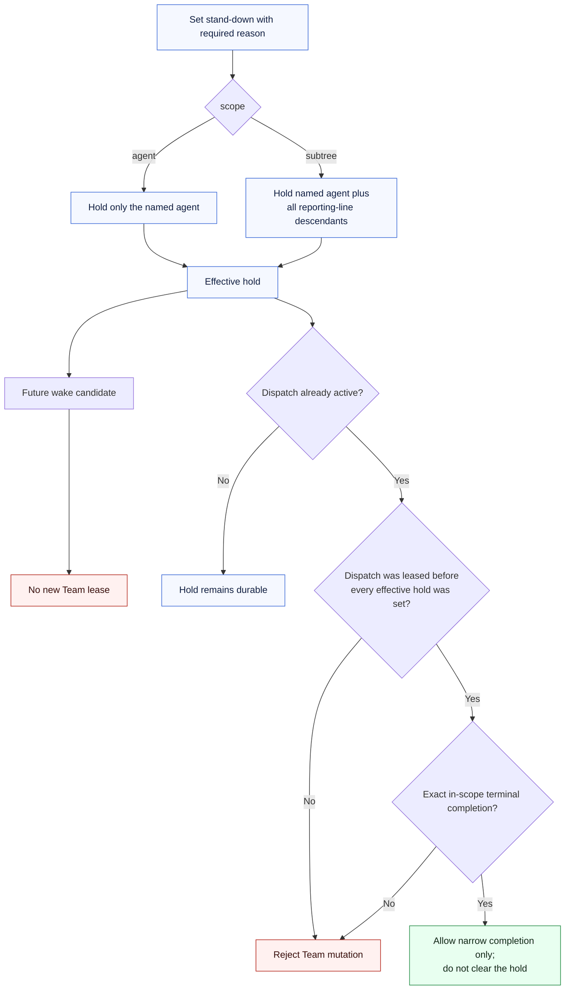
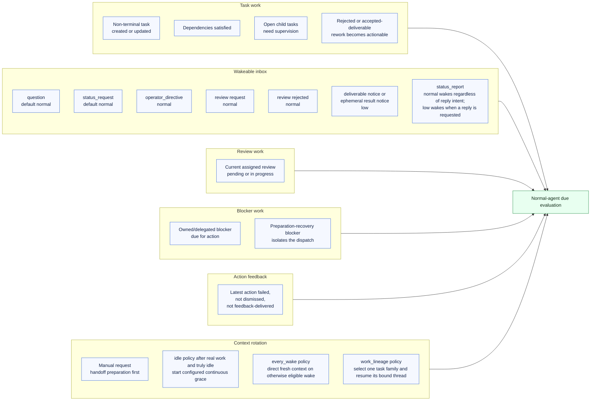
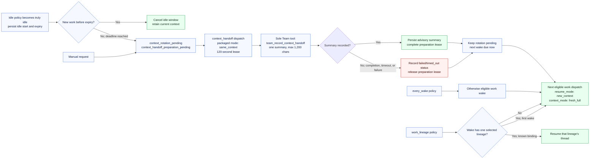
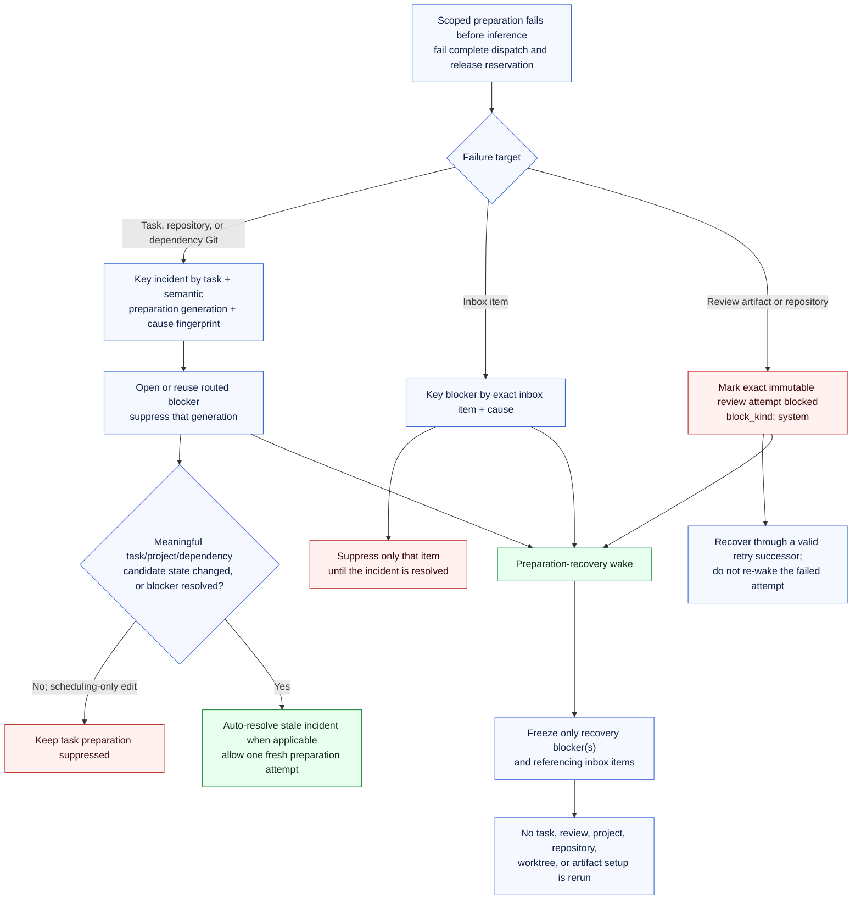
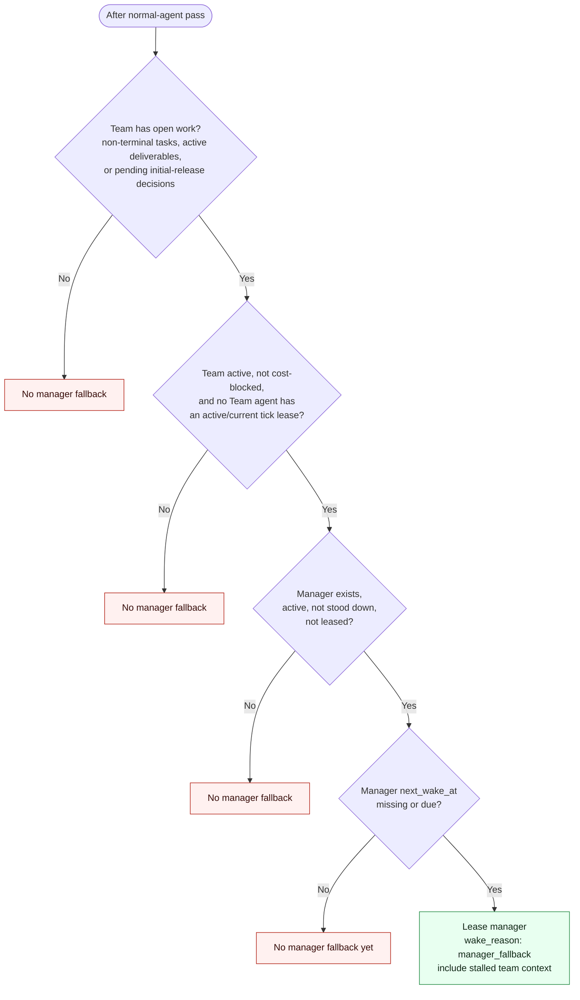
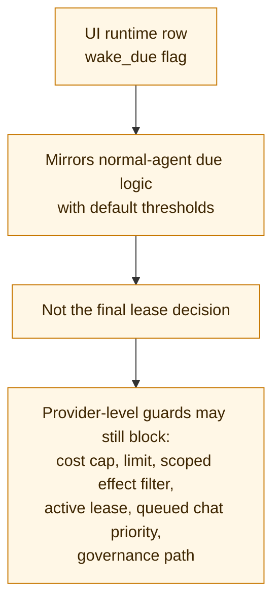

# Team Add-on Wake Decision Tree

This is a visual companion to the Team Add-on wake logic. It separates the
durable paths that can lead to inference:

- debounced persistent-agent wake requests,
- queued Team Chat claims, which consume capacity before ordinary leases,
- normal persistent-agent wake leasing,
- role tasks assigned atomically with a dispatch when exact-role capacity is free,
- bounded `context_handoff` preparation before manual or idle rotation, and
- governance-manager wake leasing.

The same runtime cron tick drains the Team outbox. Case closure paths also emit a
`team.outbox.publish_requested` event after commit with the exact outbox record IDs; the immediate
publisher targets those records so an older backlog cannot consume its bounded batch. The cron
drain remains the recovery path. Both paths publish internal `team.*` events recorded by MCP tools.
External Team Chat reply delivery also runs from one of those events, but neither outbox
publication nor external send is itself a wake lease decision.

## Runtime Entrypoints

`effect:team:enqueue-operator-chat-message` accepts exactly one fixed
`conversation_id` or `agent_id`, plus a fixed `operator_user_id`. Its
provider/target/source-message tuple makes ingress replay-idempotent.
`allow_team_mutations` defaults to false and requires an authenticated author
allowlist when enabled. A queued external message otherwise follows the same
Chat claim, lease, and `team_reply_to_chat` rules as a built-in operator
message.

Text messages delivered during an active dispatch include bounded earlier exchanges and reply
links from that conversation, both in MCP attention results and relay steering notes. Follow-ups
such as "that" should be resolved from the conversation; agents can read more history with
`team_list_conversation_messages` when needed.

An unlinked `team_send_operator_chat_message` to the operator awaiting the current Chat batch's
reply is rejected before posting. The error supplies `team_reply_to_chat`, the conversation ID,
and the batch message IDs. Replies to separately injected messages continue to use exact
`source_message_ids`; ordinary proactive messages remain available outside an outstanding batch.

Only a successfully resumed mutation-enabled Chat dispatch can seed ordinary
Team context and consume a pending ordinary rotation. A reply-only dispatch
stays exact to the claimed message and leaves that ordinary reset pending, even
when the underlying session uses `new_context`.

## Normal Persistent-Agent Wake Leasing

Before evaluating ordinary agents, the scheduler considers pending ownerless role
tasks in priority, creation-time, and ID order. A task needs satisfied dependencies,
passing execution gates, and an authorized active creator. Candidates must hold the
exact role in the project and pass the existing availability and authorization
checks, including the wake interval when the scan respects it. Existing ready tasks,
inbox responses, reviews, and recovery work take precedence for that agent. Each
dispatch can claim at most one new role task.

The provisional owner is retained only when that task enters the reserved dispatch;
both records and the scored assignment event commit in the same transaction.
Remaining tasks stay queued. Delivered tasks retain their owners across subsequent
wakes. A confirmed preparation failure before prompt submission can return only a
task newly claimed by that dispatch to the queue. Uncertain delivery and started
work retain ownership across later failed attempts. The periodic
scan remains the recovery path for missed queue wakes.

```mermaid
flowchart TD
    start([Candidate persistent agent])

    start --> limit{"Remaining ordinary<br/>lease capacity?"}
    limit -->|No| skip_limit["Skip"]
    limit -->|Yes| active{"Agent status is active<br/>and Team-assigned?"}

    active -->|No| skip_inactive["Skip"]
    active -->|Yes| stood_down{"Effective active stand-down?<br/>direct-agent hold or inherited subtree hold"}

    stood_down -->|Yes| skip_stood_down["Skip"]
    stood_down -->|No| filters{"Effect filters match?<br/>team_id, project_id, agent_id"}

    filters -->|No| skip_filter["Skip"]
    filters -->|Yes| cost{"Agent team<br/>cost-blocked?"}

    cost -->|Yes| skip_cost["Skip"]
    cost -->|No| busy{"Underlying session busy?"}

    busy -->|Yes| skip_busy["Skip"]
    busy -->|No| lease{"Existing wake lease<br/>still active?"}

    lease -->|Yes| skip_lease["Skip"]
    lease -->|No| gather["Gather actionable tasks, wakeable inbox,<br/>current reviews, due/assigned blockers,<br/>action feedback, and context rotation"]

    gather --> prep_recovery{"Due preparation-recovery<br/>blocker?"}
    prep_recovery -->|Yes| isolate["Isolate recovery scope:<br/>preparation blockers plus referencing inbox only;<br/>no task, review, project, repo, or worktree setup"]
    prep_recovery -->|No| work
    isolate --> work{"Any wake-eligible signal?"}

    work -->|No| clear_low["Clear low-priority batch<br/>and skip"]
    work -->|Yes| handoff{"Rotation pending and<br/>handoff preparation pending?"}

    handoff -->|Yes| lease_handoff["Reserve empty-scope context_handoff dispatch;<br/>lease 120s in retained context;<br/>grant only team_record_context_handoff"]
    lease_handoff --> handoff_terminal["Recorded, completed without summary,<br/>timed out, or resume failed"]
    handoff_terminal --> fresh_due["Keep rotation pending; clear handoff preparation;<br/>make fresh work dispatch due now"]

    handoff -->|No| immediate_inbox{"High or normal<br/>pending inbox?"}
    immediate_inbox -->|No| other_immediate{"Other immediate reason?<br/>rotation pending; due blocker; review;<br/>action feedback; or task work due"}
    other_immediate -->|No| low_only{"Wakeable low-priority<br/>inbox present?"}
    low_only -->|No| skip_not_due["Skip until task interval<br/>or another signal"]
    low_only -->|Yes| advance_low["Advance low-priority<br/>batch counter"]

    advance_low --> low_due{"Counter reached<br/>low_priority_wake_after_cycles?"}
    low_due -->|No| skip_low["Skip for now"]
    low_due -->|Yes| cause

    immediate_inbox -->|Yes| task_only{"Task work is the<br/>only immediate reason?"}
    other_immediate -->|Yes| task_only
    task_only -->|Yes| progress_throttle{"No-progress count<br/>at limit?"}
    progress_throttle -->|Yes| skip_throttle["Open/reuse execution-stall blocker;<br/>skip task-only wake"]
    progress_throttle -->|No| cause
    task_only -->|No| cause{"Choose cause in priority order:<br/>preparation recovery, non-low inbox,<br/>due blocker, review, low inbox,<br/>action feedback, scheduled"}

    cause --> reserve["Create immutable TeamDispatch in preparing<br/>with exact task, blocker, review, inbox,<br/>project, and managed-repository IDs"]
    reserve --> prepare{"Scoped repository/worktree and<br/>review-artifact preparation succeeds?"}
    prepare -->|No| prep_failed["Fail complete dispatch before inference;<br/>release reservation and record targeted incident"]
    prepare -->|Yes| leased["Mark dispatch leased"]

    leased --> lineage{"work_lineage policy?"}
    lineage -->|Yes; bound| bound_thread{"Thread already bound<br/>to this lineage?"}
    bound_thread -->|Yes| retained_delta
    bound_thread -->|No| fresh_full
    lineage -->|Yes; unbound| fresh_full
    lineage -->|No| context_mode{"Fresh lifecycle context?<br/>rotation/every_wake, first successful<br/>ordinary-context wake, or explicit new_context"}
    context_mode -->|Yes| fresh_full["Resume new context<br/>context_mode: fresh_full"]
    context_mode -->|No| retained_delta["Resume retained context<br/>context_mode: retained_delta"]

    fresh_full --> prompt["Prompt exact dispatch scope"]
    retained_delta --> prompt

    classDef wake fill:#e8fff0,stroke:#208a42,color:#102a16;
    classDef skip fill:#fff1f0,stroke:#b42318,color:#3a0b07;
    classDef process fill:#f5f8ff,stroke:#3867d6,color:#102044;
    class lease_handoff,fresh_due,leased,fresh_full,retained_delta,prompt wake;
    class skip_limit,skip_inactive,skip_stood_down,skip_filter,skip_cost,skip_busy,skip_lease,clear_low,skip_throttle,skip_not_due,skip_low,prep_failed skip;
    class gather,isolate,advance_low,reserve,handoff_terminal,lineage,bound_thread process;
```

The dispatch scope is immutable membership, not a stale copy of every record.
On a `retained_delta` wake, stable identity, role, subordinate, project,
outcome-catalog, and session detail is intentionally omitted. The agent can call
`team_get_current_dispatch_context` to hydrate current permitted detail for the
tasks, inbox items, blockers, reviews, projects, and Git contexts named by that
frozen scope; hydration cannot add a newly created record to the active
dispatch.

### Stand-Down Lease And Completion Boundary

The UI's **Stand down** action sends direct-agent scope and **Stand down
subtree** sends subtree scope. The Admin API and `team_stand_down_agent` use
`subtree` when scope is omitted. The pre-hold exception still enforces frozen
dispatch membership and allows only deliverable/review/ephemeral/chat completion
operations, or a support-task update whose complete mutation is exactly
`{"state": "finished"}`. Starting work, widening that update, touching an
out-of-scope record, or using a dispatch leased after the hold is rejected.

## Normal-Agent Wake Signal Sources

### Context-Handoff Ordering

Manual and expired-idle rotation are deliberately two dispatches. The advisory handoff
must happen before the conversation is reset:

An invalid or oversized handoff call does not release the active preparation
lease; it can still complete or time out. Durable Team state remains
authoritative, and the advisory summary never replaces task, review, blocker,
or deliverable records.

### Preparation Failure Retry Suppression

Preparation failures are keyed to the target and stable cause instead of
feeding an unchanged setup back into every cron tick:

The recovery dispatch lets the accountable owner resolve, delegate, or
escalate the durable incident without retriggering the setup that failed.

## Manager Fallback

A newly accepted ordinary root deliverable is tracked as a pending
initial-release decision when its project has release policy. That durable row
keeps the Team eligible for manager fallback even if the project lead handled
the root-resolution inbox notice. The fallback prompt and dispatch carry the
same bounded deliverable ID set. A release request changes each included row to
`release_requested`; `team_decide_initial_release` changes it to audited
`not_planned`. Either transition removes the row from later fallback wakes, and
an audited `reopen` makes it pending again. Legacy accepted deliverables have no
disposition row and do not generate retroactive fallback work.

## Governance-Manager Wake Leasing

## Governance Signal Sources

## UI Badge Caveat

