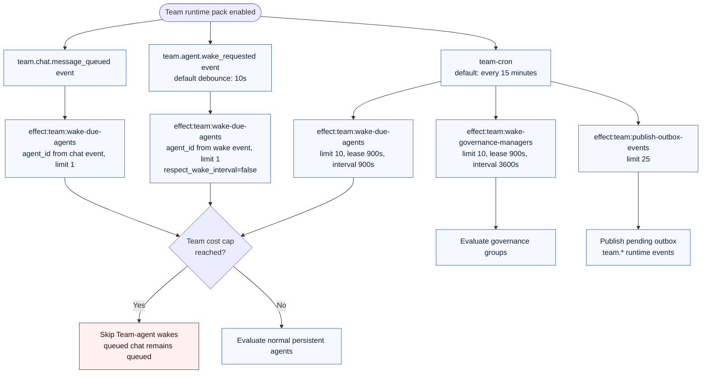
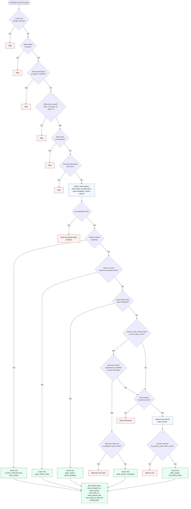
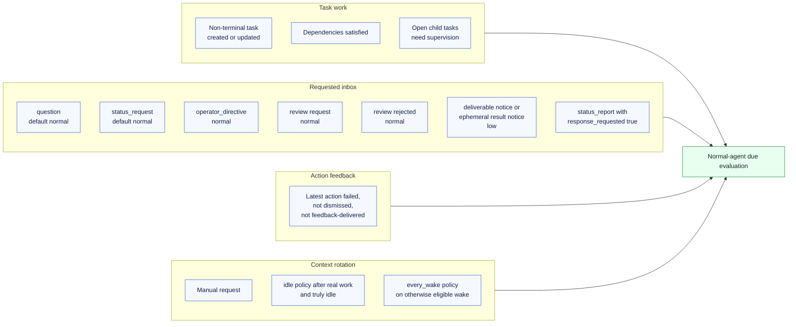
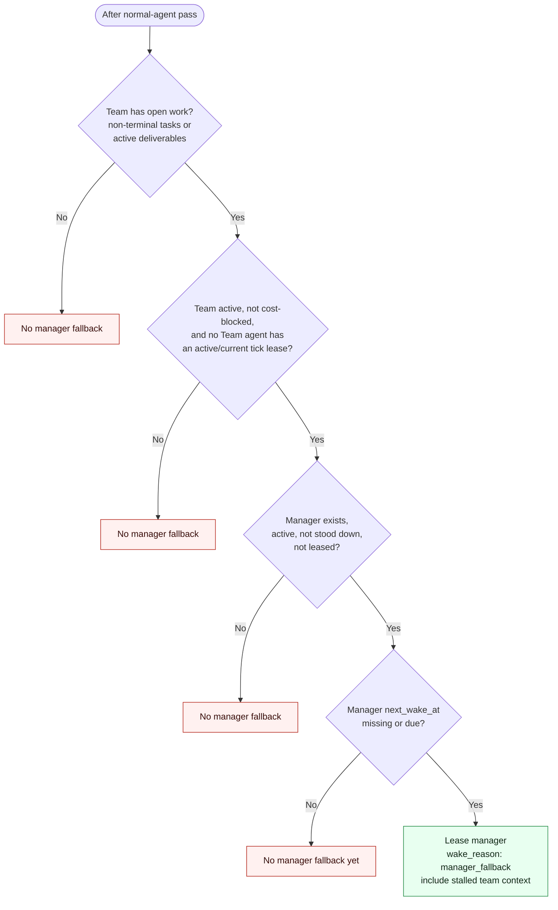
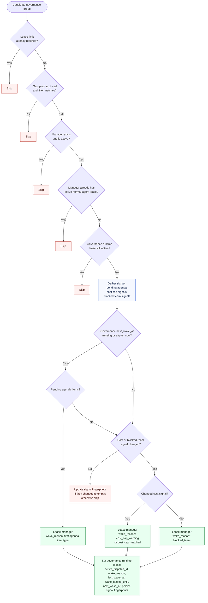
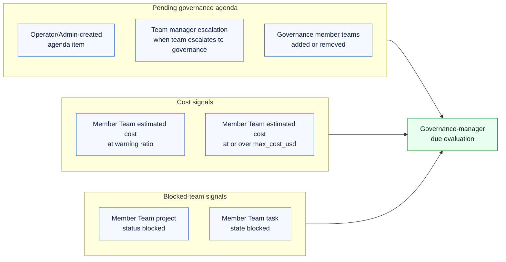
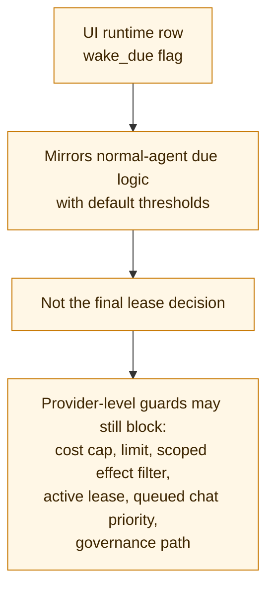

# Team Add-on Wake Decision Tree

This is a visual companion to the Team Add-on wake logic. It separates the four
wake paths:

- debounced persistent-agent wake requests,
- queued Team Chat wake dispatches,
- normal persistent-agent wake leasing,
- governance-manager wake leasing.

The same runtime cron tick also drains the Team outbox. That path publishes
internal `team.*` events recorded by MCP tools, but it is not itself a wake
lease decision.

## Runtime Entrypoints

## Normal Persistent-Agent Wake Leasing

## Normal-Agent Wake Signal Sources

## Manager Fallback

## Governance-Manager Wake Leasing

## Governance Signal Sources

## UI Badge Caveat

